It feels like only yesterday that I started experimenting with SketchUp, trying to design our house. I was both inspired and humbled by the creativity I saw all around me. When I reflect at those early renders now, I can’t help but smile — they’re a quiet reminder of my design journey so far.

I strive for harmony in every space, whether through thoughtful proportions, balanced colour palettes, or a curated mix of materials and textures.

With my holistic approach, I design interiors where the energy flows freely and every shape serves a purpose. Functionality meets beauty, and high-quality materials ensure each space stands the test of time.

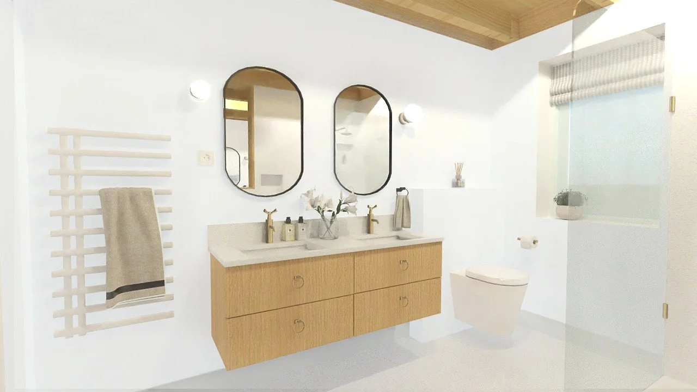

<Callout>
My **e-design** might be just the right thing **FOR YOU.**
</Callout>

If you find yourself **OVERWHELMED** with the idea of getting your home put together without trial and error, do not hesitate to contact me for more details

<LinkButton label="Get in touch" href="/contact" />

<Gallery columns={3} aspect="3/2" images={[{"src": "/src/assets/library/93ac68-bedexport02.jpg", "alt": "Bright bedroom with wooden accent wall behind the bed, white bedding, and modern furniture including a nightstand and a cabinet with decorative items. Sunlight streams through the window, casting shadows on the wall."}, {"src": "/src/assets/library/bb1c08-cosychair-large.jpg", "alt": "Cozy living room corner with a white sofa, potted plants on a small white table, a macrame hanging chair with a white pillow, a wooden coffee table with a mug, and wooden wall accents."}, {"src": "/src/assets/library/d25531-bathfbmainreto.jpg", "alt": "Modern bathroom with a round mirror, beige cabinetry, white sink, stack of towels, glass shower with tiles, toilet, and minimal decor."}]} />

<LinkButton label="View projects gallery" href="/gallery" />

> A great interior blurs the line between inside and outside. Its timeless quality flows through space like a river, reflecting the personality and lifestyle of those who live within it in every drop.

## Don’t know where to start?

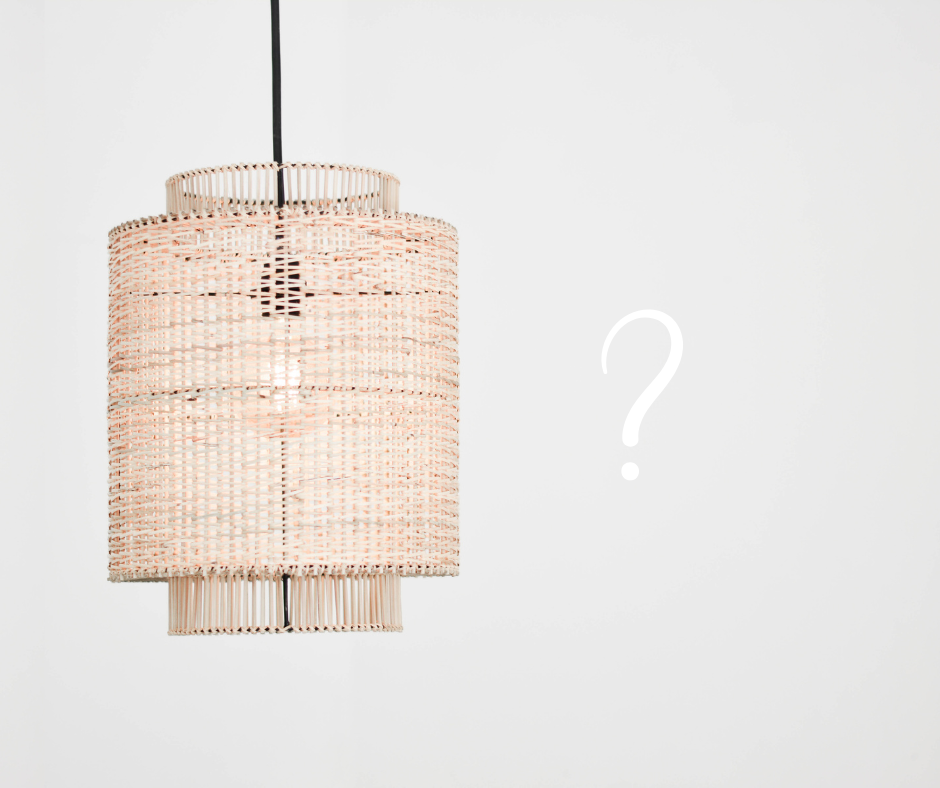

There are so MANY styles out there — honestly, who can name them all? But which one feels right for you?

Let me walk you through a few of the basic ones, so you can narrow down your choice to only one or two.

## Traditional

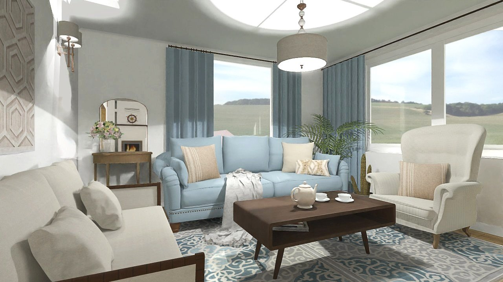

Traditional interior is a safe middle ground for the ones who prefer routine and a more conservative approach. It can be either very classic and elegant full of light fabrics and shades of champagne, or easy going and charming such as shabby chic in a more rustic setting. Surrounded by solid wood and large comfortable sofas - well, it’s all about comfort and luxury for traditionalists.

---

## Minimalist

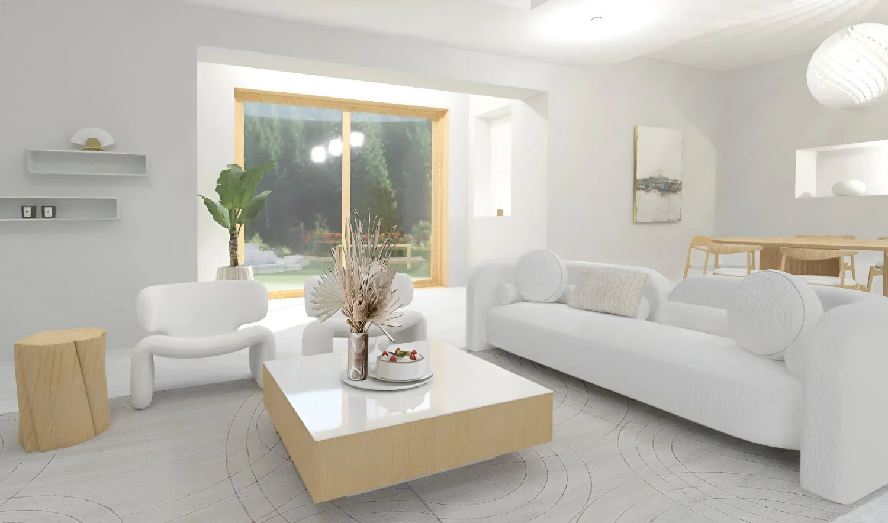

Maybe contemporary minimalism is your talk - and believe it or not, even sleek minimalist interiors can be cosy! Focused on simple shapes and neutral colours minimalists like to surround themselves with less, but rather high quality furnishings. People who prefer contemporary design are usually introverted and determined. Solid sculptural pieces with very few decor items are their way to style their home.

---

## Mid-Century Modern

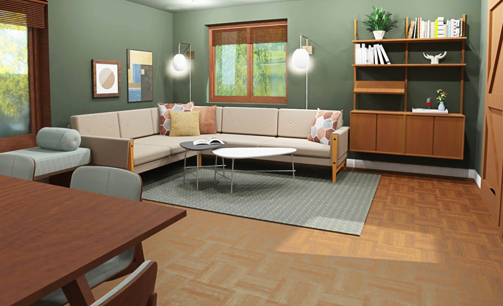

The good old times can be brought to life with a help of retro accessories and famous designer furniture in revived mid century modern style homes. This very popular style offers the best of both worlds - tried and tested timeless furniture pieces of the past 50-70’s with a twist of our current sleeker contemporary fashion. Ideal for trend setters as well as the ones who value traditional craftsmanship. Vintage does the talking.

---

## Scandinavian

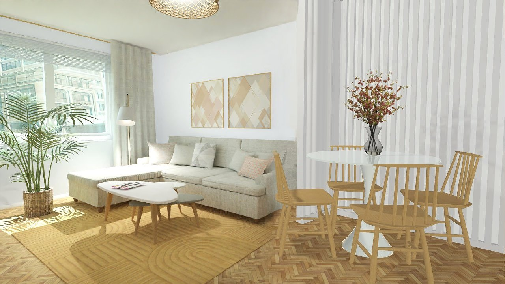

Perhaps you fancy clean lines and practicality of Scandinavian design. Simple, yet harmonious style where abundance of white meets warmth of pale wood. Lovers of Scandinavian design are rational and straight forward thinkers, they are usually good with plants and love to have their home surrounded by greenery. Sometimes they like to brighten up the typical white or earthy tones with pastel colours.

---

## Eclectic

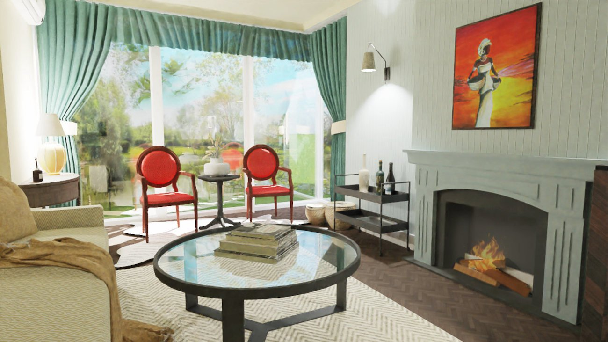

Are you a lover of colours with a desire for an eclectic twist? A tasteful mismatch of old and new, because - WHY NOT? Eclectic design is wonderful for active people who seek frequent change. They often bring interesting ornaments from their exotic travels to decorate their home. This style is inviting with an abundance of pattern and generous splashes of black.

---

## Industrial

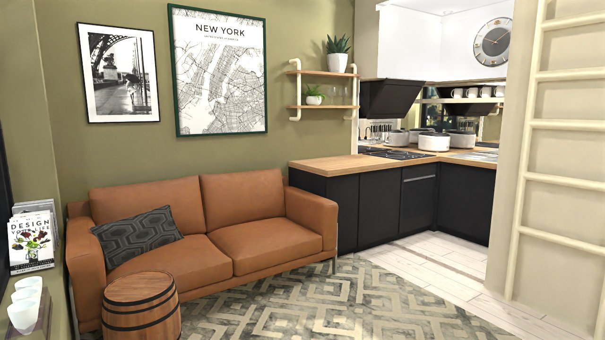

How about a splash of brick wall combined with a nice leather sofa for lounging around all tied together with black metal? Industrial style is typical for loft apartments and old factories-turned residential living spaces. Colours of rust, moss and grey are sleek, yet calming. Are you energetic, outgoing and love a vibrant city atmosphere? An extrovert surrounded by friends who desires a modern and functional home without unnecessary tchotkes? Industrial style might be your answer.

---

## Art Deco

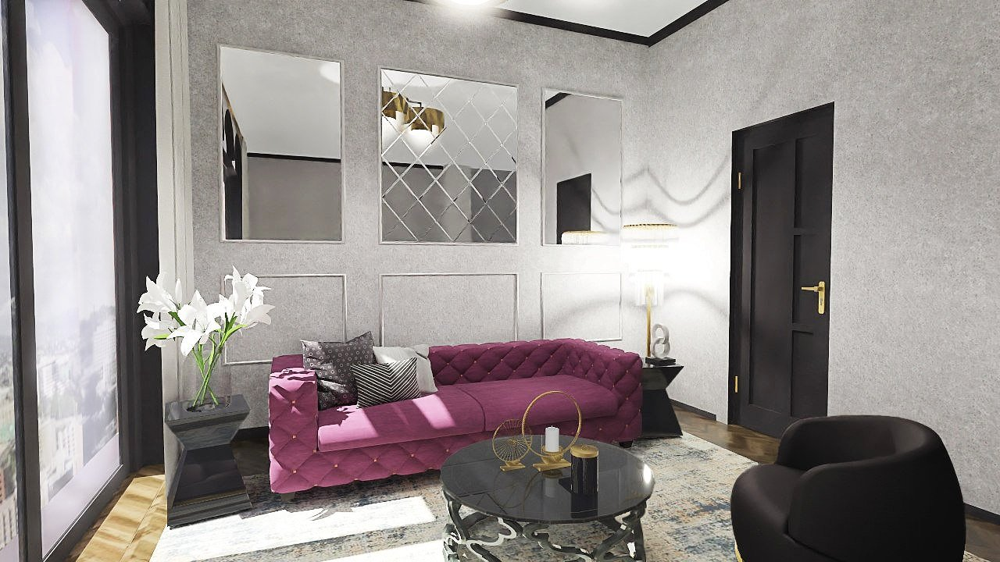

The opulence and glam of the early 20’s century days - that is art deco. Imagine shiny intricate metals, glass details, geometric patterns and smooth curvy furniture. If you fancy rich jewel tones, know what you want and demand the best in everything including your interior, you might find that art deco style is your ultimate inspiration. Simply put - it’s glamour at its best.

---

## Ethnic

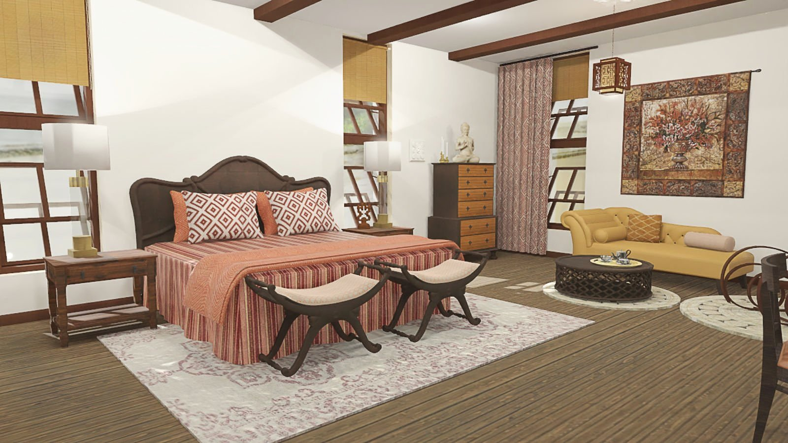

Now, for the world travellers who love to feel like they’re on an eternal holiday right at their very home, the ethnic design can fulfil their lavish expectations. Whether it’s Moroccan lamps, oriental rugs, native fabric patterns or African animal feet furniture, ethnic style offers a wide range of shapes and colours. Its themes can vary from neutral to rich and dark, and include also a more sophisticated version in a form of colonial design/twist.

---

## Combination of styles is welcome!

**Even desired** — for we are all unique. Be it Scandi with a hint of Ethno, contemporary living room with a beach vibe, or perhaps traditional with an eclectic twist or relaxed shabby chic elements. It’s all up to you! I will choose the right colours, furniture, finishes and help you visualise your room.

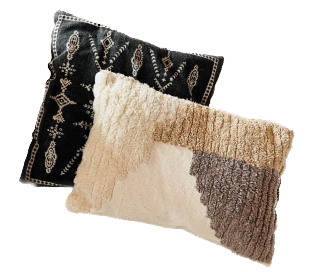

## Where to now?

<LinkButton label="Projects gallery" href="/gallery" />

<LinkButton label="How I work" href="/how-i-work" />
