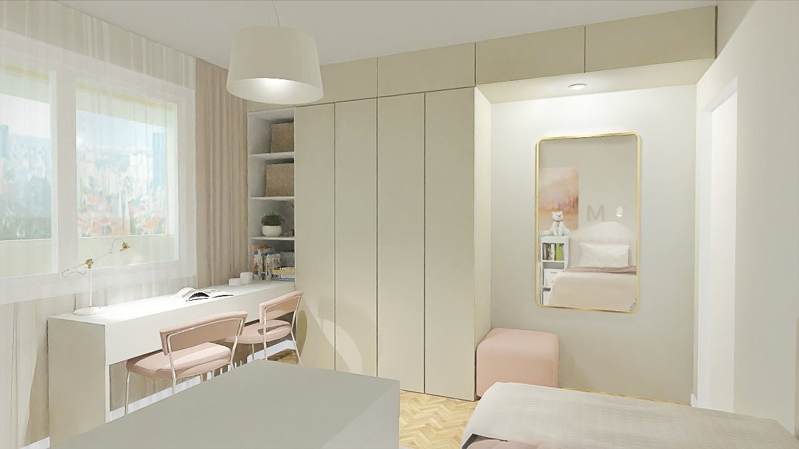
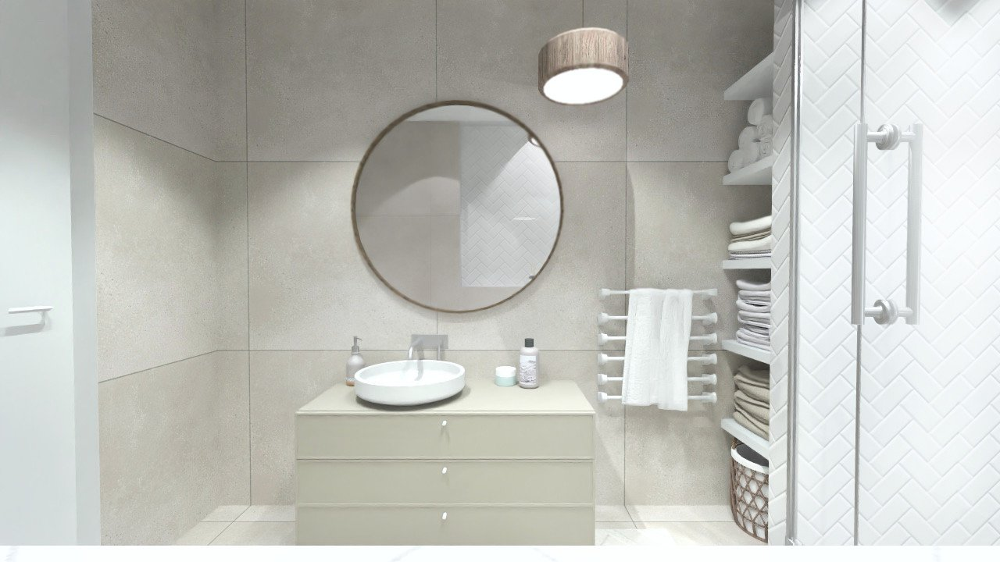
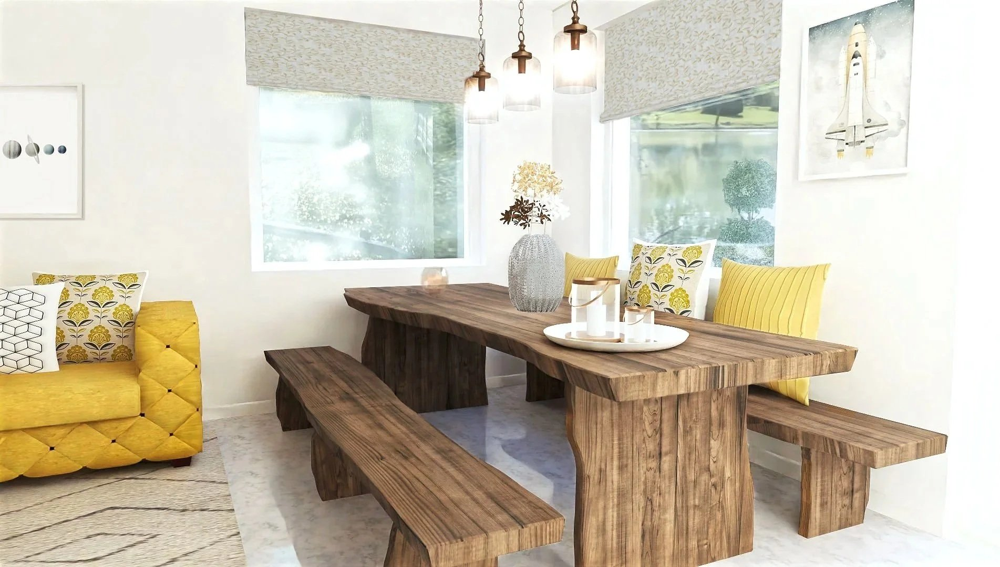

Soft pink tones blend beautifully with warm beige in this shared girls’ bedroom.

<Gallery columns={2} aspect="3/2" images={[{"src": "/src/assets/library/143b58-jm-reto.jpg", "alt": "A bright bedroom with twin beds, a desk near a window, and teddy bears on the beds."}, {"src": "/src/assets/library/42c01b-beige-living-front.jpg", "alt": "Bright living room with beige and white patterned sofa, white coffee table with decorative vase and pampas grass, side table with candles, wall art, two large windows with curtains, and white chairs."}]} />

> A warm, welcoming and light-filled open-plan living space with a soft, feminine feel.

<Gallery columns={3} aspect="3/2" images={[{"src": "/src/assets/library/da233c-beige-living-neat.jpg", "alt": "Bright living room with white walls, a modern TV on a white stand, a beige patterned sofa, a black floor lamp, and a white coffee table holding a vase with dried pampas grass, a small white vase, and a magazine. A window with sheer curtains and a pink orchid in a white pot are visible."}, {"src": "/src/assets/library/78adb9-traditionallivingroom.jpg", "alt": "Living room with light blue sofa, white armchair, wooden coffee table with teapot and cups, large windows with blue curtains, patterned rug, and indoor plants."}, {"src": "/src/assets/library/1853f5-krbchairs.jpg", "alt": "A cozy dining area with a round wooden table, two blue upholstered armchairs, a window with light blue curtains, a round mirror on the wall, a white table lamp, and a decorative shelf with framed photos and a model ship."}]} />

With a marine-inspired theme, the original armchairs were reupholstered to match the fresh new look.

<Gallery columns={3} aspect="3/2" images={[{"src": "/src/assets/library/2a5055-krb.jpg", "alt": "Interior view of a living room featuring a fireplace with a fire, a wooden chair with a blue patterned cushion, a white shelf with framed photos and a model ship, and a ship's wheel decoration on the wall above the fireplace."}, {"src": "/src/assets/library/231f83-sage-bedroom-xl.jpg", "alt": "A bedroom with light green walls, a large bed with white bedding, two nightstands with lamps on each side, and hanging plants near a window with white curtains. A round mirror with a dark frame decorates the wall above the headboard."}, {"src": "/src/assets/library/0f6dc1-midcenturyliving01.jpg", "alt": "Bright mid century modern living room, white sofa, round wooden table, crystal chandelier and oak wooden floor"}]} />

Mid century modern open plan living space features sleek leather armchairs and statement lighting.

<Gallery columns={2} aspect="3/2" images={[{"src": "/src/assets/library/059b1d-midcentliving02.jpg", "alt": "Bright mid century modern living room, white sofa, leather armchairs, ceramic table lamps and blue abstract painting"}, {"src": "/src/assets/library/7d1b18-sumisrender01.jpg", "alt": "A cozy bedroom with a pink upholstered bed, pillows, a small round wooden side table with magazines, a white wardrobe, a large mirror with a ballerina figurine, and a window with gray curtains showing houses outside."}]} />

Teen girl’s bedroom with glam elements and Japanese influence.

<Gallery columns={2} aspect="3/2" images={[{"src": "/src/assets/library/c17ea5-sumisrender02.jpg", "alt": "A bedroom with white walls and ceiling, a wooden desk with a computer monitor, a chair, and a desk lamp, a backpack on the floor, a dresser with a mirror and decorative items, a pink stool, and a pink bed in the corner."}, {"src": "/src/assets/library/d25531-bathfbmainreto.jpg", "alt": "Modern bathroom with a round mirror, beige cabinetry, white sink, stack of towels, glass shower with tiles, toilet, and minimal decor."}]} />

Layering of shapes and textures livens up the neutral colour scheme of this small bathroom.

> Many of my designs appear naturally throughout the [blog](/blog), alongside stories and ideas, and in the design section — exploring a range of styles and moods. Whenever you see a render with my image credit, you’re looking at my own work.

[**See the design process**](/how-i-work)

### *A great interior blurs the line between inside and outside.*

Its timeless quality flows through space like a river, reflecting the personality and lifestyle of those who live within it in every drop.
