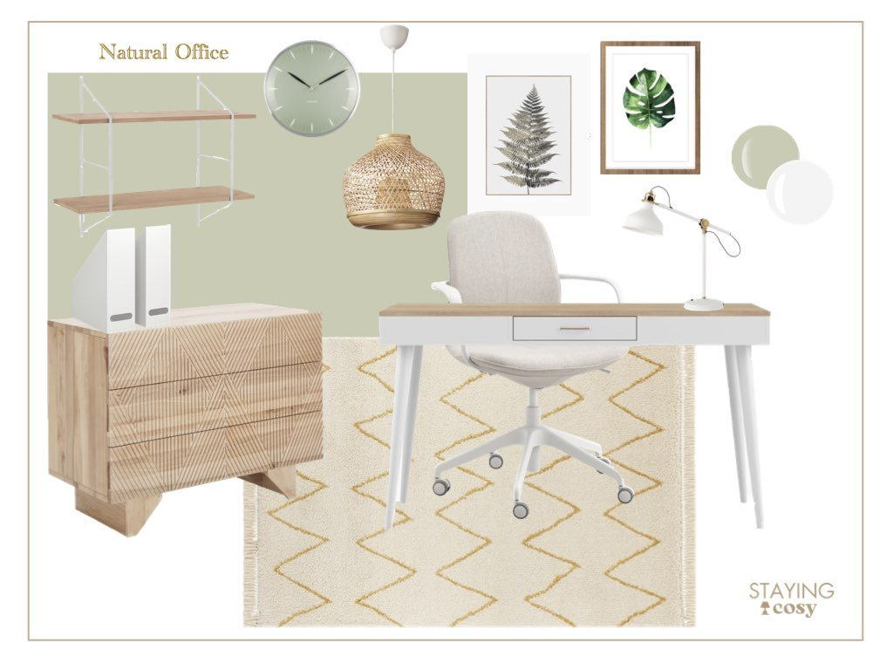
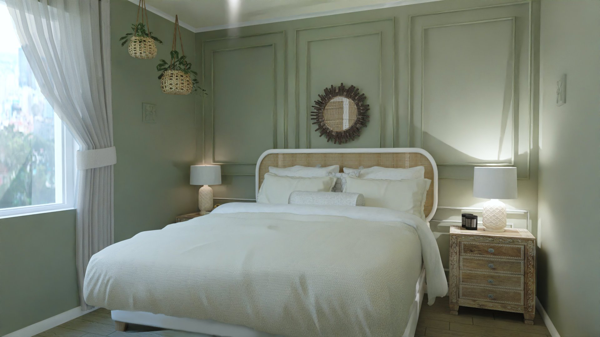
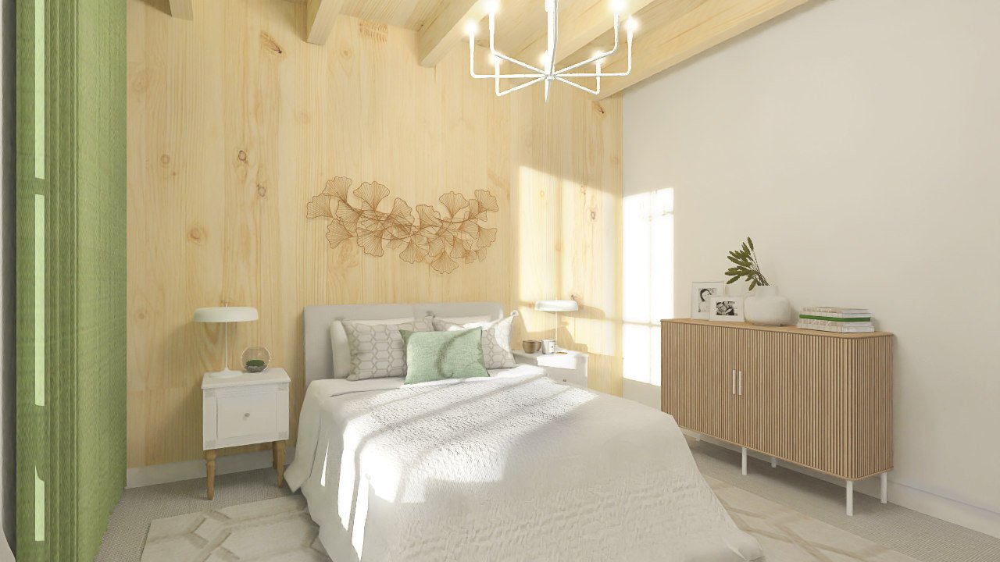

I offer interior design services with realistic visuals and helpful guidance on layout, lighting, colour, and more — all done online, from the comfort of your home. Just thoughtful design made easy.

1. **Get In Touch** — for more information as the price depends on the size and complexity of your space
2. **Fill In My Questionnaire** — to give me a better idea what and who I am designing for
3. **Send Me Your Floor Plan** — and photos - the more detailed the more accurate the design will be
4. **I Get To Designing** — after confirming the most suitable layout
5. **Receive Your New Home Look** — via PDF - full of inspiration - depending on the plan of your choice

*Your space — thoughtfully re-imagined*

#### **WITH IMPROVED:**

- Flow & function
- Clutter-free living
- Hidden storage potential
- Sensory harmony
- Adaptive open concepts

## E-design Plans

### Vision Board

A 2D mood board with colours, furnishings and, if required, also additional shopping links to components

From €100,-

### Basic 3D Design

Efficient layout with a 3D representation in a very basic monochromatic mood, to give you an idea of how the interior elements can work together. Perfect for kitchen layout. One revision included.

From €150,-

### Full 3D Design

A full on design with all the bells and whistles including specific colours, furnishings, lighting and beautiful 3D visuals to guide you. Two revisions included.

From €350,-

## What you’ll receive:

A 15-20 page presentation including:

1. Mood board
2. Shopping list
3. Renders
4. Tips and ideas
5. Helpful guides
