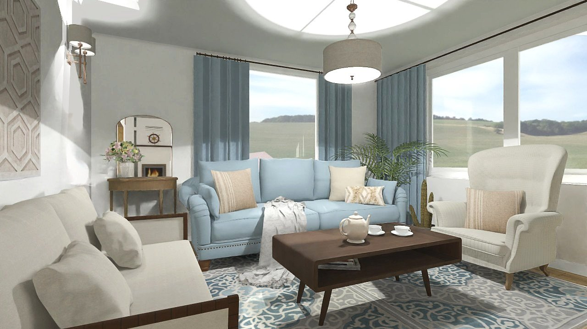
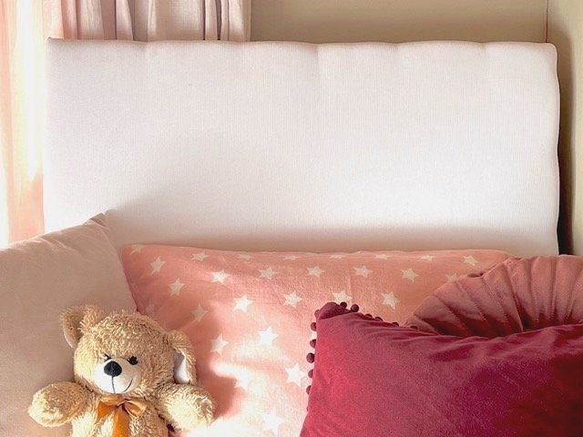
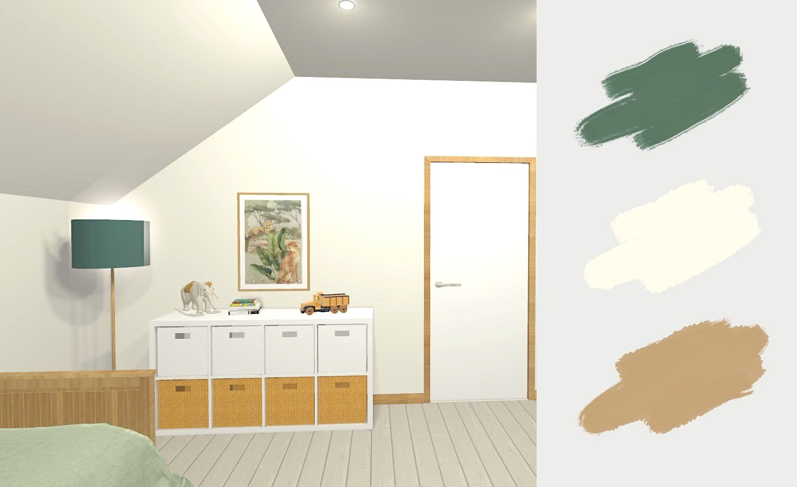
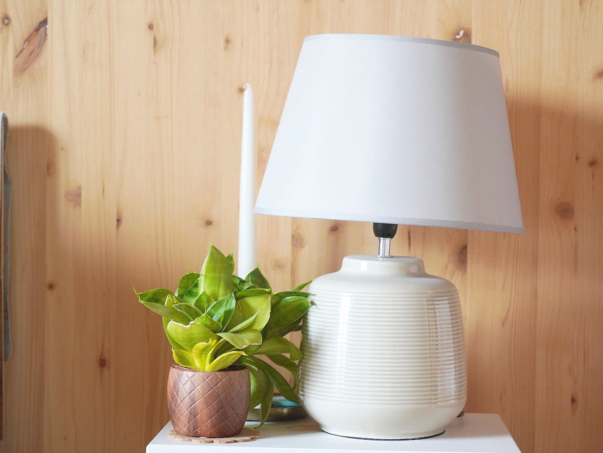
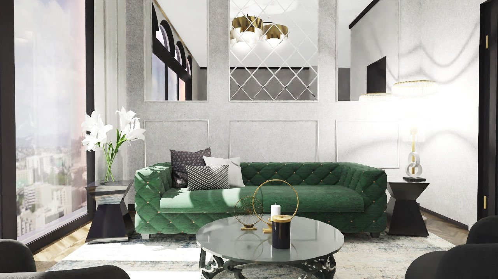
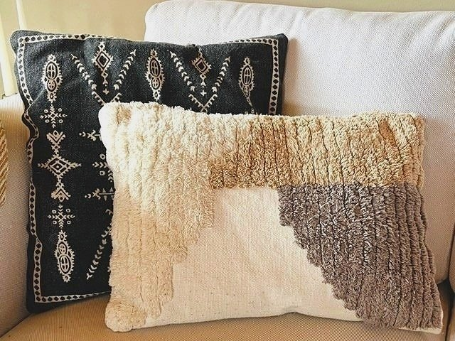
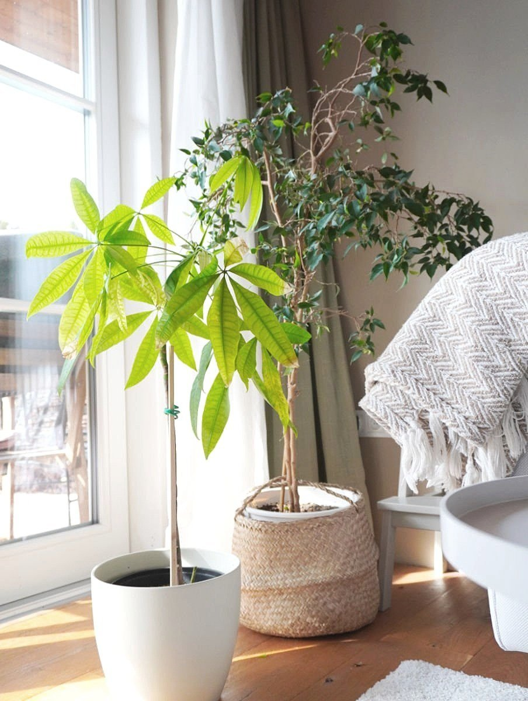

*Feeling that dull and monotonous pace recently? Grey wintery views and the same old bedding you haven’t changed since Christmas? Well, it’s time to freshen up those good old bones of your interior, and there is no better way to do so than with some inspiration.*

<Caption>
Image credit: Staying Cosy
</Caption>

## 1. Rearrange Your Existing Furniture

Rearranging the room’s layout has always been my number one to bring a breath of fresh air into any room. This will be less useful in really small rooms and bathrooms, but bedrooms and living rooms are typically ideal candidates for layout changes.

### Create new focal points

Consider moving the furniture around to create a new focal point or to make the space feel more open and inviting; alternatively, take the opposite approach and divide the room into smaller parts, such as window seats and reading nooks. It has the potential to significantly alter the atmosphere of a room.

### Start by drawing a sketch of your room

You can start by drawing a sketch of your room on a sheet of paper, then cut out proportional furniture pieces and rearrange them so you don't have to do the task twice. If you prefer more specialised help, I can create a [3D design](/edesign) for you and develop numerous layouts using your existing furniture.

## 2. Swap Furniture Pieces

To keep things as sustainable as possible, before purchasing any new furniture, have a look around your home and reorganise it before introducing any ‘new’ pieces. Go big and swap whole rugs, side tables, benches, or whatever you already own. I am especially a big fan of changing out my curtains. It’s amazing how they provide a distinct atmosphere in each room that differs from their prior location.

### Create a Swapping group

If that hasn’t made enough of an impact or you don’t have a sufficient amount of furniture for rearrangements, try to first get rid of something by gifting, selling, or simply swapping pieces of furniture with your friend before you opt to splash out on new things.

You can go even further and take the initiative to organise a furniture swap Facebook group for your friends or for your neighbourhood.

## 3. Reupholster

<Caption>
Image credit: Staying Cosy
</Caption>

Refreshing furniture with a new, updated layer of fabric is undoubtedly less wasteful, and if the present fabric is already a little worn, it could be an ideal opportunity to produce a whole new design. You can repurpose the old fabric for kids' arts and crafts, or if it's in horrible shape, rip it up into rags for cleaning. Reupholstering works well for headboards and dining chair seats.

### Get budget sofa covers

If you have a limited budget, you can buy inexpensive sofa or armchair coverings, such as [these](https://www.amazon.com/Luxurious-Stretch-Slipcover-Resistant-Furniture/dp/B07RZ3C29D/ref=sxin_16_pa_sp_search_thematic_sspa?content-id=amzn1.sym.1091e5b8-0ff4-492a-aa0b-7bc8b59253c6%3Aamzn1.sym.1091e5b8-0ff4-492a-aa0b-7bc8b59253c6&crid=3I7Y7K2VLTZWV&cv_ct_cx=sofa%2Bcover%2Bfitted%2Bstretchy&keywords=sofa%2Bcover%2Bfitted%2Bstretchy&pd_rd_i=B07RZ3C29D&pd_rd_r=643afef3-01d9-410a-91ac-0a3262ab4e8a&pd_rd_w=1YCDw&pd_rd_wg=8Zjs2&pf_rd_p=1091e5b8-0ff4-492a-aa0b-7bc8b59253c6&pf_rd_r=QS3CKAJJX70MSQAEGK1J&qid=1743961567&sbo=RZvfv%2F%2FHxDF%2BO5021pAnSA%3D%3D&sprefix=sofa%2Bcover%2Bfitted%2Bstrec%2Caps%2C420&sr=1-1-6024b2a3-78e4-4fed-8fed-e1613be3bcce-spons&sp_csd=d2lkZ2V0TmFtZT1zcF9zZWFyY2hfdGhlbWF0aWM&th=1), to instantly refresh your furniture. They're also super easy to keep clean because they're washable. Measure properly before purchasing to avoid the wrong fit.

Headboards are generally easy to reupholster on your own, but for more complex jobs, I'd rather go with a professional service that specialises in upholstery.

## 4. Apply a New Colour Scheme

<Caption>
Image credit: Staying Cosy
</Caption>

Have you been playing it safe with grey and white interiors for far too long? Inject some colour into your home with little snippets here and there. You don't have to go overboard and paint entire walls; it is completely unnecessary. Randomly distributed subtle colours are enough to create an impact and are an ideal place to start before you have the confidence to include bolder items.

### Coordinate colours

Put that muted-green wool blanket that had been hiding at the bottom of your neatly packed drawer over your old headboard; match it with curtains or a bed cover; and coordinate with cushions to create a whole new bedroom to snuggle down in at the end of your day.

### Mix and match cushion covers

Cushion covers are the simplest way to revitalise a tired living room. You can even mix and match the ones from previous seasons to create a unique and original combination that you've never tried before. Paint your artwork frames or flower pots in similar tones, and you've successfully applied a new and fresh colour scheme. And, since we're already talking about painting, let's make it the following tip.

## 5. Paint Smaller Items

Don't be afraid of the way it sounds. Painting can be an easy and affordable weekend job if you decide to work on smaller areas. Such as adding a pop of colour to your drawer handles, creating a new restored cosy nook, or updating a side table. You can give these ideas a try before spending money on larger, more complex pieces. Even painting just the ceiling or window frames can make a significant difference. Here are a few more hints of what you can paint with a little bit of [planning](/diy-planner) and effort:

- Step risers or whole stairs
- Dining chairs
- Tables
- Shelving
- Picture frames
- Doors
- Bed frames
- Flooring
- Even tiles

## 6. Introduce Metals

<Gallery columns={2} images={[{"src": "/src/assets/library/1e9faf-nickel-medium.jpg", "alt": "nickel medium"}, {"src": "/src/assets/library/b25f73-candles.jpg", "alt": "candles"}]} />

I love using metal in design. It's like adding jewellery to a home. A little bit of pearl necklace in the form of a white powder coating or dark pearls represented in a sleek black lustrous finish. True raw metals are the icing on the cake.

### Select dominant metal

For a touch of sophistication and a harmonious look, start by selecting a dominant metal that will serve as a primary focus, such as silver, stainless steel, brass, or copper. Take your existing aesthetic into consideration. And mind you, nickel, though grey, is not cold like silver or stainless steel. It has warm tones instead and is usually easier to clean.

### Blend warm and cool

Once you’ve decided on your main metal, blend warm tones like gold or brass with cooler ones to create balance. To achieve a cohesive feel, choose furnishings and accessories that feature a combination of metals. Items like metal hardware, light fixtures, picture frames, or accent pieces are all excellent opportunities for introducing these raw materials to your home. By thoughtfully combining various types, you can elevate your interior and create a stylish, modern, and visually attractive space.

## 7. Use the Magic of Lighting

<Caption>
Image credit: Staying Cosy
</Caption>

Creative and intentional lamp placement may make a huge difference in how your home feels. For the ultimate cosiness, varied and layered lighting is essential. With the literal flick of a lightbulb, good lighting can transform a flat, one-dimensional interior into a warm, enchanting place.

If you feel like your living area is lacking something, but you can't pinpoint what exactly it is, it could be as simple as an inviting reading light in the form of a floor lamp. Perhaps a statement table lamp placed on a side table will do the trick. Choose between downward and upward illumination to light up an artwork.

### Play with coloured lightbulbs

Experiment with different colour temperatures or even coloured bulbs, which may look amazing under the stairs, in children's bedrooms, or lighting up unusual architectural elements.

There's a secret to creating a true heart of home. If possible, place a beautiful accent lamp close to the physical centre of your layout. As another alternative, place it in a heavily trafficked area, such as a hallway or an intersection that is typically gloomy and dark. You may use a floor or table lamp, basically a light that shines at eye level or below.

### Right colour temperature

For this purpose, choose a warm light bulb with a kelvin temperature ranging from 2000 to 3000. Turn it on once it starts getting dusky and leave it running till nighttime or even the following morning. According to feng shui, the centre of a house is where energy radiates and spreads throughout. By creating a visual 'fire', we support and boost this energy.

Last but not least, keep your energy expenses under control and the environment happy by replacing your light bulbs with the most energy-efficient options.

## 8. Hang Mirrors

<Caption>
Image credit: Staying Cosy
</Caption>

Why not multiply those stunning views from your window or dining area when it's so simple? Hanging mirrors not only improves the visual perception of space, but they can be easily replaced with other wall decor in the future if desired.

### Practical entry mirror

Position one in the entryway for a final outfit check before leaving the house. If you don't like large pieces, you can create smaller clusters of different sizes of mirrors. On the contrary, for a glam or art deco look, you could cover half a wall in mirrors to create a sense of luxury and opulence. In case of the latter, make sure to stock up on micro fibre cloths :-), as polishing will become your second nature.

### Reflect enriching views

Reflect an inviting garden or a generously set dining table to visually enrich your home. Stick mirrors to your wardrobe door or use them as a unique touch on your furniture. Don't be scared to include a little mirror on your gallery wall. It's funky and unusual.

Different mirror frames serve as extensions to your existing textures, so play with them to create a cohesive design. A wide range of mirror shapes will allow you to turn a boring wall into an illusionary passageway that bounces light throughout the space.

## 9. Accessorise

<Caption>
Image credit: Staying Cosy
</Caption>

Accessorising is often the first option considered when renovating a room; therefore, I intentionally put it at the end. I wanted to prioritise more interesting and eco-friendly solutions over buying new decor on a regular basis.

### Tiny impactful tweaks

Many accessories I have already mentioned, as the categories are rather intertwined. So, whether you want to add a new pop of colour, incorporate a new design theme through shapes and textures, or illuminate dark corners, accessories are the perfect place to start.

Tiny but impactful tweaks like swapping cushion covers, updating lamp shades, bed throws, and little decor pieces with personality are absolute favourites for quick makeovers. Try using seasonal hues or introducing a new design concept entirely.

### Create that seasonal vibe

Have you been decorating with boho and neutral tones for too long? Consider infusing your home with gold and glam elements instead, or try adding some black sophistication. Get inspired by examples of different [design styles](/edesign). For a more dramatic effect, choose contrasts; for a softer approach, look at beautiful pastel shades.

Follow up with strategically placed artwork to establish a new focal point. If you're willing to try, you can even create your own contemporary piece of art. Involve your children, and your home refresh may become a fun-packed family event!

## 10. Bring Life with Plants

<Caption>
Image credit: Staying Cosy
</Caption>

Plants sustain life. That is a statement of its own, or, to put it another way, plants are life. They are an invaluable tool for creating a soothing ambiance, and with the right container, they can complete any kind of interior. In addition, they purify air unlike any man-made purifier. What's not to like?

### Easy care plants

If you are a total newbie to plant care, I have good news for you. There are plenty of types that are easy to maintain and require minimal watering or sunlight. Cactuses, thick-leaf kalanchoe, or aloe vera are excellent choices for sunny areas, while ZZ plants and philodendrons thrive in low-light conditions; ferns are ideal for bathrooms along with other moist areas.

### Pretty and Eco solution

Have you got a spot in your home where most accessories just won't work? Candles don't cut it; there's an odd cabinet corner, a gaping empty space where something is lacking. You can bet that plants will never disappoint.

Annually replace plant pots with larger ones to accommodate their developing roots, and take advantage of this occasion to show off your new brass plant container. Get that fresh fig leaf you've always wanted for your birthday; let the plants take centre stage if you're a true botanist at heart; or, like most of us, start with the beginner-friendly beauties to bring a touch of nature into your home.

## Before You Start…

Prior to undertaking any improvements, remember the priority of a [holistic interior](/blog/holistic-interior-design-guide-101): *Fresh air and unobstructed energy flow.*

Meaning ventilate, declutter and wipe down those sticky wooden floors. Clean space is the number one priority in maintaining a healthy living environment. Do the necessary hard work first and then enjoy the decorating process to the fullest.

---

---

---
