*The dream garden is always beautiful. It has wildflowers, fruit trees and morning coffee under a pergola. Nobody photographs the summer mowing, autumn leaves, broken tools, or the moment when you realise your garden has become just another responsibility.*

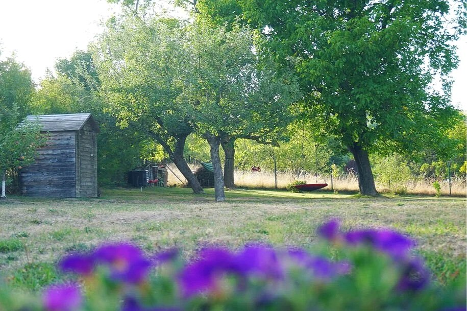

<Caption>
Image credit: Staying Cosy
</Caption>

Before we built our home, we envisioned a generous garden. A place with trees, flowers, fruit bushes, a vegetable patch and, of course, somewhere our children could run wild while we spent slow summer evenings outdoors.

But the reality looks quite different from the picture we imagined. A garden is never truly finished when the last plant goes into the ground; it is a living, breathing thing — and so are we, its caretakers.

## The Dream of an Abundant Open Space

<Figure align="right" size="medium">
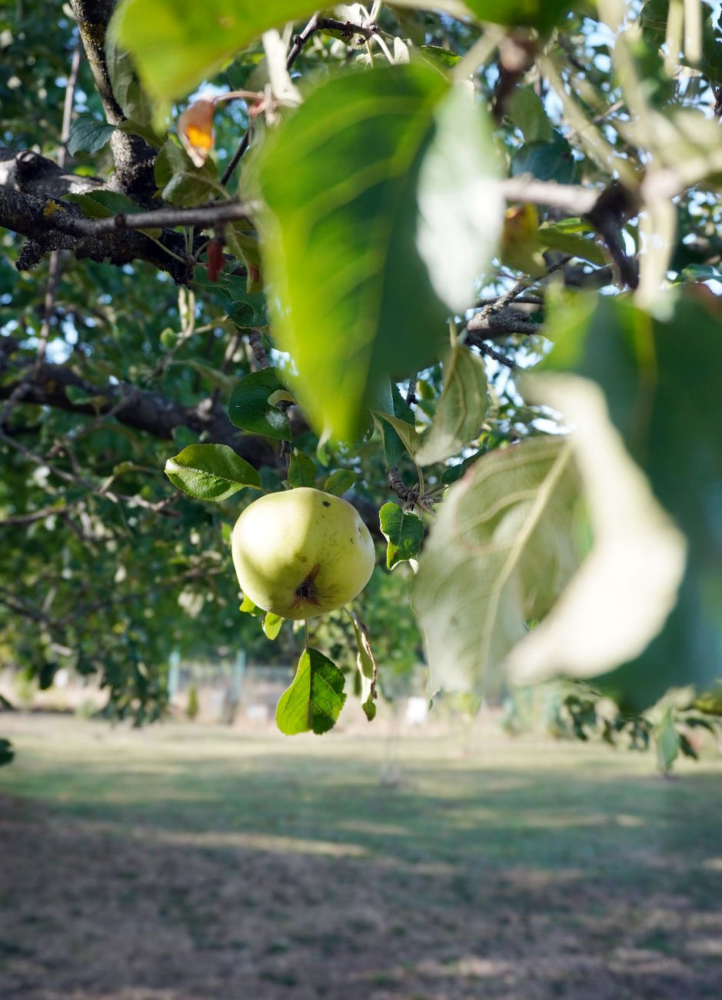

<Caption>
Image credit: Staying Cosy
</Caption>
</Figure>

Years ago, my husband and I dreamed of a vast, open landscape we could carve ourselves. To us, a home was never meant to be a cramped suburban plot, with a tiny patch of grass neatly boxed in by concrete walls. I pictured a sweeping meadow filled with wild greenery and plenty of space for our family to grow.

Maybe some of that came from my own childhood. I spent many summer holidays at my grandparents’ farmhouse, surrounded by orchards and boundless, unfenced open space. As a child, I experienced that landscape simply as freedom. I could wander, explore and disappear into the garden without thinking about who was going to look after it.

I certainly didn’t notice the work behind that freedom.

My grandfather meticulously pruned the fruit trees and kept the grass under control, usually using a hand scythe. There was always something to be done, but I saw the landscape, not the maintenance.

And, of course, I had no idea that my adult version of roaming freely would be somewhat less useful. There is only so much wandering around an orchard you need to do when you are grown up, and suddenly time becomes a much more precious commodity.

That was the dream.

Then [we found the land](/blog/reflective-slow-living-home-journey) that felt like the perfect place to build our home.

I still remember how much we loved it when we first stepped onto the sheep-grazed meadow. It had the space, the trees and that endless feeling of possibility we’d been looking for.

At that point, I was already imagining the garden. I just hadn’t imagined the work.

## The Work Behind a Large Garden

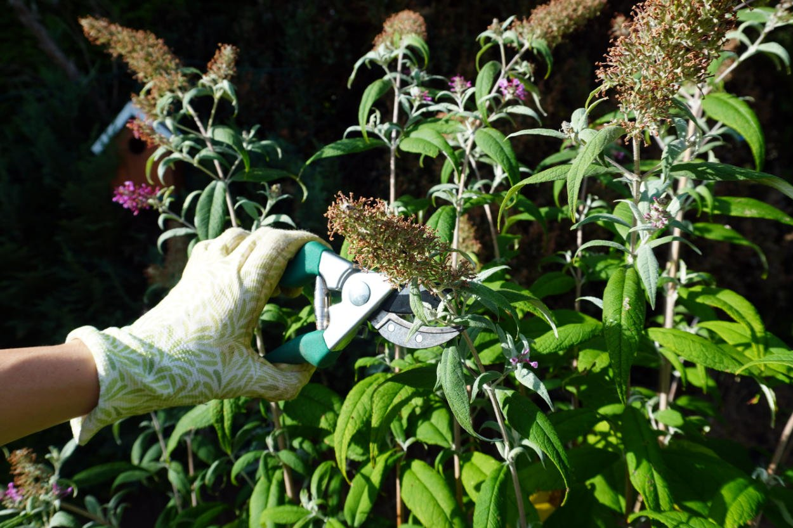

<Caption>
Image credit: Staying Cosy
</Caption>

I would much rather spend an afternoon wandering around with a cup of tea or watching things grow than trimming overgrown bushes, hauling buckets of compost, or chasing whatever seasonal job has suddenly become urgent.

Large lawns look deceptive; they promise easy maintenance but actually demand an enormous amount of time. Our garden covers around 1,600 square metres, just under half an acre, which by today’s standards makes it fairly substantial.

I still remember relentlessly pacing behind our electric mower, swapping out the batteries multiple times just to clear the back garden. It often felt like a stressful race against time. Every rainy spell brought a slight sense of despair, I knew the grass would shoot up overnight, forcing me right back out into the yard even sooner.

Don’t mention spring rains to me. *Though I know perfectly well that we desperately need them.*

### Useful Gardening Advice vs Reality

Of course, I have read all the usual advice. Minimise your lawn. Create lush borders. Plant more perennials. Make your garden work harder for nature.

And yes, all of that makes sense. There is just one small caveat those articles sometimes forget to mention: beautiful borders need maintenance too.

<Figure align="right" size="medium">
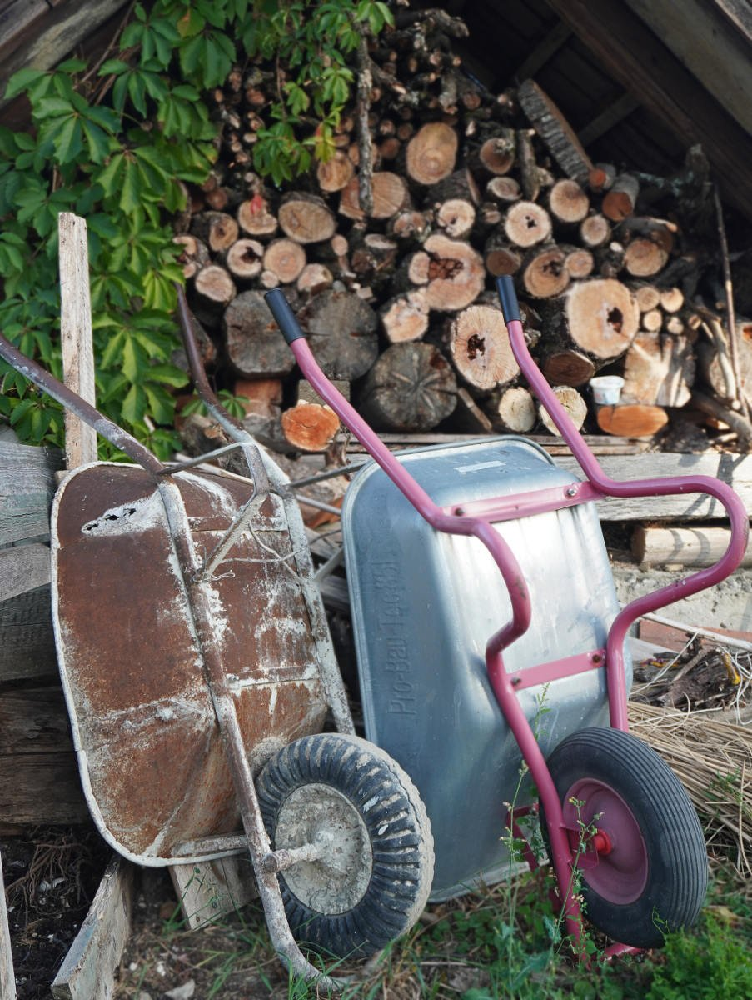

<Caption>
Image credit: Staying Cosy
</Caption>
</Figure>

We have never been after a pristine, perfectly green lawn. Dehydrated summer grass and dandelions don’t bother me much at all. For us, the lawn is simply a large open space, and I am quite happy for it to look a little wild.

The point is not really the lawn.

Whatever form a large garden takes, the upkeep is constant. Lawn, perennial flower beds, a [vegetable patch](/blog/extend-growing-season-diy-containers), fruit trees or a combination of all of them, something will always need doing.

*Plants grow. Bushes spread. Weeds appear. You can count on it.*

And then there is the awkward question of when you actually create all those lovely parts of the garden. When your landscaping budget is virtually non-existent and most of your available time is spent cutting the grass just to keep up with the season, there isn’t much left for creating anything new.

> “We weren’t running out of ideas. We were running out of weekends.”

So much time went into maintaining what was already there that the garden itself seemed to develop at a painfully slow pace.

### Gardening Does Not Wait

I am probably naturally more hands-on with gardening than my husband, which has occasionally made me rather frustrated trying to explain that things in the garden cannot always wait until next weekend.

Those flowers need dividing now. Plants without water might not survive another week, and weeds have an uncanny ability to take over the moment you turn your back.

This is one of the less glamorous truths about gardening. There is a periodicity to it that you can’t ignore. You can’t negotiate with a growing season.

Basically, just keeping the whole garden alive consumed most of our free time.

Was it a reasonable price for fulfilling the dream? I honestly still can’t tell.

What I do know is that, however much we wanted this garden, it was never going to come before our family.

## When Priorities Change

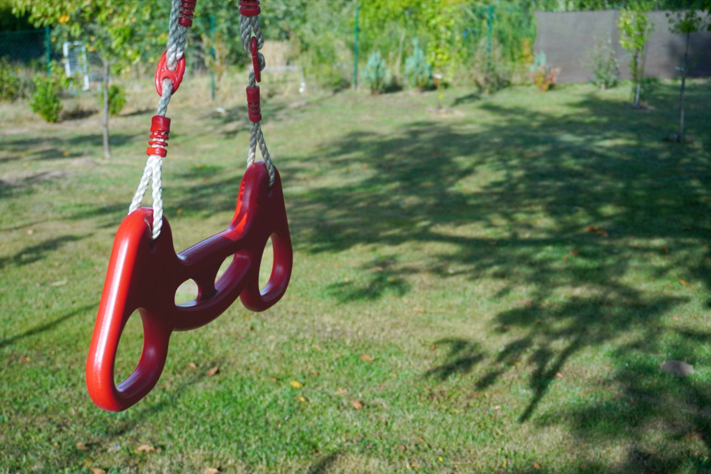

<Caption>
Image credit: Staying Cosy
</Caption>

We planted a plum tree for our older daughter and an apricot for the younger one. This was a family garden, after all. More than anything, I wanted our children to experience at least a little of the free-roaming freedom I had enjoyed in my own childhood.

A garden house, three swings, a hammock and one slide later, it became obvious that small children needed a lot of supervision. Especially when you had a fearless little wanderer whose first instinct was rarely to check for safety with her parent.

Garden projects moved incredibly slowly. I simply could not disappear into one for any length of time, other than in short spells dedicated to watering or deadheading. Instead, I let the children discover gardening in their own time and on their own terms.

To this day, their favourite place in the garden is probably the large round swing hanging from our tall walnut tree.

> “The garden was not neglected. It was taken over by children’s laughter, running feet and endless summer evenings curled up in the hammock.”

As the children grew, we treated the whole family to a round, above-ground frame pool. It allowed our children to become comfortable in the water, learn to swim and, before long, exchange their favourite swing for endless hours spent diving underwater.

<Figure align="right" size="medium">
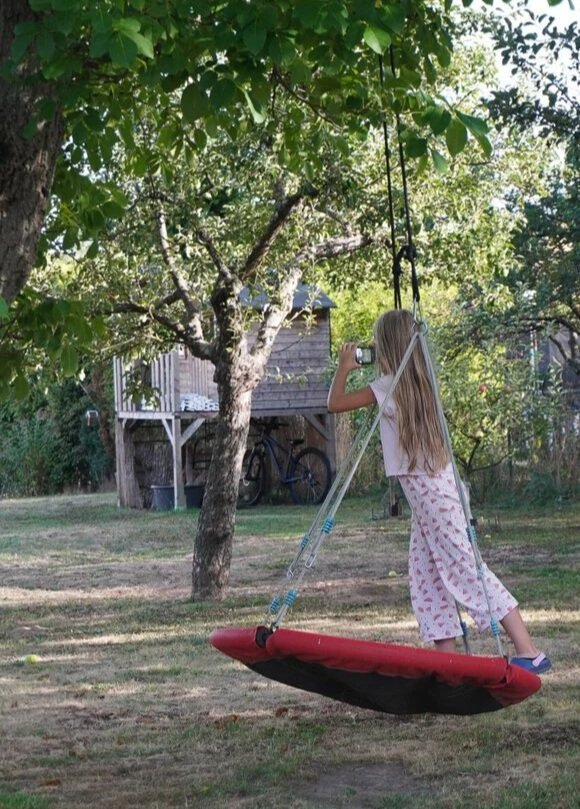

<Caption>
Image credit: Staying Cosy
</Caption>
</Figure>

The garden kept giving us its own kind of abundance. Birds dropping by for a sip of water, the occasional hedgehog appearing at dusk and our very favourite annual firefly-spotting tradition.

We may not have grown the lush edible forest I once imagined, but the garden gave our children something more valuable. It has given them endless opportunities to discover nature, sleep under the stars with friends in a tent pitched outside, get frightened by a sniffing fox, enjoy long afternoons in the sun and even, with all due ceremony, bury the occasional dead bird or garden mole.

They have made memories here that I hope they will one day cherish with the same fondness I have for my grandparents’ farmhouse.

All of that mattered more to us than having a finished, catalogue-perfect garden.

And as I am writing this, our daughters have just hopped on their bikes and headed off for an evening ride.

The garden has been doing just what we wanted it to do all those years ago. It welcomes life.

## Creating a Garden For Our Lifestyle

I eventually came to realise that we are not gifted gardeners.

And that’s OK.

Gardening isn’t a competition, and our plots don’t have to look pristine to be successful. Although it often feels as if we haven’t achieved very much on a random Tuesday, looking back, the transformation is undeniable. We have turned a wild field of tall grass into a living, cared-for garden — a beautiful space that reflects exactly how we live today.

Gardening isn’t a competition, and our plots don’t have to look pristine to be successful. Although it often feels as if we haven’t achieved very much on a random Tuesday, looking back, the reality is striking. We have transformed a wild field of tall grass into a living cared-for garden that beautifully reflects the way we live now.

Gardening isn’t a competition, and our gardens don’t have to look pristine to be successful. Although it often feels as if we haven’t achieved very much, looking back, we have actually transformed a field of tall grass into a living cared-for garden that reflects the way we live now.

### Old Trees & New Beginnings

With our land, we were lucky to inherit several mature apple and walnut trees, some of which needed annual pruning.

Have we ever pruned the apple trees properly ourselves?

No.

Have we attempted it?

Absolutely.

It usually involved me standing below the tree and instructing my husband, who looked rather lost somewhere between the branches, which ones to cut and which ones to keep. I didn’t really know much more than he did, but having done a little internet research, I felt considerably more qualified.

Fortunately, we have now reached the stage where we get professional help with this, and the trees really do appreciate it.

Having mature trees is one of the great blessings of an established garden. They give the landscape character and make everything around them feel more settled and well-aged. A young garden can feel like a project for quite some time. Mature trees make it feel like a place.

Among them, we have also planted more than seven young fruit trees. As I mentioned earlier, two were gifts for our daughters. However, as time has passed, some have struggled to produce fruit, mostly because their flowers freeze during late spring frosts. We are now considering replacing them with varieties better suited to our climate.

I suppose that is another lesson gardens are very good at teaching you. Sometimes even the things you carefully plan just end up not working.

### The Herb Garden & Patio

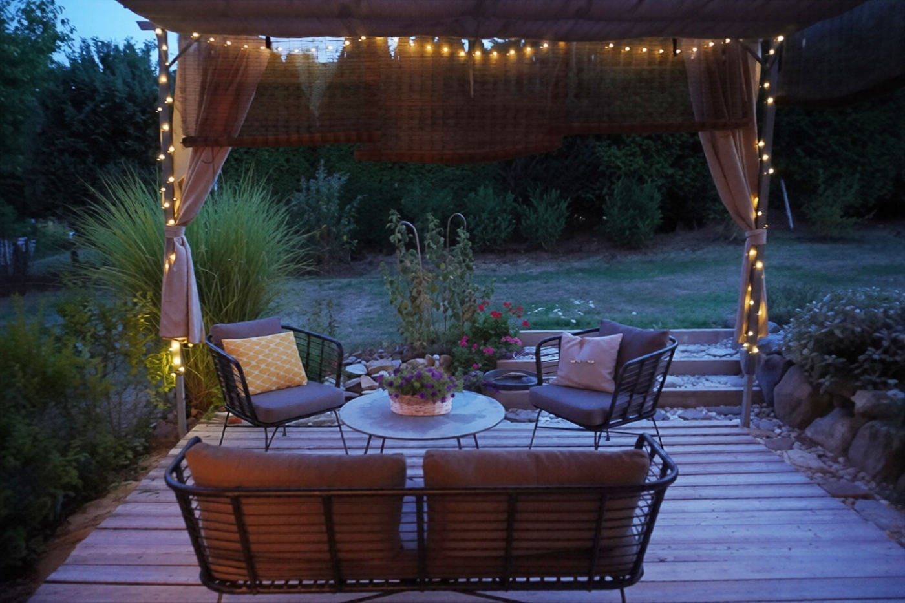

<Caption>
Image credit: Staying Cosy
</Caption>

One of my garden dreams came true when we created a herb garden just off the terrace. Since we all love cooking, having easy access to fresh herbs was an absolute must.

I do find it difficult to tame the increasingly enthusiastic sage throughout the season, but otherwise, having fresh basil, thyme, oregano, mint and lemon balm just outside the kitchen is one of those small luxuries I genuinely appreciate.

Last year, we also improved the patio with a retractable fabric awning, which we absolutely love, and renewed the steps leading up to the garden. Its proximity to both the kitchen and living room doors, together with the privacy provided by the thick bushes along the street side, makes it a cosy retreat with lovely views over the back garden.

The only thing that now needs attention is the flower bed adjoining the herbs. It desperately needs reorganising and is firmly on my autumn to-do list. My main inspiration for it is my [Tulln visit](/blog/perennial-flower-bed-ideas).

### The Edible Borders

Last spring, we established a cascading strawberry wall, which gave us plenty of fruit this summer.

<Figure align="right" size="medium">
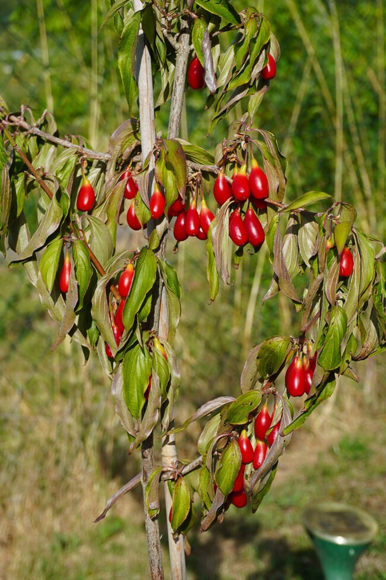

<Caption>
Cornelian Cherry | Image credit: Staying Cosy
</Caption>
</Figure>

Along the fence surrounding our property, we have planted primarily edible bushes, mixed with a few evergreens. Those on the north side are not doing quite as well as the ones with a more favourable southern exposure, which have already rewarded us with our first proper harvest this season.

Alongside the usual raspberries and blackcurrants, we’ve introduced juneberry, chokeberry, honeyberry, Cornelian cherry, and gooseberry.

This summer, the Cornelian cherry started fruiting for the very first time. I’m incredibly excited about it, as I’ve never actually tasted one before. The chokeberry, on the other hand, was a thoughtful gift from a friend and has already proved excellent for rich jams and spicy chutneys.

I deeply love this corner of the garden. It seamlessly combines two things I’ve always wanted from our outdoor space: a view that is beautiful to look at, and a harvest that is edible.

### Space for Fun & Retreat

Lastly, it would not be a proper garden for us without space to play.

Two years ago, my husband and I casually picked up our badminton rackets. We used to love playing when we were younger, and our joy in the game quickly returned. Before long, we found ourselves wondering why we hadn’t played during all those previous summers.

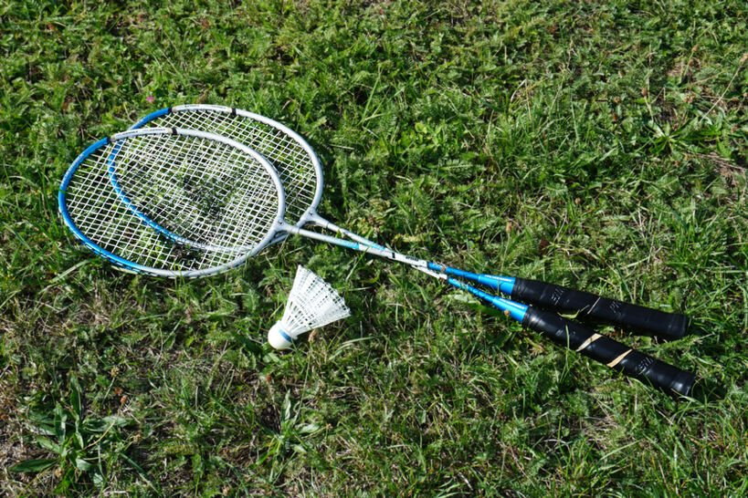

<Caption>
Image credit: Staying Cosy
</Caption>

Then a rather hilarious parenting realisation came over us. We had small children to look after and a massive garden to maintain. There simply hadn’t been an opportunity to pick up a racket in the carefree way we once could.

Frisbee has also been my younger daughter’s favourite activity this summer. And then there is our hammock, tucked away at the very far end of the garden beneath the tree canopy, ready for quiet sunset moments and the occasional deep thought.

## The Best Garden Investments Over Time

The summer season is almost over, and we will soon be packing away the frame pool after weeks of scorching weather and hours spent floating in warm water. If we’re lucky, we might still manage one last dip before autumn takes over.

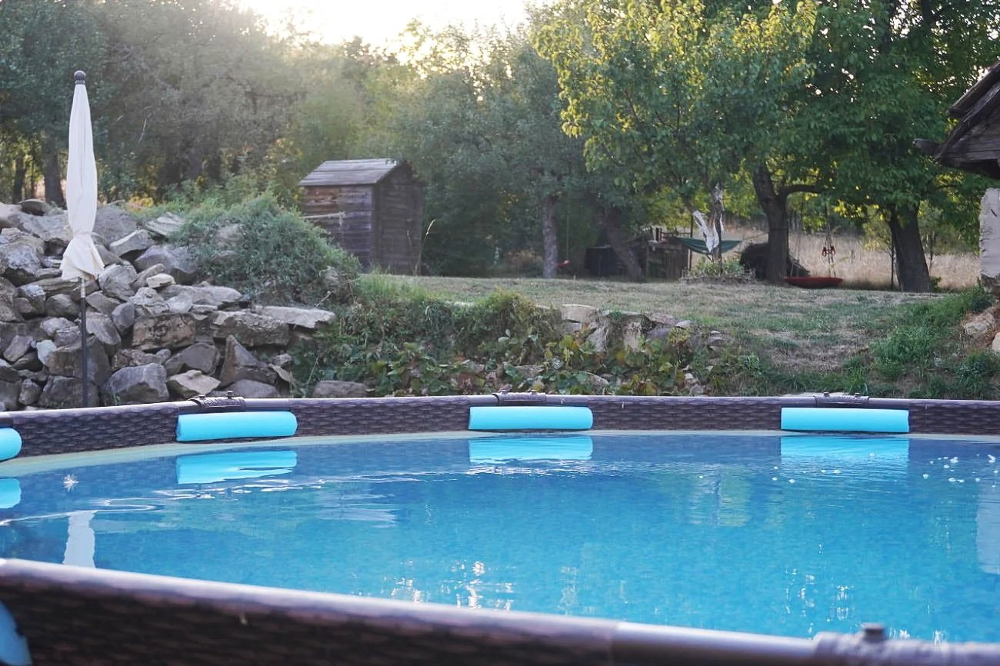

<Caption>
Image credit: Staying Cosy
</Caption>

**The Pool — A Summer Treat for Whole Family**

The pool has undoubtedly been one of our best garden investments. Although we only use it for around three months of the year, it has been well worth the money and effort required to set it up and maintain it.

At 3.6 metres (almost 12 ft) in diameter and one metre (just over 3 ft) deep, it is rather modest, but more than enough for cooling down on a hot summer day. Needless to say, the children have had their fair share of water-related fun in it once again this year.

**The Robot Mower — A Little Gadget That Saved Us Hours**

<Figure align="right" size="medium">
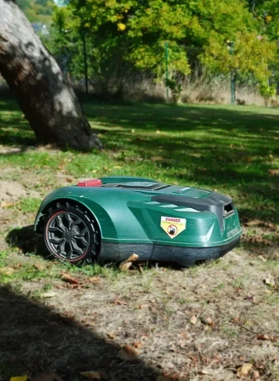

<Caption>
Image credit: Staying Cosy
</Caption>
</Figure>

But the absolute winner has been our robot mower. It is the very appliance that helped us remove the most repetitive and time-consuming task of all.

It gave us our time back. It reduced the constant pressure of lawn maintenance and finally allowed us to focus on other garden improvements.

Thanks to it, our garden finally became a place to enjoy our free Sunday afternoons, instead of a never-ending chore.

Our mower cost only a few hundred euros, but the time it saves us is priceless. After installing it, I genuinely wondered why on earth we hadn’t bought one sooner?

## Ten Years Later

After ten hectic years, I think we have finally reached the stage where we spend roughly equal amounts of time working in the garden and enjoying it.

The front yard landscaping is still very much to be continued, but we have accepted that gardens develop slowly. Spacious ones even more so.

Would I choose a large garden again? Probably. Though perhaps not quite this large.

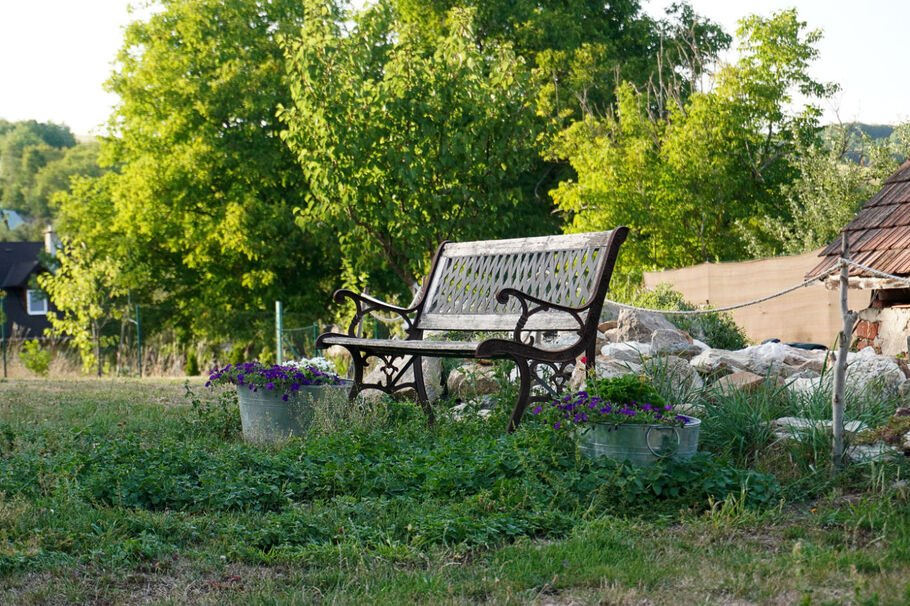

<Caption>
Image credit: Staying Cosy
</Caption>

I have learnt that the surroundings are more important to me than the size of the plot. I’d still want trees, privacy, birds, and flowers, but next time, I would definitely account for landscaping and garden design in the original budget — and, of course, think much more carefully about how much time we realistically have for maintenance.

Perhaps that’s perfectly fine.

Somewhere along the way, I stopped seeing the garden as a project that needed to be completed. It became nature’s backdrop to our lives.

After a full decade of mowing, planting, pruning, swimming, playing badminton, and watching fireflies, I think that is more than enough.

---

**☘︎ You might also enjoy reading**

- [*Designing a Green Home with Heart and Purpose*](/blog/shaping-a-green-home-with-purpose)
- [*What if a Town Could Lower Your Heart Rate?*](/blog/town-design-lower-heart-rate)
- [*Fresh Air is The Most Underrated Element of a Healthy Interior*](/blog/fresh-air-in-home)
