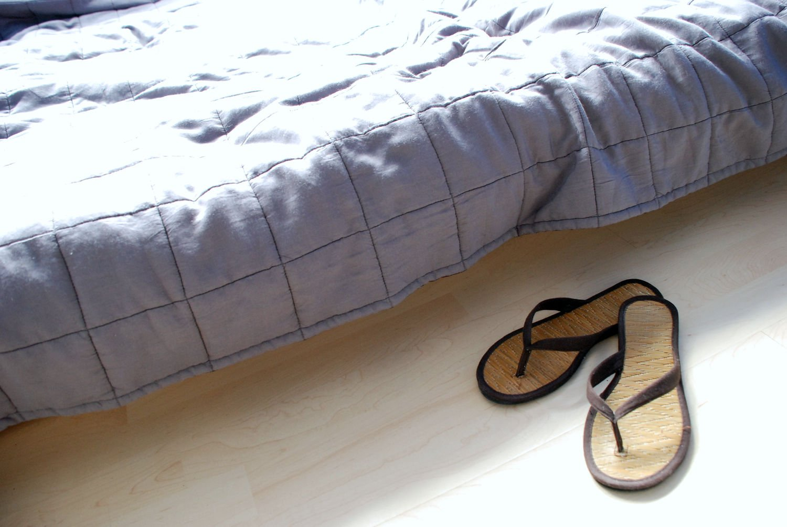
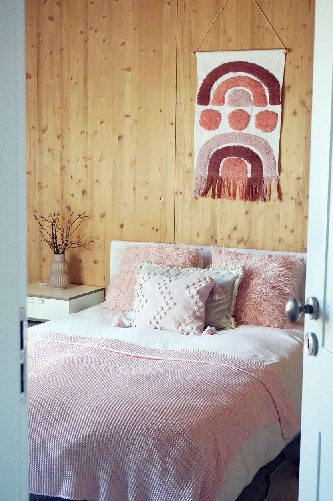
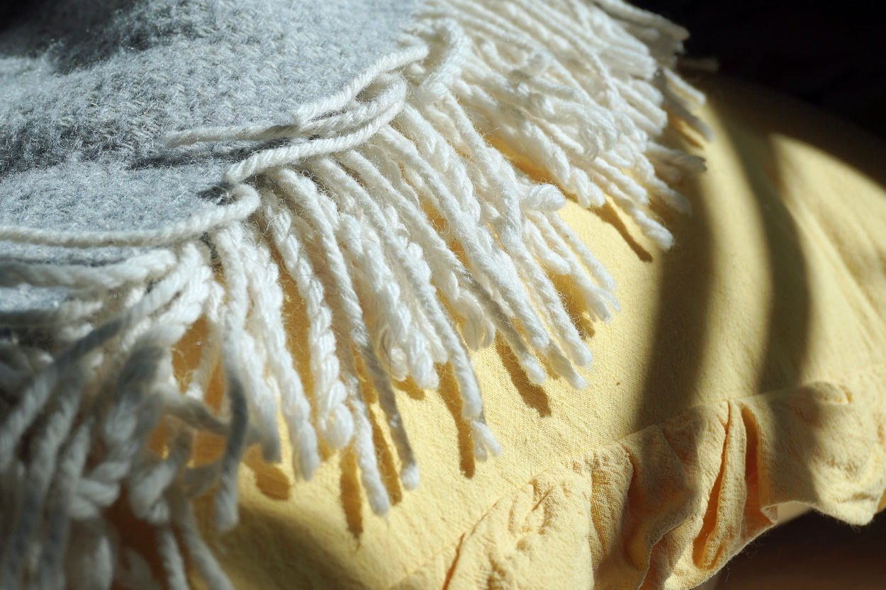
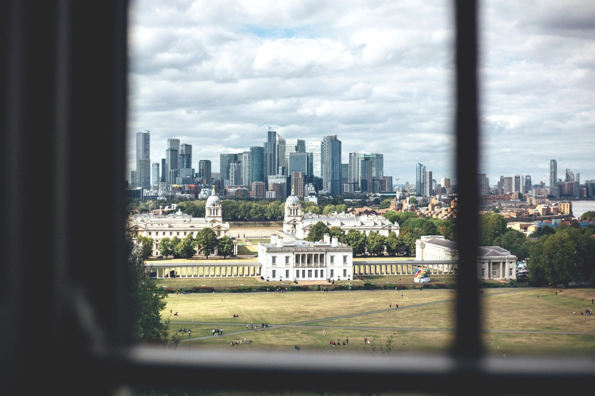
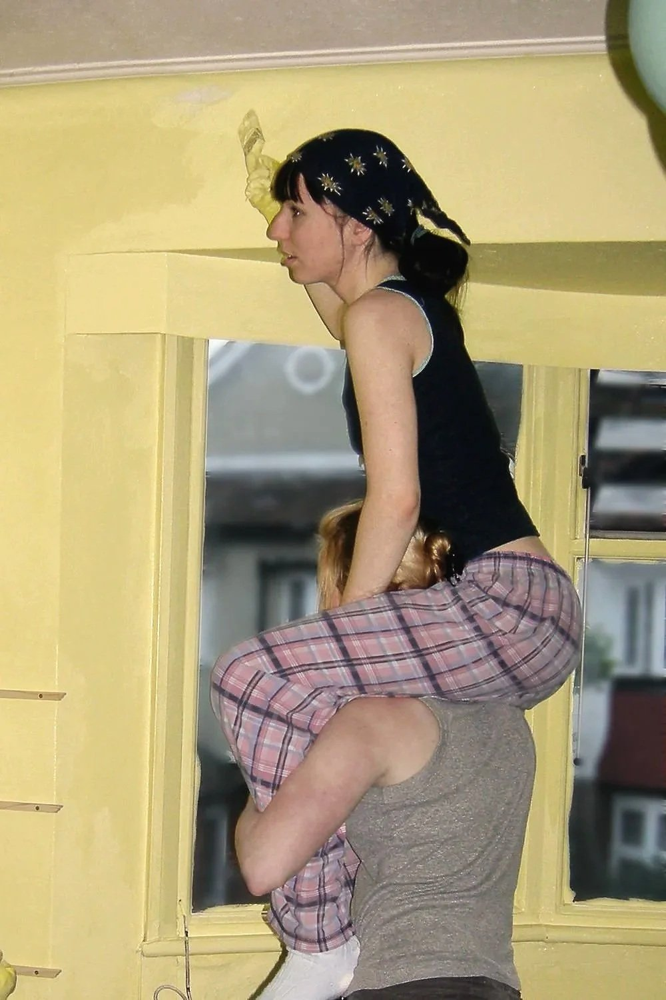

*I’ve moved 18 times, and found that a kitchen door leading outside can be an instant love affair, while a ruined view is enough reason to pack your bags. For years, I was a nomad by choice, collecting lessons from tiny studios and gloomy apartments. Those eighteen sets of keys were my real education. They taught me exactly how the spaces we inhabit affect the lives we lead.*

<Caption>
Floor bed in one of my rented flats back in 2007 | Image credit: Staying Cosy
</Caption>

Looking back, moving 18 times was one of the most valuable lessons of my life. A free course in living that felt exciting and strangely enjoyable. Every move was like a breath of fresh air — a new beginning. It’s no wonder my numerology life path number signifies constant change.

Over time, I’ve mastered the art of nesting, learning exactly how to turn a shell of a building into a soulful sanctuary within weeks. Making a place feel like home became as natural to me as breathing. Through all those transitions, from temporary flats to building my own eco-home, certain truths remained.

If I had to distill all my moves into the most meaningful lessons for [intentional living](/blog/holistic-interior-design-guide-101), these five would be the heart of the story.

## Layout Matters More Than Square Metres

<Caption>
My current bedroom | Image credit: Staying Cosy
</Caption>

It is tempting to think that bigger always means better, but after 18 relocations, I can tell you with certainty: *it doesn't*. In fact, small places are often easier to furnish, more budget-friendly, and force a level of intentionality that a sprawling hacienda often lacks.

**The real winner isn't size — it’s layout.**

You can have the most expensive sofa in the world, but if the flow of the room is blocked or you are cut off from the natural light, you will never exactly feel at peace. No amount of extra square footage can compensate for an awkward floor plan of too many walls, poorly placed doors, or a lack of space between furniture.

> “A small home with good circulation and a clear purpose always breathes better than a maze-like mansion.”

It comes down to the balance of used and negative space, so you don’t feel like you’re constantly tripping over your surroundings.

And, of course, the secret to a successful small layout is **clever storage**. When everything has its place, even something as simple as a dedicated basket by the front door, the entire energy of the room shifts. A space that is easy to maintain and fast to clean leaves you with extra time to enjoy with your family.

This naturally raises the question of [how much space we really need to live comfortably](/blog/how-big-should-your-home-be) — something I’ve explored a little deeper when looking at real-world averages. Take a look, the numbers might be an eye-opener.

## Natural Light is the Ultimate Home Luxury

<Caption>
Image credit: Staying Cosy
</Caption>

My last apartment in the UK was just re-furbished and in a sought-after, safe area. Yet, I remember crying the day we moved in. Despite the great location, the living space was trapped between small windows and looming walls of a ground-floor Victorian layout. With a baby on the way and a closing window of time, we stayed — but the lack of light meant a persistent gloom. Whether it was the intensity of nesting hormones or simply the weight of the shadows, the darkness felt like a physical burden.

It taught me an invaluable lesson: you can fix almost anything in a house, but you cannot easily recreate the **healing power of the sun**. Unless you are prepared for a full-scale architectural overhaul, bad light is a battle you rarely win.

Our home now is the opposite; it is flooded with light. We are fortunate to have an orientation that catches both the eastern and western sun — an ultimate luxury perfect for **healthy living**.

If you are looking for a new place, look at the windows before you look at the walls. Observe how the sun travels through the rooms throughout the day, and don't be afraid to bring a compass. A home bathed in natural light feels alive and connected to the rhythm of the world outside, turning even a simple morning coffee into a moment of restorative peace.

## The View Outside Counts

<Caption>
Image credit: [Lison Zhao](https://unsplash.com/@lison?utm_source=unsplash&utm_medium=referral&utm_content=creditCopyText) on [Unsplash](https://unsplash.com/photos/white-concrete-building-under-cloudy-sky-during-daytime-Yeu3ZExKksE?utm_source=unsplash&utm_medium=referral&utm_content=creditCopyText)
</Caption>

Since I’ve already mentioned the windows, it is a natural progression to look at what lies beyond them. Abundance of light and views are inadvertently connected; a [well-designed window](/blog/architectural-window-design-trends) is only as good as the story it tells.

I remember the smallest flat I ever rented in London. It was tiny, but it had a massive window that faced the city centre. We could literally see the skyscrapers glinting in the distance — a view that made the small room feel like it belonged to the whole city. Then, one day, the school next door began renovations. They put up a new building right in front of our city-view, and just like that, the magic was gone. The atmosphere of our home felt as if it had been extinguished.

We can’t be fortune tellers, and we often have no control over what might overshadow our vistas in the future. What I do know, however, is that living in a place with a pretty view, be it a quiet garden, or even just a glimpse of the clouds through a strategically positioned skylight, is an emotional bonus we shouldn't overlook.

If you’ve always had a view, you might take it for granted. But once it’s gone, you quickly realise it was **free therapy**. A connection to the outdoors is a vital ingredient for a home that feels alive. It reminds us that we are part of something larger, providing a sense of perspective that no piece of furniture or wall colour can replicate.

## Homes Grow with People, Not the Other Way Around

<Caption>
My yellow rented room | Image credit: Staying Cosy
</Caption>

A house shouldn’t dictate your life. Adapt it. Live with it. Let it evolve with you. One of the greatest joys of moving 18 times was the opportunity to breath personality into every new space.

Whether it was painting a rented room a muted yellow, finding that one perfect spot for the bed, or adding a simple set of shelves — each change was a step toward turning a cold structure into a **soulful sanctuary**.

Take the kitchen, for example. In every home I’ve lived in, the meal prep area has naturally become the heart of our daily life. Because we value fresh, homemade food and gourmet experiences, our kitchen always becomes a hub for social connection and sharing, no matter its size. Someone else might use that same square footage completely differently, and that is the beauty of a it. Homes evolve with the people inside them.

We bring life into our dwellings. Without our presence, [our rituals](/blog/eco-friendly-spring-cleaning-rituals), and our personal touches, these spaces are simply empty structures. It is the way we live within them, from our quiet morning coffees to Friday game nights full of laughter, that turn a house into a living, breathing home.

## Imperfection is Perfectly Okay

I’ll tell you a secret. Your home will never be finished. Yes, it’s out. Stop waiting for it to be complete and start living now.

The downside of our image-based culture is that we’ve been conditioned to crave a *version of home* that doesn't exist. We scroll through curated squares and feel like a failure when our own reality doesn't match the filter. Believe me, I have been there. In our current eco-home, the driveway is still a mud-bath mixed with gravel, the master bathroom is an empty shell waiting to be finished, and the upstairs is still missing its carpet.

But how much does this impact the quality of our daily life? We have a warm home and fresh food on the table. Where do our priorities stand? I find myself longing for those last few kitchen shelves, but is it a matter of true necessity, or a pressure to perform for an invisible audience?

*“Who am I really trying to impress?”*

Distancing ourselves from our personal values is a fast track to perpetual unhappiness. Sometimes, a quick DIY fix that brings instant satisfaction is enough. Other times, the most holistic thing we can do is simply stop grieving for what we haven't achieved yet.

> “Embracing the unfinished is what makes a home warm, human, and most importantly — real.”

Reflecting on all my house moves, I recognise that a house is never a destination. It’s a slow, beautiful evolution. It doesn’t matter if you are sharing a flat, settling into your first apartment, or finally in your forever home — **don’t wait for a perfect moment to enjoy your home.** Instead, let it grow alongside you.

Focus on the flow, bring in a slice of your personality, and welcome the unfinished. Because the most beautiful homes are the ones where our soul has enough room to flourish.

Does any of these lessons resonate with your own home journey? Share your thoughts in the comments below.

---

**☘︎ Start your own home evolution:**

*•* [*Beauty of Desire Paths — Walking the Way We Feel*](/blog/beauty-of-desire-paths)

*•* [*Are You Planning an Eco-friendly House Build or Renovation?*](/blog/eco-friendly-building-guide-materials-principles)

*•* [*Dignity by Design — Guide to a Wheelchair Accessible Home*](/blog/accessible-wheelchair-friendly-home-design)

SEARCH THE BLOG

