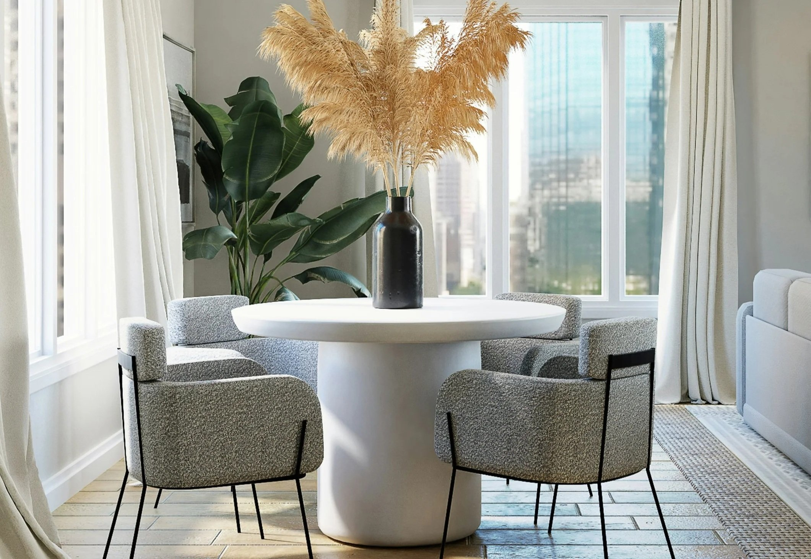
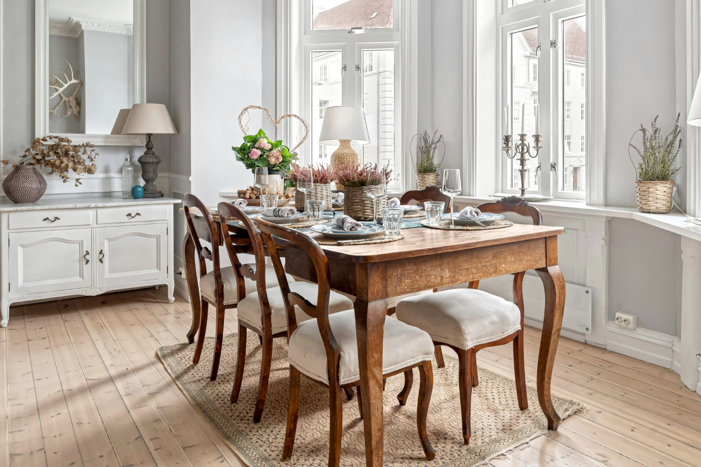
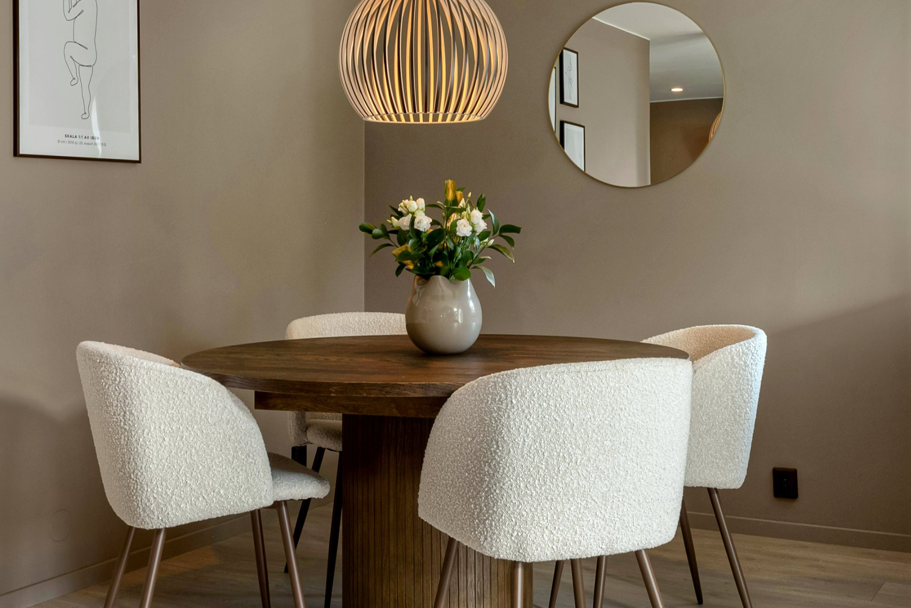
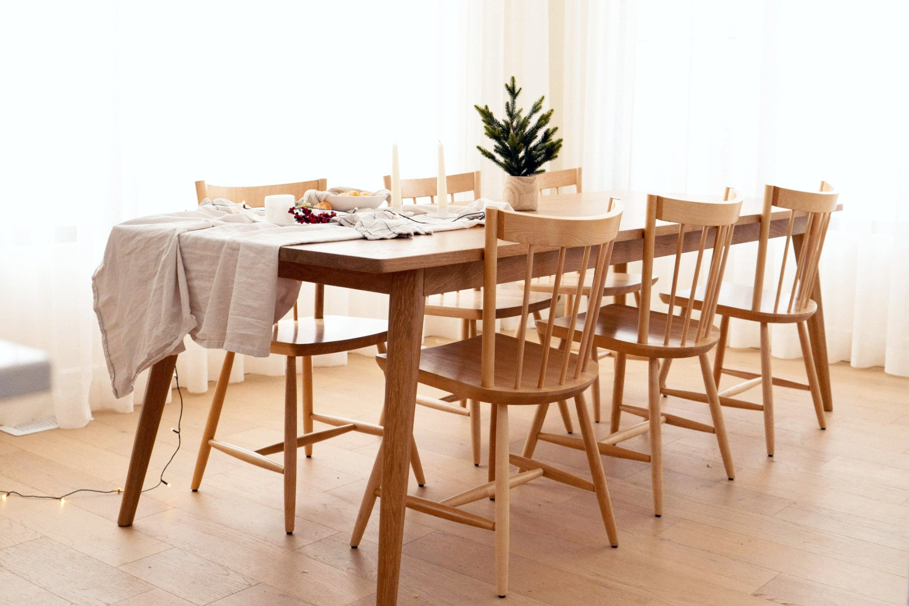
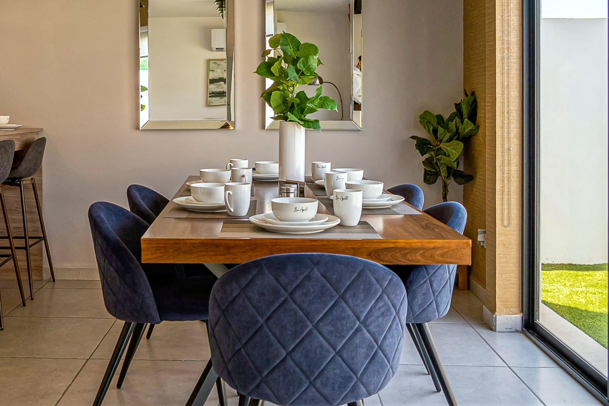
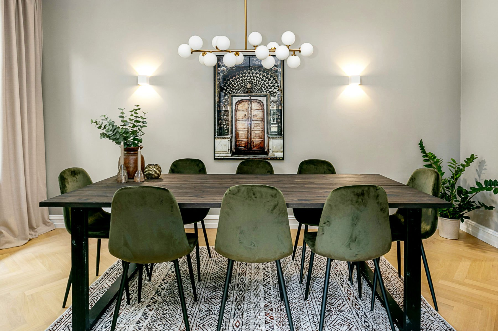
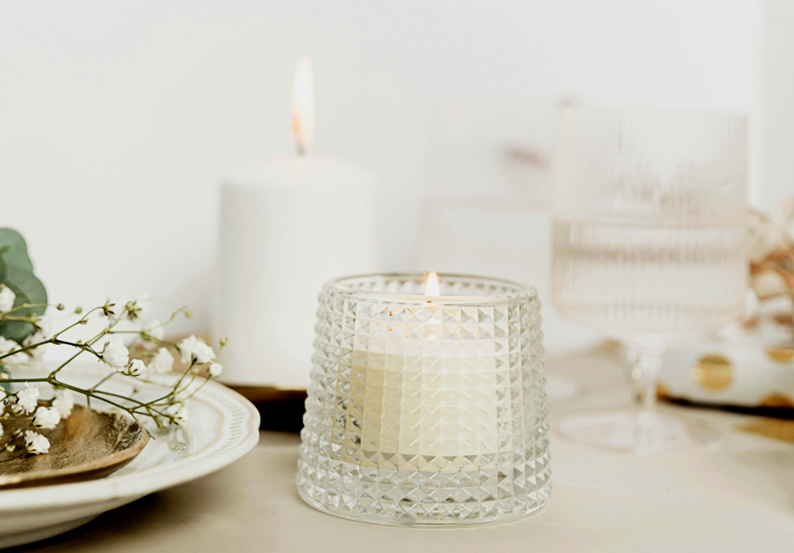

*With the long-awaited festive season just around the corner, what better piece of furniture to focus on but dining table? As the weather cools and days grow shorter, dining naturally moves indoors, and the table takes centre stage—holding everything from quick weekday meals to hearty family dinners, effortlessly moving between the everyday and the extraordinary.*

<Caption>
Image credit: [Spacejoy](https://unsplash.com/@spacejoy?utm_content=creditCopyText&utm_medium=referral&utm_source=unsplash) on [Unsplash](https://unsplash.com/photos/white-and-gray-sofa-chairs-near-white-window-curtain-io5Tvjh7vCc?utm_content=creditCopyText&utm_medium=referral&utm_source=unsplash)
</Caption>

We all know that a good solid table can last a lifetime. And if you’re currently looking for a piece that will grow with your family, you’re in the right place. Whether you’re finally upgrading to your first *real* dining table, moving, or simply love admiring a good design, here’s a roundup of **five timeless styles** that combine form, function, and a whole lot of heart.

## 1. Classic Farmhouse Table

<Caption>
Image credit: [Alex Tyson](https://unsplash.com/@alextyson195?utm_content=creditCopyText&utm_medium=referral&utm_source=unsplash) on [Unsplash](https://unsplash.com/photos/a-dining-room-with-a-table-and-chairs-j9WI9kVo4kY?utm_content=creditCopyText&utm_medium=referral&utm_source=unsplash)
</Caption>

There’s a reason this table never goes out of style. If I weren’t already in love with its round sister, it would probably be my first pick. Originally from countryside, thanks to its soft appeal it has made its way into our modern homes, and it’s here to stay. It’s the kind of furniture that welcomes you with almost audible whisper: “*you’re home.”*

### Who will love it?

Large farmhouse table is ideal for anyone who values warmth, durability, and a sense of lived-in comfort. Apart from working well in country homes & rustic cottages, it fits beautifully in Scandi-farmhouse blends, or even modern interiors that want to soften their clean lines. It’s perfect for families, keen hosts, or anyone who loves a kitchen-table lifestyle — where homework, baking, and big conversations all happen in the same place.

### Key materials, shapes & finishes

It is usually crafted from solid oak — sometimes reclaimed, sometimes new, or other solid hardwood with visible grain and a natural, matte or lightly oiled finish. You’ll often find generously sized rectangular shapes with trestle bases, and turned legs that nod to rustic tradition. Their natural charm, however, is in its imperfections: knots, textures, and slight variations that make each piece unique.

### Chairs & accessories that pair well

Mix-and-match chair combinations can take this table to new heights — always unique, always in style. Even an adventurous mix of colours never looks out of place with a classic farmhouse base. For a more subdued and traditional look, the timeless [Windsor chair](https://www.wayfair.com/furniture/pdp/chesley-solid-wood-side-chair-w011339348.html?piid=1853437640) makes a perfect companion, along with other spindle-back or cross-back styles. Cosy wooden bench on one side is another welcome addition.

For a modern take, add stylish metal or soft-upholstered chairs at either end. Style it with a timeless cotton table cloth, or just a linen runner, handmade ceramics and a rustic milk jug filled with colourful field flowers. It certainly doesn’t need much to feel complete.

### Lighting

A pair, or even a trio, of oversized pendant lights — whether in matte black, aged brass, glass, or woven rattan — create a strong focal point and pair amazingly well with the natural texture of oak. [Rustic chandeliers](https://www.wayfair.com/lighting/pdp/canora-grey-emilyn-6-light-dimmable-matte-black-classictraditional-candle-style-chandelier-w005968770.html?piid=2091466739) with wrought iron and candle-style bulbs add a touch of vintage charm, while linear suspension lights work well for longer tables, offering even illumination across the surface.

If you’re leaning toward a softer, layered look, natural materials like linen shades, clay, or wicker pendants can add warmth and texture.

#### Find your perfect farmhouse table

*Here are the ones I love! For* ***budget-friendly***\*, try\* [*IKEA Skogsta Acacia Table*](https://www.ikea.com/us/en/p/skogsta-table-acacia-00611878/#content) *(US) or* [*IKEA Möckelby Oak Table*](https://www.ikea.com/gb/en/p/moeckelby-table-oak-00293772/) *(EU).* ***Mid-range*** *fans will love* [*Birch Lane Crain Norene Extendable*](https://www.birchlane.com/furniture/pdp/birch-lane-crain-norene-extendable-solid-wood-dining-table-kbft1169.html?piid=107102624%2C107102625) *(US) or* [*The Rustic Table Company Farmhouse Table*](https://therustictablecompany.co.uk/product/the-farmhouse-table/?gad_source=1&gad_campaignid=21517197800&gbraid=0AAAAADlOBk35A-MJ5klqMGSTIuNOxjZjW&gclid=Cj0KCQjw58PGBhCkARIsADbDily9mCPpRTC0oNyLZhf_5yWppSWQMOu-MZtqhrytPmVe3ZEAkMgFYX8aAvwtEALw_wcB) *(EU). And if you’re* ***going all out***\*, consider this modern take from\* [*Crate & Barrel Breckenridge*](https://www.crateandbarrel.com/breckenridge-100-126-weathered-rustic-oak-wood-extendable-dining-table/s411899) *(US) or traditional* [*Living Shop Old French Table*](https://www.living-shop.eu/en/products/furniture/tables/dining-table-old-french-cottage-country-style-220) *(EU).*

---

## 2. Round Pedestal Table

<Caption>
Image credit: [Alex Tyson](https://unsplash.com/@alextyson195?utm_content=creditCopyText&utm_medium=referral&utm_source=unsplash) on [Unsplash](https://unsplash.com/photos/a-dining-room-with-a-round-table-and-white-chairs-uBeDqKZehcg?utm_content=creditCopyText&utm_medium=referral&utm_source=unsplash)
</Caption>

This table is the very definition of equality and connection. Depending on its design it can feel both humble and magnificent, bringing everyone closer together on a very emotional level, which I personally love! There are no sharp edges, no head of the table—*just a tender invitation to come as you are.*

### Who will love it?

If you need a truly versatile piece, look no further. A round pedestal table is perfect for those who value connection and unobstructed flow. While its shape naturally suits smaller spaces—saving room and encouraging intimacy—even larger versions manage to retain that sense of closeness.

It works beautifully in compact dining nooks, where every inch counts, for families, social diners, or anyone who loves sharing meals without shouting down a long table. Beyond practicality, its round form evokes equality and unity, making it a thoughtful choice for homes rooted in togetherness.

### Key materials, shapes & finishes

Round pedestal tables usually feature a single central base, often crafted from solid wood, metal, or a combination of both. This base offers clean lines and better legroom — perfect for tucking in chairs without the usual corner restrictions. Modern versions sometimes work with intricate metal leg shapes.

Tabletops are made of oak, walnut, birch, glass, or even stone. Finishes can range from warm, matte woods to sleek glossy painted tones, perfect for that eclectic touch. Whether rustic or refined, the round silhouette itself always adds a sense of balance to the room.

### Chairs & accessories that pair well

Since pedestal bases eliminate bulky corner legs, seating becomes much more flexible. To maximise its potential, opt for chairs with low-profile backs — ideally without armrests — so everyone can easily scoot in and out. Prefer comfort over numbers? Choose fewer, curved [upholstered chairs](https://www.target.com/p/set-of-4-dining-chairs-beige-modern-upholstered-armless-kitchen-chair-with-20-inch-wider-seat-and-metal-legs-for-dining-room-kitchen-tanpinhause/-/A-1003250219#lnk=sametab). Armrests are welcome here, but not essential. Going for more streamlined look? Get a set of matching sculptural or moulded chairs.

One of the best things about a round table is that you can add or remove chairs without disturbing the overall balance — *it always looks right!* I may be biased, of course, because I fell for a round table a long time ago—and I still feel secretly proud to have one of my own.

Now, accessorising. For bold, minimalist statement, let the table shine in its full glory — bare, with just a glossy round vase brimming with tulips. Or dress it up with a crisp linen tablecloth for a candle-lit dinner *(just keep an eye on that red wine!)*. For busy families, round place mats protect the surface from scratches and make daily cleaning easier.

### Lighting

A round table practically begs for a statement pendant or soft-glow chandelier hanging right above it, bringing the whole intimate scene together. It should mirror its shape so a single, central pendant light is the classic choice.

Drum or [globe-style chandeliers](https://www.westelm.co.uk/ardsley-cluster-chandelier-h12339) work especially well, offering soft, diffused light without dominating the space. If you’re after something more dramatic, a sculptural statement pendant hung low over the centre can act as both lighting and a piece of art.

Round tables can also shine with clustered pendant lights or a trio of small hanging lights grouped together — adding interest while keeping the glow soft and welcoming.

#### Find your perfect round table

*My favourites are:* ***on budget***\*,\* [*Target Luck Live Pedestal Table*](https://www.target.com/p/47-2-round-dining-table-suitable-for-multiple-scenarios/-/A-1004866707?preselect=1004866706#lnk=sametab) *(US),* [*Jysk Kliplev Table*](https://jysk.co.uk/dining-room/dining-tables/dining-table-kliplev-d120-natural-oak) *(EU). Perfect* ***mid-range*** *options from* [*Crate And Barrel Palisades Table*](https://www.crateandbarrel.com/palisades-48-round-whitewashed-wood-dining-table/s375994) *(US), or* [*Westwing Cono Table By Kare Design*](https://www.westwing.de/runder-esstisch-cono-o-120-cm-169642.html) *(EU). For* ***high-end***\*, look at this stunning\* [*Maiden Home Reade Table*](https://maidenhome.com/products/the-reade-round-dining-table?variant=40827071332537) *(US) available in multiple finishes, or this beautiful white* [*BoConcept Madrid Table*](https://www.boconcept.com/en-gb/v/madrid/370t086-2:291-9:0022-13:0115/) *(EU).*

---

## 3. Scandinavian Wood Table

<Caption>
Image credit: [Melyna Cote](https://unsplash.com/@laptiteminimaliste) on [Unsplash](https://unsplash.com/photos/a-dining-room-with-a-table-and-chairs-kz6hqA2mdhA)
</Caption>

Simple and effortlessly calming. That is the Scandinavian-style dining table. With its light wood tones, clean lines, and functional beauty, it’s the kind of piece that *slips into a room without overwhelming it*. Yet, somehow it still manages to set the tone right.

### Who will love it?

This table draws people who crave order and simplicity in their lives. It suits homes that lean into minimalism, abundance of natural light, and an uncluttered lifestyle. Whether you live in a small city apartment or a relaxed open-plan space, a Scandinavian-style table helps create a sense of visual peace. It’s a perfect choice for anyone who prefers the *“less but better”* approach — slow living at its core.

### Key materials, shapes & finishes

Usually crafted from light-toned woods like ash, birch, beech, or white oak, these tables often feature a slim, streamlined silhouette. Finishes are typically matte or lightly oiled, allowing the natural grain and tone of the wood to voice its understated beauty. Many times a plain white lacquered tops accompany the wooden base. You’ll often find tapered legs, rounded corners, and an overall lightness that fits effortlessly with minimalist or Japandi-inspired interiors.

### Chairs & accessories that pair well

To preserve the natural uncomplicated nature of Scandinavian-style table, it pairs beautifully with chairs in similar tones. Think plywood in white, soft grey, natural wood, or black for contrast. You can go full Scandinavian with sleek spindle-back chairs or soften the look with upholstered seat pads in linen or boucle.

Keep the styling minimal, no runners or elaborate table coverings. [Quality stoneware](https://www.westelm.co.uk/kaloh-stoneware-dinnerware-collection-e3426?location=&quantity=1&attribute_1=Dinner%20Plate&attribute_2=Anchor%20Grey) dinner set will do the trick accompanied by a small sculptural living plant. The beauty here is in the quiet restraint.

### Lighting

Minimalist lighting in classic white or contrasting black is a perfect match for this table’s clean lines. If you’re feeling adventurous, try [sculptural fixtures](https://www.nordicnest.com/brands/tradition/flowerpot-pendant-lamp-vp7/?variantId=501683-01) in petroleum blue or sage green — both matte and glossy finishes can work, as long as the shapes stay simple and geometric. A touch of pastel can also bring in a hint of playfulness without disrupting the calm.

#### Find your perfect Scandinavian table

*If money is tight check this* ***budget*** [*Ikea Lisabo Table*](https://www.ikea.com/us/en/p/lisabo-table-ash-veneer-10563773/) *(US), or* [*Ikea Tonstad Table*](https://www.ikea.com/gb/en/p/tonstad-table-oak-veneer-80593880/#content) *(EU). For* ***mid-range*** *head to* [*Nordic Nest In Between Table*](https://www.nordicnest.com/brands/tradition/in-between-bord-sk5/?variantId=36723-03) *(US&EU), and as* ***high-end***\*, I suggest the iconic Alvar Aalto’s Table from\* [*Finish Design Shop Artek’s Table 86*](https://www.finnishdesignshop.com/en-us/product/aalto-table-86?sku=AK165040) *(US&EU).*

---

## 4. Mid-Century Modern Table

<Caption>
Image credit: [Fotografías inmobiliarias](https://unsplash.com/@fotosinmobiliarias?utm_content=creditCopyText&utm_medium=referral&utm_source=unsplash) on [Unsplash](https://unsplash.com/photos/a-dining-room-with-a-table-and-chairs-MPRux4UG-ZI?utm_content=creditCopyText&utm_medium=referral&utm_source=unsplash)
</Caption>

Whether you’re a design lover, or just appreciate a well-crafted form, this table always adds polish without feeling too formal. I love how even a simple morning coffee can feel instantly elevated when it’s served there. It offers a blend of timeless design and subtle sophistication that make it a piece which *never tries too hard, yet always stands out.*

### Who will love it?

If you’re drawn to clean elegance with just the right touch of retro charm, a mid-century modern table might be your perfect match. It is ideal for those who value craftsmanship, design heritage, and a sense of curation. It works well in vintage-inspired homes, urban apartments, or contemporary spaces that need a bit of character.

This is the table for someone who appreciates a classic Eames chair, a vintage pendant lamp, or a carefully chosen ceramic bowl — elegant, stylish, and lived-in, but never overdone.

### Key materials, shapes & finishes

It often features rich, warm woods like walnut, teak, or rosewood, paired with sleek finishes and tapered legs, or geometrical bases. Oval, rectangular, and round shapes are all common, often with softly curved edges and a refined, understated look. You’ll often find beautifully crafted joinery, sculpted edges, and surfaces finished in a glossy or satin sheen. Some designs include extendable leaves — a nod to both style and function.

### Chairs & accessories that pair well

Pair with iconic mid-century chairs like the above mentioned [Eames moulded shells](https://shop.mohd.it/en/eames-plastic-chair-dsw-chair-with-hopsak-cushion.html), wishbone chairs, or upholstered pieces in tweed or leather. Slim-lined credenzas, vintage sideboards, or a statement rug underneath will help complete the look. Keep accessories intentional: a sculptural centrepiece, a warm-toned carafe, or a minimal candleholder will echo the table’s sense of thoughtful design.

### Lighting

Blown glass is a signature material that pairs beautifully with mid-century modern tables. Whether clear, frosted, or vintage-coloured, these pendants add just the right touch of elegance and nostalgia. Grouped thoughtfully in clusters or arranged on sleek brass or matte black frames, they create a striking visual centrepiece without overwhelming the space.

Other classic options include starburst chandeliers, [brass pendants](https://www.wayfair.com/lighting/pdp/joss-main-vinnie-1-light-unique-cone-pendant-w004719421.html?piid=1742904043), and minimalist geometric fixtures — all designed to blend form and function seamlessly.

#### Find your ideal Mid-Century table

*If on a* ***budget*** *check out* [*Target Laveer Table*](https://www.target.com/p/gdfstudio-laveer-mid-century-modern-rubber-wood-59-w-dining-table/-/A-1001666029?preselect=1001666030#lnk=sametab) *(US), or* [*Wayfair Ovo Table*](https://www.wayfair.co.uk/home/pdp/brayden-studio-ovo-table-204-cm-walnut-wisconsin-u110590553.html?piid=1061006230) *(EU). For* ***mid-range*** *it is* [*West Elm Aubin Table*](https://www.westelm.com/products/aubin-dining-table-h13107/) *(US), or* [*Kave Home Mailen Table*](https://kavehome.com/en/en/p/mailen-oval-table-in-ash-wood-veneer-with-dark-finish-o-220-x-105-cm) *(EU), and for* ***high-end*** *try* [*DWR Edel Table*](https://www.dwr.com/office-desks/edel-table-grand/100180682.html?lang=en_US&sku=100180682) *(US) with its cute tiny drawer, or this unique* [*Milia Shop Perro CansadoTable*](https://www.miliashop.com/en/tables/6004-perro-cansado-rectangular-table-ceccotti-collezioni.html) *(EU).*

---

## 5. Industrial Loft Table

<Caption>
Image credit: [Lisa Anna](https://unsplash.com/@lisaanna195?utm_content=creditCopyText&utm_medium=referral&utm_source=unsplash) on [Unsplash](https://unsplash.com/photos/a-dining-room-with-a-table-and-chairs-XeCtp0jg-iM?utm_content=creditCopyText&utm_medium=referral&utm_source=unsplash)
</Caption>

*Well grounded, and impactful.* Modern industrial table brings a raw, urban edge to dining spaces right as you walk in. Combining metal, wood, and minimalist lines, it creates a look that’s both striking and contemporary.

### Who will love it?

Those who appreciate loft-style interiors, urban aesthetics, or a mix of rugged and refined materials. Perfect for anyone who wants a statement table that balances durability with design, who values substance over frills and prefers furniture that ages gracefully. They’re especially loved by urban dwellers, minimalists who crave a strong centrepiece, or families who need something robust enough to handle real, everyday life.

### Key materials, shapes & finishes

The signature look is a reclaimed or rustic wood top — oak, walnut, or even distressed finishes — balanced with matte black or steel frames. Shapes are usually rectangular, offering generous space and presence, though slimmer silhouettes can keep things from feeling too heavy in smaller rooms. A clean-lined design with visible textures, grains, and subtle imperfections is what really defines the industrial spirit.

### Chairs & accessories that pair well

Industrial dining tables shine when paired with equally grounded seating. Metal-framed chairs, vintage-inspired stools, or even [leather-upholstered seats](https://www.wayfair.com/furniture/pdp/george-oliver-dylan-side-chair-aaet2321.html) add warmth while keeping the look cohesive. For a softer touch, you might balance the hard edges with upholstered benches or lighter wood tones.

Accessories should lean simple: ceramic dishes, iron candleholders, linen napkins. A touch of greenery — like eucalyptus in a plain glass vase — instantly softens the mood without breaking the aesthetic.

### Lighting

Pendant lighting with exposed bulbs, metal shades, or even a rustic chandelier adds drama and presence. Black-finished or bronze fixtures feel most authentic, but softer brass tones can warm the look. For longer tables, try a row of [matching pendants](https://www.wayfair.com/lighting/pdp/trent-austin-design-dileo-industrial-pendant-light-2-pack-vintage-hanging-lighting-fixture-with-black-metal-dome-lamp-shade-w005219906.html?piid=2146760061%2C2102822741); for smaller spaces, a single bold fixture does the trick. The goal is to keep the focus strong, centred, and atmospheric.

#### Find your perfect Industrial table

*My fave picks are:* ***budget-friendly*** [*Wayfair Eleanor Extendable Table*](https://www.wayfair.com/furniture/pdp/millwood-pines-elaenor-vidaxl-dining-table-natural-edges-tabletop-with-power-coated-steel-legs-rustic-design-bistro-table-for-dining-room-kitchen-solid-acacia-wood-w005261399.html?piid=805253607%2C805253603) *(US), or this black ceramic* [*Jysk Moselund Table*](https://jysk.de/esszimmer/esstische/esstisch-moselund-90x180-keramik-schwarz) *(EU). For* ***mid-range*** *head over to* [*Crate &Barrel Brussels Table*](https://www.crateandbarrel.com/brussels-88-solid-oak-wood-dining-table/s339446) *(US), or acacia wood* [*Kave Home Alaia Table*](https://kavehome.com/en/en/p/alaia-table-made-from-solid-acacia-wood-with-natural-finish-180-x-90-cm) *(EU), and for* ***high-end*** *try* [*Milia Shop Sigma Table*](https://www.miliashop.com/en/tables/29061-sigma-cattelan-italia-table.html#/61659-top-canaletto_walnut/76324-base-op0_transparent_painted/64765-dimensions-200_x_100_x_h_75_cm) *by Cattelan Italia (US&EU), or this sleek* [*Diotti Eliot Table*](https://www.diotti.com/en/table-wooden-top-steel-structure-eliot.html) *(EU).*

---

***A Bonus Tip:***

*Even the most stylish table benefits from smart functionality. Extendable or drop-leaf tables are ideal for those who host varying numbers of guests, want flexibility in small spaces, or simply like to adjust the dining setup with ease. Consider this feature as a practical complement to your chosen design style — it keeps your table compact, yet versatile.*

<Caption>
Image credit: [Ellie Ellien](https://unsplash.com/@ellienelie?utm_content=creditCopyText&utm_medium=referral&utm_source=unsplash) on [Unsplash](https://unsplash.com/photos/a-table-topped-with-a-vase-filled-with-flowers-and-a-candle-nrnNBVtC_oo?utm_content=creditCopyText&utm_medium=referral&utm_source=unsplash)
</Caption>

Invest in quality craftsmanship. It might be a splurge now, but it’s one of those pieces that only gets better with time.

*... and one final note on creating the perfect atmosphere.*

No matter what table speaks to you, remember that by adding dimmable light bulbs you can instantly turn your everyday setup into a welcoming dining spot. And for that extra touch of true classic charm, light a few [VOC-free](/blog/chemicals-that-pollute-our-living-rooms) candles and let the room settle into a soft, mellow glow, perfect for an evening unwind.

---

---

---
