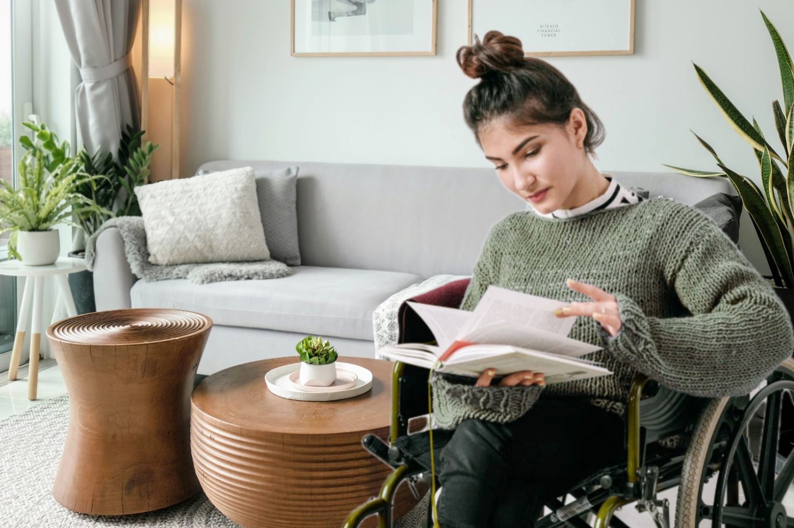
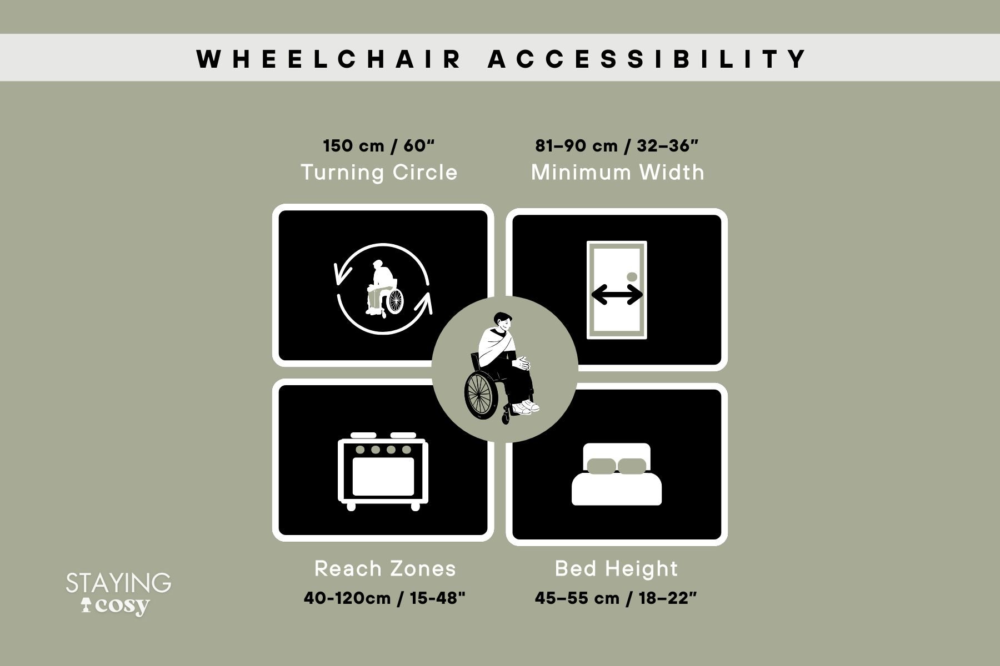
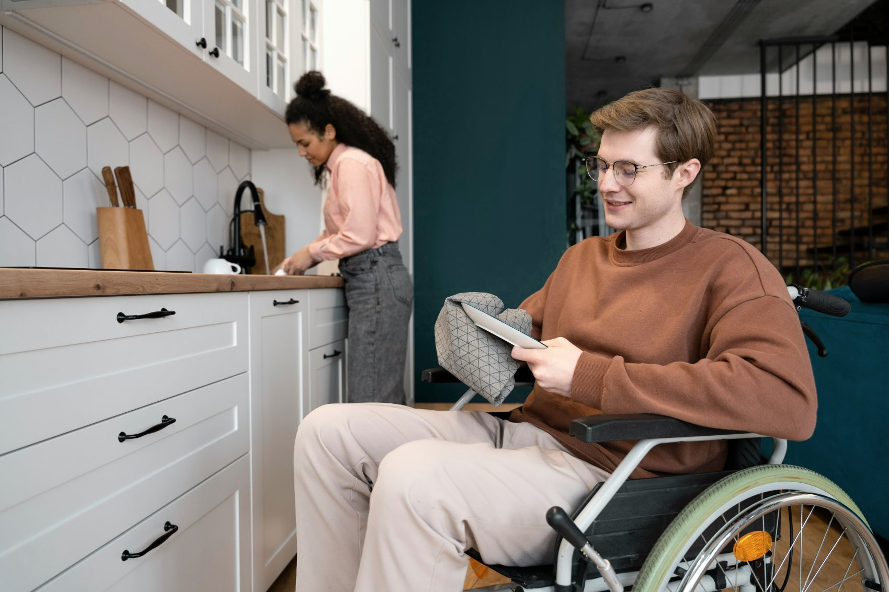
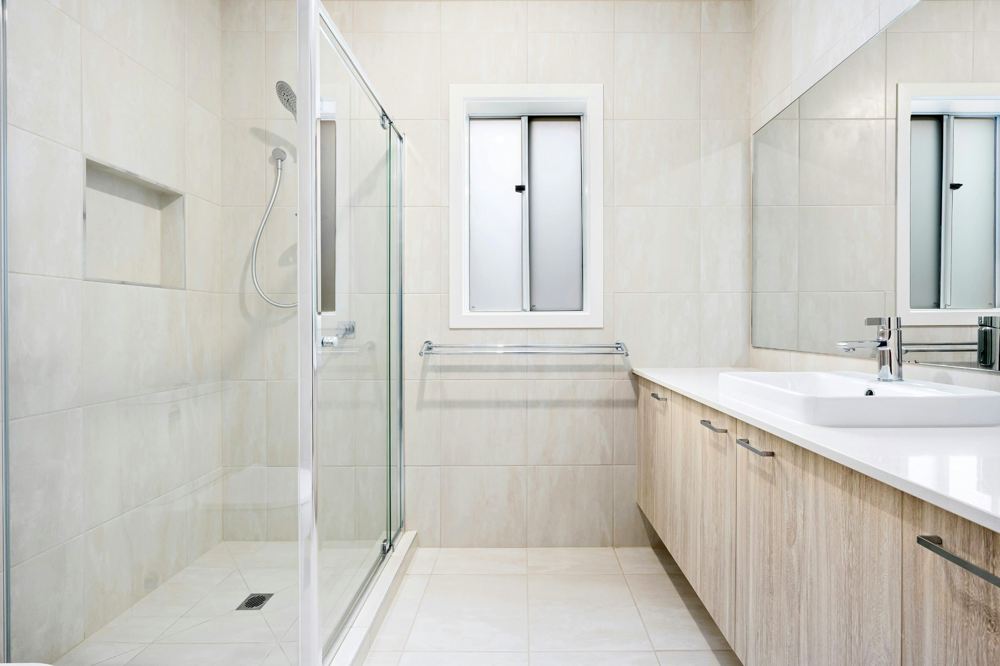

*In the endless stream of curated interiors and colour palettes, we rarely pause to ask the most essential question: ‘Who are these homes designed for?’ Creating a wheelchair-friendly interior is an act of dignity, not a set of rules, measurements, and compliance.*

<Caption>
Image credit: [Minh Pham](https://unsplash.com/@minhphamdesign?utm_source=unsplash&utm_medium=referral&utm_content=creditCopyText) on [Unsplash](https://unsplash.com/photos/a-living-room-filled-with-furniture-and-a-large-window-OtXADkUh3-I?utm_source=unsplash&utm_medium=referral&utm_content=creditCopyText) & Canva
</Caption>

In an accessible home the movement is fluid, freedom is built-in and everyone, regardless of ability, feels genuinely at ease.

When I first started this [blog](/blog), I felt drawn to the *quieter topics* of interior design, and creating an accessible home was one of them. In my mind, independence equals mental ease and the freedom to move without much effort. If you are adapting your house for wheelchair access, or supporting someone who is, you are very much in the right place.

## Defining Home with Invisible Accessibility

A holistic home should respond to real bodies and real routines. Often, the word *accessible* brings up images of sterile ramps and clinical grab bars, but those don’t reflect the reality quite as it is. Whether we are young, old, or navigating a new set of life circumstances, our spaces should support us exactly as we are.

> “Inclusive design is not a compromise on style; it is an evolution of it.”

It makes us remove the friction of daily life so the environment seemingly disappears, leaving only the ease of living.

The psychological weight of a barrier goes past the physical effort. Every narrow doorway or unreachable shelf is a subtle reminder of a limitation. Conversely, a home designed with *Universal Design* principles acts as a silent partner in our independence. Dignity grows in the spaces where we don’t have to ask for help, and where the architecture itself affirms that we belong.

### Accessible Design Benefits Everyone

It’s strange how accessibility is often seen as a trade-off, when the reality is quite the opposite. I am convinced that it isn't just for those who rely on a wheelchair full-time. Whether it's a temporary injury, aging, pregnancy, or simply carrying a heavy load — all of us experience physical boundaries at some point.

A home designed with movement in mind naturally supports everyone. It removes the obstacles of daily life, making routines smoother and creating a sense of calm that benefits every resident and guest alike.

So, where do we start creating an inclusive home? Right at the front door.

## Wheelchair Friendly Entrance

The transition into a home sets the tone for the entire interior experience. It is the first point where design either greets a person or presents a barrier to overcome.

### Creating a Seamless Arrival

A wheelchair-friendly home begins before the front door even opens. To ensure ease from the first step, focus on the threshold. Standard door sills often act as literal roadblocks; replacing these with flush or beveled thresholds allows for a smooth, jolt-free entry.

If your home’s elevation requires a [ramp](https://www.amazon.com/Nuvium-Threshold-Doorways-Wheelchair-Aluminum/dp/B0DR8H6HKX/ref=sr_1_5?crid=3V26KULLWUFVA&dib=eyJ2IjoiMSJ9.ShNArtT1zzsRrYAa_mWA8vKBzSoL4iQRnRk8IW9DidtanJR4tV_CAp_skADvZ1iqwPcGEL5rJ8c6SBnwec2gskl1OuSJAgeEUH0YGkv4fBjVGoLU7mDasKLU3TPzVCE2nKIK4AUos0HdLcNuhpoMhTMpPwcAuZ-vZM7LORlpHMeR9Fp6Qcv8AS-8Tj9pXrLhhbdBD9813wajFMDkYAfQMLqdGPDyHSv6X2iIMRpzep2ndZSjvcH9bX0GkQ9rWcVjbmV4I9Bsz7VXDixxQ5Vat0-sQcuriZJOxYx5I4Mqba4.kIV4upTFi1E1LYdpAHKHMXNTuBz-gALX0EiJNpFwAh0&dib_tag=se&keywords=modular%2Bramp%2Bsystem&qid=1769785437&sprefix=modular%2Bramp%2Bsys%2Caps%2C277&sr=8-5&th=1), prioritise a **1:12 slope ratio**, meaning 1 cm vertical rise for every 12 cm of horizontal run (1” for every 12”) to ensure the incline is manageable rather than a workout. For those with limited space, a modular ramp system can be a faster, more adaptable solution than permanent masonry.

### Spacious Width and Clearance

<Caption>
Graphic: Staying Cosy - made in Canva
</Caption>

Once the threshold is crossed, the hallway must breathe. A minimum doorway width of **81–90 cm** (32–36”) is the gold standard for comfortable manoeuvring. However, it isn’t only about the width of the door; it’s about the *swing*. If a traditional door blocks a narrow hallway when open, consider installing offset hinges, also called Z-hinges, to gain an extra 5 centimetres of clearance without replacing the frame. Alternatively, opt for a sliding pocket door to reclaim floor space entirely.

## Living Spaces – The Art of the Turn

> “Movement is the purest expression of independence.”

Too often, standard furniture arrangements create tight, awkward paths that make moving through a home with a wheelchair unnecessarily difficult. The layout should facilitate a *flow* that feels intuitive. Clear pathways and an abundance of open space should let the room breathe.

### Radius of Freedom

A key technical requirement that doubles as a comfort feature is the approx. **150 cm turning circle** (60”). This is the space required for a standard wheelchair to make a full 180-degree turn.

In the living room, you can achieve this *invisibly* by opting for furniture that preserves open floor space and sight-lines. For example: leggy, mid-century modern furniture that keeps the floor visually open, or by grouping seating around a central *plaza* rather than tight corridors.

Thoughtful layouts like this preserve independence while keeping the room warm, inviting, and naturally flowing.

### Flooring Texture Without Resistance

Your choice of flooring is where slow living aesthetics meet high-value functionality. While plush rugs are a staple of cosy design, they are the enemy of easy rolling. Look for **low-pile carpets,** ideally less than 1.3 cm or, better yet, luxury vinyl plank (LVP) or engineered hardwood. These provide the warmth of natural materials with the durability and low rolling resistance necessary for effortless movement. Subtle colour or texture variations can also help with orientation and make spaces feel layered and tactile, without creating barriers.

### Thoughtful Lighting

Lighting is often overlooked in accessibility, yet it is the primary tool for both safety and emotional regulation. For a wheelchair user, shadows and glare can hide floor level changes or obstacles, creating unnecessary anxiety.

We want to aim for layered lighting, that combines soft ambient glow with focused task lighting. Smart dimmers, mobile-app controls or motion-activated sensors allow for effortless adjustment without reaching for awkwardly placed switches.

☘︎ ***A Note on Lighting Quality***

*To make your home more restorative, look for a high* ***Colour Rendering Index (CRI)*** *on your bulb packaging. A CRI of 90, or Ra > 90, ensures that colours appear as they would under natural sunlight, enhancing both your mood and visual clarity.*

*Explore more on how to layer light in my* [*Simple Lighting Guide*](/blog/interior-lighting-guide)*.*

### Sensory Design for Accessible Home

A wheelchair-friendly home should nourish the senses, not just accommodate the body. In order to balance the hard surfaces needed for mobility, we look to natural elements to soften the environment.

Incorporate [non-toxic indoor plants](/blog/air-purifying-plants) at eye-level, and use [acoustical wall panels](https://www.amazon.com/Soon-Global-Acoustical-Decorative-Absorbing/dp/B0F4Q8V7C4/ref=sr_1_5?dib=eyJ2IjoiMSJ9.0yWtcqW2WZaqrn_Fiee94M5sT6jdFCt4WEeNJWwAnXRVxoyHALwynOCr7SSeMp3CkiDbB7Jkz8OMKYzgYBeq1GYop3OxvHr6WIKe-l-JgFAZmOREI4y946M8g1N2gIssc8f4nCMOKclQAJOiz8CBE3JoPau1MaMChO8ePKe0TOLOVLJPtjuSBGAk6Oq4ddLI-TZ_EGI2ZYTVzl6BMwuk4ZLLiXucLPW5zAh6c39UXMVO1pFr8YqT0fG-mTayJvY4j9zxqk02tNdfGYj5nB_cAJD-oexXoI9WdQXiGgUV4hg.MdOtNsY8Iiup5wQTS-P2FYM1JLjiSys44v2HISOdz6g&dib_tag=se&keywords=acoustic%2Bpanels&qid=1769766733&sr=8-5&th=1) that look like art but function to dampen the echo often found in open-plan, hard-floored spaces. These textures and sounds dictate the *vibe* of the home; they provide orientation cues, reduce stress, and make the space feel alive and comforting. Instead of a house of modifications they turn it into a nurturing place of peace.

## Practical Applications Room by Room

Accessible home design is most tangible when we look at each room and the ways careful choices can support independence and comfort. We design these private spaces not around compliance charts, but around genuine moments of living — making a simple cup of tea, taking a shower, falling asleep.

### Kitchens that Invite Participation

<Caption>
Image credit: [Raj Tuladhar](https://unsplash.com/@reazonsraj?utm_source=unsplash&utm_medium=referral&utm_content=creditCopyText) on [Unsplash](https://unsplash.com/photos/a-man-in-a-wheel-chair-in-a-kitchen-75xbITy2szk?utm_source=unsplash&utm_medium=referral&utm_content=creditCopyText)
</Caption>

The kitchen is where life happens. From preparing meals to sharing lunch with family, this space should support participation for everyone. For ease of use, consider:

- **Multi-level counters:** Instead of one static height, design a kitchen with purpose-built zones. A section of countertop lowered to 75–85 cm (30-34”) is perfect for food prep from a seated position, while a standard 90 cm (36”) counter works for standing family members. This multi-level approach feels intentional, not accessible. Warm wood finishes, integrated handles, and layered lighting help the kitchen feel inviting rather than clinical.
- **Clear paths & reach zones:** Ensure at least 120 cm (48”) of clearance between sink, fridge, and cooktop. Keep essentials within 40–120 cm (15–48”) from the floor to eliminate stretching or awkward bending.
- **Smart storage & appliances:** Pull-out and pull-down shelving, side-opening ovens, front-control induction hobs, and dishwashers on raised platforms bring everything within easy reach. Open under-counter space under sinks or prep areas provides necessary knee room for seated cooking
- **Inviting finishes:** Warm wood, integrated handles, and layered lighting make the kitchen feel cosy rather than clinical.

### Bathrooms as Spas — Not Hospitals

A bathroom is an intimate space of self-care and autonomy. The goal for wheelchair accessible bathroomis to integrate necessary safety features so seamlessly that the room feels like a luxurious spa retreat, not a clinical necessity.

- **Stylish grab bars:** Ditch the institutional chrome. Designer anti-slip grab bars now come in stunning finishes like bronze, [matte black](https://www.amazon.com/Grab-Bar-Bundle-Compliance-Diameter/dp/B0BKMV37S1/ref=sr_1_1_sspa?crid=3UDSX6196N9IB&dib=eyJ2IjoiMSJ9.rurlC5qhUO4pjm7k7sNxBnUxJSithV1Z9k6D9WQkjcJutYd0DN9yBuPVvWVwMhRj-wTTr_OKlm2ImklljWCjC2JU5j642ihWJDiA4tV6QNUthc9OzGYR0R000CvxK_F4H3D3b1E9BifilJ5CcB2zMQM9apjeePU7NvuMU4vpkioPBZQN_aJJgUECk53e9Wu2SnGU63lSMqJDgolCWiHqYBrm96XG1SdY_AiR0i1JHq1O9nQqyQuaH3EudjGt97DtwhvwNoc-P9Mn72SeQ8sPIh5QGDMoLFnxVJU_3tO-evA.bHhtXsm5fVia32F6msDE8cvWz6D-DmMZTGtzkBy9Fzg&dib_tag=se&keywords=matt%2Bblack%2Bgrab%2Bbars%2Bfor%2Bshower&qid=1769768835&sprefix=matt%2Bblack%2Bgrab%2Bbars%2Bfor%2Bshower%2Caps%2C242&sr=8-1-spons&sp_csd=d2lkZ2V0TmFtZT1zcF9hdGY&th=1), and [brass](https://www.amazon.com/dp/B0DPZNRBP1/ref=sspa_dk_detail_5?psc=1&pd_rd_i=B0DPZNRBP1&pd_rd_w=YOrgM&content-id=amzn1.sym.7446a9d1-25fe-4460-b135-a60336bad2c9&pf_rd_p=7446a9d1-25fe-4460-b135-a60336bad2c9&pf_rd_r=1T1FQ5CAY9YV8CZ7DB3N&pd_rd_wg=9XCfd&pd_rd_r=7b7b76b2-6c6a-47ff-8dcb-a79d67df2dc5&sp_csd=d2lkZ2V0TmFtZT1zcF9kZXRhaWw), and can double as sleek towel racks or shower shelves.
- **Curb-less shower** is the epitome of inclusive design. It’s a modern, minimalist trend in all high-end design right now, yet it provides effortless access for a wheelchair. Use a beautiful, continuous tile from the bedroom right into the shower for a seamless look.
- **Floating vanities:** Install a wall-mounted or *floating* vanity with open space underneath. This provides vital knee clearance while offering a sleek, contemporary aesthetic that makes the room feel larger and cleaner.
- **Non-slip surfaces:** Subtle textured tiles maintain safety while remaining elegant. Think spa-like finishes and warm tones. Functionality and indulgence are not mutually exclusive.
- **Smart lighting and mirrors:** Motion sensors or easily reachable switches reduce effort; tilting mirrors can accommodate seated users.

### Bedrooms for All Abilities

A bedroom should be a place of quiet retreat, where comfort is paramount. Dignity here means the ability to get into bed easily and access your belongings without assistance.

- **Perfect bed height:** For seamless transfers, the bed height should align closely with the wheelchair seat height, typically around 45–55 cm (18–22”), depending on the individual. The ideal bed height depends entirely on the individual user. The goal is to match the height of the mattress precisely to the height of the wheelchair seat for a seamless, safe side transfer. This often means using a [low-profile box spring](https://casper.com/blogs/article/low-profile-vs-standard-box-spring?srsltid=AfmBOoryEhu1umgDEAoCm4xKbclf1ChNLelLvHdAWXsE6QdV1to5UvT7).
- **Accessible storage:** Maximise independence by lowering closet rods and installing pull-out drawers instead of deep, inaccessible shelves. An adjustable closet system ensures everything remains within that comfortable 40–120 cm (15–48”) reach zone.
- **Night-time ease:** Bedside lighting, reachable outlets, and minimal obstacles reduce effort during night or early morning. Integrate textures, soft furnishings, and personal touches to maintain a sense of retreat, calm, and personality.

## Future-Proof Your Home with Universal Design

<Caption>
Image credit: [Lisa Anna](https://unsplash.com/@lisaanna195?utm_source=unsplash&utm_medium=referral&utm_content=creditCopyText) on [Unsplash](https://unsplash.com/photos/a-bathroom-with-a-sink-shower-and-mirror-ELsmyMq-1fg?utm_source=unsplash&utm_medium=referral&utm_content=creditCopyText)
</Caption>

The journey through designing a wheelchair-friendly home is ultimately a proactive step toward a more empathetic world. We move past simply addressing a current need and look toward a future where every home is built with the foresight that life is unpredictable.

*Universal Design* solutions, like curb-less showers, zero-step entries, and extra-wide hallways, make life easier not just for wheelchair users but for everyone else. The most powerful tool in any designer's kit is not a measuring tape or a colour swatch; it is empathy.

I started by questioning who our homes are designed for. Nearing the end, the answer is clear: *They are designed for all of us, in all our varied circumstances.* A house is a structure, but a home is the feeling of belonging it provides. When the physical environment fades into the background, the freedom to simply live takes centre stage.

I hope this guide inspires you to create spaces where everyone, regardless of ability, can truly feel at home.

---

**☘︎ Looking for more holistic interior inspiration?**

[*Tiny Kitchen Tips*](/blog/tiny-kitchen-clever-design-tips) *|* [*Natural Materials Around my Home*](https://bluebird-hawk-as8j.squarespace.com/blog/natural-materials-around-my-home) *|* [*Holistic Interior 101*](/blog/holistic-interior-design-guide-101)

SEARCH THE BLOG

---

---
