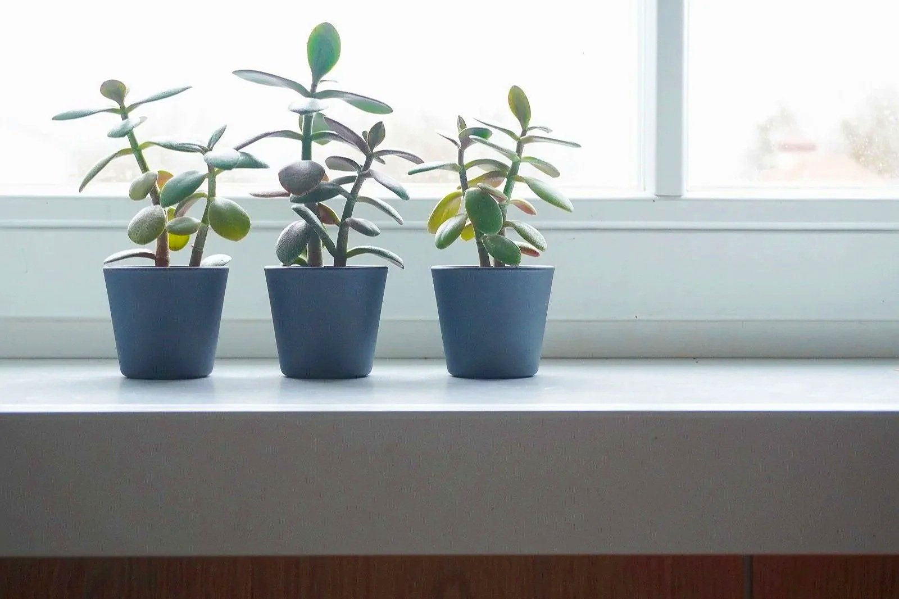
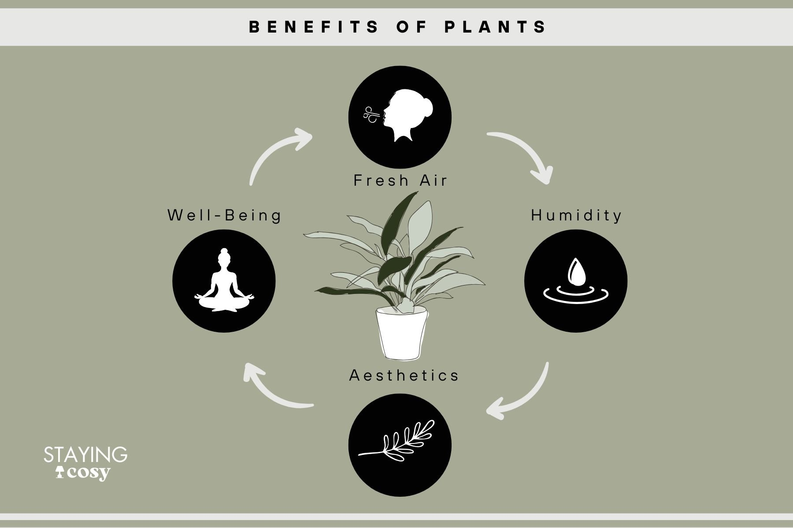
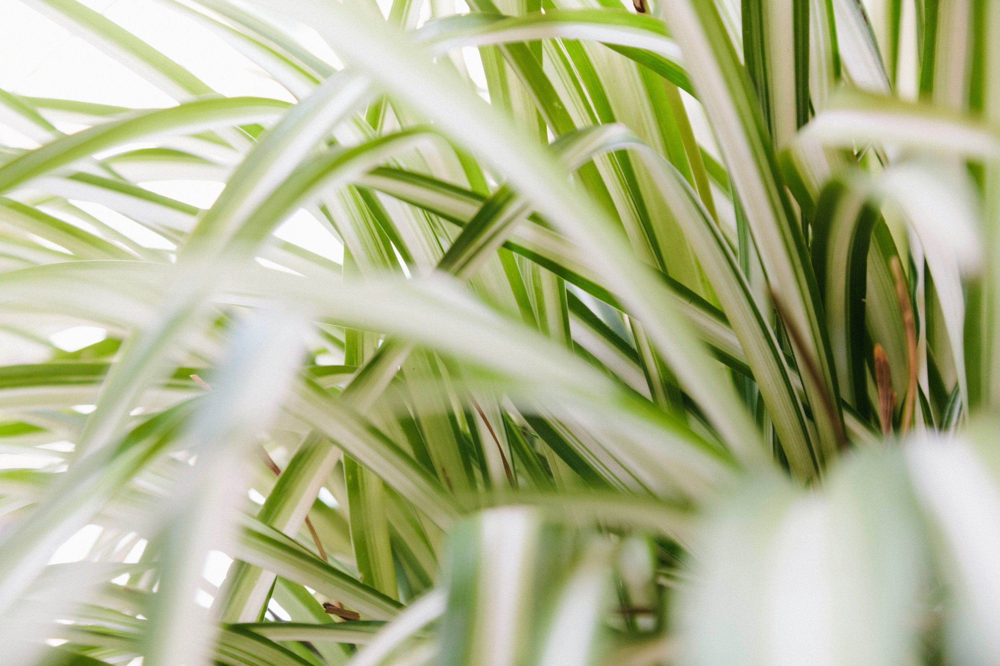
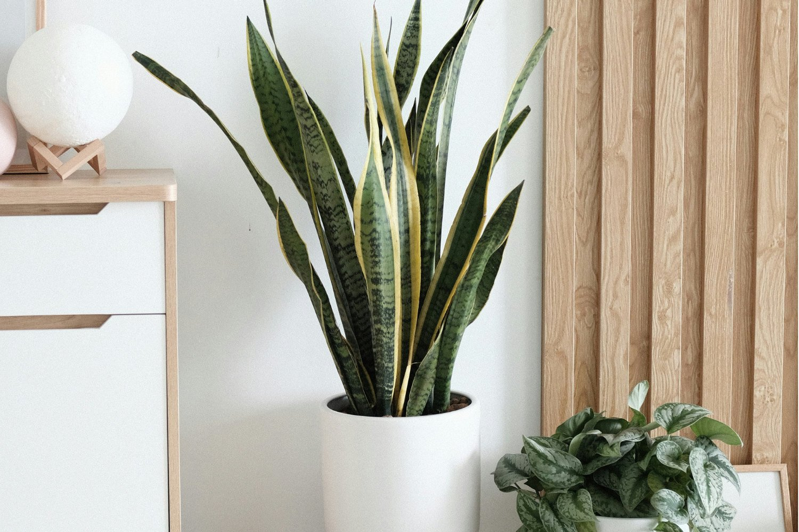
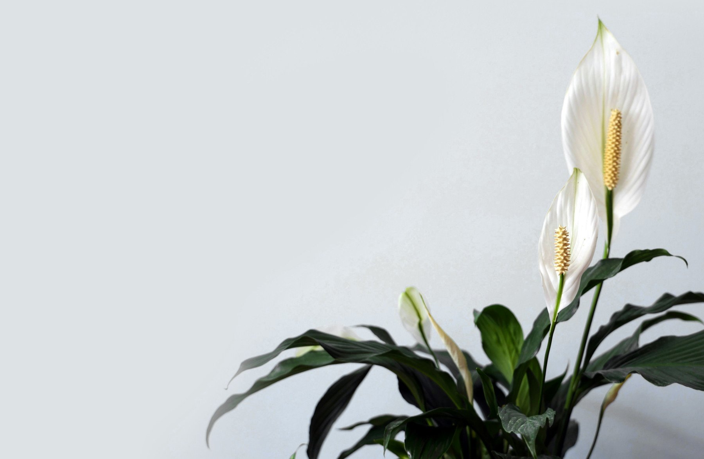
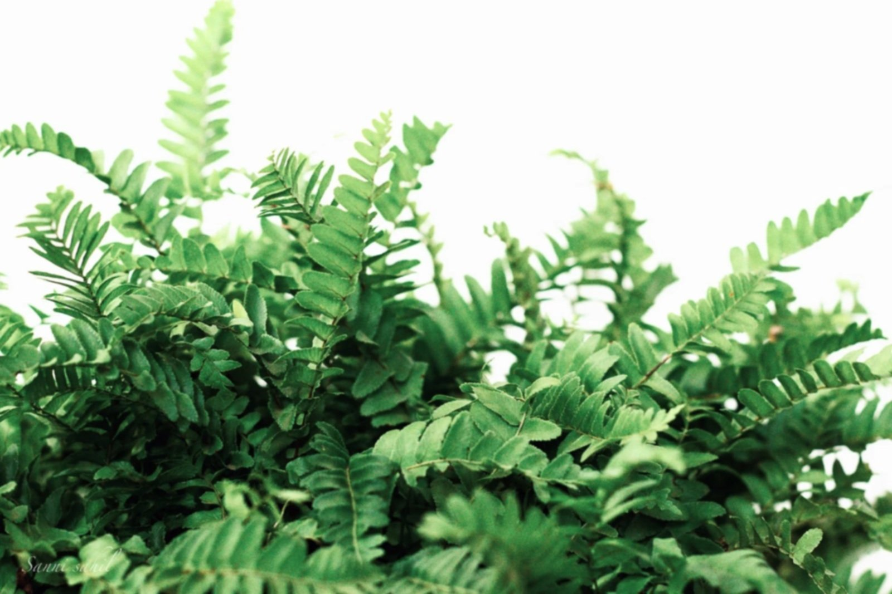
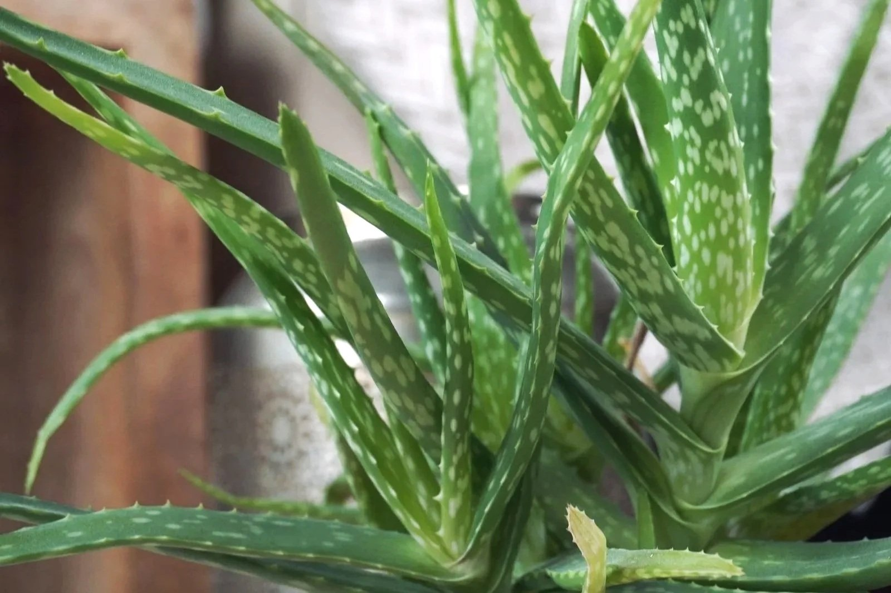
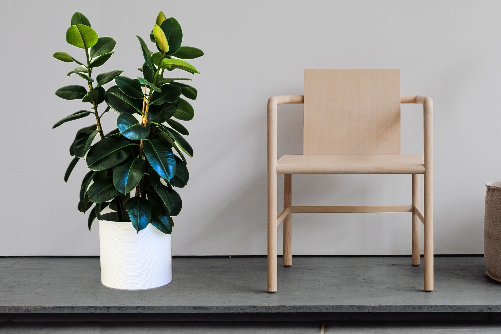
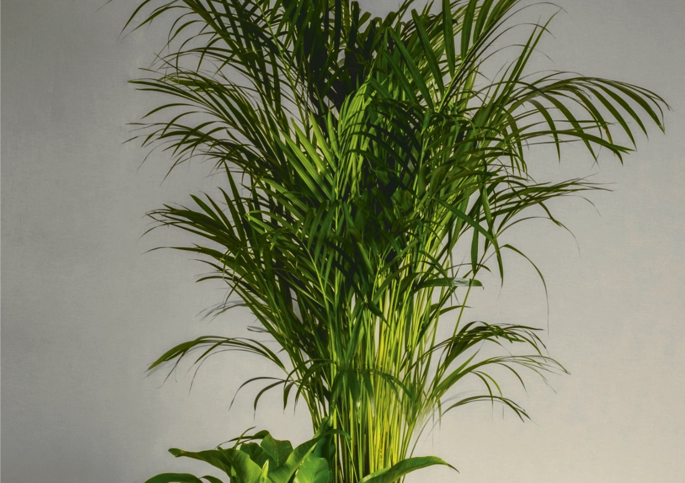
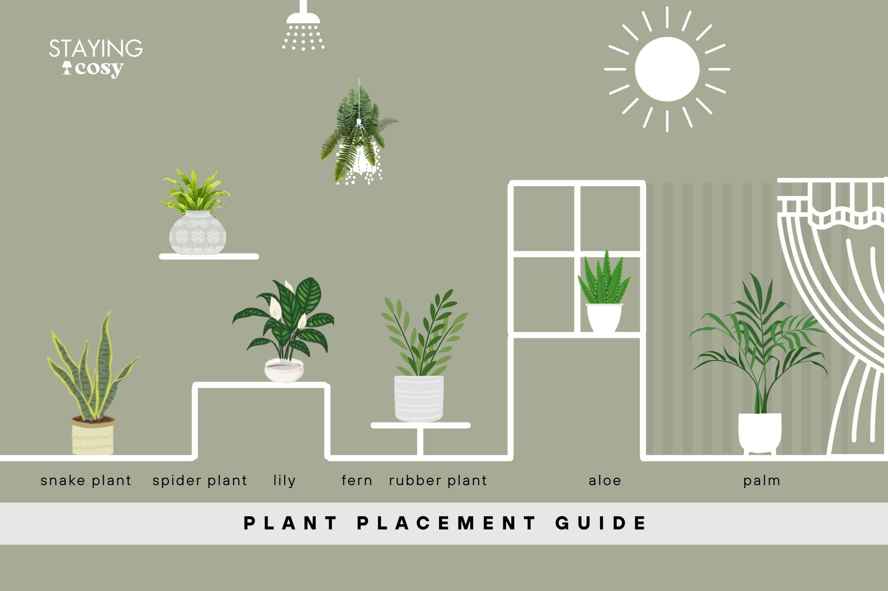

*What better way to kick off the new year than with some fresh plans—or, perhaps, plants? Well, why not both! Let’s make a little plan to add some greenery to our homes and freshen up the air without relying on fancy filters.*



<Caption>
Image credit: Staying Cosy
</Caption>

Nothing works better for indoor air purification than surrounding ourselves with plants that do the job naturally!

If you didn’t know, our homes can be up to **five times more polluted than the air outside**. Curious? Check out [this post](/blog/chemicals-that-pollute-our-living-rooms) to learn more. By adding a few carefully selected plants, you can naturally clean the air, boost your mood, and make your home feel more alive.

Before I introduce you to the easy-to-grow bunch, let’s quickly look at some of the other benefits plants bring.



<Caption>
Graphic: Staying Cosy - made in Canva
</Caption>

### Why add plants indoors?

Plants are living organisms that can certainly do more than just brighten up a room. Here is a closer breakdown:

⋆ **Air purification:** they absorb toxins like formaldehyde, benzene, and xylene.

⋆ **Humidity & comfort:** plants help maintain healthy indoor humidity levels, great for skin and respiratory health.

⋆ **Mental well-being:** studies show greenery reduces stress, improves focus, and boosts mood.

⋆ **Aesthetics:** they add life, texture, and colour to interiors, complementing all décor styles.

To make things easier, I’ve included a **purification rating** at the end of each plant section, ranging from good, to strong, to excellent. Enjoy the read!

## 1. Spider Plant

*(Chlorophytum comosum)*



<Caption>
Image credit: [Alberto Nicoletta](https://unsplash.com/@agalberto?utm_source=unsplash&utm_medium=referral&utm_content=creditCopyText) on [Unsplash](https://unsplash.com/photos/green-leaf-plant-in-close-up-photography-3SFYql1q3uE?utm_source=unsplash&utm_medium=referral&utm_content=creditCopyText)
</Caption>

A resilient and forgiving classic, perfect for beginners or anyone who wants a splash of green without fuss. Its thin, arching leaves and tiny baby plants bring life and movement to any room. *Bonus:* those little offshoots can be shared with friends!

- **Ease of care:** Very easy; water once a week, tolerates occasional neglect.
- **Visual appeal:** Long, gracefully arching leaves; the two-tone look may not appeal to everyone, but it adds a lively touch.
- **Placement:** Indirect light is best, direct sun can scorch the leaves. Works beautifully on shelves or in hanging baskets.
- **Purification:** Strong — removes formaldehyde and xylene.

## 2. Snake Plant

*(Sansevieria trifasciata)*



<Caption>
Image credit: [Minh Pham](https://unsplash.com/@minhphamdesign?utm_source=unsplash&utm_medium=referral&utm_content=creditCopyText) on [Unsplash](https://unsplash.com/photos/snake-plant-in-vase-MBsReSZ2WNM?utm_source=unsplash&utm_medium=referral&utm_content=creditCopyText)
</Caption>

Also known as Mother-in-Law’s Tongue, this plant is practically indestructible. It combines sculptural beauty with incredible resilience, making it a perfect low-maintenance air-purifying companion. Its thick, architectural leaves add height and drama to corners, shelves, or bedside tables.

- **Ease of care:** Extremely easy; tolerates irregular watering and low light.
- **Visual appeal:** Tall, upright leaves with bold variegation — a striking design statement.
- **Placement:** Low to medium bright indirect light; adaptable to almost any indoor space.
- **Purification:** Strong — removes formaldehyde, benzene, and trichloroethylene.

## 3. Peace Lily

*(Spathiphyllum)*



<Caption>
Image credit: [Lan Gao](https://unsplash.com/@langao?utm_source=unsplash&utm_medium=referral&utm_content=creditCopyText) on [Unsplash](https://unsplash.com/photos/white-petaled-flower-with-green-leaves-Q8_8Dc0WIAI?utm_source=unsplash&utm_medium=referral&utm_content=creditCopyText)
</Caption>

An elegant plant with luxurious dark leaves, the Peace Lily feels made for modern interiors. When in bloom, it produces delicate white flowers, making it ideal for anyone seeking both beauty and air-purifying power.

- **Ease of care:** Moderate; keep the soil consistently moist and mist occasionally.
- **Visual appeal:** Highly decorative, with dense glossy green leaves and iconic white blooms; timeless and calming.
- **Placement:** Low to medium light; perfect for darker living rooms, offices, or bedrooms.
- **Purification:** Excellent — removes ammonia, benzene, formaldehyde, and trichloroethylene.

## 4. Boston Fern

*(Nephrolepis exaltata)*



<Caption>
Image credit: [Sanni Sahil](https://unsplash.com/@sannisahil?utm_source=unsplash&utm_medium=referral&utm_content=creditCopyText) on [Unsplash](https://unsplash.com/photos/green-leaves-under-white-sky-during-daytime-Tr87R2ox78A?utm_source=unsplash&utm_medium=referral&utm_content=creditCopyText)
</Caption>

If you need to balance high humidity, Boston Fern is your best friend. With its abundant, arching fronds, this vibrant green classic instantly softens any space. If you are willing to take on slightly more advanced plant care, it will reward you with an airy sense of movement and light.

- **Ease of care:** Moderate; thrives with consistent moisture and higher humidity, but can tolerate occasional lapses in attention. Loves misting to stay lush.
- **Visual appeal:** Dense, cascading fronds bring texture and greenery to corners, shelves, and window sills, adding a natural, lively vibe to any room.
- **Placement:** Indirect light; perfect for bathrooms, kitchens, or other well-lit high humidity areas.
- **Purification:** Strong — removes formaldehyde and xylene from indoor air.

## 5. Aloe Vera

*(Aloe barbadensis miller)*



<Caption>
Image credit: Staying Cosy
</Caption>

A hardy succulent that’s as practical as it is decorative. Known for its soothing gel, Aloe Vera doubles as a natural remedy, while its upright, fleshy leaves add a sculptural element to any room. It loves bright environments with partial sunlight. *Bonus:* its gel can be used for minor cuts and skincare.

- **Ease of care:** Very easy; flourishes on minimal watering. Keep leaves away from glass to prevent sunburn.
- **Visual appeal:** Architectural, spiky leaves with a soft green hue; minimal and modern.
- **Placement:** Bright, indirect sunlight; ideal for sunny windowsills, kitchen counters, or office desks.
- **Purification:** Good — removes formaldehyde and benzene from indoor air.

## 6. Rubber Plant

*(Ficus elastica)*



<Caption>
Image credit: [Denley Photography](https://unsplash.com/@denleyphotography?utm_source=unsplash&utm_medium=referral&utm_content=creditCopyText) on [Unsplash](https://unsplash.com/photos/a-plant-in-a-pot-GNdLc38zNjU?utm_source=unsplash&utm_medium=referral&utm_content=creditCopyText) - edited in Canva
</Caption>

Famous for its bold, shiny leaves, it never fails to bring instant drama and elegance to a room. A true statement piece. Available in multiple varieties, Rubber Plant always creates a striking visual impact. Perfect for anyone looking for a functional and stylish air purifier.

- **Ease of care:** Moderate; prefers bright, indirect light and occasional watering, letting the soil dry slightly between sessions. Taller branches may need support.
- **Visual appeal:** Large, deep green leaves with a glossy finish are very decorative; grows upright and sculptural, perfect for corners or next to furniture pieces.
- **Placement:** Bright, indirect light; works well in living rooms, offices, or hallways.
- **Purification:** Strong — removes formaldehyde and improves overall air quality.

## 7. Areca Palm

*(Dypsis lutescens)*



<Caption>
Image credit: [feey](https://unsplash.com/@feeypflanzen?utm_source=unsplash&utm_medium=referral&utm_content=creditCopyText) on [Unsplash](https://unsplash.com/photos/a-green-plant-in-a-white-pot-with-three-white-vases-bbzahEZzj1c?utm_source=unsplash&utm_medium=referral&utm_content=creditCopyText) - edited in Affinity Photo
</Caption>

A true tropical charmer, the Areca Palm naturally grabs your attention with its lush, feathery fronds. One of the most effective air purifiers, it brings a vacation-like vibe into your home — no passport required. Just make sure you have enough space, as it can grow quite tall and wide.

- **Ease of care:** Moderate; enjoys bright, filtered light and consistent moisture, but dislikes soggy soil. Mist occasionally to boost humidity.
- **Visual appeal:** An absolute stunner, with arching leaves that add height and texture; perfect for creating a relaxed, resort-inspired atmosphere.
- **Placement:** Bright, indirect filtered light; keep away from drafts or strong sunlight. Works beautifully in living rooms, bedrooms, or well-lit hallways.
- **Purification:** Excellent — removes toxins like formaldehyde, toluene, and xylene while adding moisture to the air.

---

As I’m writing this post, the very first of 2026, I notice my large Rubber Plant filling the corner of our living room. A lovely present from our neighbour. Another one in the mix is my Aloe Vera, soaking up the pale winter sunlight on an east-facing windowsill, this one passed on to one of my daughters. Plants really do make awesome gifts: more lasting, more sustainable than cut flowers, but…

### How easy are they, really?

If you’re unexpectedly given one, you might panic a little. Can you handle plant parenting? I certainly wouldn’t call myself the best plant caretaker, yet my plants have somehow been thriving for years. My watering routine is rather spontaneous — including a few leftover splashes from forgotten glasses of water.

The trick is to choose the easy-care ones and place them correctly. Check out this simple placement guide to see where each of the 7 featured plants thrives in a home setup\*\*\*.\*\*\*



<Caption>
Graphic: Staying Cosy - made in Canva
</Caption>

For example, roses? That’s a whole different story. The plants I’ve mentioned here are both air-purifying and low-maintenance, no need to be afraid of adding one to your home. After all, bringing nature indoors goes beyond aesthetics—it’s about [balance and wellbeing](/blog/shaping-a-green-home-with-purpose).

So, here’s to greener corners, cleaner air, and homes that breathe easier!

---

```
SEARCH THE BLOG
```

---

---
