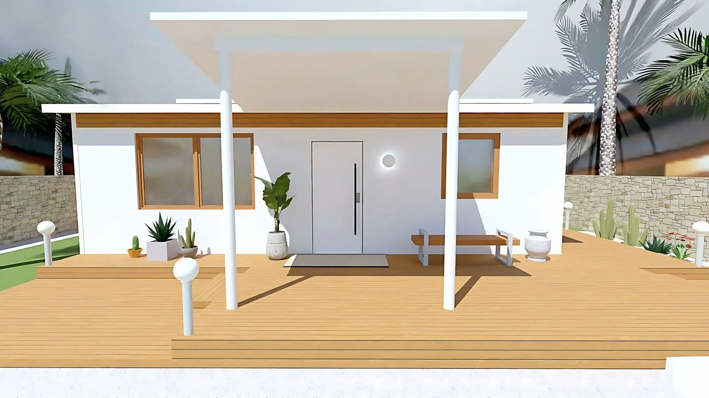
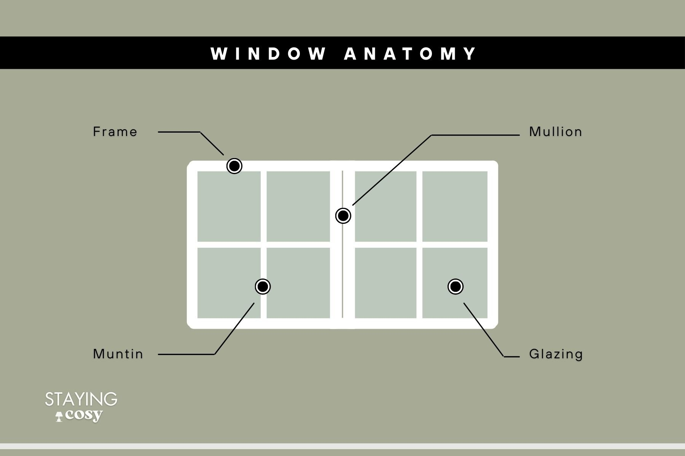
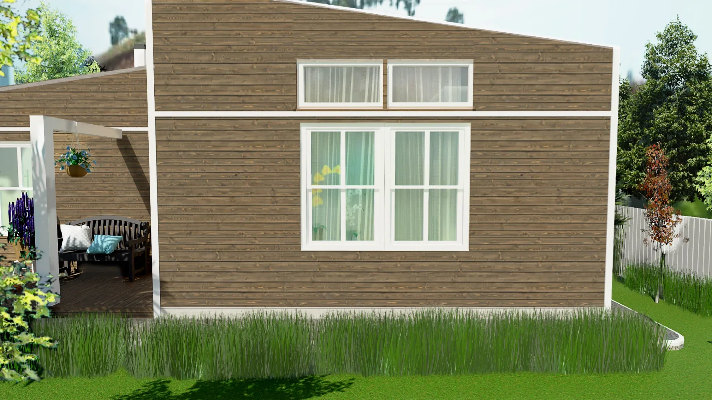
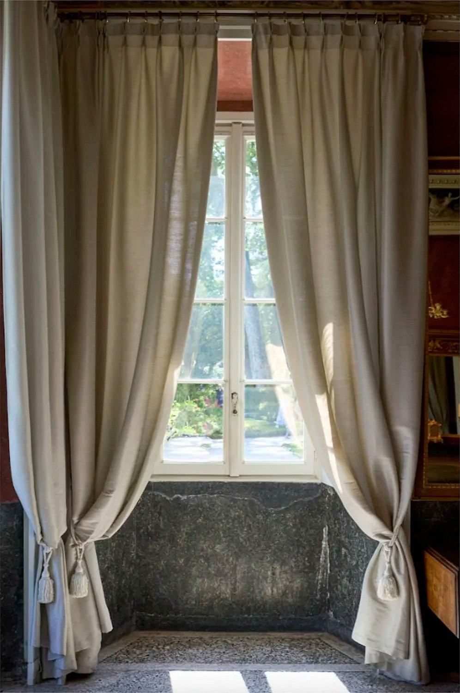
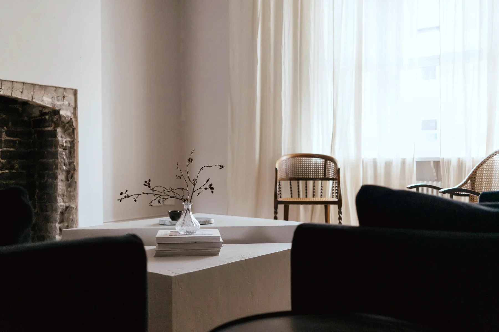

*If you’re worried that a post about windows might be a total snooze-fest, stick with me! I promise that by the time you finish reading, you’ll be convinced that windows are one of the most versatile and uplifting features of any building.*

<Caption>
Image credit: Staying Cosy
</Caption>

While the trend for massive, invisible panes of glass has its own beauty in bringing the outdoors in, I’ve found myself craving a return to windows that feel like a deliberate part of the home's identity. Instead of *shop-style glass* that disappears, I love windows that hold space. They achieve this by using frames, varied widths, and deep sills to create a sense of shelter and pique interest.

There is so much beauty in the small details. It’s spanning from traditional casings and architraves, those functional trims that frame our view, to the intentional un-uniformity that expands a design’s horizon. We don’t need to retreat into the eccentricities of the Baroque era to make a statement. We simply need to give windows the creative credit they deserve.

## Breaking the Four-Sided Mould

When we think of a window, we usually picture a simple rectangle. But windows should serve a home’s character, not just follow the path of least resistance. Choosing a modern style doesn’t have to mean settling for a flat, anonymous sheet of glass; there are far more expressive options available than most of us realise.

### Revival of Divided Light

Historically, glass couldn't be produced in large sheets, so builders pieced together smaller panes using **muntins** — the thin strips dividing the glass. Today, we’re seeing a sophisticated revival of these designs, but with a minimalist twist. By playing with varied frame thicknesses or combining horizontal and vertical mid-framing, you can completely transform a façade.

And no, this isn’t just decorative nostalgia. It’s architectural rhythm.

### Window Anatomy

To plan your design, it helps to know the language. Apart from muntins, you’ll also hear the term **mullions**. These are the thicker, structural dividers between window units. The **frame**, meanwhile, is the outer part that attaches directly to the building's wall.

Here’s a quick visual guide:

<Caption>
Image credit: Staying Cosy - made in Canva
</Caption>

### Design Trends to Watch

Beyond the standard grid, consider how these elements can soften or sharpen your home's exterior.

The latest window design trends bring us:

- **Asymmetrical framing:** Using varying mullion widths for a custom, artistic look that feels less mass-produced.
- **Arched tops:** Drawing from *Hacienda Modernism*, these curves use slim-profile metalwork to elegantly soften the sharp, clinical lines of contemporary design.
- **Mixed materials:** Pairing high-performance black aluminium for the exterior with warm, tactile wood for the interior.

Most homes now opt for slim-profile metal frames, like these elegant [Slim-line windows from Rayners Aluminium](https://www.reynaers.co.uk/products/aluminium-windows/slimline-38) for a crisp, contemporary feel.

Functionally, a window’s shape and placement influences airflow, privacy, and our day-to-day use. A tall, narrow window placed beside a wide, low one makes a wall feel dynamic while optimising light exactly where you need it.

## The Power of Colour and Harmony

Although white and natural wood remain timeless classics, recent years have seen a surge in **anthracite, bronze, and dual-colour frames**. These deeper tones echo contemporary architectural trends, giving even older homes a sharp, modern edge.

<Caption>
Image credit: Staying Cosy
</Caption>

### The Golden Rule of Context

When choosing a palette, you have to think about the big picture. Inside, the window frame sits in conversation with your skirting boards; outside, it must speak to your front door and fencing. This balance is at the heart of [interior colour harmony](/blog/your-guide-to-beautifully-layered-home), where every choice, from the boldest charcoal to the simplest white, requires intention to avoid a visual clash.

I recently noticed a neighbour paint their fence a sharp black against a warm yellow house with brown trim. While intended to be a modern update, it created a stark contrast that felt disconnected from the home's existing soul.

Even seemingly *safe colours* like black need to harmonise, or they can easily look like a mistake.

### Proportions and Personality

A good window has balanced proportions and placement, considering both the interior and exterior flow. A great window does all that while keeping the home thermally efficient and providing a picturesque view that instantly lures you to peek through.

If you’re lucky enough to live in a village cottage, don’t shy away from playful, muted shades. **Sage green, dusty blue, or soft ochre** can be absolutely beautiful. The key is consistency. Your interior tones should echo the charm of the exterior, perhaps complemented by stone terraces, climbing grapevines, or lush gardens. Truth be told, I secretly dream of a little garden house exactly like that.

### The Best of Both Worlds

Torn between two looks? **Dual-colour frames** are a brilliant compromise. I used this approach on our own front door: a vibrant teal outside for personality, and a calm, clean white inside to keep the entryway bright and airy.

## Window as a Three-Dimensional Sculpture

A window isn’t a flat sticker on a wall; it is a structural feature with depth and volume. Outside, the casing sets the architectural tone for your entire façade, and this is where the reveal depth comes into play. Here is how to use it:

- **The Deep Reveal:** Pushing the window 10-15 cm (4–6 inches) into the façade wall creates a *shadow box*. This provides natural shading and passive cooling, but aesthetically, it makes the house look anchored and expensive.
- **The Exterior Brim:** Often called a drip cap, crown mould or head casing, this is the *eyebrow* of the window. A slightly pronounced brim keeps water off the glass and adds a crisp shadow line that defines the building's face.
- **The Interior Casing:** Also called trim, this is your inside *picture frame*. In modern designs, we’re seeing blind or shadow-gap casings that hide the frame entirely, or chunky wood surrounds that double as a cosy reading nook.

<Gallery columns={2} images={[{"src": "/src/assets/library/0ed10a-window-brim-deep-sill-render.webp", "alt": "Window with a top brim and deep reveal"}, {"src": "/src/assets/library/9bc5ef-flat-brimless-window-render.webp", "alt": "Flat window without a brim or reveal"}]} />

You can also play with colour and finish. A dark casing against a light wall adds definition, while a natural wood introduces warmth and texture. Overall, the casing is your chance to give windows the creative attention they deserve. For those looking to push the boundaries of interior trim, brands like [Creative Edge](https://creativeedgeskirting.co.uk/architrave/?keyword=bespoke%20architrave&gad_source=1&gad_campaignid=21775918708&gbraid=0AAAAA-NT3A_kRIQbRnwWZ8whu6VIBNV19&gclid=Cj0KCQiAqeDMBhDcARIsAJEbU9SLShxuC8KHTGL_VRXPuzsbOxBXfykOU-SkQK1BL2zt0rQAoNriap8aArLPEALw_wcB) offer a beautiful variety of profiles that complement almost any architectural style without ever feeling overdone.

## Choreography of Light and View

Windows are the cinematography of your home. They dictate how light enters, how it moves, and how it dances across your floors. While vast, shop-like panes can flood a room, their scale often feels impersonal or exposing. Thoughtful framing and placement, on the other hand, make light feel deliberate, warm, and nurturing. They act as a protective barrier that shields us, providing a sense of retreat and privacy.

<Caption>
Image credit: [Steffen Lemmerzahl](https://unsplash.com/@steffen_l?utm_source=unsplash&utm_medium=referral&utm_content=creditCopyText) on [Unsplash](https://unsplash.com/photos/a-window-with-a-curtain-and-a-bench-in-front-of-it-B7ag1ENADKU?utm_source=unsplash&utm_medium=referral&utm_content=creditCopyText)
</Caption>

### Framing the World

Think of your window panes as living art. A tall, vertical window portraits a single tree, while a long, horizontal ribbon window transforms a garden path into a panoramic landscape. By treating the outdoors as part of your decor, your walls become ever-changing galleries that shift with the seasons.

### Sculpting with Sun

The shape of your glazing is the primary tool for architectural light-sculpting:

- **Tall & Narrow:** These create *dramatic god rays* — sharp, intentional shafts of light that stretch across a room, adding a sense of height and a cathedral-like grandeur.
- **Wide & Low:** These bathe a space in a soft, even glow, perfect for making a kitchen or workspace feel expansive and airy.
- **Transoms & Side Panels:** These are your layering tools. Set above or alongside the main unit, they invite light from unexpected angles, brightening ceilings and corners while keeping the central view private and focused.

*For more on balancing natural light with your evening interior, explore my* [*lighting guide*](/blog/interior-lighting-guide) *for a home that feels harmonious at any hour.*

### Texture and Rhythm of Light

A window’s depth and grid pattern create subtle, textural shadows. Deep sills produce soft gradients, while multi-pane grids filter sunlight into rhythmic patterns that add a nest-like sense of comfort. As you look at your own windows, consider these three principles for a more airy home.

**☘︎\**‍ ‍***Gentle Design Insights:\*\*\*

- Maximise natural light
- Balance brightness and privacy
- Refine with tactile hardware

<Caption>
Photo by [Toa Heftiba](https://unsplash.com/@heftiba?utm_source=unsplash&utm_medium=referral&utm_content=creditCopyText) on [Unsplash](https://unsplash.com/photos/white-ceramic-mug-on-white-table-TZF0WM46yg4?utm_source=unsplash&utm_medium=referral&utm_content=creditCopyText)
</Caption>

In the end, by choosing the most fitting window style, *you’re choosing the energy of the entire room*\*\*.\*\* From the sharp clarity of a minimalist frame to the filtered glow of a traditional sash, windows are the pulse of your home’s atmosphere. They balance light, view, and mood, transforming a room from merely functional to emotionally alive.

---

**☘︎ Looking for a fresh perspective?**

*Explore the* [*10 ways to give your home an instant refresh*](/blog/10-ways-to-give-your-home-instant-refresh) *to see how small, intentional changes can transform the energy of your space today.*

SEARCH THE BLOG

