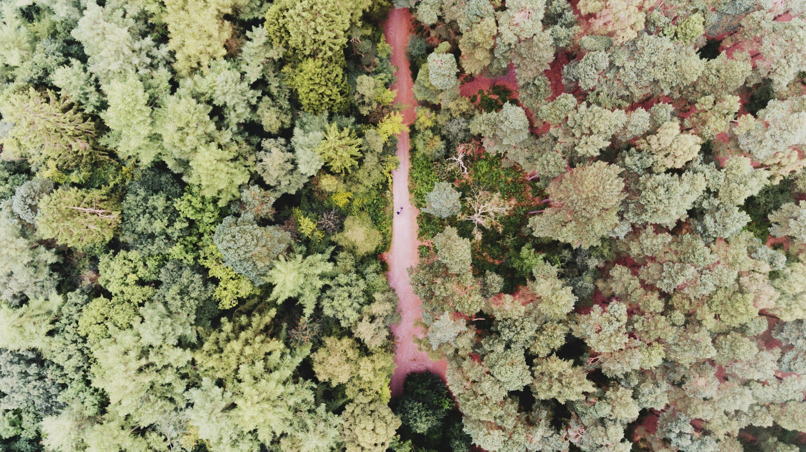
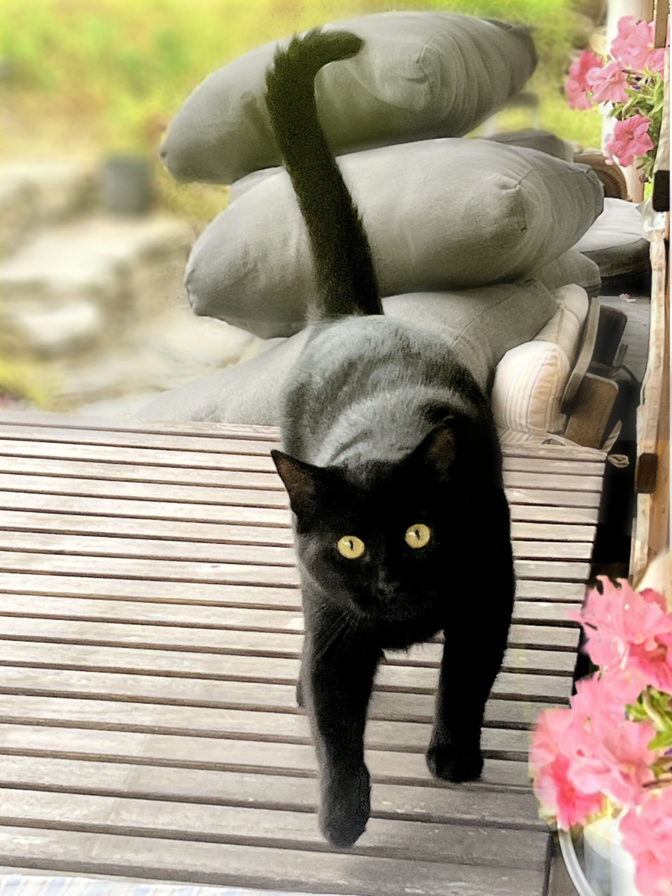
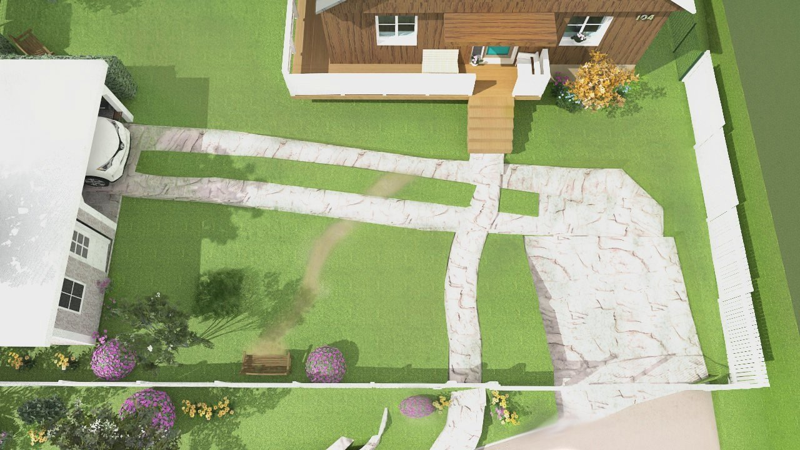
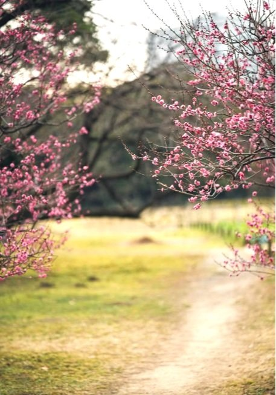
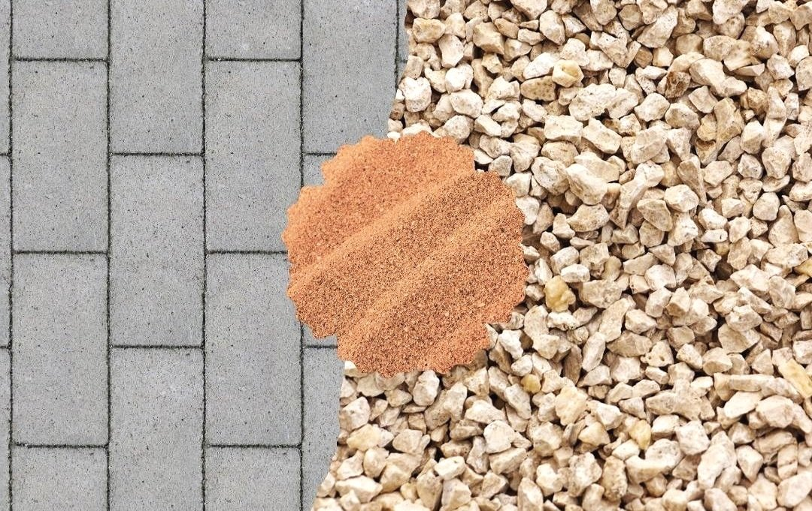
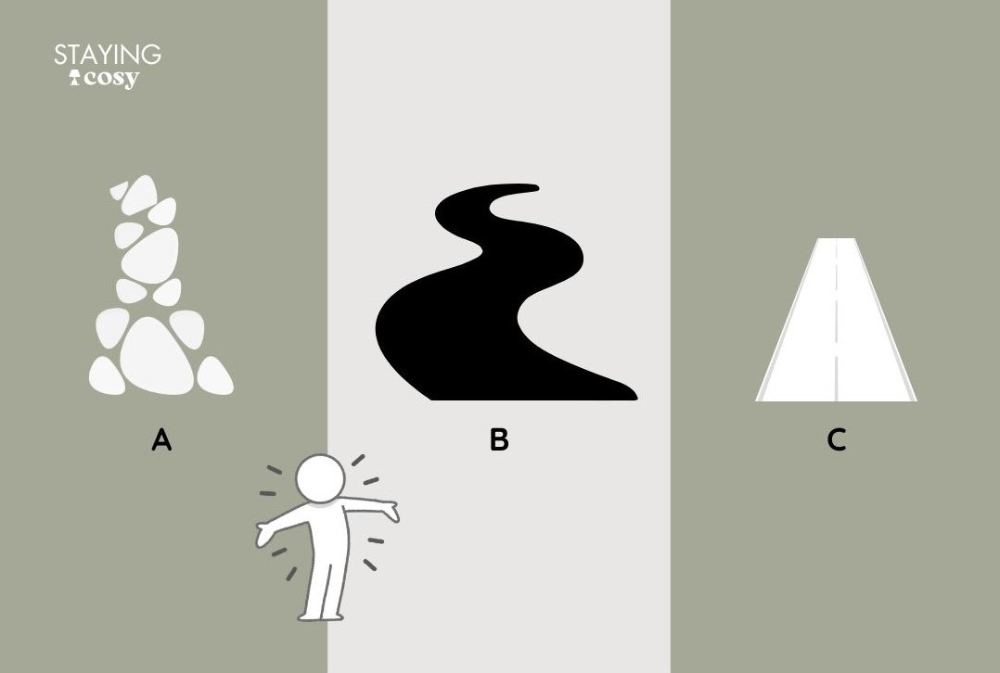
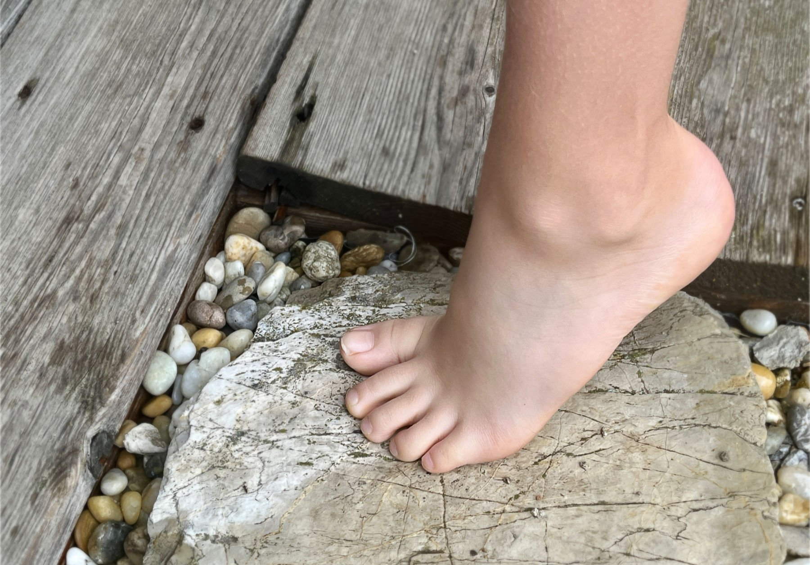

*We intuitively create paths whenever we choose to step off the paved road—not to rebel, but just because it feels right. I love how they reveal something honest about us. We don’t always follow the rules—we follow our instincts, our rhythm… or maybe just the sun on the quickest way home.*

<Caption>
Image credit: [Rog Shafi](https://unsplash.com/@rogshafi) on [Unsplash](https://unsplash.com/@rogshafi)
</Caption>

Our house happens to sit right along the way favoured by our neighbourhood cats. Every day they carefully cut across our garden, on their way from the street to the open fields beyond. There’s no visible path, no worn track through the grass, but I see them take the same line again and again. Their trail is invisible, yet clearly there.

Just like those cats we shape our surroundings all the time, often without noticing. Whether it’s the shortcut we take when we’re running late for the bus, or the way we gravitate toward the shade of a big oak tree on a hot summer day… *our choices leave a mark.*

<Caption>
Funny how something so small can say so much about the natural flow of life
</Caption>

*Image credit: Staying Cosy*

We think we’re all logic and reason, but honestly, it’s often our instincts *and feelings* calling the shots. That goes for the paths we walk, as well as the ones we take in life.

And whoever came up with the term *“desire path”* really nailed it. It says so much in just two words—about our craving for ease and comfort, for the path that just *feels right* underfoot.

## So, What Is a Desire Path?

I am going to answer with a counter-question:

> “Why do we take that worn dirty trail when there’s a brand-new concrete walkway just a few metres away?”

Logically, we should choose the paved path. It’s clean, tidy, thoughtfully designed, laid with sleek tiles and engineered for smooth walking. Surely it’s the *better option* for our feet. And yet… we drift toward that little field-like track without much thought, as if pulled by something invisible and deeply instinctive.

A kind of unspoken longing. A desire.

<Caption>
Image credit: Staying Cosy
</Caption>

And that’s what a desire path is. Our natural human foot traffic.

It shows us where people actually *want* to walk, not just where they’re *told* to. Over time, repeated use carves a visible track into the ground, inviting more feet to follow. Before long, it becomes a part of the landscape itself.

You’ll find them everywhere: in city parks and public gardens, across school lawns, on hiking trails, and in open fields where official paths never quite align with where people *want* to go.

☘︎ **The Psychology Behind Desire Paths**

*We’re wired to seek what’s direct, simple, and intuitive. We’re drawn to shortcuts that save time and effort. But there’s more to it than efficiency. There's comfort, too. Hard, flat pavement isn’t what our bodies evolved to walk on. A worn-in track of grass or soft dirt actually engages our feet in a healthier, more dynamic way.*

We’re also drawn to what pleases the eye and calms the mind. Would you rather walk along a dusty roadside or a cherry tree-lined path bursting with blossoms? The desire path wins again—not just for its ease and logic, but for *beauty.*

### A Path of Choice And its Gentle Rebellion

Sometimes, a desire path isn’t only natural — but can be a little intentional.

It’s what happens when people quietly push back against a rule, a system, or a plan that doesn’t make sense to them. When we step off the approved route and walk our own way, we express something powerful: *that choice matters*. That movement is a kind of freedom.

In these cases, *“desire”* might not be the most fitting word. Maybe what we’re really seeing here is a *“path of choice.”*

It’s a reminder that we’re not just passive travellers—we're shaping the world with every step we take.

<Caption>
Would you rather walk along a concreted road or a cherry tree-lined path bursting with blossoms?
</Caption>

*Photo by* [*Szymon Shields*](https://unsplash.com/@shields_mcmxcix?utm_content=creditCopyText&utm_medium=referral&utm_source=unsplash) *on* [*Unsplash*](https://unsplash.com/photos/a-dirt-road-surrounded-by-trees-with-pink-flowers-lnXHs8BXzwU?utm_content=creditCopyText&utm_medium=referral&utm_source=unsplash)

## Nature Finds Its Way

A few years back I noticed a narrow little track forming near my daughter’s school — just a dirt path through the edge of a grassy area beside a nearby apartment block. It didn’t look like much, just the mark of dozens of feet cutting through a patch of green. But it quickly became the route of choice for school kids heading to and from the bus stop. Naturally, it was the shortest way.

The residents of the building weren’t too thrilled. They wanted that strip of grass to stay untouched. They put up signs and taped off the path, trying to stop people from walking through. And eventually… it worked. They planted some shrubs there to create a physical barrier. The footsteps stopped, the greenery crept back. The desire path disappeared.

It was just a few metres’ difference, but there was something about it — *quieter, softer, a little more pleasant.*

### They Are Uneven

Natural paths often feel better underfoot. Their uneven texture warms differently, grips better, and is far gentler on our spine than flat concrete. Our feet are made for variety like stone or gravel, not to be cushioned and boxed in inside of shoes. It’s one of the reasons I like to mix floor textures in our home, too. Letting the body feel its way—even indoors.

<Caption>
Image credit: Canva - edited
</Caption>

Kids almost always prefer walking barefoot over wearing slippers. Mine are no different. Having surfaces that shape, grip and challenge are a perfect backdrop for their feet development.

When we’re out and about, we all try to wear barefoot shoes, or at the very least, something with a roomy toe box. I stray now and then, some occasions still call for something a little more polished, but for the most part, we try to stay pretty grounded.

### They Are Often Curvy

In Feng Shui, curved paths are thought to soften energy and slow things down. They offer a little pause in our every day rush. I love how that idea fits so well with desire paths. While some do go straight from A to B, many of them don’t stick to perfect lines or angles.

A lot of the ones I’ve noticed over the years gently veer off course, maybe because of a slope, a tree, or a patch of wildflowers blooming just off to the side. What starts as a shortcut often turns into a soft bend or a diagonal trail, shaped by what’s around it.

<Caption>
Graphic: Staying Cosy - made in Canva
</Caption>

Isn’t that beautiful?

Even when we’re in a hurry, we naturally adjust to our surroundings. Our steps respond to the landscape. And in return, the land quietly records those moments—*our little traces in time.*

## Should We Build New Paths in Their Place?

Near our busy local bus station, there’s a curious sight: two freshly built asphalt walkways and right alongside them, a large, well-worn desire path. One of the official routes hugs the riverbank, which makes sense. But the other? It misses the mark entirely. The desire path cuts straight across the open space in a far more intuitive way. I can’t help but wonder:

> “When people repeatedly walk the same line through a landscape, they are usually showing us where the path should have been all along.”

Why not make it official? If they have worn a path into the ground, chances are they’re not going to switch just because a new paved side-walk pops up a few metres away.

The desire path will simply remain — just as muddy, and just as used.

### Where our footsteps lead us

They may look like shortcuts, but these beaten trails tell a bigger story. They’re full of clues. About how we move, what we need, and how we connect with the outdoors in general. Desire paths gently challenge the top-down way cities are usually designed. They encourage urban planners to listen to the actual needs of communities.

Rather than viewing them as problems to correct, we could treat them as blueprints—an invitation to create cities and open spaces that feel better and more intuitive. They are a kind whisper from the ground saying: *Hey, this is what works.*

After all, paths that follow our instincts are often the most sustainable and the most loved.

<Caption>
Image credit: Staying Cosy
</Caption>

### Following the flow

Even in our own garden, where there are no set tracks yet, I’ve started paying close attention. We naturally drift from the terrace to the shed, or over to the trees and compost bins, while the kids zigzag between the swings, the veggie patch, and whatever corner feels most exciting that day.

Just like those neighbourhood cats who cut through daily on their way to the fields—there’s an unspoken flow happening here.

Over time, I’ve noticed very faint lines appearing in the grass. Little by little, they’re showing me where paths *want* to be. And when we do get around to laying stone or gravel, I’ve made a quiet promise to honour those steps we’ve already taken.

### Sometimes the best way forward is already under our feet

Next time you're taking a stroll, notice the delicate foot trails carving through parks, shortcuts across gardens, or that familiar line winding behind a row of benches. There’s an understated beauty in the way these paths are formed.

And maybe—just maybe, the best paths are the ones we never planned at all.

---

---

---
