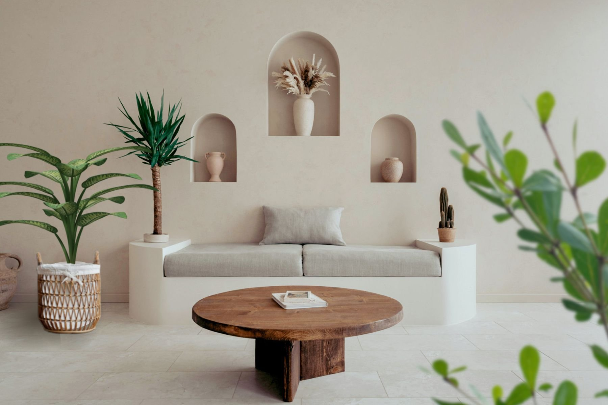
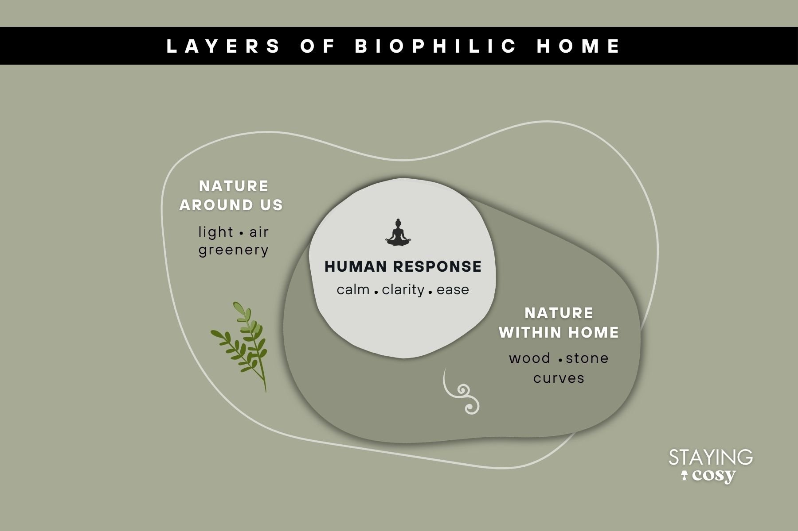
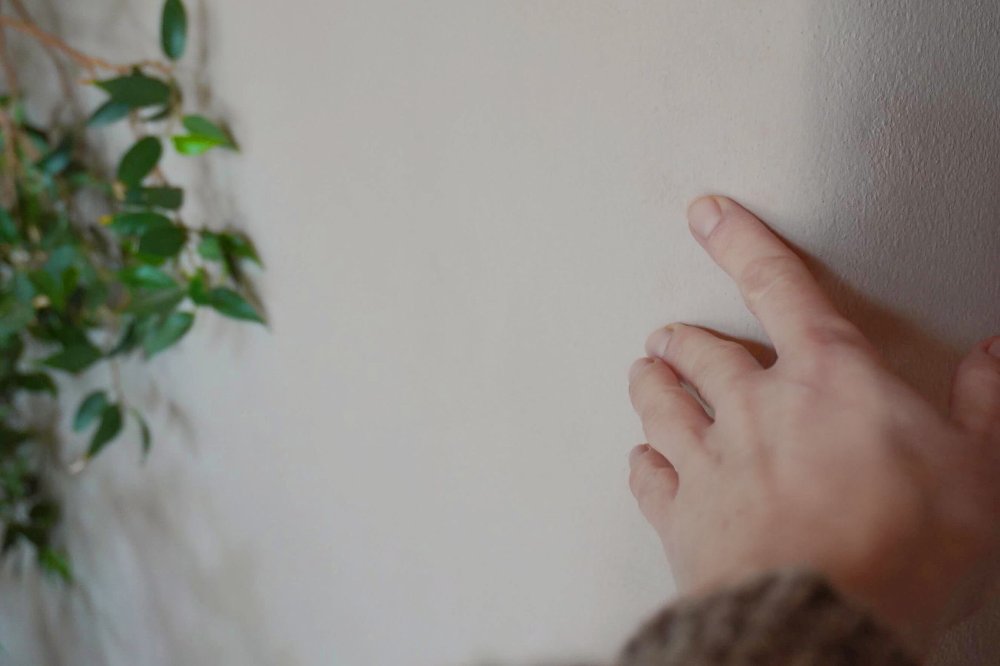
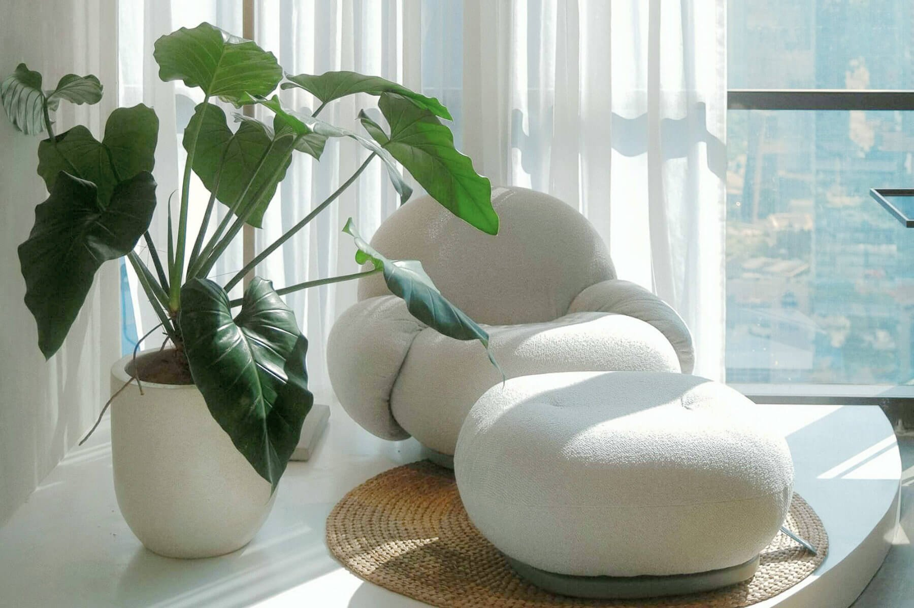
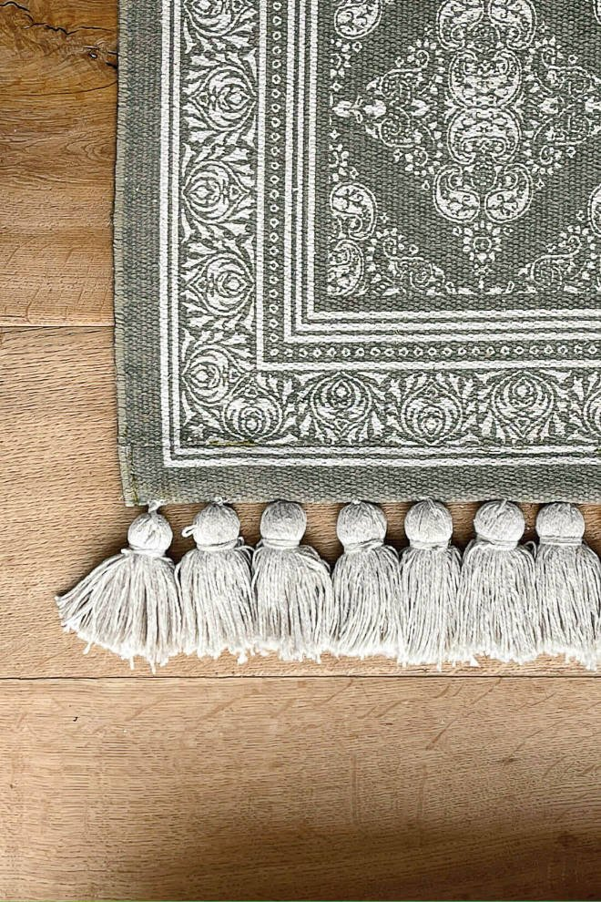
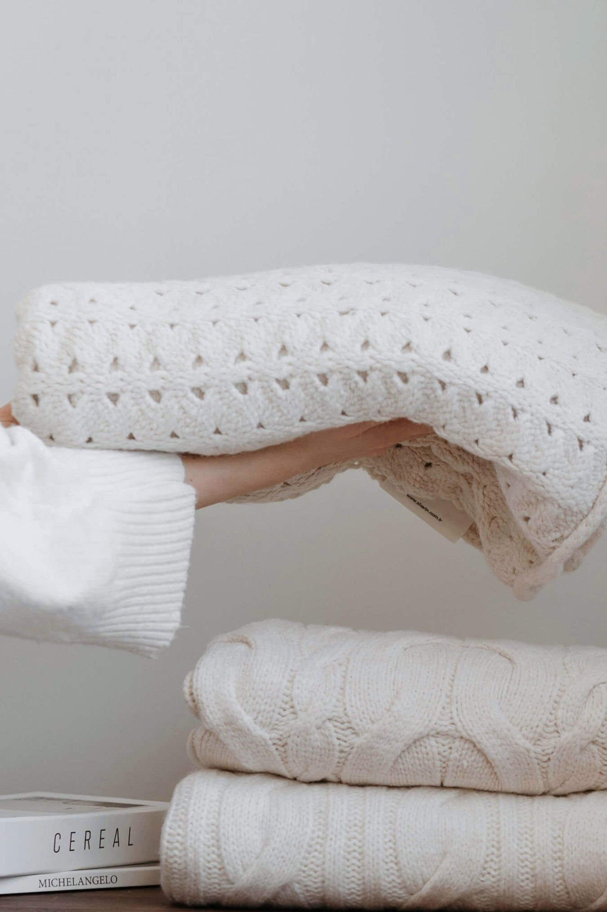
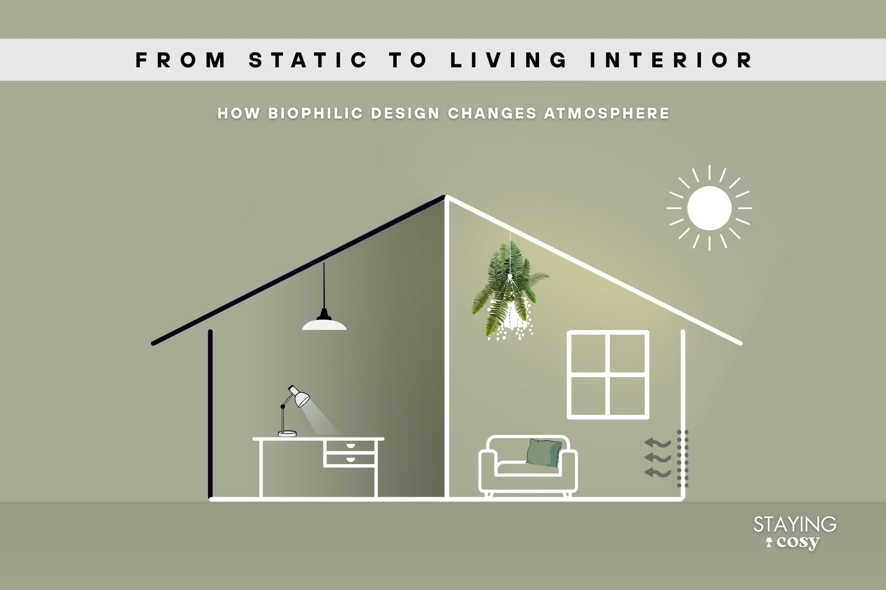

*Have you ever visited an old friend and found yourself never wanting to leave? Their home just feels so pleasant, so comfortable… just right. It’s hard to put your finger on why. Maybe it’s the way the light hits the floor, or how the rooms seem to flow into the garden. You don't feel like a guest; you feel like you belong there.*

<Caption>
Image credit: [Andre Portolesi](https://unsplash.com/@andreportolesi?utm_source=unsplash&utm_medium=referral&utm_content=creditCopyText) on [Unsplash](https://unsplash.com/photos/a-living-room-with-a-couch-and-a-table-AMIqdp54tJA?utm_source=unsplash&utm_medium=referral&utm_content=creditCopyText) - edited
</Caption>

For a long time, we’ve treated home design like a math equation, aiming for total control. We obsessed over clean lines, perfect finishes, and keeping everything *just so*. But while those spaces look great, they can feel a little cold and distant in real life. It’s as if the most important ingredient was left out.

We’re finally coming back to a simpler truth: our bodies know what we need. We don't want to live in a static box; we feel better in spaces that breathe and evolve alongside us. We are naturally drawn to environments that feel alive.

This is **the heart of biophilic design**. It leans into our connection to the natural world outside. Light moves through the day, materials soften and age, and the space slowly becomes something we build a relationship with, rather than just a passive back drop to our lives.

## Home as a Biophilic Ecosystem — Not Just a Fancy Greenhouse

<Caption>
Graphic: Staying Cosy — made in Canva
</Caption>

Biophilic design is often mistaken for buying a bunch of houseplants and hoping for the best. *I know we do love a good fern*, but in reality, it means creating a home that talks to your senses. Think less about decorating and more about building a space that restores your brain after a long day. It usually boils down to three key experiences:

**1. The Direct Experience — I can see & touch**\
This is the most obvious one. It’s the feeling of a breeze on your skin or having actual greenery in your line of sight. It’s the simple reminder that you’re living in a breathing ecosystem, not a sealed plastic box.

**2. The Indirect Experience — The vibe layer**\
This one is subtler. It’s found in patterns that mimic nature, think soft organic curves rather than harsh clinical angles, or the texture of raw stone, leather and wood that ages gracefully — showing its life story rather than hiding it. These cues hit us on a subconscious level, tricking our brains into relaxing even when we’re stuck indoors.

**3. The Experience of Space — Refuge & prospect**\
This taps into our ancient psychology. As humans, we have a weirdly specific desire for prospect and refuge. Translation? We want a cosy, cocooning corner where we feel safe, but with a clear view of the world outside. Think of a window seat or a sheltered nook. It’s that reassuring *I’m safe in my den* feeling.

Some homes go all-out with indoor waterfalls and living walls, while others play it cool with textures and smart layouts. The best spaces? They mix all three. They create a rhythm that lets your nervous system wind down effortlessly.

And no, it’s not just *woo-woo design magic.* There’s real science behind that *ahhh* moment you feel in a great room. Studies show that having natural patterns around can [drop your cortisol levels by about 20%](https://pmc.ncbi.nlm.nih.gov/articles/PMC6458297/). It turns out, looking at a tree is basically a biological delete button for stress.

> “Biophilic interiors aren’t just pleasant — they’re a prescription for a healthier life.”

### Spaces That Connect Us to Nature

The real world outside is anything but boring. No two flowers are identical, and no river follows the exact same path twice. Your home shouldn't be any different. Forget the idea of a house as a finished product you just buy and consume. A real home evolves like the seasons, responding to everything you do.

Think about something as simple as taking a shower. You’re raising the moisture levels, and the house has to adapt — whether through a vent or a cracked window. That’s exactly how an ecosystem works. Biophilic design just helps that process happen more naturally, without you having to micromanage every breath your house takes. And it’s not limited only to what’s happening inside.

**Biophilic design doesn't stop at your front door.** It carries on beyond the four walls. The street you walk down, the tree-lined avenue nearby, or even that one neighbour’s over-the-top balcony garden; they all count. These bits of urban greenery reinforce those same feel-good instincts as a sunlit nook inside your living room.

Let’s be honest. The cookie-cutter urban planning of the last century hasn't done us many favours. Giant, uniform blocks and clinical high-rises can feel a bit... *soul-crushing*. They keep us distant from each other and the earth. We’re finally craving that natural touch again — not just for the look, but for our own sanity.

While we can’t all live in the middle of a forest, a thoughtful biophilic interior helps satisfy that deep-seated hunger for nature. How? By turning the very walls of your home into a living envelope.

### The Living Walls & Surfaces

<Caption>
Image credit: Staying Cosy
</Caption>

The largest parts of your home, the walls, floors, and ceilings, do a lot more than just hold up the roof. They have a healing potential. While moss walls have become a bit of a design cliché, the idea behind them is solid: creating surfaces that purify the air and regulate your indoor climate.

You don’t need a literal jungle on your wall to get these benefits. It’s much simpler, and easier to maintain, if you choose porous, natural materials like:

- Oil-treated wood for cladding or flooring.
- Clay or lime plaster walls that *breathe* with the humidity.
- Cellulose or wood-fibre insulation that keeps walls breathable without the chemicals.

**The Miniature Cloud Effect**\
In our own home, most of our large surfaces are raw wood or clay plaster, and the difference isn’t just psychological — it’s tangible. The air feels balanced, fresh, and naturally cool. Think of it like creating *miniature clouds* inside your home; these materials replicate nature’s own cycle of evaporation and airflow. These massive surfaces have a bigger impact on your daily well-being than all your furniture, plants, and decor combined.

**Why Should You Care?**\
Let’s face it. Our modern lives are kind of an assault on the senses. We’re bombarded by blue light from screens, breathing indoor air that’s often stale, and walking on hard, flat surfaces that, while easy to mop, aren't doing our spines any favours. These tiny everyday stresses add up.

Your home shouldn't be another source of stress; it should be the place that helps you find your balance again. By choosing a living envelope, you’re not only decorating, you’re building a restorative interior eco-system.

## Home is Felt, Not Just Seen

<Caption>
Image credit: [David Kristianto](https://unsplash.com/@davidkristianto?utm_source=unsplash&utm_medium=referral&utm_content=creditCopyText) on [Unsplash](https://unsplash.com/photos/cozy-corner-with-a-lamp-plant-and-chair-nH1ZL83VuLs?utm_source=unsplash&utm_medium=referral&utm_content=creditCopyText)‍ ‍
</Caption>

We’ve all been there. Scrolling through perfectly styled rooms on Pinterest, where colours and objects are placed beautifully together. Isn’t that what good design is supposed to be about?

Not quite. While design starts with the eyes, we experience it in different ways. Take a chair, for example. Sure, we want it to look stunning, but if it feels like sitting on a pile of bricks, good design stops right there. We want it to support our spine. We want the armrests to feel smooth under our palms and the fabric to be soft and easy to maintain.

**The Shift to Sensory Design**\
Truly great design is something you feel and experience through all your senses. It’s as practical as it is beautiful. And when you bring biophilic thinking into the mix, it goes a step further. Your home stops being a static backdrop and starts to *nurture* you, readily responding to what your body and mind need to feel restored.

### Sight — Harnessing Natural Light & Organic Patterns

Let’s start with the obvious: the power of greenery. Is there anything more instantly calming to look at? It’s no surprise that plants and the muted, earthy colours of nature are so versatile. They fit into almost any interior style, playing nicely with patterns, textiles, and natural materials. It’s a bit of a design cheat code, nature is biophilic by default, so it always looks right.

**The Rhythm of the Sun**\
Aligning your home with the sun’s natural schedule certainly helps your fiddle-leaf fig thrive, but most importantly it has a huge impact on your own biology. When you let natural light lead, colours look more vivid, and your body starts to sync up with its own internal clock, called circadian rhythm. Light does so much more than just help us see where we're walking; it’s the master switch for our energy, mood, and our sleep.

Designing lighting with the circadian rhythm in mind is a game changer. It keeps you alert and focused during the day and helps you drift off at night. If you’re ready to master your home’s glow, [my full lighting guide](/blog/interior-lighting-guide) dives much deeper into how to get it just right.

- **To unwind:** Pair soft, low-level light with rounded, organic furniture. It’s like a visual hush for your nervous system after a chaotic day.
- **To re-energise:** Use vivid bursts of colour, like a vase of red tulips and a bright focused or overhead lighting. These little hits of natural beauty gently awaken the senses.

> “Structuring your light to be soft in the morning, bright at midday, and warm in the evening subtly guides your internal clock and supports your body and mood.”

### Touch — Tactile Materials & Authentic Surfaces

<Caption>
Image credit: Staying Cosy
</Caption>

Nothing defines a biophilic interior more than honest, [tactile surfaces](/blog/natural-materials-around-my-home). Raw wood, stone, leather, or terracotta age gracefully, carrying the story of our lives within their texture. Small scratches, dents, or marks don’t diminish these materials; they add character, reflecting our human imperfections in an authentic way.

Take the hand-woven cotton runner along our kitchen island. Its geometric pattern is pleasing to the eye, but the experience comes through touch. Our feet feel the warmth and texture underfoot, and the thick tassels at the ends provide a gentle stimulation that’s there without being intrusive.

These materials are genuine — *what you see is what you get*, *and what you touch is what you feel.* Wood is wood, not a melamine sticker. Marble is marble, not a washable wallpaper.

### Sound — Creating a Healing Acoustic Landscape

The soundscape is one of the most immersive parts of a home. I tend to hear every subtle vibration, from low hums to high-pitched buzzes, and even the faintest background tones change how I feel. These acoustic cues get usually unnoticed. Yet they are powerful tools to counter the digital fatigue we face daily. The chirping of birds through an open window, the soft rustle of leaves, or the steady, gentle hum of a breeze can restore harmony instantly.

Hard, echoing surfaces, on the other hand, create a sense of tension and restlessness. Softer acoustics achieved through textiles, uneven ceilings, or cushioned flooring give our ears a place to rest. We aren't aiming for total silence, but for a subtle, layered soundscape. Imagine the difference between a dinner table conversation that feels clear and intimate, rather than one competing with a sharp echo or a blaring TV.

In a home attuned to sound, even ordinary moments like the whistle of a kettle feel more balanced.

### Airflow — Breathing Life Into Your Home

[Fresh air](/blog/fresh-air-in-home) is easy to overlook because we can’t see it, but we certainly can’t live without it.

One of the simplest ways to bring fresh oxygen indoors is through a daily cross-breeze. Opening windows on opposite sides of a room pushes stale air out and invites crisp air back in. Even a few minutes in the morning or evening can noticeably refresh a space and re-energise the atmosphere. This natural airflow is one of the most understated foundations of a healthy home.

Scent follows naturally, enriching the air as the seasons shift. I’m not talking about artificial perfumes or heavy diffusers, but the familiar aromas carried by the breeze and natural materials. There is the smell of rain drifting in through an open window, the scent of freshly cut grass, herbs on a kitchen windowsill, or linen drying in the sun.

### Temperature — Thermal Comfort & Bodily Harmony

<Caption>
Image credit: [Isa A Ozalp](https://unsplash.com/@isaozalp) on [Unsplash](https://unsplash.com/photos/a-person-holding-a-blanket-over-a-stack-of-blankets-Rol70Qs1zrs)
</Caption>

Just like fresh air, a comfortable temperature is the ultimate comfort. We tend to take it for granted today, regulating it with a quick tap on a screen, but it hasn't always been so effortless.

In medieval castles, those large woven tapestries weren't just for decoration. They were hung on stone walls as insulation, acting like soft blankets to hold warmth inside and make vast, cold rooms habitable. They are an early example of layering for warmth, and the principle still works. Soft, textile layers, like thick wool rug, heavy curtains, or upholstered furniture, help stabilise your indoor climate. A simple addition of a wall-to-wall carpet can raise the perceived temperature of a room by up to 2°C (around 3–4°F), making it feel much more welcoming underfoot.

Temperature in a biophilic home is closely tied to how a space absorbs and releases heat.

- **The daily cycle:** Think of sunlight warming a floor during the afternoon or cooler air moving through in the evening. These small shifts are deeply felt by our bodies.
- **Temperature zoning:** We naturally feel better when our bedrooms are a bit cooler for rest, while our living spaces stay warmer for relaxation.
- **Radiant heat:** Whenever possible, choose radiant heat. It mimics the sun’s warmth, feeling more natural and less forced than blowing hot air around a room.

<Caption>
Graphic: Staying Cosy — made in Canva
</Caption>

## How Biophilic and Holistic Home Overlap

Both biophilic design and holistic principles aim to support our well-being, but they approach it from different angles. Think of biophilic design as our direct link to the wild, the light, the airflow, and the greenery that brings the outdoors in. Holistic design takes a wider lens. It’s about how every corner of your home connects to create emotional harmony and simplify your daily habits.

> “Biophilic design brings nature into the room; a holistic approach weaves it into daily life.”

In short, biophilia is the nature-focused, sensory heart of a holistic home.

**The Practical Overlap**\
In a living home, these two concepts are constantly shaking hands. A kitchen herb garden, for example, is a classic biophilic touch, but it also fuels the [holistic ritual](/blog/holistic-interior-design-guide-101) of mindful, healthy cooking. Similarly, using raw timber or limewash connects us to the earth while providing the sensory grounding we need to feel *at home*. Even the way we track the sun through our windows supports our biological clock, while creating the perfect mood for a morning coffee or an afternoon wind-down.

In our own house, the main living area is surrounded by greenery and bathed in low western sunlight. This isn't just a design choice; it’s the holistic heart of our home. Over time, this corner has become our natural place to decompress. We have a thick wool rug there that regulates warmth, but it also dampens noise and creates a dedicated zone for our family game nights. Everything is holistically interconnected.

## Beyond the Potted Plant —Bringing Nature Home

Ideally, biophilic design isn’t something we add at the end; it’s where we begin. That said, I know life doesn’t always allow for that. Whether you rent, move frequently, or are just starting to rethink your home, even small, thoughtful steps make a difference.

When biophilic elements are added as an afterthought, it’s **easy to fall into a few traps**. Too many plants can create visual clutter rather than calm. Instead, focusing on a few purposeful, [air-purifying plants](/blog/air-purifying-plants) keeps the space intentional. And while faux materials may resemble nature, they don’t offer the same biological benefits. In this case, less really is more.

A dark room with a few natural accents won’t magically bring in the sun, and a sealed home without airflow will always feel stagnant. The secret is simplicity: introduce one element at a time, see how it works, and grow from there.

**☘︎ *Simple Ways to Root Your Home in Nature***

- Open windows daily to invite a fresh cross-breeze.
- Let the light move — try not to block its natural path through the room.
- Choose materials that age naturally, rather than ones that imitate.
- Introduce one living element at a time — a single plant, a wooden desk.
- Soften the edges with textiles or uneven surfaces to help the room *sound* better.

We are, essentially, part of nature. Just like the stones, plants, and animals outside our doors, our bodies crave a connection to the world that made us. While we’ve learned to value the comfort and control of our modern interiors, it’s time to rethink what a truly healthy home feels like. Nature isn’t a destination we visit; it’s a biological necessity we must bring indoors to support our well-being.

Even small, intentional touches can bridge the gap between our walls and the wild. With care, every interior can become a space that restores, calms, and delights.

It’s time to bring nature home.

---

**☘︎ Read more ideas about creating a healthy and nurturing home:**

*•* [*Holistic Interior 101 — Support Your Wellbeing Right in Your Living Room*](/blog/holistic-interior-design-guide-101)

*•* [*Do You Need an Instant Home Refresh?*](https://bluebird-hawk-as8j.squarespace.com/blog/10-ways-to-give-your-home-instant-refresh)

*•* [*Sensory Cleaning Tips Your House May be Asking For*](https://bluebird-hawk-as8j.squarespace.com/blog/eco-friendly-spring-cleaning-rituals)

SEARCH THE BLOG

