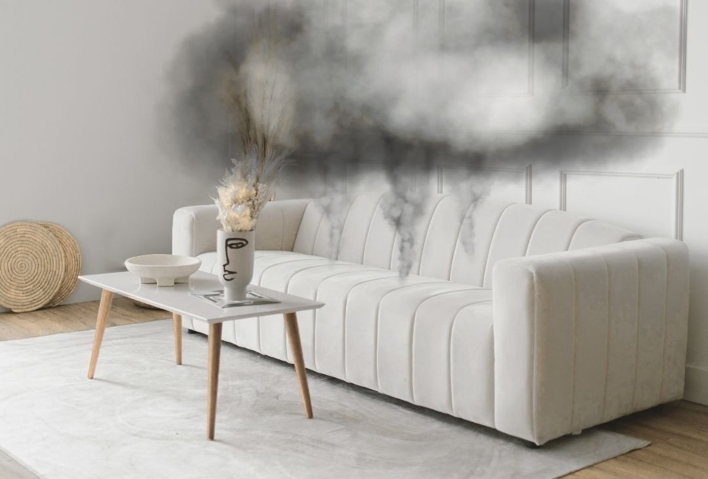
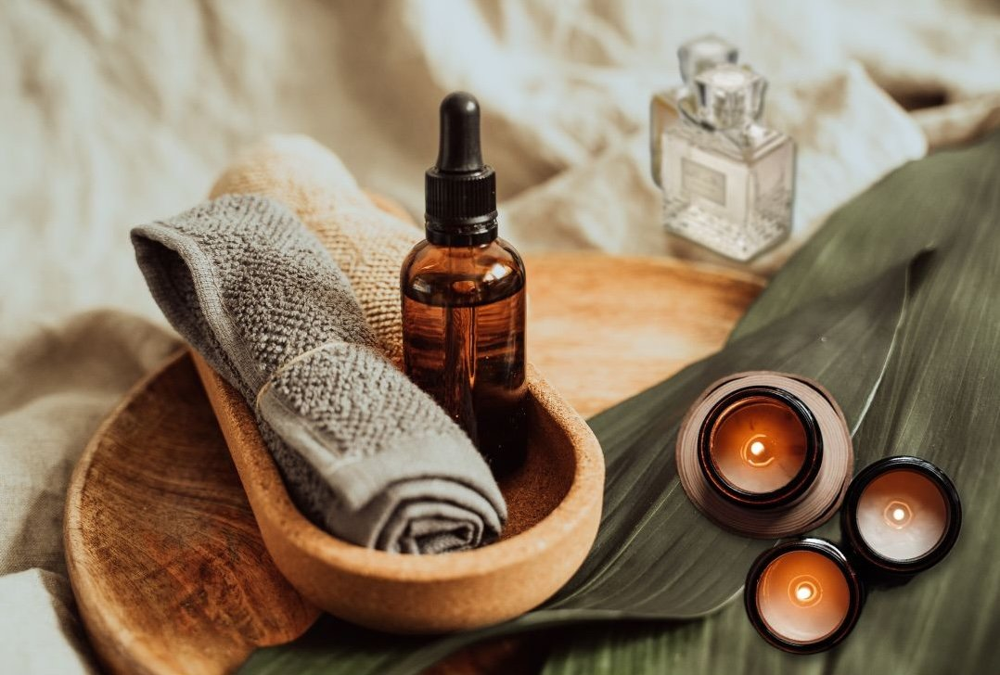
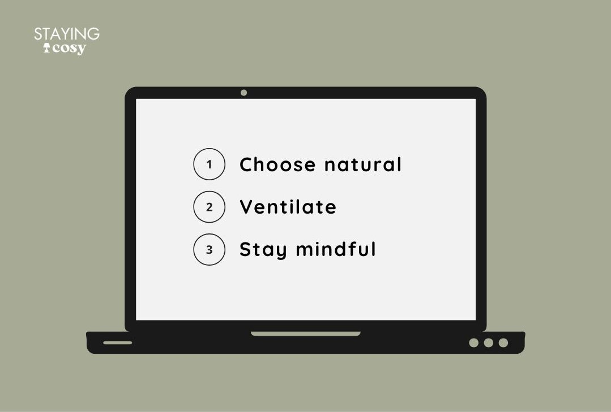

*We exercise, we force-feed our kids carrot sticks and spend far too much time debating the merits of eco-friendly dish soap. But how often do we stop to think about the air we are breathing? That crisp coat of fresh paint on the walls, that beautiful new sofa, do we really know what we brought into our homes? If you’re currently living in a state of blissful oblivion, consider this your red pill. Because sometimes, it’s the things we can't see that matter most.*

<Caption>
Image credit: Canva - edited
</Caption>

I’ll be completely honest with you, I slipped. Just after we moved into our house, we desperately needed to carpet the bedrooms. One room got a lovely, hand-me-down carpet from our neighbours. The other? A cheap, synthetic, quick-fix. The smell was awful. It lingered for days, heavy and distinctly chemical. We know better now, of course, but I learned firsthand that when you’re balancing a budget, avoiding the bad stuff is genuinely hard.

Which brings us to the invisible elephant in the room.

## Off-Gassing or What’s That Smell?

Essentially, off-gassing is caused by tiny, carbon-based molecules called **Volatile Organic Compounds** *(VOCs)*, that escape as gases from everyday solids and liquids. And look, they are pretty much everywhere. Ever unwrapped a new mattress or opened a fresh tin of varnish? That invisible cloud of sharp smell hanging in the air? Those are VOCs.

We breathe them in while doing our morning makeup, lounging on the sofa, or even prepping dinner. Fortunately, not all of them are toxic. But still, many are linked to respiratory irritation, hormone disruption, and long-term health issues. The real twist? Some are completely odourless.

You won’t even know they’re sitting in the room with you.

Home is meant to be our haven. Our place of comfort and rest. So it’s a little unsettling to realise that the space we’ve styled so intentionally might be quietly pulling us down. VOCs play a role in many of today’s puzzling chronic health issues — acting as the modern-day equivalent of Victorian lead-based paints or arsenic-laced wallpaper.

Some of these hidden toxins are easy to spot. Remember that sharp plastic tang of new electronics? Others feel deceptively elegant, like the rich amber scent of a luxury reed diffuser. You might get an immediate warning sign in a form of a headache or sudden congestion, but often, the effects simply accumulate over time.

The catch is that this chemical release doesn't just stop once that distinct initial scent fades. While the heaviest vapour escape peaks right after a product leaves the factory, low-level emissions can continue silently for months, or even years. That sofa or cabinet you bought two Christmases ago? It might still be releasing toxins right alongside you.

A bit of a psychological hurdle to clear, isn't it?

#### 💡 **Indoor Pollution by the Numbers**

- **Baseline:** Concentration levels of organic chemicals are routinely **2 to 10 times higher indoors** than outdoors.
- **Spikes:** During active floor laying, painting, or even uncapping a permanent marker, indoor levels can temporarily skyrocket to **1,000 times** outdoor baselines.
- **Regulation:** While the EU enforces stricter eco-regulations on chemical manufacturing, other global markets are still catching up.

Despite growing consumer awareness, the long-term cumulative effects of these chemical cocktails are still massively under-researched. Pressure is slowly mounting on manufacturers to swap out the worst offenders for cleaner alternatives, but for now, the responsibility sits squarely with us.

Which brings us directly to the furniture and home accessories we choose to surround ourselves with every day.

**The most common sources of VOCs at home are:**

- Furniture & upholstery
- Paints, varnishes & adhesives
- Gas stoves & fireplaces
- Household cleaners, air fresheners & candles
- Electronics & dry-cleaned clothing
- Cosmetics & personal care products
- Office & craft supplies

## Can Our Homes Make Us Sick? Furniture and Its Uninvited Guest — Formaldehyde

Here is the reality. Most modern furniture isn’t carved from solid timber anymore. Unless you’re investing in bespoke craftsmanship, what we’re usually buying is particleboard, MDF, or plywood.

<Caption>
Image credit: [Decry.Yae](https://unsplash.com/@dayee?utm_content=creditCopyText&utm_medium=referral&utm_source=unsplash) on [Unsplash](https://unsplash.com/photos/brown-and-white-striped-textile-Sf2NjUtuljs?utm_content=creditCopyText&utm_medium=referral&utm_source=unsplash)
</Caption>

It’s all bound together with industrial glues that frequently contain formaldehyde, a known human carcinogen sitting quietly in our flat-packs.

Even our mattresses carry a hidden load. Beyond the adhesives, the manufacturing process of standard polyurethane foam leaves behind traces of toluene and methylene chloride. It is not exactly what you want to rest your face against for eight hours every night.

But cheap and cheerful is tempting. And honestly, with today’s prices, fast furniture is often completely unavoidable. If you’re currently furnishing a space on a budget, please don’t be too hard on yourself. I’ve been there. You do have a few brilliant options:

- **Embrace the void:** If it isn't an absolute urgency, leave the room empty for a while. A little architectural breathing room feels incredibly grounding while you save for the right piece.
- **Hunt second-hand:** Quality, pre-loved timber furniture is a total steal, bursting with character, and critically — it already finished its high-intensity off-gassing years ago.
- **Start small:** Begin with just a few affordable basics and slowly upgrade to well-made, lasting pieces over time.

We did our own [living room transition](/blog/sustainable-living-room-makeover-on-a-budget) last year. We finally swapped out some of our early starter pieces in our main living area, mixing in a solid brass accent table, a handwoven raw wool rug, and a few mango wood coffee tables. It was a literal breath of fresh air. Completely free of synthetic chemical coatings, these raw, natural materials brought the kind of warmth and soul I’ve always craved in a home.

If you want to start your own healthy home transition, focus on the high-exposure zones first. Be it your bedroom, your living room, or your desk setup where you spend the most hours.

To make things easier, I prepared this quick-scan checklist for you.

<Caption>
Stay VOC free with my Low off-gassing home checklist | Graphic: Staying Cosy
</Caption>

And while I covered the essentials, a few mindful adjustments require a bit more nuance.

If you are already stuck with cheap particleboard pieces inside flat-pack wardrobes, you don't need to throw them out. You can easily reduce the chemical escape by sealing any exposed, raw edges with a low-VOC varnish.

For the bedroom, consider prioritising an organic cotton or natural latex mattress for your next major investment. After all, your nose rests directly against it for eight hours every single night.

And if you are tempted to fill your spaces with greenery to clean the air, remember that while [air-purifying plants](/blog/air-purifying-plants) bring immense emotional wellbeing and organic beauty to a room, their actual chemical filtering efficiency is quite limited. They are a lovely addition to a slow home, but they can't do the heavy lifting alone.

## Gas Stoves & Their Hidden Hazards — What’s Lurking in That Flame?

<Caption>
Image credit: Canva - edited
</Caption>

I grew up with gas hobs. We cooked everything on them, even our oven ran on gas. They were fast, efficient, and completely standard. So, when I first dug into the data on indoor air pollution, I was genuinely shocked to learn that unvented gas stoves are one of the biggest polluters in modern homes. It’s literally called *natural gas*, right? But the chemical reality of that blue flame is somewhat less pure.

When gas burns, it releases a mix of pollutants directly into your kitchen, including nitrogen dioxide, formaldehyde, and carbon monoxide. These aren't just abstract scientific terms. They are real respiratory irritants, particularly problematic for children's developing lungs.

Worse still, [recent studies](https://www.scientificamerican.com/article/the-health-risks-of-gas-stoves-explained/) show that gas stoves leak small amounts of unburned gas, specifically benzene, a known carcinogen, even when turned completely off. If you’ve ever felt slightly foggy or headachy after cooking a big meal in a closed kitchen, it might not just be the kitchen heat.

You don’t need to rip out your kitchen tomorrow, though. Changing your entire stove arrangement and cooking habits overnight isn’t realistic. Luckily, there are a few simple ways to reduce the risks while still enjoying your kitchen endeavours:

- **Use your extractor fan religiously:** Even if it’s loud or annoying, it makes a massive difference. Just ensure it actually vents outside rather than simply recirculating the air back into the room.
- **Crack open a window:** Make fresh air a non-negotiable ingredient. Try to ventilate during and after cooking, even in the colder winter months.
- **Cook with lids on:** It traps heat, so food cooks faster and at lower temperatures—saving fuel and reducing total emissions.
- **Deploy a portable purifier:** If you have one, position it near your kitchen boundary while you cook.

If you are planning a future renovation or an appliance upgrade, I highly recommend looking into induction or electric hobs. I’ve tried both, and especially induction is incredibly fast, both are effortless to clean, and best of all, they emit zero indoor toxins.

## The Weekend Project — Paints, Sealants & Hidden Vapours

<Caption>
Image credit: Canva - edited
</Caption>

VOCs don’t just live in big-ticket investments. They hide in the small tins and quick fixes too. That tiny can of paint left over from a weekend touch-up, the spray sealant used to fix a leak, or the industrial glue used to reattach a chair leg? They are all silent contributors to our indoor air load.

The trick here is scale and containment. The smaller the room, the more concentrated the impact. Cracking open a high-solvent tin of paint or varnish in a confined space, like a guest bathroom or a small nursery, allows chemical vapours to build up rapidly. And while that new paint smell can trigger a satisfying sense of productivity, it’s a toxic illusion. Creativity should always have the green light, but choosing our materials wisely can save us a lot of health issues.

If you’re tackling a DIY job around the house, a few simple boundaries keep your lungs clear:

- **Hunt for eco-labels:** Choose zero- or low-VOC paints and finishes backed by trusted independent bodies. Look for certifications like the EU Ecolabel or Blue Angel on the tin.
- **Take it outside:** Sand, spray, and varnish outdoors on a porch or in a garden whenever humanly possible.
- **Mask up intentionally:** Always wear a proper respirator mask when sanding old finishes or working with heavy-duty adhesives.
- **Give the room time to cure:** Give freshly painted spaces a few days to fully breathe with the windows wide open before you sleep or spend consecutive hours in them. Be extra cautious if you’re pregnant or have small kids.

## The Sensory Loophole — Fragrances and the Illusion of Clean

Don’t you just love that fresh feeling after a long, slow shower? Your skin is soft, your hair is wrapped in the clean scent of your favourite shampoo, and a beautiful candle is flickering on the counter. It’s pure, well-deserved evening of pampering. A bliss.

But hold on — let’s rewind a bit. The science tells a different story.

<Caption>
Image credit: Canva - edited
</Caption>

But if we look at the actual chemistry, that’s where the clean image ends. The word *Fragrance* or *Parfum* on a cosmetic or household label is legally considered a trade secret. Because of that regulatory loophole, a single word can represent a hidden cocktail of dozens, sometimes hundreds, of unlisted synthetic chemicals.

Many of these synthetic blends rely on phthalates, which are known endocrine disruptors. Others are petroleum-derived solvents. [Studies](https://pmc.ncbi.nlm.nih.gov/articles/PMC3018511/) show scented home products can emit over a hundred different VOCs, including already mentioned nasties like benzene and formaldehyde. They hide in cosmetics, laundry detergents, air fresheners, and even children's toys.

That wonderful holiday candle you got for Christmas? If it's formulated with paraffin wax, which is a petroleum byproduct, and synthetic perfumes. It releases toluene and benzene directly into your breathing zone as it burns. This is especially true during winter when our windows are tightly shut against the cold.

I am not suggesting you throw every luxury cosmetic and candle into the bin. I love my rituals too. But a few mindful, conscious swaps can make your apartment feel just as lovely without the hidden toxins:

- **Idiot-proof your choices with pure essential oils:** Look for products scented solely with steam-distilled essential oils rather than synthetic fragrance oils.
- **Swap your wax:** Switch out paraffin candles for clean-burning beeswax, soy, or coconut wax alternatives with unbleached cotton wicks.
- **Embrace ultrasonic diffusers:** A minimalist water diffuser with organic essential oils is a beautiful, safe way to scent a room. Just remember, less is more.
- **Scan with ingredient checker apps:** Use free tools like [Yuka](https://yuka.io/en/), [Think Dirty](https://www.thinkdirtyapp.com/?srsltid=AfmBOop-2bbOUfToSXMwITAn3Fwj-W7psixt13CRBL1rj-OFQ8DhWgbl), or [INCI Beauty](https://incibeauty.com/en) to scan barcodes while shopping. You’ll be surprised how many seemingly clean labels score poorly.

<Caption>
Image credit: Canva - edited
</Caption>

Even natural doesn't automatically mean safe or non-toxic. Trust your instincts. If a scent gives you a sudden headache, tightens your chest, or causes irritation, it's probably your body telling you it’s time for a gentler swap.

## Dry Cleaning, Gadgets… Wait, Even That Has VOCs?

By now, you’re probably starting to spot these invisible culprits everywhere. It’s a bit of a paranoia-inducing superpower, I know. But before we cross the finish line, there are a few final, completely mundane everyday things worth putting on your radar.

Starting with your dry cleaning. Traditional high-street dry cleaning relies on a pretty brutal chemical solvent called perchloroethylene. Or just *perc*, for short. It’s a potential carcinogen and a known nervous-system irritant, and it comes straight home clinging to your pristine coats. The fix? Dead simple. Just hang your freshly dry-cleaned pieces out on a covered porch, or balcony. If you live in a flat, put them in a well-ventilated room for a day or two before burying them in your wardrobe. Long-term, look for modern eco-cleaners using wet-cleaning or liquid CO₂ methods instead.

Then there is our daily tech. If you work from home, look closely at your setup. Laser printers, toners, and laminators release small amounts of ozone and VOCs whenever they print. Don’t squeeze your printer right next to your keyboard. Move it away, keep the room ventilated, and take regular outdoor breathing breaks.

New electronics do it too. Heavy plastic gadgets like TVs and computer monitors undergo high-temperature off-gassing from their internal flame retardants the first few weeks they run. Let them burn off in a highly ventilated room. And, weirdly enough, keep them dust-free. Dust particles act like tiny magnets, trapping and carrying those dropped-out chemical compounds straight into your path.

Finally, our creative hobbies. Resins, solvent-based glues, oil paints, and intense permanent markers are major chemical heavyweights. They are brilliant for the soul, but a nightmare for the lungs. Keep your crafts contained to open-air spaces or rooms with decent cross-ventilation. Mask up when needed, or switch to low-tox, water-based alternatives wherever you can.

## Striking the Mindful Balance

It’s a bit of a reality check, isn't it? It makes you wonder why we don't talk about [indoor air quality](/blog/fresh-air-in-home) with the same collective urgency we use for diet, skincare, or exercise.

We have two options here. We can either bury our heads in the sand, or face the reality with a bit of practical wit. I choose the latter.

<Caption>
Graphic: Staying Cosy - made in Canva
</Caption>

But look, that doesn't mean obsessing over every single molecule, panicking in your living room, or living in a sterile, clinical bubble. Not at all. For me personally, it’s about finding that sweet spot between mindful caution and everyday reason. I started using a minimalist [indoor air quality monitor](https://www.amazon.com/Airthings-2930-Quality-Detection-Dashboard/dp/B07JB8QWH6/ref=sr_1_2_sspa?crid=20GRWBGHDXIX6&dib=eyJ2IjoiMSJ9.fFzTJi2mrCyT1hfg7rPppHMfECB7lwAZbJ6Xt5KTAgwEItsCHxRwhRvwWn7GkX0MXeMMD1Ftx4yR7n0JeEtLRXy-yBh-Q5baJ4qFD3st00CRz2kpjGcgIngvnEa4xviBMYup1hIq8GrKXA9v1V-UBS_lX5ckEerIJU5DfuUnlPgZRvH07BkvCUcTlT6R5Q_X-8YF9wHyHwUELJyrMeGNvk8UIq4In6rM02P33xe7Dds.NM02hZv_jov-DuUpMvdE6bbGyml4tPEr6lX__zAuAVc&dib_tag=se&keywords=indoor%2Bair%2Bquality%2Bmonitor%2Bairthings&qid=1754055104&sprefix=indoor%2Bair%2Bquality%2Bmonitor%2Bairthing%2Caps%2C208&sr=8-2-spons&sp_csd=d2lkZ2V0TmFtZT1zcF9hdGY&th=1) at home, and seeing the real-time data takes away all the anxiety. It tells me exactly when to crack a window and when things are perfectly fine.

Even polar bears have microplastics in their systems now. We cannot escape the realities of our modern world completely. It is the only Earth we have. We can, however, choose to vote with our wallets and support businesses that are doing things right. When we cultivate a steady consumer demand for clean, honest materials, the toxic alternatives are forced to adapt. Or disappear entirely.

One mindful swap at a time. That’s it.

---

**☘︎ Curious about more home improvements? Read on:**

*•* [*Sound as The Missing Layer of Comfortable Home Design*](/blog/holistic-acoustic-home-design-guide)

*•* [*Interior Lighting Made Simple: Finding the Right Glow for Your Home*](/blog/interior-lighting-guide)

*•* [*What I Wish I’d Known Before Planning an Eco-Friendly House Build*](/blog/eco-friendly-building-guide-materials-principles)

SEARCH THE BLOG:

---

---
