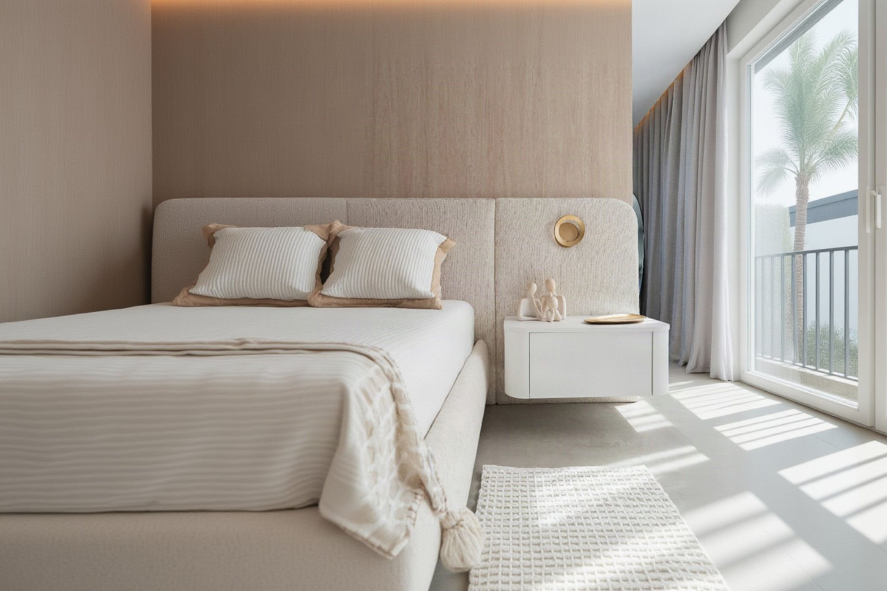
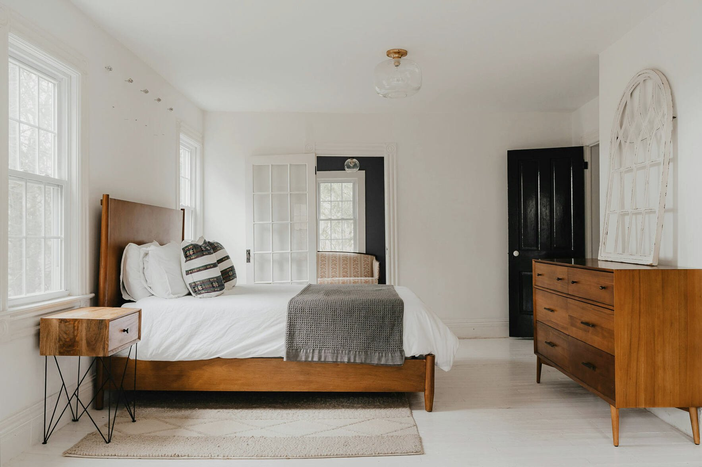
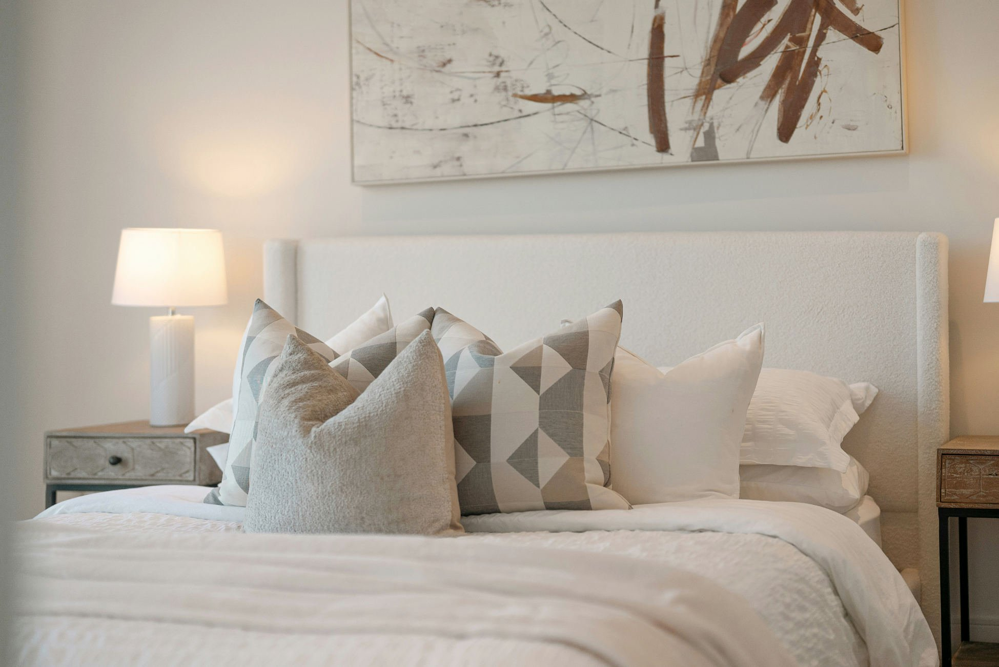
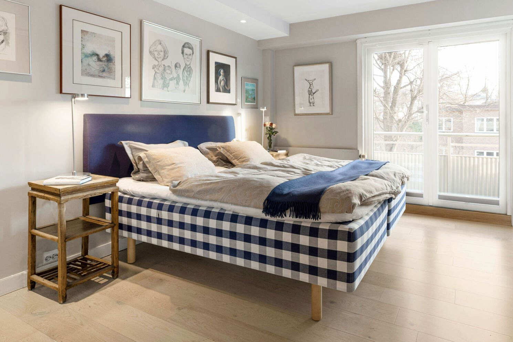
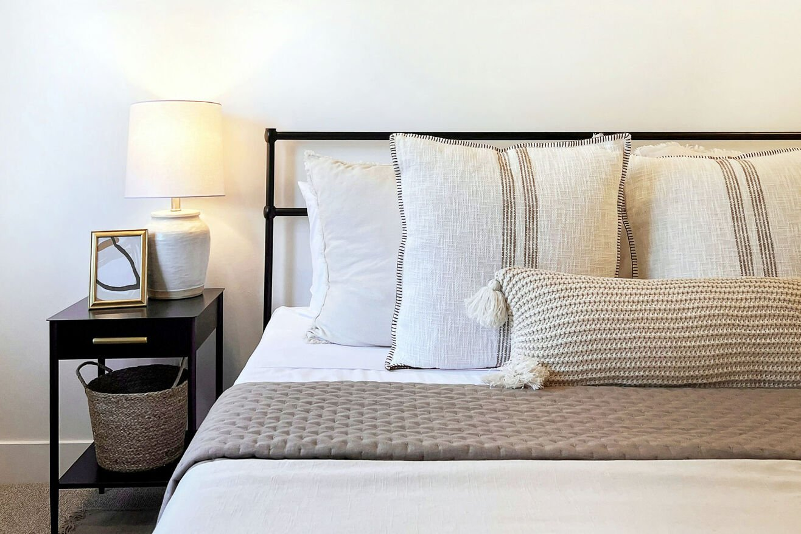
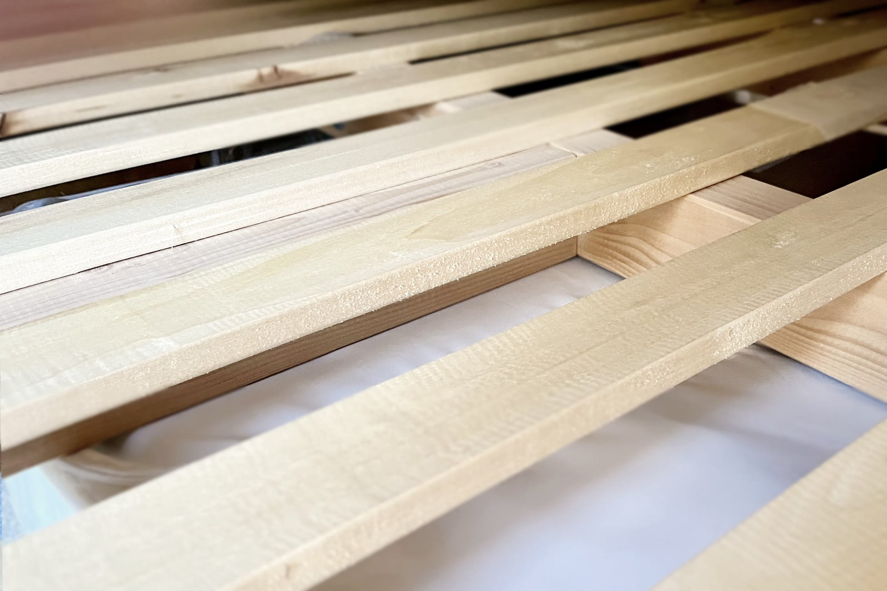

*In the twenty-third book of The Odyssey, Penelope tests her returned husband with a clever trick. She orders their bridal bed to be moved outside their bedchamber. Odysseus grows furious. He demands to know who could possibly move a piece of furniture he hand-carved himself, straight into the roots of an old olive tree anchoring the entire stone palace.*

<Caption>
Image credit: [Caroline Badran](https://unsplash.com/@___atmos?utm_source=unsplash&utm_medium=referral&utm_content=creditCopyText) on [Unsplash](https://unsplash.com/photos/modern-bedroom-with-beige-bed-and-floating-white-nightstand-E-z8iE6LSgg?utm_source=unsplash&utm_medium=referral&utm_content=creditCopyText)
</Caption>

It is the ultimate design metaphor. A bed shouldn’t be temporary flat-pack fodder. It is an immovable foundation of your life — and a good night rest.

But walk into almost any bedroom today and you see the exact opposite. Fast furniture has been slowly ruining us. We buy these flimsy composite frames that squeak within six months, wobble within a year, and crack within three. And honestly? When you calculate the emotional and financial drain of replacing your furniture every few winters, cheap becomes incredibly expensive.

Choosing a bed frame isn’t just a quick weekend styling exercise. You are investing in a structural pillar of your nightly rest. It needs to look brilliant, work with your room's layout, and most importantly, survive decades of actual sleeping without breaking your bank balance.

## Which Bed Frame to Pick? Wood, Metal, or Fabric?

First up, the core material. You hit a fork in the road almost immediately. Do you go for solid timber, a plush upholstered headboard, a minimal metal frame, or one of those heavy continental setups? Every material handles the daily physics of sleep completely differently.

Let's look at how they hold up over time.

### Solid Timber

<Caption>
Image credit: [Clay Banks](https://unsplash.com/@claybanks) on [Unsplush](https://unsplash.com/photos/a-bed-room-with-a-neatly-made-bed-and-a-dresser-BJc1mj3xgeE)
</Caption>

For me, this is the absolute gold standard. Wood is warm, naturally grounded, and, if the joinery is right, completely silent. Years ago, my husband and I decided to build our own bed frame out of solid pine. The first attempt was... a steep learning curve. But the second one? We still sleep in it today. More than ten years later, it hasn't given a single squeak, even when turning over in the dead of night. Traditional, solid joinery ages gracefully. It moves with the house.

It’s also why I always lean toward a completely uncompromised foundation, like the German-crafted [Noah Tomo Bed](https://noah-living.com/en/pages/bed-tomo) made from solid oak, or the tool-free, upcycled timber design of [Thuma Classic Bed](https://www.thuma.co/products/classic-bed?variant=40242991038569) if you are sourcing in the US. They come with their price tag, but it’s fully justified.

### Upholstered Frames

<Caption>
Photo by [Franco Debartolo](https://unsplash.com/@francotheshooter?utm_source=unsplash&utm_medium=referral&utm_content=creditCopyText) on [Unsplash](https://unsplash.com/photos/a-neatly-made-bed-with-decorative-pillows-and-artwork-8jqb9MYXjP0?utm_source=unsplash&utm_medium=referral&utm_content=creditCopyText)
</Caption>

I get why people love them. They look cushiony, and they’re incredibly forgiving when you want to lean back with a good book on a Sunday morning. But look past the gorgeous fabric for a second.

The mass-market reality is pretty grim. Most mainstream upholstered beds are just cheap plywood frames wrapped in synthetic polyester, packed tight with petrochemical foam. On top of that, they’re drenched in chemical flame retardants. If your bed frame is constantly [off-gassing](/blog/chemicals-that-pollute-our-living-rooms) into your room while you sleep, your lungs are paying the price.

If you’re set on that soft, tactile look, you have to be stubborn about the ingredients. Demand natural latex padding, certified organic wool linings, and zero-VOC linens. Otherwise, it's a hard pass.

The [Naturalmat Budleigh Bed](https://naturalmat.co.uk/products/the-budleigh-bed) offers just that. Handcrafted in Devon, UK using a solid timber frame. They upholster it entirely with natural latex, organic coconut coir, and local organic wool. Plus their beautiful bouclé is a wool, cotton, linen blend. Zero nasty chemicals, just pure comfort. For the US choice, the [Medley Chloe Bed](https://medleyhome.com/products/chloe-bed-in-natural-latex) in natural latex is a beautiful, clean mid-century aesthetic. Its upholstered headboard is made with certified needled wool and cotton over formaldehyde-free solid timber or plywood.

### Continental Beds

<Caption>
Photo by [Lisa Anna](https://unsplash.com/@lisaanna195?utm_source=unsplash&utm_medium=referral&utm_content=creditCopyText) on [Unsplash](https://unsplash.com/photos/a-bedroom-with-a-large-bed-and-a-blue-headboard-VMG5JfLOLOo?utm_source=unsplash&utm_medium=referral&utm_content=creditCopyText)
</Caption>

These are those massive, multi-layered Scandinavian sleep systems. You might also come across the name — boxspring bed. You know that supreme, hotel-level luxury. They combine a sprung divan base, a thick pocket-sprung mattress, and a plush topper into one seamless tower of comfort.

We can’t argue, that they look magnificent in large, high-ceilinged architectural spaces. But let's be realistic. They will completely swallow a smaller minimalist bedroom\*\*.\*\* Be mindful of that when shopping, and make sure you have serious square footage ready for this kind of bed to breathe.

[Hästens Maranga](https://www.hastens.com/en/beds/maranga) is the absolute peak of continental design. Available worldwide and built with solid Swedish pine, horsehair, wool, and cotton layers, if offers unparalleled weight distribution. It’s an investment, but it’s built to last generations.

### Metal Beds

<Caption>
Image credit: [mk.s](https://unsplash.com/@mk__s) on [Unsplash](https://unsplash.com/photos/a-bed-with-a-basket-and-pillows-2KWq3Tai7DA)
</Caption>

Visually, they are wonderfully minimal. They keep a small bedroom feeling light, clean, and industrial. But there's a catch. Over time, metal threads loosen and bolt holes warp. Unless the engineering is absolutely flawless, a cheap metal frame is practically destined to become a squeaking nightmare within five winters.

Plus, and this is a big thing for me, they are cold to the touch. They lack that primal warmth our brains crave when we are trying to wind down. Of course, if you pad it nicely with a lot of cushions and high mattress, you can avoid touching the frame entirely. So if you’re in love with a sleek frame, there is always a way around.

If you go metal, this is how you do it. [Original Bed Co. Solomon](https://www.obc-uk.net/products/beds/iron/solomon?_gl=1*x0533p*_up*MQ..*_ga*NTY4MDYwMTg3LjE3OTQ4MjkxMDg.*_ga_ESYHQ1JPTG*czE3OTQ4MjkxMDQkbzEkZzAkdDE3OTQ4MjkxMDQkajYwJGwwJGgxMzY4MTI4NzM3) has heavy-duty, hand-welded joints rather than cheap screws. It is built like a tank and engineered to stay completely silent through decades of use. My best overseas pick with minimalist design goes to [Benicia Iron Works Hampshire Bed](https://www.beniciaironworks.com/product-page/hampshire-iron-bed-456-1106). Handcrafted in California it features straight lines accented with simple hand poured castings and is available in multiple toxin-free finishes. Clean lines, zero wobble, and an incredibly light footprint in a room.

## Ergonomics and the Broken Toe Rule

Don’t we all love a cute looking bed with a pile of fluffy pillows on top? Meanwhile, a soft cotton throw can be hiding a literal threat to your toes.

> “If you take only one practical rule away from this entire guide, let it be this: always choose a frame with recessed or tucked-in legs.”

Why? I learnt this the hard way. A few years back, I was rushing out of our bedroom in a typical morning frenzy. Nothing unusual. Unfortunately, not quite. I violently clipped one of the bed legs and broke my toe. Ouch.

A bed should never be a physical hazard in your own home retreat. And even though we made that solid timber frame ourselves, as I mentioned earlier, maybe a third carpentry attempt will be our ultimate design win.

Let’s not forget, your shins and feet deserve a clear, unimpeded path around the mattress. No exceptions.

<Callout>
**☘︎ The Bed Accessibility Metric**

- Low platform beds of \<40cm (16") look sleek but require deep squat to get out of.
- High continental beds of >65cm (25") can feel like a climb, especially when we get older.
- The sweet spot of 45–60cm (18–24") mattress surface to floor, is where your feet naturally plant flat while sitting.
</Callout>

If you are planning your space with long-term mobility or adaptive living in mind, make sure you use bed metrics for [adaptive and wheelchair accessible interiors](/blog/accessible-wheelchair-friendly-home-design) instead.

## Silent Foundation — Wooden Sprung Slats

<Caption>
Flat planks are not ideal | Image credit: Staying Cosy
</Caption>

Never buy a bed frame that treats the mattress support like a cheap afterthought. It’s a massive design mistake. Most mass-market frames come with those rigid, flat pine planks that feel like sleeping on a shipping crate. They have zero flex. They snap the second someone sits down too heavily, and they ruin your posture because they force your mattress to do all the structural work.

You want flexible, curved [beech or birch sprung slats](https://www.baumberger.eu/en/slatted/) mounted on natural rubber rather than cheap plastic caps. Because they bow upward, they absorb the daily weight and movement instead of forcing your mattress to take the hit. That alone can easily double the lifespan of your bed setup.

To be completely clear, quality slats are a must, but your mattress is where the real work happens. You can have a frame handcrafted by royal carpenters, but if you're sleeping on a sagging, synthetic sweat-box, you are still going to wake up completely miserable.

Spend the money on natural fillings that breathe, like horsehair, coir, or organic cotton. Building an heirloom bed means pairing a sturdy frame with an equally uncompromised, non-toxic foundation.

I map out the internal materials to look for in my [eco guide to healthy mattresses](/blog/eco-friendly-mattress-materials-guide), in order to ease your decision-making fatigue.

## Spatial Physics — The Power of the Headboard Placement

Having chosen a high-quality bed is half the success. Its orientation within a room matters just as much, if not more. Placing your headboard under a window or sticking it directly inline with the doorway is an easy way to make your sleep feel completely unsettling. You want a solid headboard resting flat against a deep, structural wall.

A little bit of design psychology is at play here. The aim is to create a layout where your brain can subconsciously drop its guard because your blind spots are protected. This relies heavily on building a [sense of safety and refuge](/blog/why-some-rooms-feel-safe-psychology) within your floor plan, ensuring you can rest without your evolutionary biology scanning for threats in the dark.

## The Long-Term Math

When people see the price tag on a bespoke, solid timber bed, they usually experience a bit of sticker shock. It can be rather discouraging.

You can get a cheap, mass-produced frame for as little as €300, but you will easily replace it once or twice over the next two decades. A high-end, mindfully engineered frame might cost you around €1,500 today, but it stays with you for life. It doesn't creak. It doesn't pollute your indoor air with industrial glues. And it doesn't end up in a landfill by the side of the road.

Treat your bedroom like a luxury hotel stay. Invest in a structural pillar for your nightly rest. Go and find your olive tree.

---

<Callout>
**☘︎ Before you start styling the rest of the room:**

*•* [*Five Timeless Dining Tables for Perfect Family Gatherings*](/blog/5-best-dining-table-styles)

*•* [*Sculptural Lamps: Where Light Becomes Personality*](/blog/sculptural-lamps-light-personality)

*•* [*How to Frame Your Kids’ Art & Why You Should Do It Too*](/blog/how-to-frame-your-kids-art)
</Callout>
