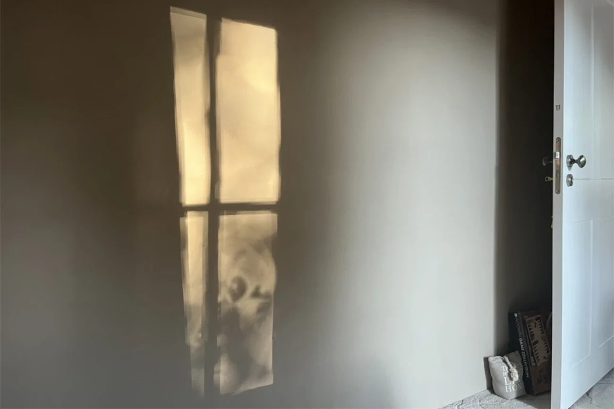
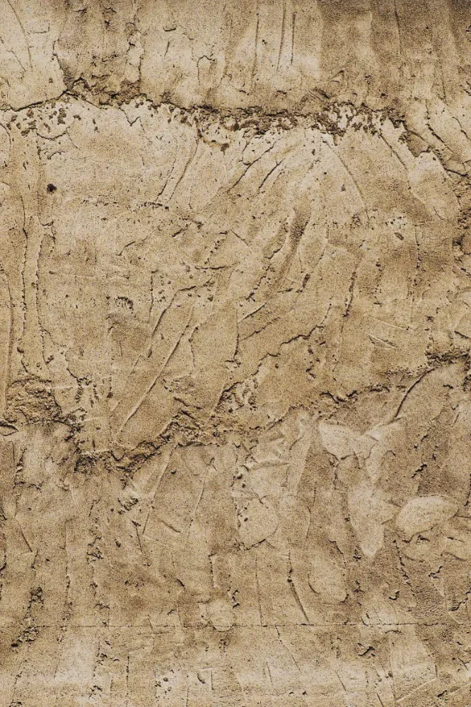
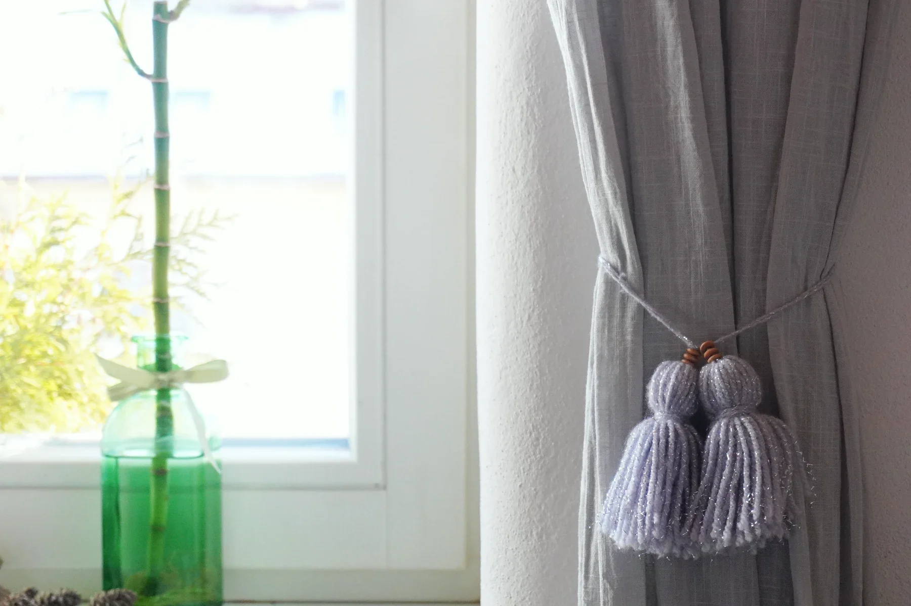
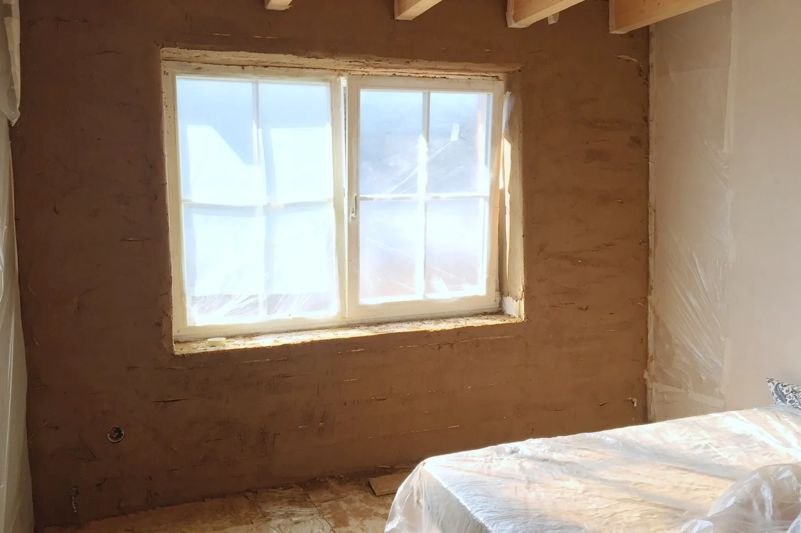
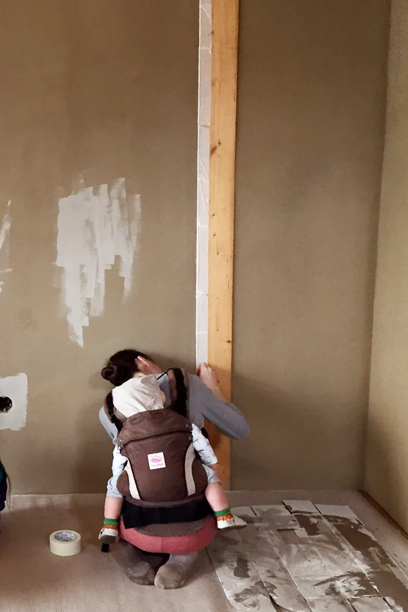
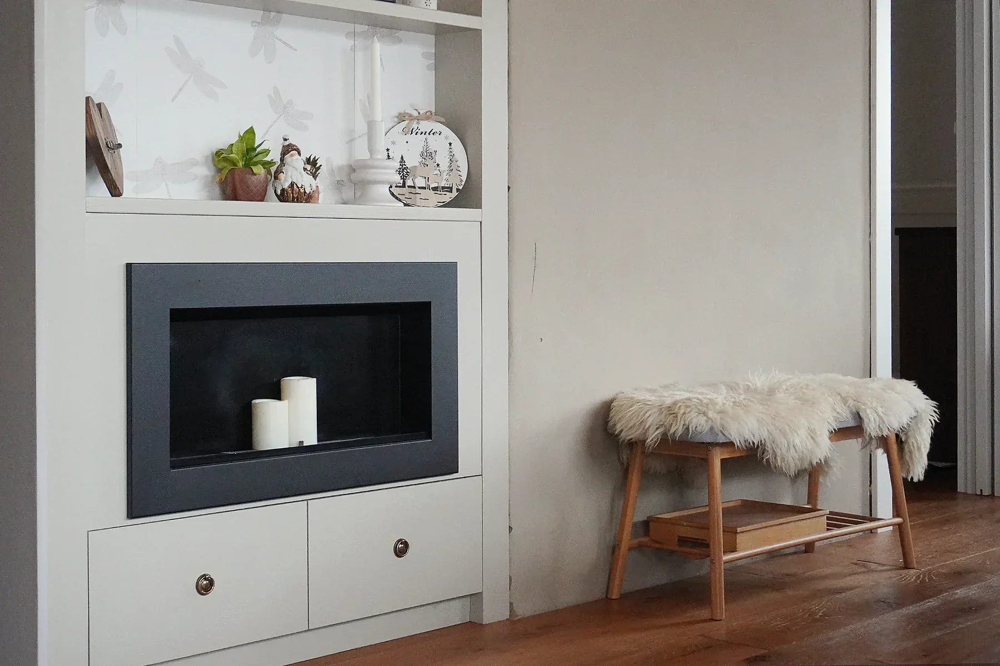
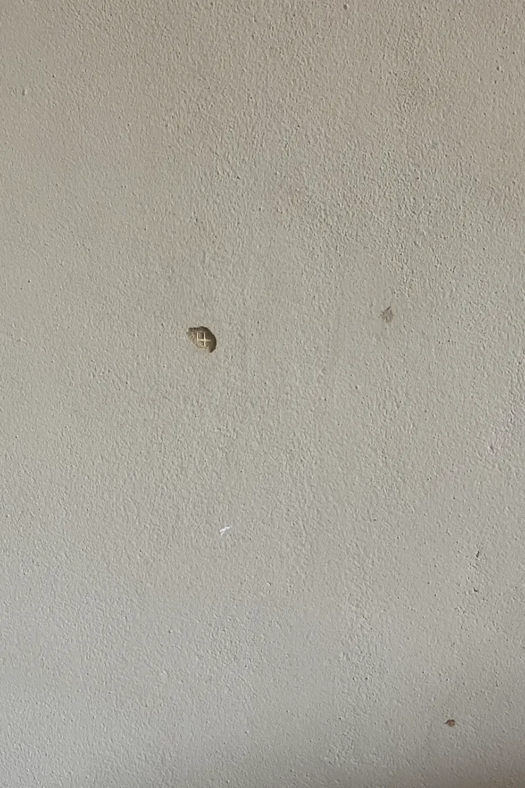

*I first came across clay plaster when visiting our friends who are into healthy building materials. Their walls felt completely different to anything I’d grown up around — softer, warmer, more organic. Nearly a decade later, living with hand-finished clay plaster in our own eco home, I’ve learnt it brings both unique beauty and very real frustrations.*

<Figure align="right" size="medium">

<Caption>
Image credit: Staying Cosy
</Caption>
</Figure>

You know that research phase before a big life decision? A little idealistic, slightly obsessive, and fuelled by far too much time spent on it? When we chose clay plaster for our home, I think we were a bit of all three.

What drew us in was simple. We wanted a healthier home built with non-toxic materials, driven by a more nurturing approach to eco design. What we didn’t fully understand yet, was that natural choices come with their own personalities too. The trade-offs are real.

## Why We Chose Clay Plaster

Going with clay wasn’t just a rational decision for us; it was an instinctive pull. On paper, the technical perks made total sense. But underneath the data, we were chasing a specific feeling. We wanted a home that felt laid-back and comforting, a bit like visiting your grandma’s house, rather than a sterile, glossy showroom where you’re scared to touch anything.

Clay plaster offered exactly that.

As a long-time lover of pottery, I already knew how clay interacted. When you work with it, it responds to your hands and forces you to slow down. If you try to force it into a flawless, machine-like shape, it loses its organic charm. Choosing clay plaster was our way of bringing that tactile, grounding experience directly into our living space.

### What We Imagined vs What We Got

Before the plaster even touched our walls, we had a strong sensory vision. Ten years later, I can safely confirm that reality lived up to the dream. We wanted three main things:

- living walls that shift beautifully with the changing daylight
- fresh air that never feels stale or trapped
- human imperfection that feels relaxed and comforting

Ultimately, we didn’t just pick a building material from a catalogue. We chose a feeling we already loved in other areas of life and decided to build our home around it.

## The Art of Clay Plastering

<Figure align="right" size="medium">

<Caption>
Image credit: Canva - edited
</Caption>
</Figure>

The very first thing we learned is that clay plaster completely dictates the timeline of a build. You cannot rush it, and you cannot force it to bend to a modern construction schedule.

Unlike gypsum plaster, which hardens through a chemical reaction, clay plaster dries naturally as the water evaporates. This means the drying process depends on the conditions around it, such as good ventilation, airflow and humidity.

Our head plasterer made it clear from day one that this is a warm-weather craft. We had to wait for the dry, sunny months of the year just so the walls could dry safely and evenly. It forced us to take it slow and work with the timing of the seasons.

### Using Our Own Earth

The most profound part of this entire experience was the source of the material itself. We didn’t buy bags of processed, imported clay from a warehouse. Instead, we used the earth from our own garden, stripping back the topsoil during the excavation for our foundations to access the rich, raw clay directly underneath our feet.

Using our own earth meant that our walls became a literal extension of the landscape surrounding us. We were bringing the very dirt we walked on inside to shelter us. This choice brought an immense sense of personal connection to the house, but it also changed the dynamic of the craftsmanship. The hands applying it weren’t working with a commercial product; they were translating our own piece of earth onto the walls.

### Unfired Clay Brick Wall — Our Heat & Moisture Thermostat

Earlier on, our head plasterer gave us another brilliant piece of advice for the core of the house. He suggested building our central living room wall entirely out of unfired clay bricks.

Unlike kiln-baked bricks, these raw mud blocks act like a massive, passive battery for our indoor climate. When the house is too humid, this giant wall absorbs the excess moisture; when the air dries out, it gently releases it back.

You don't need heavy tech jargon to understand it. You just need to take a deep breath — the [air feels crisp and clean](/blog/fresh-air-in-home). My husband has digital environment sensors tracking our rooms, and over ten years, the data has consistently proved one fact.

Our humidity levels stay incredibly stable year-round.

Ultimately, a massive wall of raw clay in the middle of our living room turned out to be the healthiest engine we could have given our home.

### Hand-Shaped Rounded Window Reveals

Because clay plaster is applied manually, it also freed us from the rigid, sharp geometry of modern drywall. Usually the corners around windows and deep sills are finished with sharp, right-angles that can feel cold and industrial.

With our plasterer’s guidance, we decided to take advantage of the material's plasticity. We finished our [deep window reveals](/blog/architectural-window-design-trends) with soft, sweeping, rounded corners. This hand-finished detail brought an organic flow to each room. The curves aren't perfectly identical, some are wider and more rounded than others, which only adds to their original charm.

<Caption>
Hand shaped window reveals | Image credit: Staying Cosy
</Caption>

Instead of cutting the incoming daylight with a harsh shadow, the rounded edges allow the natural light to roll gently into the space. It looks smooth, feels pleasant to the touch, and serves as a daily visual reminder that human hands shaped the house.

### The Artisan's Craft and the Cost

Of course, embracing this [holistic](/blog/holistic-interior-design-guide-101) method comes with a major reality check — the cost. While the raw material was technically free, the labour of hand-plastering is a premium, highly skilled craft. It is a slow, physically demanding art form where you are paying for the artisan’s time, stamina, and energy. There is a raw, unspoken transfer of skill and human emotion that goes into the clay as it's worked, which ultimately stays locked within the walls forever.

For us, every penny spent on it was worth it. Watching the slow, organic transformation of our raw garden soil turning into smooth, light-absorbing walls was a masterclass in patient building.

## The Curing Process & Breathable Finish

During the weeks of application, the house underwent a massive sensory transformation. It didn't smell chemical like a modern build, but it felt incredibly heavy with moisture. The walls were wet, cool, and muddy brown for a long time.

<Caption>
Children’s bedroom during the drying phase | Image credit: Staying Cosy
</Caption>

The process is inherently lengthier than standard gypsum or even traditional lime plastering. It requires multiple coats and a lot of patience. I remember seeing our walls dry slowly, turning from very dark to lighter shades. The evaporation of the main layers took about three weeks before the final, smooth coat could even be started.

When raw garden clay dries, it retains its natural, earthy, mud-like colour. Many people love this raw aesthetic and choose to leave it exactly as it is. However, I knew from the very beginning that I wanted to brighten up our home while still honouring the natural origin of the materials. I didn't want stark, sterile white walls, but rather a soft, warm taupe that still evoked a connection to the earth.

### Preserving the Active Clay Surface with Natural Paint

<Figure align="right" size="medium">

<Caption>
Painting with casein-based paint | Image credit: Staying Cosy
</Caption>
</Figure>

The challenge with clay plaster is that you cannot just throw standard vinyl or acrylic latex paint over it. Doing so would completely seal the surface, suffocating the walls and destroying the very breathability we chose clay for in the first place.

To preserve the healthy, moisture-regulating properties of the clay, we opted for a traditional, casein-based natural paint. Casein paint uses milk protein as a natural binder mixed with raw powder pigments. It acts like a breathable skin, allowing the clay underneath to continue absorbing and releasing moisture naturally.

Applying this paint became a true family milestone as we fully immersed ourselves in the finishing stage. I painted those walls with my younger daughter in a baby carrier sound asleep on my back.

> “From garden soil to milk-based paint, these materials carry a connection to nature. They helped us create a healthy nest for our family.”

To this day, I still fondly recall our shared lunches with our plastering craftsmen during those long painting days. Sitting together in the house as the walls were drying, sharing a meal and talking through the progress turned the entire build into a genuinely friendly experience.

## The Reality of Clay Plaster Durability and Imperfection

<Caption>
Image credit: Staying Cosy
</Caption>

And now, let’s shine some light on the elephant in the room — durability.

If you are someone who needs a pristine, gallery-white finish that stays flawless forever, raw clay plaster is probably not for you. Clay is softer than modern gypsum or cement-based finishes, and over a decade of raising a family, our walls have collected a literal timeline of our lives.

If you walked through our house right now, you would see the chaotic marks like:

- dents, mysterious splashes, crayon lines, chocolate finger prints and *yes!*, even dried boogers stuck to the bedroom walls — in the kids’ zones;
- dark oil marks, small chips and a large dent on a corner where an indoor swing collided with the wall during a kids’ wild afternoon play — in high traffic areas.

Every now and then, I simply wipe the largest flat spots with hot water. Most of them either go considerably paler or get completely removed. To be fair, modern washable paints can handle everyday surface smudges much better.

<Figure align="right" size="medium">

<Caption>
Our wall after 10 years | Image credit: Staying Cosy!
</Caption>
</Figure>

We haven’t fixed the deepest bumps and chips yet. Above all, the real downside to clay is its physical fragility. Since it’s soft, a hard impact like our indoor swing mishap will cause a deep chip that probably wouldn't happen on a solid, cement-based plaster.

However, the silver lining is how you handle the damage. If you gouge or chip a standard painted wall, patching it invisibly often triggers a frustrating cycle of filling, sanding and priming.

**With clay, that repair anxiety is much smaller**.

Since the material is inherently forgiving, you can\
reactivate it with just a bit of water and patch a chip seamlessly with fresh clay slip.

> “Instead of seeing these marks as a disaster, I have come to view the clay surface more like high-quality leather. ”

Leather isn’t ruined when it gets a scuff or a crease; instead, it develops a patina. Our clay walls have absorbed the impact of our family’s daily life for ten years. They are imperfect, slightly bruised, but rich with character. And perhaps, after a decade of stories, they are also ready for their first refresh.

If you’re standing at the crossroads of choosing a wall finish for your home, would you be willing to trade off a quality indoor climate for surfaces that collect marks, scars and stories of real life?

If a crayon line or a chipped corner will cause you daily stress, then clay is probably not for you. But if you can embrace the patina of a lived-in space, you are opening the door to a deeply rewarding experience. One, where you are completely surrounded by the calming, raw texture of nature itself.

---

<Callout>
**☘︎ Explore more articles on healthy homes & holistic design**

*•* [*Refresh your Walls Without a Single Drop of Paint*](/blog/refresh-walls-without-paint)

*•* [*Best Low Maintenance Air Purifying Plants for Your Home*](/blog/air-purifying-plants)

*•* [*Hardwood vs Laminate: Which Floor Supports Healthy Living?*](/blog/real-wood-vs-laminate-flooring-guide)
</Callout>
