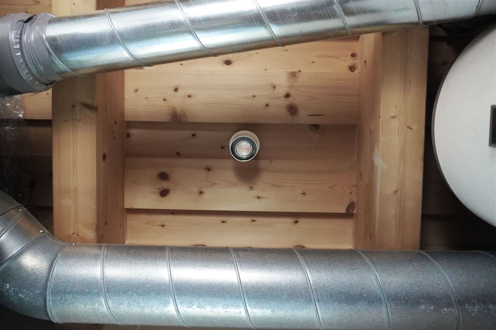
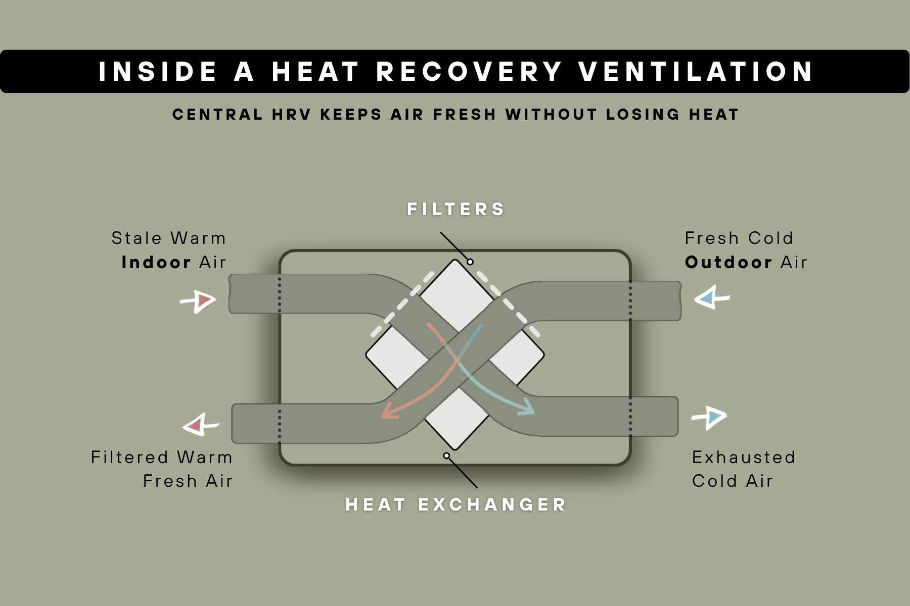
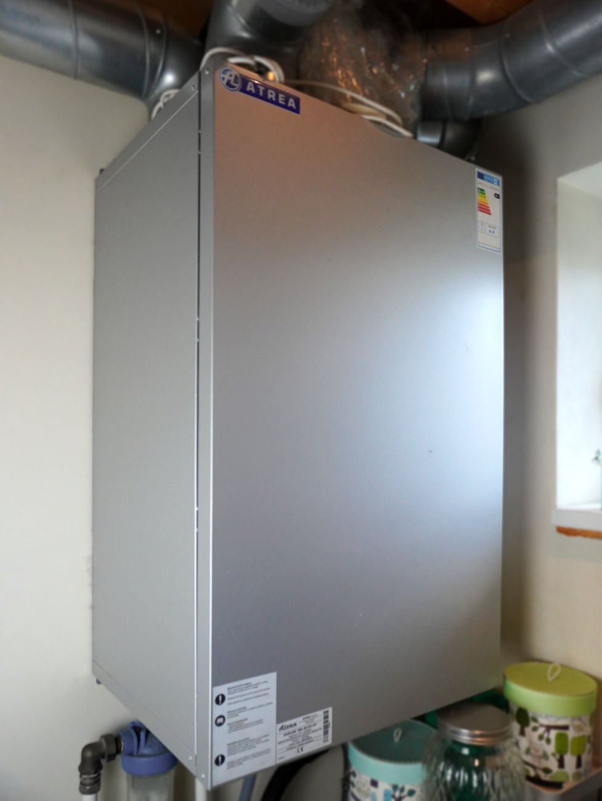
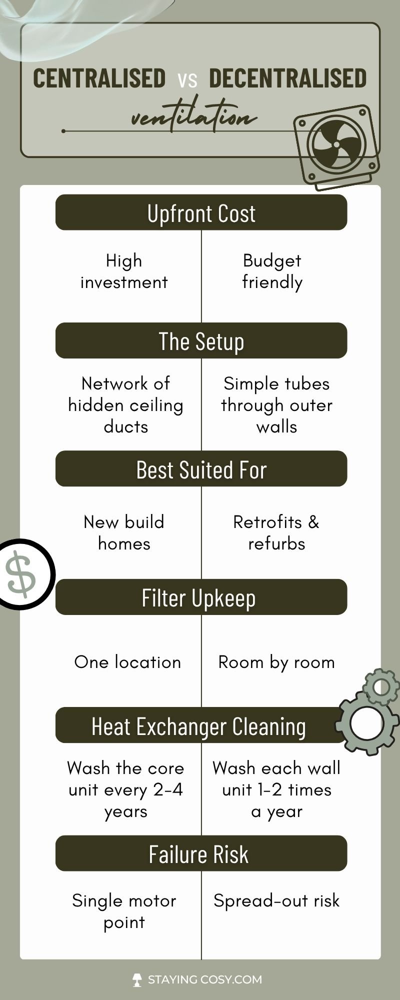
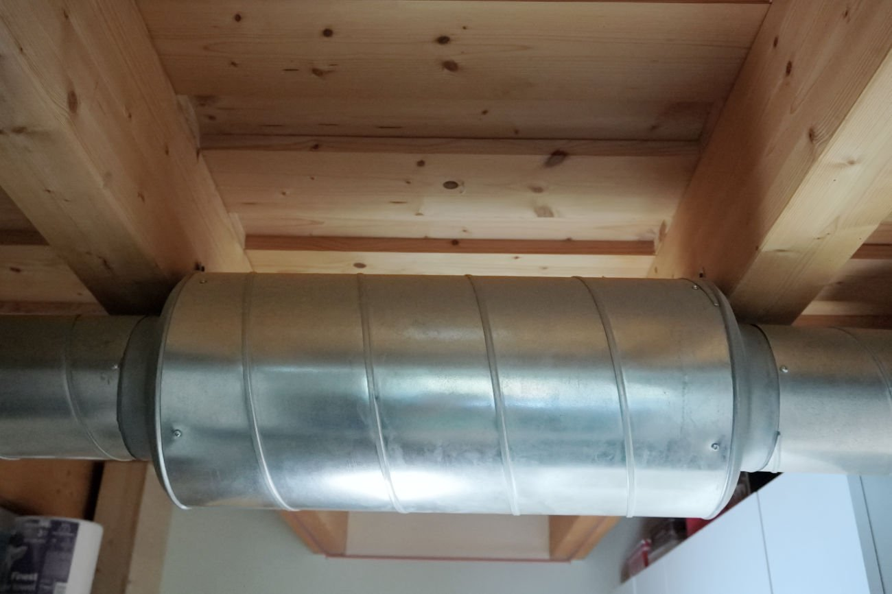
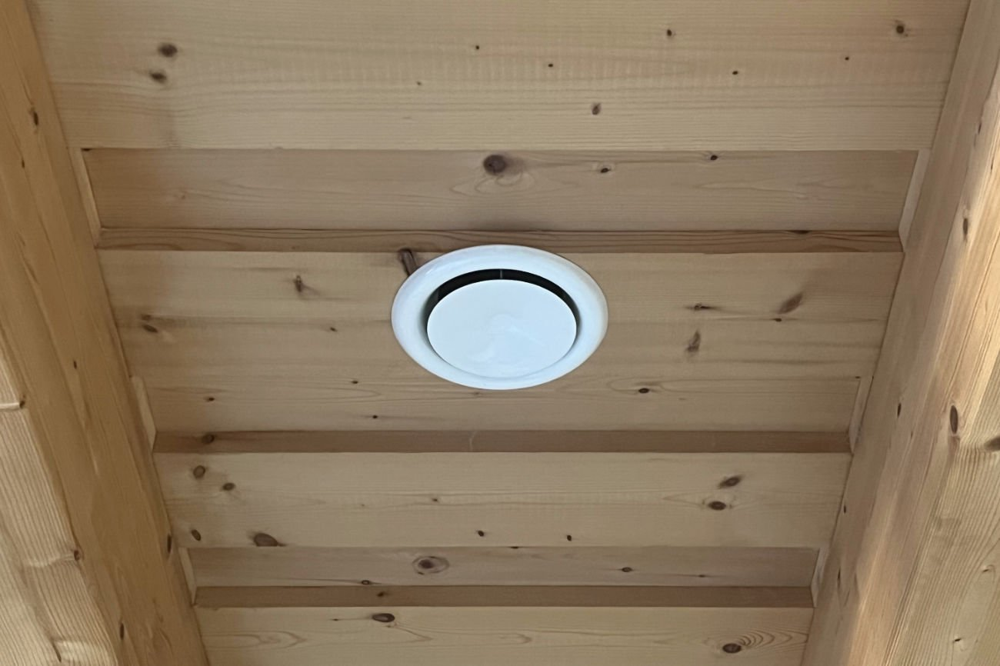

*When we moved into our eco-home, our mechanical ventilation system hadn’t been commissioned yet. Within forty-eight hours, the bedrooms felt heavy. By morning, a telltale film of condensation lined the window glass. It felt like living inside a sealed bag. Then the technician turned the system on. It was instant — like the house had finally taken its first real breath.*

<Caption>
Image credit: Staying Cosy
</Caption>

If you are building or undergoing a major refurbishment today, you are likely chasing high performance. We wrap modern homes in smart membranes, tape every structural joint, and install high-spec [triple glazing](/blog/energy-efficient-windows-guide). It is brilliant for our energy bills. But when we stopped letting heat escape, we also stopped letting fresh air in.

Old houses breathed by accident through leaky construction. Modern homes need us to design that breathing back in on purpose. While opening windows remains a vital joy for seasonal connection and quality indoor air, a truly comfortable home requires a mechanical baseline to handle real life when it's sub-zero outside.

## The Window Opening Myth

I found that whenever we talk about mechanical ventilation this question usually pops up. "But can’t I just open a window?"

Of course you can. In fact, you absolutely should. Throwing everything wide open for a deep cross-breeze on a crisp spring morning, or letting the smell of summer rain drift over the kitchen island, is one of the genuine joys of [slow living](/blog/holistic-interior-design-guide-101). Look at it this way. Natural ventilation and mechanical systems aren’t rivals. They are partners.

But relying purely on open windows in the dead of January? That is a completely different story.

The classic excuse, *I don't open windows because I lose all my heat*, is actually a fair point. Nobody wants to blast sub-zero air straight across a warm, cosy living area. And while a quick, intense five-minute airing fixes things temporarily, the exact second you slam the window shut, the stale baseline starts creeping right back up.

That is exactly where the house needs a quiet, mechanical hand to keep things steady.

## How a House Learns to Breathe — HRV Explained

[Heat Recovery Ventilation](https://passipedia.org/planning/building_services/ventilation) (HRV) acts as a quiet, continuous pair of lungs for the building.

The mechanism is straightforward. A central unit continuously extracts stale, humid, and odour-filled air from your wet rooms, like kitchens, bathrooms, utility rooms. Before this air is pushed outside, it passes through a matrix called a thermal heat exchanger. Simultaneously, fresh outdoor air is drawn into the unit.

The two air streams never physically mix, preventing cross-contamination, but the warmth from the outgoing air is transferred to the incoming fresh air.

<Caption>
Graphic: Staying Cosy — made in Canva
</Caption>

You receive oxygen-rich air brought up to room temperature automatically, preventing the massive heat loss of opening windows in the depths of January.

In Europe, you might encounter the term MVHR, which stands for Mechanical Ventilation with Heat Recovery. Essentially, it’s the same technology.

## Centralised vs Decentralised — Which One is For You?

Depending on the scale of your project, you will face a fundamental choice between two distinct design approaches:

<Caption>
Our centralised MVHR | Image credit: Staying Cosy
</Caption>

**Centralised MVHR**\
This setup relies on one substantial main unit, typically tucked away in a utility room, plant space, or attic. Ours is in the [utility room](/blog/practical-utility-room). It connects to a hidden network of ducts running through the ceiling to every single room in the house.

It provides a completely uniform, balanced climate and represents the gold standard for new builds or back-to-the-studs deep renovations where ceilings are dropped anyway. For reference, these units are usually size of smaller fridge.

**Decentralised MVHR**\
Instead of a single central engine and a house-wide pipe network, you install smaller, individual through-the-wall units in specific target spaces. They’re mostly featured in bedrooms or living areas. They alternate cycles between extracting stale air and supplying fresh air, making them an ideal, low-disruption option for retrofitting an existing, older home where tearing down ceilings isn't viable.

Because we were building a new house, we opted for a centralised system. For me, it just felt right. I couldn’t imagine drilling half a dozen holes through our freshly insulated exterior walls for decentralised units. But there is a catch. The downside with a whole-house network usually hits later, in the form of higher servicing costs and more complex duct maintenance.

Here is a quick, six-point breakdown of how both options stack up side-by-side:

<Caption>
Find the cons and pros of centralised & decentralised ventilation | Graphic: Staying Cosy
</Caption>

## The Gritty Details — Duct Sizing and Air Velocity

My worst fear with mechanical systems is noise. As someone who prioritises calm [home acoustics](/blog/holistic-acoustic-home-design-guide), I was deeply suspicious about forced ventilation ductwork. Most people worry about a constant, irritating humming, especially in the bedroom. However, a properly engineered system runs almost completely silent. If you can hear it, the installer got the physics wrong.

Noise is entirely a product of friction, pressure, and velocity.

**Narrow Ducts + High Velocity →** *Turbulent Airflow & Distracting Drone*

**Wide Ducts + Low Velocity →** *Steady Airflow & Comfortable Silence*

When air is forced through narrow ducts at high speed, it creates turbulence and a distracting drone. If you are trying to figure out how to prevent MVHR duct noise, the solution is wide duct circumferences, typically 75mm or 90mm (3 to 3.5 inches) radial semi-rigid ducts for residential spaces, and a correctly sized ventilation unit operating at a low capacity. This was exactly the advice we followed.

To add an extra peace of mind, we had an inline silencer installed on our ductwork as well. It contains a layer of sound-absorbing foam, which helps to trap the sound created by fans.

<Caption>
Inline silencer | Image credit: Staying Cosy
</Caption>

By keeping the duct diameter generous, the air moves slowly and smoothly (what engineers call laminar flow). You get the exact same volume of fresh oxygen, but the air velocity drops so low that it is completely imperceptible to the human ear.

The only exception is the boost mode. When we deliberately ramp the air volume up to purge a cooking smell or clear out heavy bathroom humidity, we can hear the unit humming away. But that only happens occasionally, and it is a temporary trade-off for a fast clear-out.

Additionally, you should opt for a radial duct system, where every room has its own dedicated pipe running directly back to a central distribution box, rather than an old-fashioned branch system. Radial setups eliminate cross-talk — that awkward phenomenon where sound travels down the pipes from the family bathroom straight into your peaceful bedroom.

## The Defensive Line of Ventilation Filters

Since a central mechanical system draws all its air through a single external point, you gain complete control over what enters your home. The filters inside the unit are your frontline defence.

- **Standard dust filters (G4):** These are your baseline mesh screens, which stop larger debris like hair, dust bunnies, and flying insects, to muck up the expensive heat exchanger.
- **Pollen filters (F7 / PM1):** If hay fever or seasonal asthma makes your springs miserable, upgrade to these. They are incredibly dense, tightly woven mats that trap the invisible nasties: microscopic spores, fine traffic soot, and PM2.5 particles. It stops them dead before they can drift into your rooms.
- **Active carbon filters:** The absolute heavy lifters for blocking traffic fumes, woodsmoke, and unwanted odours.

None of these are a set-and-forget feature. They require active management. You have to change them at minimum every six months. A good routine is doing a fresh swap right before winter kicks in, and another right as spring starts. If you are near a busy road or a dusty building site, you will probably need to pull them out every three to four months instead.

Should you leave them to clog up, your unit would have to fight against the resistance. That means higher electricity bills and a faint, strained drone echoing down your ducts.

### Our Unexpected Green Fence Lesson

Our own house gave us a masterclass this summer in why you might need a carbon filter sooner than you think.

We were already well used to dealing with the usual woodsmoke from neighbouring chimneys in the winter. But a sudden scent crisis in the absolute middle of summer caught us completely off guard. Out of nowhere, we started noticing a heavy, intensely sharp grassy smell inside the house.

The culprit? Our neighbours had recently planted a living fence of evergreen conifers — thuja bushes, just over two metres away from our external fresh air intake. During a scorching last summer, these dehydrated bushes went into survival mode. They kept releasing concentrated essential oils straight into the air. Our ventilation inlet drank the scent right in, and within hours, our bedroom smelled like an overpowering aromatherapy lab.

We couldn't turn the system off as continuous flow is non-negotiable for air quality, so we resolved it by adding a thick, double-layered active carbon filter to eliminate the smell. The carbon molecules bonded with the organic compounds, neutralising the grassy scent very effectively.

<Caption>
Interior ventilation inlet | Image credit: Staying Cosy
</Caption>

The takeaway is clear. When positioning your external intakes during a design or renovation phase, look well past your own boundary wall. Check where the cars idle, where your kitchen extraction vent exits, or even where a neighbour might plant a dense, highly aromatic garden border.

## Upfront Costs and Long-Term Care

Let’s talk numbers. Building a [healthy home](/blog/shaping-a-green-home-with-purpose) requires a pragmatic balancing of budgets. The investment split depends entirely on whether you are tackling a comprehensive new build or working within the footprint of an existing house.

For a standard three-bedroom property, a high-end centralised system generally demands a total investment of €7,000 to €12,000 once fully commissioned. This figure changes depending on your home's structural layout and the specific brand you choose. It is a significant upfront cost, but it covers the entire engineering infrastructure from the ground up. This option is highly recommended for new-builds.

Here is the cost breakdown:

**☘︎ Centralised System Costs — 3 Bed Property:**

- Hardware & Core Design: ~€6,500
- Installation & Balancing: ~€3,500
- Total Central Investment: **€7,000 – €12,000**

For the same size home, opting for a decentralised system by installing four to five individual units across your primary living spaces allows you to easily establish a full system for a total baseline of €2,500 to €3,600 — all while bypassing structural disruption entirely. It is perfect for retrofitting.

It will cost you roughly:

**☘︎ Dec\*\*\*\*entralised System Costs — 3 Bed Property:**

- Average Unit Cost: ~€750 / Per room
- Typical Setup: 4 to 5 core living spaces
- Total Decentralised Budget: **€2,500 – €3,600**

Regardless of your choice, the day-to-day running costs are fairly low. Modern units run on ultra-efficient EC fans that draw very little power. Operating them continuously, which is recommended, feels roughly equivalent to running a single low-energy lightbulb.

However, you must account for the ongoing maintenance reality to keep the system running efficiently. Here is the cost breakdown:

- **Electricity:** Around €55 per year for 24/7 uninterrupted air flow.
- **Filter Replacements:** Around €75 per year. Whatever you do, don’t skip this to save a few coins; clogged screens force the fans to work harder, inflating your bills and straining the motor.
- **Professional Servicing:** Around €250 every five years. This covers a thorough technician check to clean condensation drains, verify sensors, and keep the system pristine and lint free. If you manage your filters regularly, the hidden ductwork network itself won’t need deep maintenance for one to two decades.

In total, expect to spend about **€180 per year**.

From my own experience putting mechanical ventilation into a home is an [investment in long-term health](<https://www.who.int/news-room/fact-sheets/detail/ambient-(outdoor)-air-quality-and-health>). Even when you forget to open the windows, or are hosting a packed house party, you have complete peace of mind that the air you breathe is being constantly exchanged and filtered in the background. All year round.

Waking up every single morning feeling genuinely rested is worth it. Plus, remember, your home is actively keeping structural mould at bay while protecting your lungs from whatever is floating around in the outside air.

Would you consider putting an MVHR system in your own home during renovation? Or do you prefer sticking to traditional [fresh air habits](/blog/fresh-air-in-home)? It is certainly a choice to consider.

---

**☘︎ Are you keen to learn more about sustainable home design? Read on:**

*•* [*How to Choose the Right Type of Fireplace for a Modern Eco-Home*](/blog/the-best-type-of-fireplace-for-your-needs)

*•* [*What I Wish I’d Known Before Planning a Sustainable House Build*](/blog/eco-friendly-building-guide-materials-principles)

*•* [*Hardwood vs Laminate Flooring — Which Fits Your Health & Budget*](/blog/real-wood-vs-laminate-flooring-guide)

SEARCH THE BLOG

