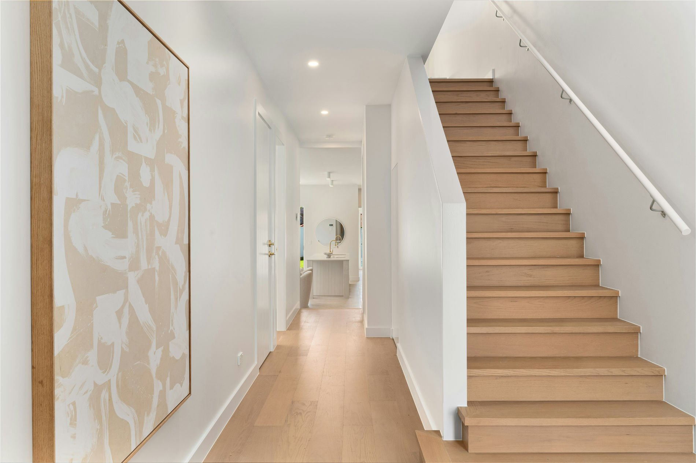
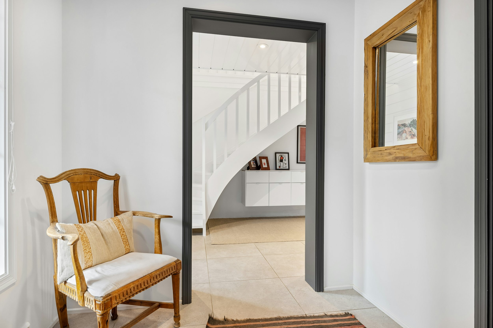
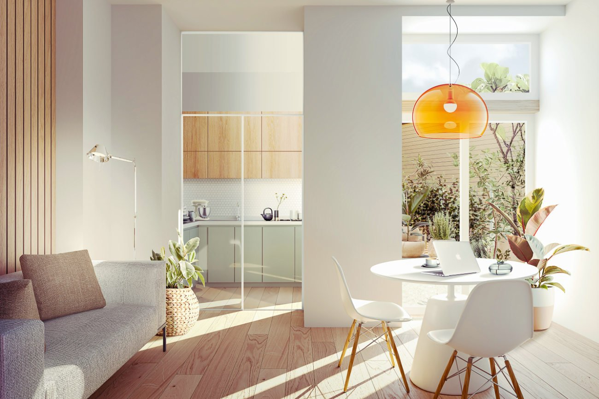
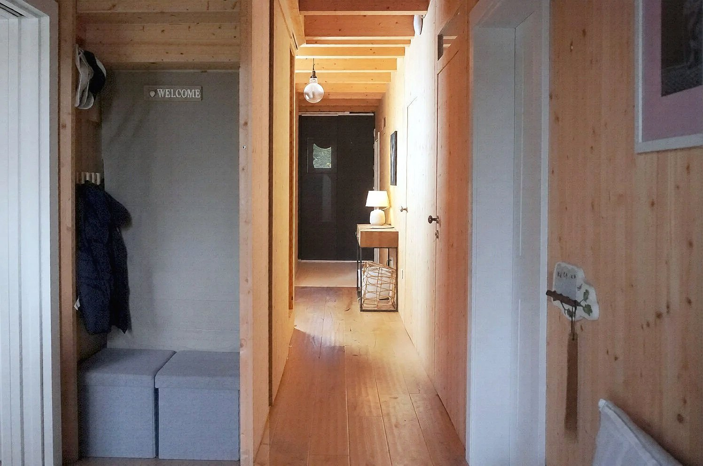
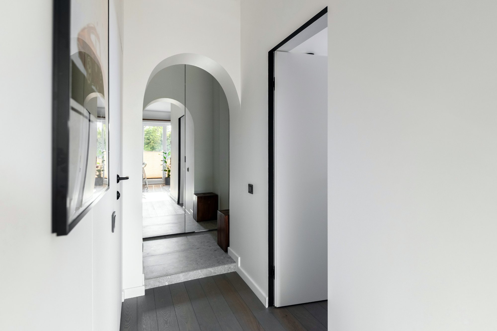
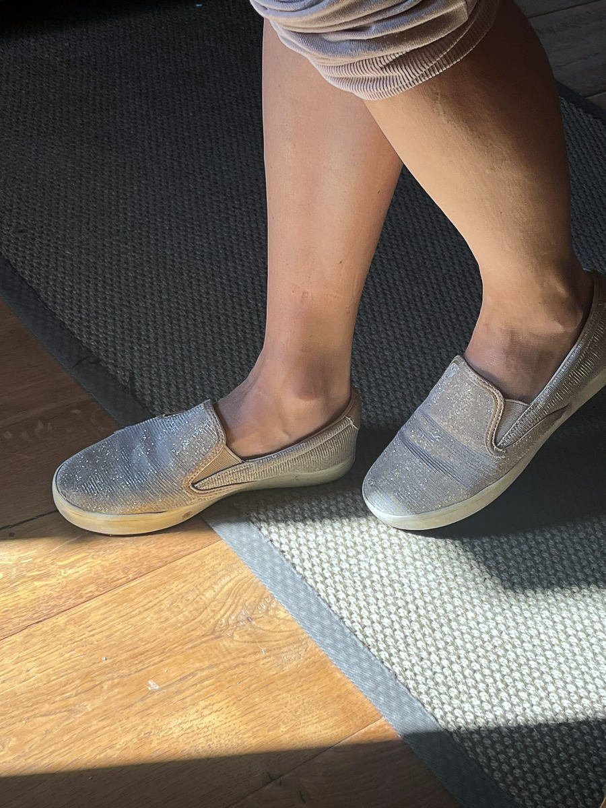

*Our houses are more like movies than still photographs. Surely, we don’t build them just to sit in them. At least, I didn’t. We’re constantly moving. Sometimes reaching for a late-night snack from the fridge, or maybe dragging the bins out for the Wednesday collection. We’re always on the move.*

<Caption>
Image credit: [Lisa Anna](https://unsplash.com/@lisaanna195?utm_source=unsplash&utm_medium=referral&utm_content=creditCopyText) on [Unsplash](https://unsplash.com/photos/a-picture-of-a-hallway-with-stairs-and-a-painting-on-the-wall-iYs7V9uv0P0?utm_source=unsplash&utm_medium=referral&utm_content=creditCopyText)
</Caption>

When I look at floor plans, I notice how everyone obsesses over the main destinations. The bedrooms, the kitchen. But where do hallways, corridors, and landings stand? Don’t we tend to treat them like leftover square footage? Just dumb little lines on a piece of paper meant to get us from point A to point B.

Just mapping out your morning routine can be a massive eye-opener. I’m usually half-asleep when I stumble into the kitchen, passing through our small hallway between the bedrooms to get there. You might be rushing downstairs instead, letting a narrow corridor guide you while getting ready for work. Either way, we usually end up spending hundreds of hours a year navigating through these invisible, in-between zones.

If a living room gets all the design love because we sit there, then the spaces we walk through every single day deserve some respect too. They don’t need to clone the next room's style, and they definitely don't need to beg you to stay. They just need to prime your brain for what’s next.

## Stop Treating Hallways Like Leftovers

<Caption>
Image credit: [Lisa Anna](https://unsplash.com/@lisaanna195?utm_source=unsplash&utm_medium=referral&utm_content=creditCopyText) on [Unsplash](https://unsplash.com/photos/a-chair-sitting-in-a-room-next-to-a-doorway-WKtKXU1qo70?utm_source=unsplash&utm_medium=referral&utm_content=creditCopyText)
</Caption>

A hallway can be just as cool as a main living room. Period. You just have to design it so. When I’m remodelling a place, I always map out the connections first. It’s a massive balancing act. You want the hallway to feel wide and welcoming, sure, but you can't let it steal precious space from your actual rooms.

And yeah, there's [real science](https://theccd.org/article/threshold-spaces-as-mediators-of-focus-creativity-and-mindfulness/) backing this up. Psychologists studying neuro-architecture found that when a house forces you to jump abruptly from one zone to another without a little breather, your brain registers it as a micro-stressor. It literally bugs your mind.

☘︎ **The Psychology of the Threshold**

Moving straight from a chaotic kitchen into a quiet bedroom forces a sudden mental change. If the architecture doesn't offer a buffer, your brain misses the chance to adjust.

You can easily fix this layout shock by dropping the ceiling height, narrowing the hallway, or changing the direction of your flooring. It acts as an immediate spatial reset button.

## When In-Between Spaces Disappear

Our homes are [getting smaller](/blog/how-big-should-your-home-be). At the same time, everyone is obsessing over open-plan living, meaning hallways are basically disappearing. Don’t get me wrong, I love openness. A well-planned walk-through layout can look incredible. But we are losing something vital here, that essential layout breather between rooms. Even if you leave the door wide open, your bedroom or bathroom still needs to feel tucked away and completely private.

<Caption>
Image credit: [laura adai](https://unsplash.com/@lauraadaiphoto?utm_source=unsplash&utm_medium=referral&utm_content=creditCopyText) on [Unsplash](https://unsplash.com/photos/a-living-room-with-a-couch-a-table-and-chairs-m8Mz6UjaoEo?utm_source=unsplash&utm_medium=referral&utm_content=creditCopyText)
</Caption>

Think about it. When you delete hallways entirely, your brain has to jump from one environment to the next without a single second to adjust. You go straight from a loud kitchen into a quiet bedroom. It just feels jarring.

Thankfully, structural walls usually mean you can’t get rid of hallways completely. But instead of settling for long, dark tunnels, you can change the game. Try wider, shorter and well-lit passages. Or even better, design open-plan loops so you have a couple of different ways to walk across the house without hitting a wall.

We did exactly this in our own home by chopping what would have been a single, narrow hallway into three distinct segments. That tiny layout tweak immediately broke the boring uniformity, brought in way more light, and gave us three separate entry points so walking around never feels like hitting a dead end.

#### 💡 **Standard Corridor Dimensions**

- Standard hallway width is between **90cm and 100cm** (about 3 to 3.5 feet). If you go any narrower, the space will immediately feel tight and purely functional.
- On the flip side, anything over **120cm** (around 4 feet) needs an actual job. Give it a built-in bookcase or a low bench seat — otherwise, you're just looking at wasted floor space.

## How Do You Change the Feel of a Narrow Corridor?

These awkward, narrow strips of your floor plan are actually the ultimate blank canvas. Stop looking at them as dead square footage. With a bit of intent, you can twist them into highly functional zones that extend the character of your entire home. So, how do you make corridors perform better?

### Make Them Work Harder

If you are giving up precious floor space for a hallway, it needs to earn its keep. The smartest trick here is blending storage directly into the architecture so smoothly that it completely unlocks the flow of your home instead of choking it.

I always turn to handle-free, custom joinery for this. Resist leaving a long hallway wall completely blank, map out a run of shallow, floor-to-ceiling cupboards. If you use push-to-open latch panels and paint them to match your walls precisely, the cabinets vanish. Suddenly, you have a massive, hidden asset that swallows seasonal linens, winter coats, or vacuum cleaners, completely preserving your clean architectural lines.

Now, if your hallway happens to be on the wider side, especially if you're hitting that 120cm mark, you can start creating physical pauses. Try cutting a deep niche into the partition to hold a low bench or a built-in bookshelf. It gives you a highly practical spot to drop keys or kick off shoes, while instantly breaking up the endless flatness of a long corridor.

### Avoid the Hotel Hallway

I think we’ve all seen this mistake before, walking down a long, narrow corridor lined with a repetitive row of identical doors. In a home, not a hotel. It gives off a stark institutional feel rather than a cosy home vibe. Your eyes just shoot down a dark tunnel. To fix this, you have to turn down the visual noise. Not every door needs to be the star of the show.

The best strategy is to conceal the doors that lead to purely utilitarian spaces. Your laundry cupboard, powder room, or utility room doesn't really need to be celebrated.

We used this idea to avoid cluttered feeling in our narrow hallway by seamlessly blending our utility and bathroom doors right into the wall finish. They are completely flush-mounted and match the surrounding pine-cladding. Only our bedroom doors get a distinct colour and material.

<Caption>
Our seamlessly blended doors | Image credit: Staying Cosy
</Caption>

By hiding the secondary doors, you break up that boring corridor rhythm. Only the primary destinations, like bedrooms or the main living area, deserve distinct frames or contrasting materials. This clear visual hierarchy will naturally guide you through the distinct zones of the house.

### Use the Architecture

Corridors are notoriously starved of light.

If you’re adventurous enough when remodelling, try pushing your hallway right up against an exterior wall. This works beautifully in slim-footprint homes. I saw such a corridor as a kid in a row of mid-century bungalows on my street, and I instantly loved it. Those passages were wide, incredibly bright, and turned a basic walkway into an enjoyable, almost gallery-like experience.

If an exterior wall isn't an option, which is case of most homes, you can easily borrow light from the adjacent rooms. Swap out solid internal walls for steel-framed glass partitions, high windows set just below the ceiling, or even transoms above doorways. It lets natural light bleed from bright living spaces directly into darker hallways.

Think of it as spatial punctuation. By breaking the continuous run of a wall or ceiling, you introduce natural visual chapters into the corridor. It gives your mind a moment to pause. You can drop the ceiling height a few inches right above a doorway, or widen the floor plan to form a small landing. Even a simple change in your wall materials breaks the monotony, making a long walk feel like a collection of short, easy-to-digest stages.

### Mirrors… But Not Always

<Caption>
Image credit: [Irena Oze](https://unsplash.com/@iistyle?utm_source=unsplash&utm_medium=referral&utm_content=creditCopyText) on [Unsplash](https://unsplash.com/photos/modern-white-hallway-with-arched-doorways-and-dark-flooring-laazSoSwtsE?utm_source=unsplash&utm_medium=referral&utm_content=creditCopyText)
</Caption>

It is the ultimate interior design cliché, that if you’re stuck with a tiny hallway, you should slap a mirror on the wall.

Well, maybe.

Sure, a mirror throws light around and plays tricks on a tight layout. But it can just as easily backfire. If you position the glass so it constantly reflects a cluttered coat rack, a dark doorway, or the messy utility zone, you haven't actually solved the space problem. You’ve just duplicated the mess.

Before hanging a mirror in a transition space, look at what sits directly opposite it. Use the glass to improve what you see, rather than using it blindly out of habit. Reflecting a patch of natural light creates instant intrigue, while capturing a clean, open view brings a sense of order to a tight layout.

### Control the Floor Direction

<Caption>
Image credit: Staying Cosy
</Caption>

I'll tell you a little design secret that most people are not aware of. The way your flooring runs matters. A lot. If you lay wood planks or tiles parallel to the length of a corridor, you create a *runway effect*. It visually stretches the space and makes you feel like you need to hustle through it.

If you want a long corridor to feel shorter and more relaxed, run the flooring perpendicular to the path. Or better yet, use a herringbone pattern. This layout tricks the eye into slowing down. It changes the whole energy, turning a rushed walkway into an optically calm transition.

☘︎ **Fast-Track Transitions**

- **Utility:** Conceal functional doors, like bathrooms and utilities, to match the wall colour. Clean up the sight lines.
- **Light:** Borrow light from adjacent spaces using transoms or glass partitions.
- **Pacing:** Run your flooring perpendicular or drop the ceiling height to create a natural pause.

A well-designed transition gives you a second to just breathe. It lets you shed the heavy workday and move into your private spaces with a completely clear mind.

It is a small architectural luxury, sure. But it adds an extra value to your home environment.

---

**☘︎ Are you looking for more design ideas for your home?**

*•* [*Where to Place the Bed in a Small Studio Layout*](/blog/small-studio-bedroom-bed-placement)

*•* [*Are You up for an Instant Home Refresh?*](https://bluebird-hawk-as8j.squarespace.com/blog/10-ways-to-give-your-home-instant-refresh)

*•* [*The Under Window Sink Can Become the True Soul of Your Kitchen*](/blog/under-window-kitchen-sink-design)

SEARCH THE BLOG

