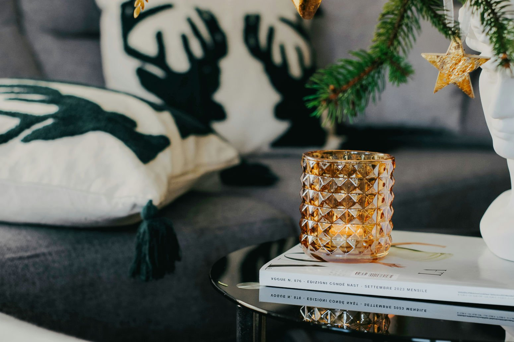

*The clocks went back last weekend and set my internal trigger. Suddenly, the afternoon light vanished by four, the air turned crisp, and a familiar, low-level panic set in. I froze in the middle of the kitchen. I haven’t started my Christmas shopping yet!*

<Caption>
Image credit: [Nataliya Melnychuk](https://unsplash.com/@natinati?utm_source=unsplash&utm_medium=referral&utm_content=creditCopyText) on [Unsplash](https://unsplash.com/photos/a-living-room-with-a-couch-and-a-coffee-table-fVdcpMLxxC0?utm_source=unsplash&utm_medium=referral&utm_content=creditCopyText)
</Caption>

Never mind that I’ve already done a massive, deep declutter of the house. Yes, thank you very much, past me and my [stress-free Christmas planner](/blog/holistic-christmas-guide) from last year.

But today? Today isn't about logistics. It’s about that weird, early-November transition where we have to choose between an over-the-top holiday performance or actual peace of mind.

Right now, my ongoing shopping list on my phone consists of a handful of books. I haven’t even begun to map out my minimalist Christmas decor ideas for the living room. The big questions are still swirling. Do we invite my parents this year? Or do we keep Christmas Eve entirely to ourselves, wrapped up in our own little bubble?

I catch myself obsessing over how to make it all perfect. But honestly, what does that even mean?

Does it mean we get lucky with the weather and the garden is covered in a pristine blanket of snow while the snowflakes are falling peacefully behind frosted window panes? Does it mean the kids get every single item on their wish list? Does it mean the traditional Christmas dinner is a culinary masterpiece, with the battered fish fried to absolute, golden perfection and the potato salad looking like a work of art?

Or does it mean tracking down a flawlessly symmetrical, blue spruce that looks like it was generated by a AI or pulled straight out of a Pixar film?

I've been thinking about this. And I’m starting to realise my expectations aren't just high. They’re entirely unimportant.

## The Reality of Messy Memories

The holiday school break is long. Way too long. The freezing temperatures mean we are trapped indoors together for days on end. My ultimate goal is to create nice memories for all of us, but primarily for our girls.

<Caption>
Image credit: [Anna Peipina](https://unsplash.com/@saules_art?utm_source=unsplash&utm_medium=referral&utm_content=creditCopyText) on [Unsplash](https://unsplash.com/photos/brown-star-ornament-on-black-surface-Js05xQ5TLUw?utm_source=unsplash&utm_medium=referral&utm_content=creditCopyText)
</Caption>

So we bake traditional honey cakes together.

We all pitch in to tidy and clean the house, [winter-proofing it without toxins](/blog/winter-proof-clean-home-non-toxic) for the upcoming festivities, though *pitch in* is a generous term for a teenager and a pre-teen. We haul the ski gear out of storage, prepping for when winter properly hits the slopes. And our absolute favourite game to play right now? It doesn't come out of a fancy, expensive box. It's just a game of *Guess Who I am Thinking Of,* using names scribbled onto torn pieces of scrap paper.

It makes me think, who on earth decided Christmas had to be flawless to be memorable?

A century ago, a festive tree was decorated with gingerbread biscuits and shiny apples. That was it. If you received a single gift, you were lucky. Having a hot meal on the table was a luxury. Then we steered away from what actually matters.

> “We got stuck in a loop of what the season looks like on the outside, sacrificing our internal peace to feed certain aesthetics. We forgot how to appreciate the present moment. ”

As a parent, navigating these societal expectations is draining. I deliberately teach my kids to wait for good things. We talk about *want* versus *need*. I don’t randomly buy them gifts throughout the year, which admittedly ups the ante for December. The anticipation is sky-high.

But when I get past the holiday marketing, what do I actually want? What do I love?

## What We Truly Wish For

I want the music playing. I want candles lit and the heavy scent of deeply satisfying winter bakes filling the house.

I love listening to my girls sing their chorus practice, or whatever else they feel like belting out in that moment, while I’m prepping carrots for soup. I love the casual talks about their friendships, their school crushes, or their gift ideas. They enjoy finding useful things for others, too, which warms my heart knowing how much they care.

I love meeting up with friends, mulled wine burning our hands, laughing into the frosty night about everything that hasn't gone to plan this year. We snap a photo or two to prove we actually made it out of the house, keeping up our usual seasonal tradition.

I love those late-night moments when the house finally goes quiet, sitting on the sofa with my husband, reviewing the chaos of the day with a shared, exhausted smile. Maybe even finally getting to plan our own little escapes.

<Caption>
Image credit: [Prophsee Journals](https://unsplash.com/@prophsee?utm_source=unsplash&utm_medium=referral&utm_content=creditCopyText) on [Unsplash](https://unsplash.com/photos/a-table-with-a-book-and-a-pen-on-it-WSjsO32SsZM?utm_source=unsplash&utm_medium=referral&utm_content=creditCopyText)
</Caption>

I love lighting the fire when my fingers are completely numb from being outside. Stripping off the heavy winter jackets. Slipping my toes into thick, woolly slippers.

That's the magic. Right there.

Every year we wander down to our local Christmas market for a cup of warming punch, looking up at the massive silver fir that dominates the square. On the way back, we always stop to make a wish under the ringing bell. We are entirely content in this mini-world we’ve built for ourselves.

We don't need a picture-perfect tree at home. We just need time for each other, and a comfortable space to enjoy these slow Christmas traditions in our own way.

So, let the parsnips burn a little. Let the wrapping paper be mismatched and messy. Your sanity is worth a thousand times more than an impeccably styled holiday. Don't you think so?

---

<Callout>
**☘︎ Bring the festive spirit into your home:**

*•* [*Mocha Christmas Inspiration For Ultimately Grounded Holiday Interior*](/blog/mocha-christmas-inspiration-natural-cosy)

*•* [*The Best Type of Fireplace for Winter Sofa Snuggling Through an Eco-Lens*](/blog/the-best-type-of-fireplace-for-your-needs)

*•* [*18 Places, One Home: What Frequent Moving Taught Me About Living Well*](/blog/18-places-one-home-lessons)
</Callout>
