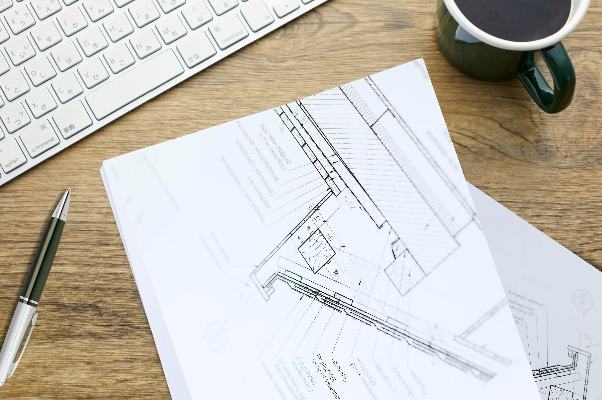
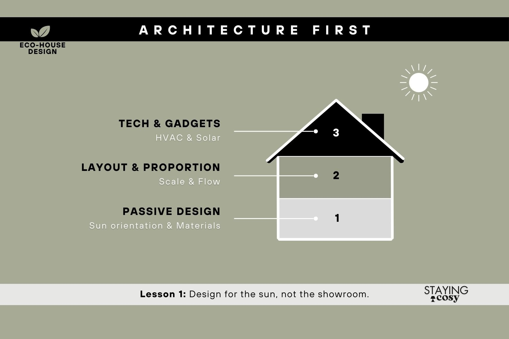
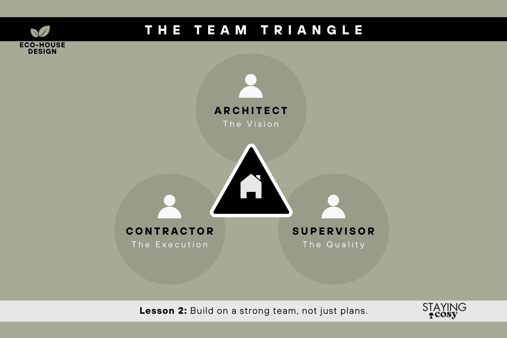
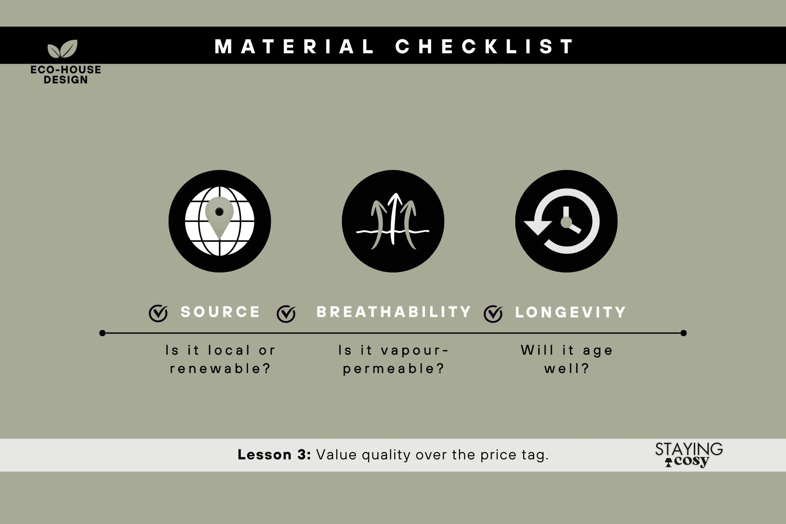
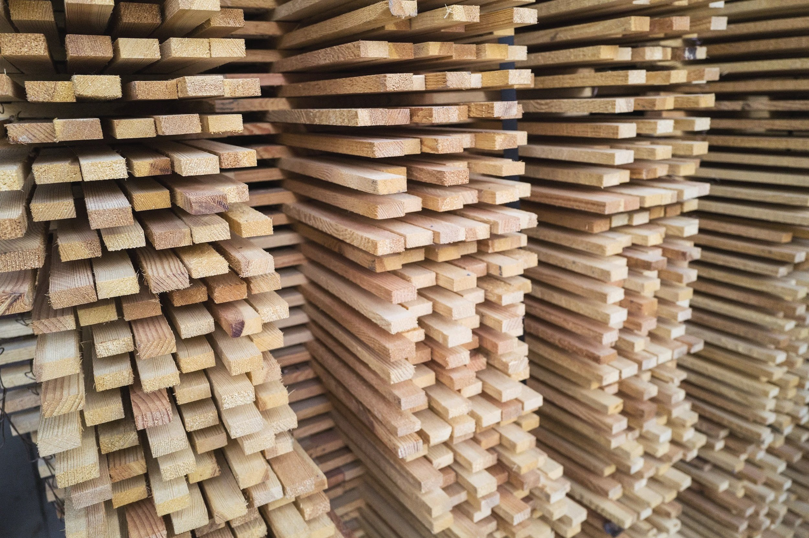

*Moving 18 times was my unofficial degree in architecture. After years of observing how different homes perform, weather, and often fail, I finally took those lessons and built my own eco-home. Now, I’m sharing the practical strategies, smart materials, and eco-friendly foundations to help you navigate your own build to a successful reality.*

<Caption>
Image credit: Staying Cosy — made in Canva
</Caption>

I am deeply in love with interiors and the unique ways we inhabit them. Moving so often gave me a broad, honest perspective on what works and what doesn’t. I learnt to recognise spaces that feel supportive and those that slowly wear you down.

Living with different walls, light, and layouts taught me how our environment affects the human psyche. This became the basis for designing our own home, a process rooted in emotional architecture and sustainability. Ten years ago, I finally stopped moving and started building. I had taken everything I’d learned from those eighteen front doors to create a holistic eco-home.

Whether you are seeking a remodelling inspiration or preparing for a full-scale eco build, there are things I wish I’d known before the first foundation pillar was laid. This guide is a deep dive into building an [eco-friendly house](/blog/shaping-a-green-home-with-purpose) that supports the planet and **saves you a lot of stress** along the way.

You’ll learn about the philosophy of ecological architecture, the essential materials for a healthy build, and the 3 underlying truths I discovered while building our eco-home.

## Before You Design a House — Do Your Invisible Preparation

Before you start drawing plans or making eco-friendly choices, there’s a phase most people omit. The thinking, noticing and testing that happens long before architects or contractors enter the picture.

> “The most enduring choices come from paying attention to how you already live.”

For me, it was those eighteen moves. Every home left its mark. Some lessons were obvious, others only appearing after weeks or months. Layouts that made life simple, and others that felt awkward in daily life. Rooms that welcomed the light, and those that felt cold and stiff. Surfaces that aged gracefully, and others that demanded constant attention.

Over time, you build a mental catalogue of **what works and what doesn’t**. And though it’s highly individual, some patterns are surprisingly universal.

When we built our house, all of this became our preparation, our life school. We weren’t chasing a Pinterest-perfect eco-home, but a house for us, for our needs and expectations. If you want to follow the full story, I go into more detail in [our house journey](/blog/reflective-slow-living-home-journey).

The main takeaway is learning to notice your everyday habits. A new home won’t change them overnight. No one else can answer these questions for you. And believe me, building or undertaking an extensive renovation will raise a lot of questions —so, come prepared.

## Architecture First, Technology Second

The biggest lesson I learned is that technology can only do so much. No amount of solar panels or high-end heat pumps will fix a poor design. The house itself has to work first. Its proportions, its orientation, and how it fits within the existing environment. Everything else comes on top of that.

**Good architecture does more than just look nice.** It helps a house work well energetically and age beautifully over time.

If you give it good bones from the start, it will reward you for decades. Focusing on technology is exciting, but it often distracts from these vital points.

Here’s a simple diagram to show you how to approach your design from the ground up.

<Caption>
Graphic: Staying Cosy - made in Canva
</Caption>

### Orientation and Natural Light in Eco-Homes

I’ve lived in homes that were architecturally perfect on paper but felt dim and cold in reality. Even the most beautiful finishes couldn’t bring them to life.

When we designed our house, sun orientation became a top priority. We realised that following passive design principles was more effective than any high-tech gadget. By mapping carefully where the sun would hit at different times of the year, we could improve the house's comfort and energy performance naturally. Even small changes, like widening a window or adding a simple overhang, can radically improve a house’s comfort and energy performance.

You won’t get every room facing the ideal direction, but thinking about correct orientation early avoids compromises later. Planning for natural light in this way creates a house that feels airy and reduces reliance on artificial heating or [lighting](/blog/interior-lighting-guide).

**Practical steps for natural light:**

- **Track the sun’s path.** Map your plot at different times of the year before finalising layout and window placements. Remember: winter sun sits low, summer sun sits higher.
- **Plan for daily movement.** Kitchens thrive in morning light; living rooms benefit from softer evening glow, and bedrooms facing East are great for an early riser.
- **Balance the seasons.** Use rooflines and shading to manage winter warmth and summer cooling naturally.

### Layouts That Work

Beautiful 3D renders are enchanting, but they can hide awkward proportions. It’s difficult to get a true sense of scale purely from an image. I’ve seen so many people overlook it entirely and end up with ridiculous corners or dead areas that never get used. After living in so many homes, I knew exactly what to watch for when designing ours.

We tried to imagine how we’d use each room. Where would the furniture go? Which areas needed the most open space? Thinking through these details early on helped us avoid a clumsy layout, and now, we actually use all the rooms fairly evenly.

I spent a lot of time measuring the homes of friends and family just to get a feel for real dimensions. I’d wholeheartedly recommend doing the same. Don’t be shy about whipping out a tape measure, *just check with your friends first.* It will save you countless headaches later.

**How to get the scale right:**

- **Walk the plan.** Use tape on the floor or mock-up furniture to test room proportions before building.
- **Check sight lines.** Ensure rooms connect naturally without creating dead ends.
- **Mind the balance.** Ceiling heights and room widths should feel harmonious; a tall ceiling in a tiny room can feel oppressive rather than airy.

### Navigating Eco and Local Guidelines

Building to **eco-standards** or within protected historical areas comes with non-negotiable realities. At first, wall thicknesses and insulation rules can feel restrictive. During our build, some of my favourite creative ideas had to be set aside for the sake of energy efficiency or structural stability. You may even need to adhere to regulations that also dictate which exact materials you are allowed to use or the overall look of your home.

At the time, it felt frustrating. Looking back, these constraints actually improved the house. They forced us to make smarter, simpler decisions rather than adding unnecessary complexity.

Eco-friendly guidelines aren’t there to make life harder. They exist to ensure the house performs well for decades. Learning how to work with them, rather than against them, is one of the most valuable lessons in building sustainably.

**Takeaways for navigating rules:**

- **Know your must-haves.** Identify which eco-standards are fixed and where you have room to play.
- **Ask early.** Your architect and contractor are there to guide you and help you find workable solutions.
- **Stay compliant.** Verify local and state codes, then align with [EU or national standards](https://energy.ec.europa.eu/topics/energy-efficiency/energy-performance-buildings/energy-performance-buildings-directive_en) for eco, passive, or [zero-emission houses](https://energy.ec.europa.eu/topics/energy-efficiency/energy-performance-buildings/energy-performance-buildings-directive/zero-emission-buildings_en).
- **Embrace the limits.** Restrictions often inspire better, more resilient design choices.

## Choosing the Right Team

Even the best ideas will fall flat if the people realising them aren’t up to the task. The right team won’t just tick boxes. They’ll save you from endless headaches, creative compromises, and those “*why didn’t anyone think of this?”* moments. Get it right, and your house will be wonderful. Get it wrong, and you’ll spend half your time fixing problems that never should have existed in the first place.

<Caption>
Graphic: Staying Cosy - made in Canva
</Caption>

### Your Architect is Your Guide

Start with your architect. Look for experience in eco-homes or sustainable building. Don’t just admire the pictures in their portfolio. Ask how those homes perform over time, how layouts work in daily life, and how materials age. A good architect will listen, challenge your ideas thoughtfully, and guide you toward solutions that balance design, sustainability, and your lifestyle.

Prepare to go back and forth multiple times. Give the process space — the architecture will organically evolve, so let it grow naturally rather than forcing it too fast.

### The Contractor Reality Check

Then there’s the contractor. A reliable, skilled builder can turn complex or unusual eco-designs into reality. When it comes to money — and let’s be honest, it’s not little — base your decisions on facts, reputation, and experience, not emotion. Save your feelings for the smaller stuff. Things like curtain colours or bedroom furniture.

I chose our architect wisely, but looking back, I wish I had applied the same rigour to selecting our contractor. Trustworthiness, attention to detail, and experience with natural materials are more important than speed or the lowest price. Sometimes it’s worth waiting a few months to hire the right person rather than rushing into a less experienced team.

### Building Supervisor is Your Safety Net

Conclude your team with an independent building supervisor. I can’t overstate how much our supervisor’s professionalism and experience saved us from difficulties when parting ways with our less experienced contractor. His skills were invaluable. Make sure your supervisor is a member of a certified guild — it’s a solid indicator of their expertise.

Once you understand the roles of each team member, these are the key steps to choosing the right people for your project:

1. **Check portfolios and references**

   See how past projects have aged and ask about the challenges the team faced.

2. **Start small if possible**

   A test project or smaller renovation can reveal how a team works in practice.

3. **Ask about their eco experience**

   Materials, insulation, passive design, energy systems — make sure they have real hands-on knowledge.

Choosing wisely at this stage sets the tone for everything that follows. With the right architect and contractor on your side, and an independent professional oversight, you’ll dodge many common pitfalls and give your eco-home the best chance to be as functional, and durable as it deserves to be.

## Quality Materials Matter

Quality construction materials are the backbone of a good house. With an eco‑home, going natural matters for two big reasons: **sustainability and a healthy indoor climate.** That’s not trendy jargon. It’s the difference between a breathable building and one that begins to mould, and demand constant attention early on.

<Caption>
Graphic: Staying Cosy - made in Canva
</Caption>

### Eco-Home Construction

I spent a lot of time studying natural plasters, insulation types, and finishes during our build. Not because I enjoy spreadsheets, but after eighteen moves, I had a keen sense of which materials stand the test of time. We went around in circles. After weighing brick walls, a timber stud frame, and aerated concrete blocks, we finally settled on timber.

Among the traditional options, these days you can even choose factory-made straw panels such as [EcoCocon](https://ecococon.eu/), from Lithuania. Each material behaves differently over time and comes with its own pros and cons. **Insulation choices** are even broader: wood-fibre, cellulose, cork, straw, sheep’s wool, recycled cotton, and hemp. Most excel at acoustic comfort, some shine in thermal performance, but each requires a slightly different approach to get the best results.

#### How Materials Behave

<Caption>
Image credit: [Georg Eiermann](https://unsplash.com/@georgeiermann) on [Unsplash](https://unsplash.com/photos/a-bright-airy-living-room-with-minimalist-decor-eLMSYhpAGEI?utm_source=unsplash&utm_medium=referral&utm_content=creditCopyText)
</Caption>

Every material reacts differently to heat, moisture, and daily wear. Timber expands and contracts, porous concrete is forgiving, fired brick is a timeless classic. Knowing how each performs before you commit avoids surprises later. Walls, insulation, windows, and ventilation don’t act alone. One choice can cancel out another if the system isn’t considered holistically.

Clay plaster, for example, breathes and regulates humidity beautifully, but it is fragile and chips easily. Our recycled cotton insulation behind the bedroom wall? Lovely on paper, slightly awkward to source, but it does its job without fanfare.

#### Sourcing Local Where Possible

Transport costs aren’t just ecological, they affect timelines and budgets. Local materials often arrive faster and integrate better with local skills.

### Natural Interior Finishes

Moving inside, [natural finishes](/blog/natural-materials-around-my-home) continue the eco philosophy. Timber floors, untreated wood trims, and natural paints add warmth while subtly regulating indoor climate. Sustainable furniture choices are the cherry on top, a small but rewarding way to extend your eco efforts into everyday living.

#### Performance Over Aesthetics

It’s tempting to choose a plush carpet or polished tile purely for the aesthetic, but true eco-design is about long-term performance. Beyond the look, consider how your floors will impact your home's ecosystem, or the efficiency of your heating. Natural materials like timber or stone often invite a slower pace, but usually demand more maintenance by default. And, that’s not for everyone.

I spent months of weighing options, collecting samples, and changing my mind more than once. From all that effort one thing became very clear. **Every decision ripples outward** — into costs, schedules, and living comfort afterwards. And that’s the part most glossy eco-home stories politely skim over.

## Building Differently — Lessons Learnt the Hard Way

> “Building Eco means things will be harder. Not constantly, but often enough to notice.”

There’s a crucial piece missing between the beautiful concepts and the messy reality of building. It’s where careful planning collides with spreadsheets, material delays, and the occasional “*that’s not how it’s usually done*” remark.

Tough season — natural materials arrive late, skilled labour is scarce, and every decision seems to unlock three more questions. Some solutions also cost more upfront, even when they save money down the line.

What surprised me most wasn’t the complexity. It was how emotional the process can become if you’re not careful. Eco-building asks for patience, clarity, and the ability to step back when something doesn’t go to plan. Because something *will* not go to plan.

**It’s the truth you might not want to hear.**

Before you dive into an eco-build, there are a few realities to expect: budgets can swell, timelines can stretch — the usual cautions any builder will tell you. But beyond these familiar hurdles, there are deeper lessons that no guidebook or architect will warn you about.

#### ☘︎ **The 3 Essential Truths I Discovered While Building an Eco-Home**

1. ***You’ll be told NO — often.***

   *Sometimes for good reasons, sometimes out of habit. Learning when to listen, and when to gently push back, is a skill you develop as you go.*

2. ***Complexity creeps in quietly.***

   *One eco upgrade can trigger changes elsewhere. Within the structure, ventilation, or detailing. Simpler solutions often outperform clever, complex ones in the long run.*

3. ***Commitment matters.***

   *Building an eco-home isn’t harder because it’s idealistic; it’s harder because it asks you to think things through more carefully and live with those final decisions. Above all, it’s a commitment that pays off only over time.*

## Is Building an Eco-Home Worth it?

Absolutely. After nearly a decade in our house, I can say it’s definitely worth it for the health benefits, thermal performance and overall comfort. And no,  if you’re not willing to ride a life-altering rollercoaster full of hurdles, ups and downs, and moments that make you question your sanity.

The payoff is subtle, not flashy.

Would I do it again? Most certainly, yes. Nothing builds inner resilience like facing challenges head-on. But I’d do a few things differently, armed with the immense patience and focus on long-term vision that an eco-build teaches you. It’s not easier, it’s not faster, but it’s deeply rewarding.

In the end, the house is our daily backdrop. And when it works, you feel that it was made for you, not the other way around.

---

**☘︎ If you enjoyed reading this guide you might also like:**

[*Holistic Interior 101*](/blog/holistic-interior-design-guide-101) *|* [*Windows are More Than Just Holes in a Wall*](/blog/architectural-window-design-trends)

SEARCH THE BLOG

---

