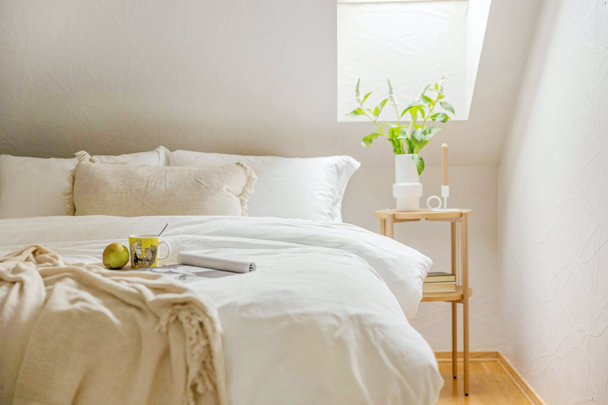
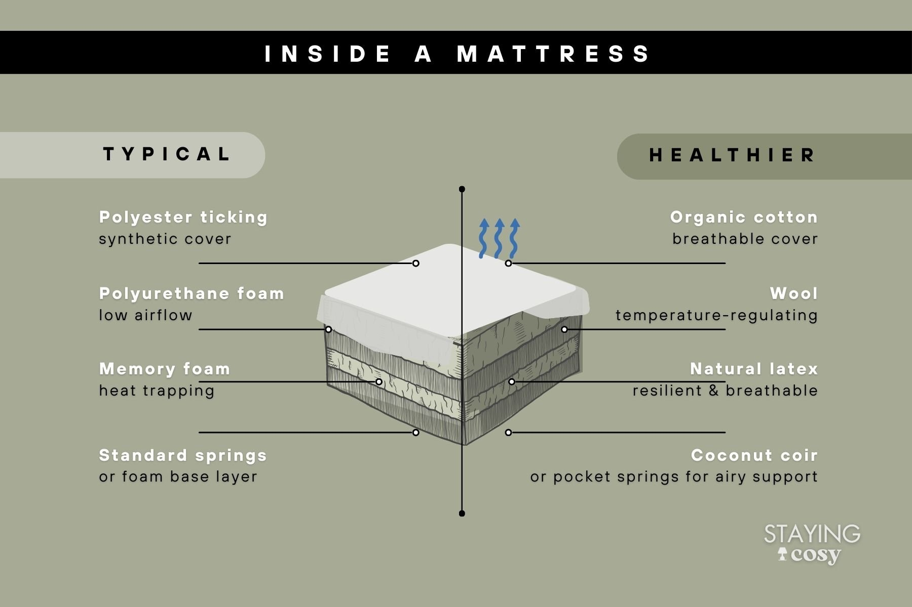
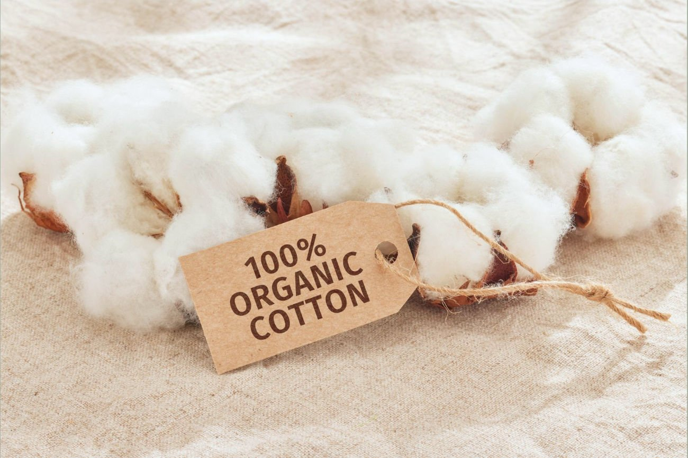
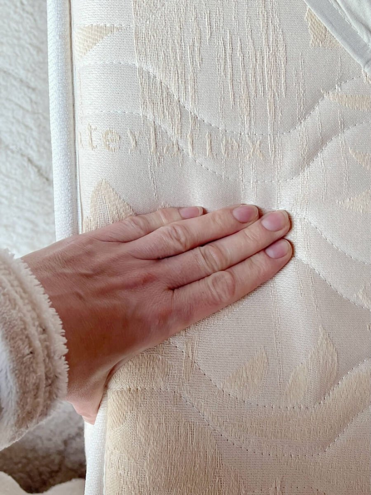

*Latex mattress, natural coconut fibre, or the classic spring combination? Standing in front of a wall of mattresses in a showroom can feel overwhelming. Every label promises comfort, support, better sleep… and before long they all start sounding the same. How do you cut through the noise and find the best eco-friendly mattress that’s non-toxic and supportive?*

<Caption>
Image credit: [Lisa Anna](https://unsplash.com/@lisaanna195?utm_source=unsplash&utm_medium=referral&utm_content=creditCopyText) on [Unsplash](https://unsplash.com/photos/a-bed-with-a-white-comforter-and-pillows-pzinSuHrbwA?utm_source=unsplash&utm_medium=referral&utm_content=creditCopyText)
</Caption>

Few things restore the body more than deep, uninterrupted sleep. The recommended nightly rest for adults is around eight hours, with a little more for growing children. That adds up to roughly one third of our lives. An impressive amount, and one worth protecting with a healthy mattress choice.

I vividly remember the moment, years ago, when we upgraded our well-loved futon to a firmer natural latex mattress. At the time I was pregnant, and the difference felt like a small miracle. Suddenly mornings were easier, and my back very much approved of the change.

Yet when the time came to buy mattresses for our children’s beds, the process was far more practical. We checked a few options, visited the nearest shop, tested a couple of models and chose the ones that felt best. Quick and simple. Parenting sometimes doesn’t allow much time for deeper exploration. And to be fair, they turned out to be excellent pick.

But looking back, I wonder if we could have chosen mattresses made from healthier, natural materials — options that would be eco-conscious as well as comfortable.

## The Main Types of Mattresses You’ll Encounter

<Caption>
Image credit: [D koi](https://unsplash.com/@dkoi?utm_source=unsplash&utm_medium=referral&utm_content=creditCopyText) on [Unsplash](https://unsplash.com/photos/a-group-of-white-fluffy-objects-W1rK4mBImv4?utm_source=unsplash&utm_medium=referral&utm_content=creditCopyText)‍ ‍
</Caption>

Before we dive into the eco options, it helps to know the main types of mattresses you’ll most likely encounter in stores. Understanding the basics makes it easier to spot healthier alternatives. Most mattresses today are simply different combinations of these three foundational types.

**1. Foam mattresses**

Foam mattresses are built from layers of foam, usually with a denser base layer for support and a softer top layer for comfort. Within this category, there are several types — standard polyurethane foam and newer high-resilience or gel-infused foams. Another familiar type is memory foam, which allows your body to sink gently and then slowly rebounds to its natural shape. Not everyone finds this sensation comfortable, so it’s always worth testing in a store before buying.

Foam mattresses can offer excellent support and help keep the spine aligned. The downside is that many are synthetic, which can trap heat and sometimes release chemicals — something to consider if you’re aiming for a healthier, more eco-conscious bedroom.

**2. Spring mattresses**

Spring mattresses use metal coils, either traditional open springs or **pocket springs**, where each coil sits in its own fabric pocket. They often have additional padding on top, sometimes foam or fibre layers. Springs are naturally breathable and provide good support, especially for heavier bodies, and they tend to feel bouncier than foam.

Springs help airflow through the mattress, which can make for a cooler night’s sleep. The padding on top is usually where materials vary: many conventional mattresses still rely on synthetic layers, which can affect both breathability and chemical exposure. Choosing a spring mattress with natural fillings or organic top layers is a simple way to make this type healthier for both your body and your home.

**3. Hybrid mattresses**

Hybrid mattresses combine the best of both worlds: a spring core for support and airflow, topped with foam or latex layers for comfort. They’re very common today and can be made in either conventional or natural ways. The layers on top: foam, latex, or fibre determine the feel, breathability, and overall eco-friendliness of the mattress.

Hybrids can offer the supportive bounce of springs with the contouring comfort of foam or latex. For those seeking healthier sleep, the choice of natural or low-VOC materialsin the top layers makes a big difference, letting you enjoy the benefits of a hybrid mattress without compromising your [indoor air quality](/blog/fresh-air-in-home) or sustainability goals.

## Where Conventional Mattresses Fall Short

<Caption>
Graphic: Staying Cosy — made in Canva
</Caption>

Now we come face-to-face with the realities of good sleep from a health perspective. Many conventional mattresses rely heavily on synthetic foams. Comfortable at first, these materials can trap heat and sometimes release small amounts of chemicals as they age.

Synthetic foams are often petroleum-based. For this reason, it’s recommended to **air out a new mattress for a few days** before sleeping on it. This gives any initial [VOC emissions](/blog/chemicals-that-pollute-our-living-rooms) a chance to dissipate and makes your bedroom a little healthier from the very first night.

Dense foam also tends to trap body heat. You know that feeling of over-sweating that doesn’t evaporate fast enough? Often, it’s the mattress restricting airflow. When synthetic layers limit natural ventilation, our sleep quality can be affected — even if the mattress feels soft and supportive at first.

## Materials That Make a Mattress Healthier

Wool, cotton, and coconut fibre are excellent options when choosing a natural fibre mattress for children and adults alike. They provide comfort, breathability, and long-term durability. An organic mattress for deep sleep is a superior choice for restorative, healthy nights.

<Caption>
Image credit: Canva - edited
</Caption>

### Natural Latex

This is no newcomer in the world of mattresses. Natural latex comes from the sap of the rubber tree, which is processed into a resilient, flexible foam. Unlike its synthetic polyurethane counterparts, natural latex is both breathable and remarkably durable. After my personal testing, I can confidently say it is an ideal healthy mattress for pregnancy, providing firm support without harmful chemicals.

It gently adapts to the body while still providing **solid support** for the spine. I’ve had one myself for several years. It doesn’t really contour the body, so you feel like you’re sleeping *on* the mattress rather than sinking deeply into it. If, like me, you’re not a fan of that sinking-in sensation, this might be a great option for you.

**Keep in mind**

Natural latex can last many years without losing its structure. Combined with its breathability and low chemical load, it’s one of the most popular materials for healthier, eco-conscious sleepers.

### Wool Layers

Wool is one of nature’s most impressive temperature regulators. It keeps us warm in winter, yet somehow manages to stay comfortable in milder weather too — a quality that translates beautifully into mattresses.

Besides helping regulate temperature, wool also **wicks away moisture**, meaning perspiration doesn’t linger in the mattress. Instead, it evaporates naturally, helping keep the sleep environment dry and comfortable.

Wool adds a breathable cushioning layer while naturally managing humidity. That’s a small but important detail for a restful night’s sleep.

### Horse Hair

A step further from wool in durability and structure, horsehair is one of the oldest and most impressive mattress fillings still in use today. It’s valued not for softness, but for its remarkable resilience and ability to regulate moisture naturally.

When used in mattresses, horsehair creates a responsive, slightly springy layer that helps air circulate freely through the core of the bed. This constant airflow is what gives it its reputation for staying dry and fresh over time — even in warmer climates or more humid homes.

Historically, it has been used in traditional mattress making for centuries, often in higher-end natural builds where longevity matters more than instant softness. It also happens to be naturally **resistant to dust mites and bacteria**, which makes it a thoughtful option for those sensitive to allergens.

It’s not a material that tries to feel luxurious in an obvious way. Instead, it works in the background, supporting structure, breathability, and long-term comfort in a very understated way.

### Coconut Fibre

While coconut works wonders for flavouring dishes, its fibrous husk also has an unexpected second career inside mattresses. Coconut coir is made from the fibrous husk of coconuts. Once compressed into firm sheets, it becomes an excellent support layer within a mattress.

This material is **naturally springy** and extremely breathablethanks to its open structure. Air can move through the fibres easily, helping heat and moisture dissipate instead of getting trapped.

Coconut coir provides firm support and encourages airflow without relying on dense synthetic foams, making it a naturally comfortable and healthy layer.

### Organic Cotton Covers

Most mattresses are finished with an outer fabric layer known as the **ticking**. When made from organic cotton, this cover becomes a breathable surface that sits closest to your body.

Cotton allows air to circulate while remaining soft and comfortable against the skin — especially when paired with natural fillings like wool or latex beneath it. The ticking is sometimes removable and washable, which sounds like a great idea in theory. In practice, it can be a bit of a wrestling match.

I remember this clearly from my mum’s mattress. Getting the cover back on after washing, especially if it has shrunk even slightly, is rarely worth the effort.

For everyday use, it’s often easier to opt for a breathable slip-on mattress protector that can be washed alongside your bed linen. This outer layer completes the mattress system, helping the natural materials inside regulate temperature and moisture more effectively.

☘︎ ‍**What to Look For When Choosing an Eco Mattress**

- Natural layer composition — e.g., latex + wool, coir + latex.
- Firmness & spinal support tailored to your body.
- Organic or eco certifications such as GOTS, or OEKO-TEX.
- Breathable cotton outer layer of the mattress, called ticking.
- Removable mattress protector — optional, helps keep the mattress clean.
- Size & thickness to fit your bed perfectly.

## Eco Mattress Types Worth Considering

Now that we’ve explored the materials, let’s look at how they come together in actual mattress types. Choosing the right kind can make all the difference for your comfort, sleep quality, and long-term health.

<Caption>
Image credit: Staying Cosy
</Caption>

### Natural Latex Mattresses

**For longevity and support**

Usually layered with wool or cotton for extra softness, these are responsive and slightly springy. They provide solid support without that sinking sensation, making them ideal for eco-conscious sleepers who move frequently during the night.

**My best picks:** [Neonatura Latex Mattresses](https://www.neonatura.eu/mattresses/natural-latex-mattress.html) (EU) | [Avocado Spring-free Organic Latex Foam Mattress](https://www.avocadogreenmattress.com/products/organic-latex-foam-mattress) (US)

### Wool, Horsehair and Cotton-Top Mattresses

**Naturally regulating temperature**

Featuring thick wool, horsehair or cotton layers over a supportive base, these are excellent for those who struggle with night sweats. The natural fibres act as a built-in climate control system, keeping the surface breathable and soft.

**My best picks:** [Baumberger Rossa Horsehair Mattress](https://www.baumberger.eu/en/classic-collection/#read-more-rossa) (EU) | [Cotton Sleep Organic Cotton & Wool Mattress](https://www.amazon.com/COTTON-SLEEP-Cotton-Mattress-Fiberglass/dp/B0FGXRM7JP/ref=sxbs_pa_sp_search_thematic_btf_sspa?content-id=amzn1.sym.ad22450d-6082-41d7-8247-a75bc80cf7c2%3Aamzn1.sym.ad22450d-6082-41d7-8247-a75bc80cf7c2&crid=1A97ZT99OMUS1&cv_ct_cx=wool%2Bor%2Bhorsetail%2Bmattress%2Beco&keywords=wool%2Bor%2Bhorsetail%2Bmattress%2Beco&pd_rd_i=B0FGXRM7JP&pd_rd_r=d4487aaf-6551-43e6-8599-47fa561c8cb7&pd_rd_w=165GS&pd_rd_wg=xh2Hq&pf_rd_p=ad22450d-6082-41d7-8247-a75bc80cf7c2&pf_rd_r=T68TTJQZ4GTX5T41XA32&qid=1778498231&s=home-garden&sbo=RZvfv%2F%2FHxDF%2BO5021pAnSA%3D%3D&sprefix=wool%2Bor%2Bhorsetail%2Bmattress%2Beco%2Cgarden%2C192&sr=1-1-a693d726-5e2f-419b-97dc-a19c77786b55-spons&aref=EwtYELASqU&sp_csd=d2lkZ2V0TmFtZT1zcF9zZWFyY2hfdGhlbWF0aWNfYnRm&th=1) (US)

### Coconut Coir or Hybrid Mattresses

**A firmer feel with airflow in mind**

If you prefer a firmer feel, coconut coir provides robust support and excellent airflow. Often combined with latex and wool, these hybrids offer a balanced comfort that is particularly well-suited for hot sleepers.

**My best picks:** [Greenfibres Natural Latex and Coconut Coir Mattress](https://www.greenfibres.com/natural-latex-coir-mattress) (EU) | [Comfort Pure Natural Coconut & Latex Mattress](https://comfortpure.com/products/cocomat-mattress?_pos=2&_sid=809fdb9be&_ss=r) (US)

### Eco-friendly Futons and Roll-Ups

**Simplicity and space-saving comfort**

Lightweight, flexible, and surprisingly supportive, these are often crafted from layers of latex, coir, or organic cotton. They are perfect for guest beds or minimalist homes where [space is at a premium](/blog/small-studio-bedroom-bed-placement).

**My best picks:**[Futon Design Latex Futon Mattress](https://www.futondesign.be/en/notre-collection/matelas-futon/futon-latex/) (EU) | [The Futon Shop Shikibuton Latex and Natural Wool Futon Mattress](https://www.thefutonshop.com/all-natural-latex-and-wool-shikibuton-mattress) (US)

You might encounter mattresses that are reversible, with a summer/winter side, but most modern eco designs only need occasional rotation to maintain even wear. Once in a while, this helps keep the mattress performing at its best over time. Most experts recommend replacing a mattress every seven years to maintain comfort, support, and hygiene.

Many companies also offer trial periods, allowing you to return a mattress if it isn’t quite right — a reassuring way to invest in nightly comfort.

<Caption>
Image credit: [iam_os](https://unsplash.com/@iam_os?utm_source=unsplash&utm_medium=referral&utm_content=creditCopyText) on [Unsplash](https://unsplash.com/photos/a-person-lying-in-a-bed-tgMKcE-Qo5o?utm_source=unsplash&utm_medium=referral&utm_content=creditCopyText)‍ ‍
</Caption>

Sleep is important. It’s intimate and immediate, felt with every inch of our body. The mattress we choose will serve us for many years, guarding the quality of our sleep. Taking a little extra time before committing can help ensure it’s the right fit for your home as it is for your back.

Choose thoughtfully, and your mattress will reward you with many nights of deep, rejuvenating rest.

---

**☘︎ Want more ways to make your home a sanctuary?**

*•* [*Wool, Cotton & Linen — Bring Warmth Back into the Living Room*](/blog/natural-textiles-wool-cotton-linen)

*•* [*Hardwood vs Laminate Floor — Which is Best for Your Home?*](https://real-wood-vs-laminate-flooring-guide)

*•* [*Tassel & Pom-pom Home Upgrades with a Touch of Whimsy*](/blog/tassel-and-pompom-home-upgrades)

SEARCH THE BLOG

