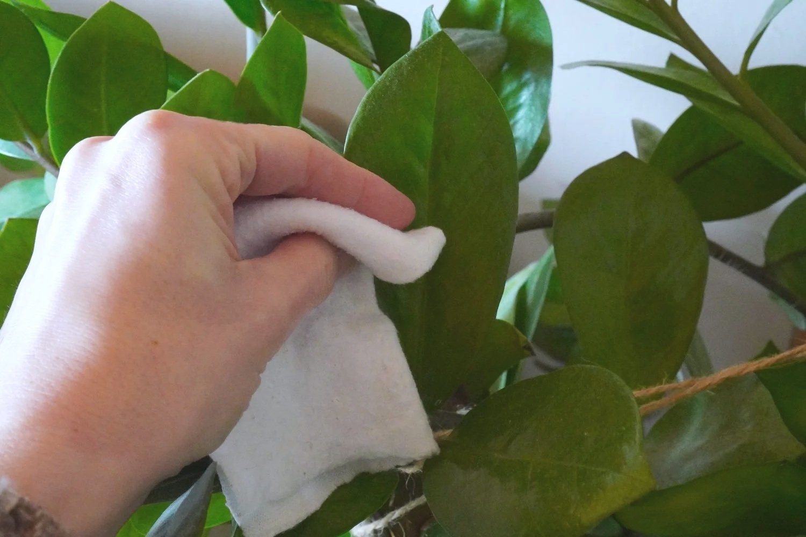
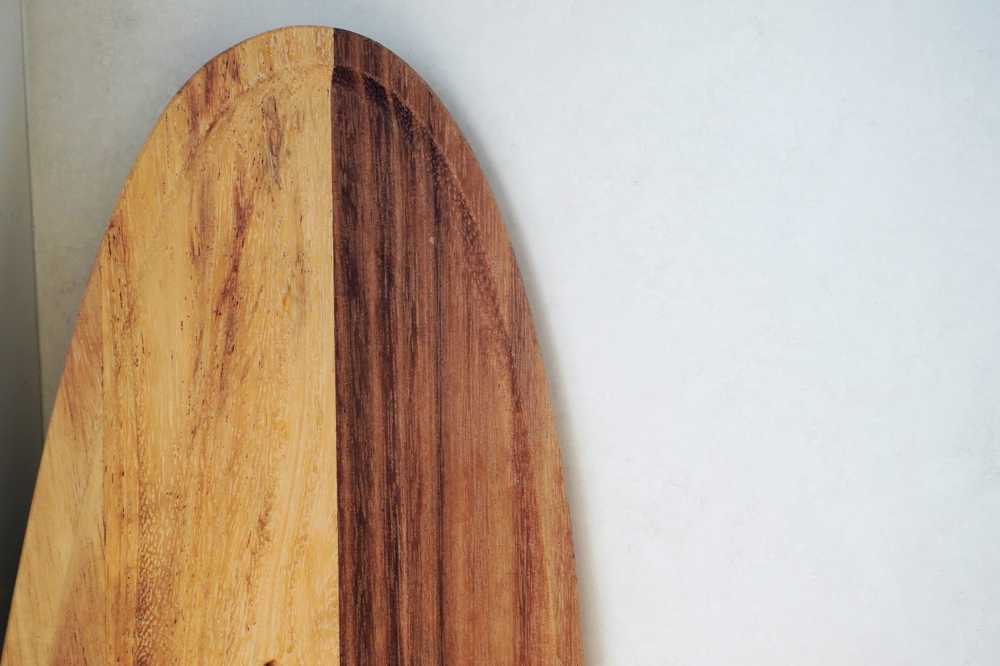
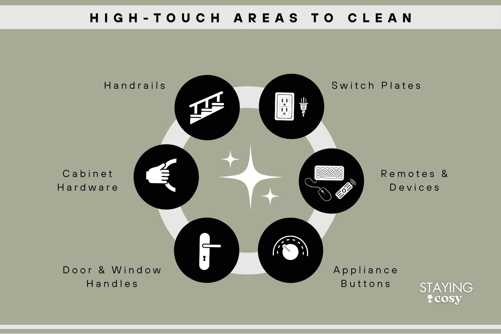
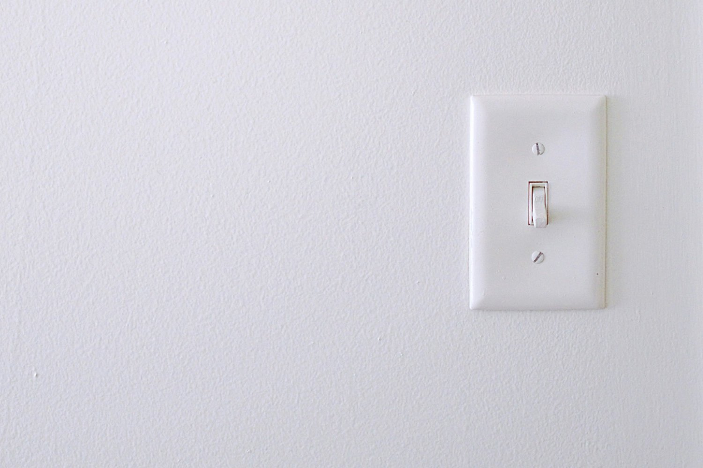

*You can feel it before you see it. That subtle shift when the air loses its winter edge and suddenly turns soft, carrying the scent of damp earth and new life. For me, this moment also marks the renewal of the home, when the traditional spring cleaning of the house begins to feel less like a chore and more like a necessary homecoming.*

<Caption>
Image credit: [Olivia Harper](https://unsplash.com/@liv_harper?utm_source=unsplash&utm_medium=referral&utm_content=creditCopyText) on [Unsplash](https://unsplash.com/photos/a-white-curtain-hanging-from-the-side-of-a-window-xnppIJt_3-I?utm_source=unsplash&utm_medium=referral&utm_content=creditCopyText)
</Caption>

As warmer days approach, I find myself moving away from the frantic *scrub-everything mentality* of the traditional spring cleaning checklist. Instead, I’ve started viewing this season as an opportunity to refresh the house. Especially the high-touch surfaces we use daily but often forget about. Or perhaps I’m just getting older and finally valuing my time and energy more than the pursuit of a sterile, perfect interior.

Once we move past the winter grime, we can take the time to honour and protect the materials our homes are made from. Let this season be about resetting the energy of the rooms we call home, turning them back into the sanctuaries they are meant to be.

## 1. The Ritual of Air & Leaves

At the end of winter, it often feels as if our own lungs are yearning to expand and inhale the fresh, moist spring air after a season of indoor dryness. There is no better way to welcome this change than by inviting the oxygen directly into our homes. But first, we must ensure we make the most of it.

### Cross-breeze Reset

Opening the windows for a strategic cross-ventilation session is the first and most vital step of a spring home refresh. Aim for fifteen minutes with windows open on opposite sides of your home; this allows the air to physically push out the stagnant winter energy and replace it with a clean slate.

### Houseplant Rejuvenation & Leaf Cleaning

While the breeze moves through the rooms, turn your attention to your houseplants. Use a soft, damp cloth to gently wipe the winter dust off their leaves. If you have the space in your bathroom, most plants will deeply benefit from a quick, lukewarm shower afterward. Mimicking a gentle spring rain rejuvenates them for the warmer, sunnier days ahead.

<Caption>
Image credit: Staying Cosy
</Caption>

Plants are truly our home’s natural lungs. Wiping their leaves improves their aesthetics; but also helps them photosynthesise better. This in turn improves your indoor air quality more effectively.

Thanks to your [air-purifying plants](/blog/air-purifying-plants), combined with the fresh oxygen from open windows, your home’s air becomes positively charged and oxygen-rich. It’s a simple truth of a healthy home: clean air supports a healthy body.

☘︎ ***Fresh Pots, Happy Plants:***

Give your plants a completely fresh start this spring! If you have time, move them into slightly larger pots — their roots will thank you, and the foliage will flourish through the sunny months.

## 2. The Wood & Stone Nourishing Ritual

Now take a deep breath, pause for a moment, and let’s turn our attention to what the dry winter air might have done to our wood surfaces.

If the air in our homes feels dry after a long winter of heating season, imagine what it has done to the organic materials within our interiors. I always notice how our wood cladding shrinks during the cold season. Wood, bamboo, and cork are living, breathing foundations, and by springtime, they are often thirsty, having lost some of their natural luster to the indoor climate.

### Oiling Thirsty Wood

After a gentle cleaning with warm water and a non-aggressive, eco-friendly cleaning product specifically designed for wood, we can begin to restore the dry surfaces. A soft cloth and a drop of natural beeswax or linseed oil can transform a parched tabletop into a glowing centrepiece. It is a slow, tactile ritual.

And if your kitchen has wooden countertops, you might enjoy my [step-by-step guide on how to oil them](/blog/how-to-oil-wooden-counter-tops). Oiling will deepen the wood’s colour and enhance its grain.

<Caption>
Image credit: Staying Cosy
</Caption>

> “You will literally feel the wood rejoice under your hands as you restore its moisture, reconnecting you with the very soul of the material.”

Take a moment to look closely at the high-use areas of your furniture or your cork and wood flooring. The beauty of these materials is their ability to be healed. Unlike synthetic surfaces, a dry patch or a small scratch isn't a permanent flaw; it is a mark of life that can be refreshed with a bit of oil and intention. By nourishing these materials now, you are ensuring they remain resilient for the years to come.

**Chopping Boards & Utensils**

This is also a golden opportunity to grab a food-safe wood oil and move on to your kitchen chopping boards and wooden spoons. The rhythmic act of oiling can be deeply soothing. It offers an unexpected moment of meditation and a mental wind-down, all while preserving the tools you use to nourish your family.

### Natural Stone Care

Natural stone surfaces like marble, granite, or quartz require just as much love as your timber floors. We shouldn’t clean stone to strip it; we clean it to feed it. Like wood, stone is porous and it breathes. Sealing it with synthetic, plastic-based waxes only suffocates the natural character of your home. To keep your surfaces healthy, aim for this nourishing ritual at least once a year.

Avoid the common mistake of using acidic cleaners like lemon or vinegar on stones like marble, as they slowly eat away at the polish. Instead, use a simple pH-neutral soap and warm water for the initial clearing. Once dry, nourish the surface with a breathable, natural, oil-based stone sealer. The sensory result is beautiful: the stone loses that *chalky* dryness, regains its visual depth, and feels cooler and smoother under your palm.

## 3. The High-Touch Reset

How often do you think of your door handles as a breeding ground for bacteria? We touch them dozens of times every single day. Truth be told, I am far from obsessed with hyper-sanitisation, but common sense suggests that giving them a thorough cleaning once a year feels like a justified part of a seasonal reset.

<Caption>
Graphic: Staying Cosy — made in Canva
</Caption>

### Sanitising the Invisible Points of Contact

Grab a damp cloth and a disinfectant spray, and move slowly room-by-room. Start with light switches, then move on to door knobs, window handles, and furniture pulls. If you don’t have a favourite [anti-bacterial eco-cleaning product](https://www.amazon.com/Method-Cleaner-Antibacterial-Citron-Ounce/dp/B07DBRMHHS/ref=sr_1_11?crid=JWF7HN4YZJG1&dib=eyJ2IjoiMSJ9.nSe_xOiCQ2Ct33jDTpBKDsQKAglzEDHXxKxZO5xzfp2nuvpxzhWPTtL32P3RZ5_hMHGps26JACcECZ5XtKgVjnbsyTJ0HxeDBupoV0Rtc7YrrYQ2uWvS6f8B3_dR9guxBfI8Q0m4dPKcnyU71TEyr9oTDfxsbLzZkopbhdvg5fEQM8UXI2DNtEqsdcRkR6-5BVNG6Hwh6FW_s4b_sV5VhNytx3KqATT_yOsUyWduNOszO7VZ4AqfCYfbgqkNYlxWkXrnh2ndG3bdRC8RaOWbzBDI2pAQmhs4juYPbZ04KDc.fjt2k4mYkYVf0rBsAGDO4cWZbobnx9NzhWb12GXNO14&dib_tag=se&keywords=eco%2Bcleaning%2Band%2Bsanitising%2Bspray&qid=1773304062&sprefix=eco%2Bcleaning%2Band%2Bsanitising%2Bspray%2Caps%2C196&sr=8-11&th=1) on hand, a simple **1:1 ratio of white vinegar and water** with five drops of lemon or eucalyptus essential oil works beautifully. It is naturally antibacterial and smells like a fresh start.

I love putting some tunes on while doing this — time flies by, and the calm beats turn cleaning into a little dance around the house.

### Deep Kitchen Audit

The kitchen is the heart of the home’s activity. By spring, it often carries a fine layer of *winter hustle* in the high-traffic zones. First, focus on cleaning areas around your bins and the kitchen cabinet hardware. Wipe down the kettle handle, the toaster, and the fridge/freezer door pulls.

If you find yourself with extra energy, you might as well give your kitchen a little deeper grime removal. Beyond the handles, take a moment to wipe the top edges of your cupboard doors and the seals of your fridge, freezer and dishwasher. These are places where dust and cooking oils collect over time. You can follow by giving the exterior of all your cabinetry a quick wipe.

If you have open shelving, a quick damp-dusting of the jars and bottles will instantly brighten the room. Don’t forget your extractor fan and island lights. By removing the film of the past season, light suddenly has more surfaces to bounce off. It’s amazing how much light a clean surface reflects back into the room.

☘︎ ***Pro-tip:***

Do you ever clean your knife handles? I didn’t — until I realised that most of us tend to overlook them. Now it’s a staple in my seasonal routine. It’s a small detail, but it makes your most-used tools clean and ready for your cooking adventurous.

<Caption>
Image credit: [Isabella Fischer](https://unsplash.com/@izzyfisch_?utm_source=unsplash&utm_medium=referral&utm_content=creditCopyText) on [Unsplash](https://unsplash.com/photos/white-wall-switch-ynfmVbvunQU?utm_source=unsplash&utm_medium=referral&utm_content=creditCopyText)‍ ‍
</Caption>

Without much hassle, these small rituals can be accomplished afternoon-by-afternoon over the course of a week. Your reward will be a full sensory reset: fresh air to breathe, beautiful satin-oiled surfaces to touch, and a clean, ready-to-use kitchen that is prepared to nourish your family.

Let this sensory spring cleaning ritual become part of your annual mind reset as well. A gentle way to reclaim your time, energy, and the soul of your home.

---

**☘︎ Are you looking for more eco-ideas?**

[*Effective Window Cleaning Hacks*](/blog/effective-window-cleaning-hacks) *|* [*Holistic Interior 101*](/blog/holistic-interior-design-guide-101) *|* [*Toxin-free Home*](/blog/chemicals-that-pollute-our-living-rooms)

SEARCH THE BLOG

