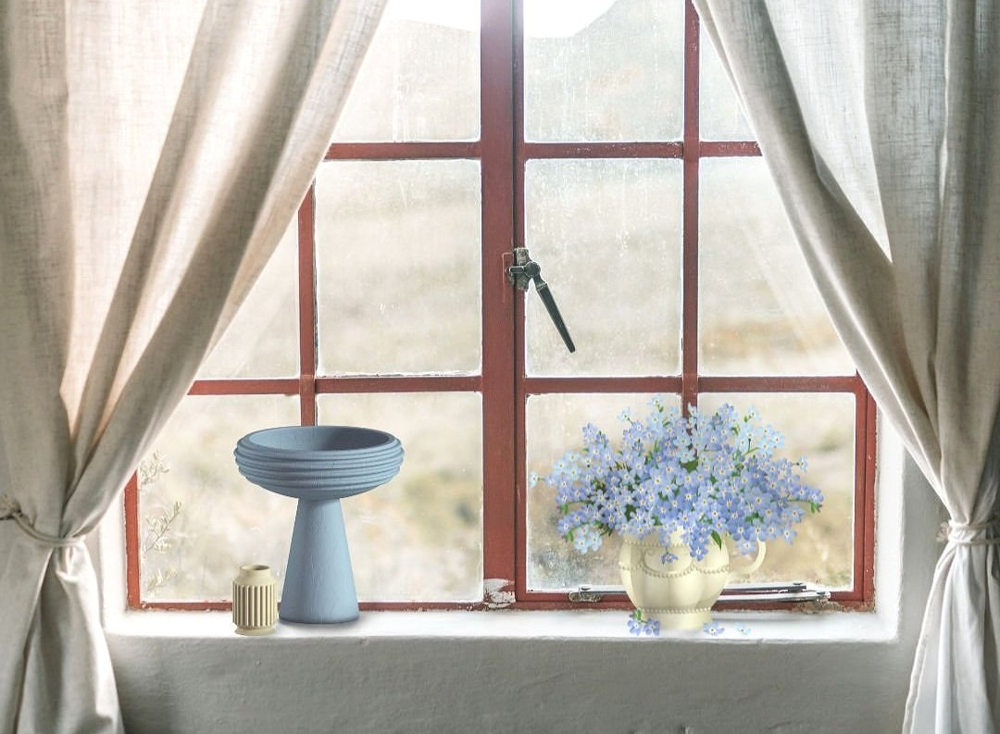
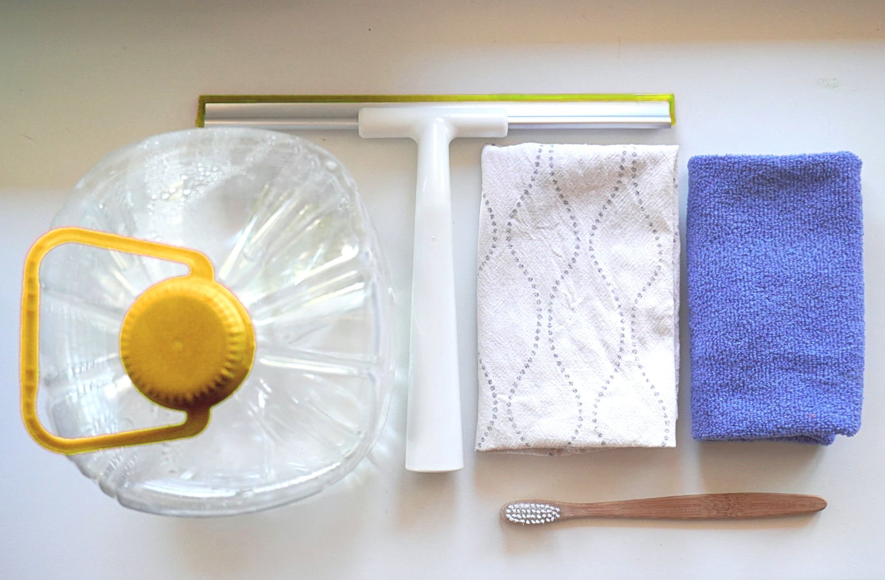
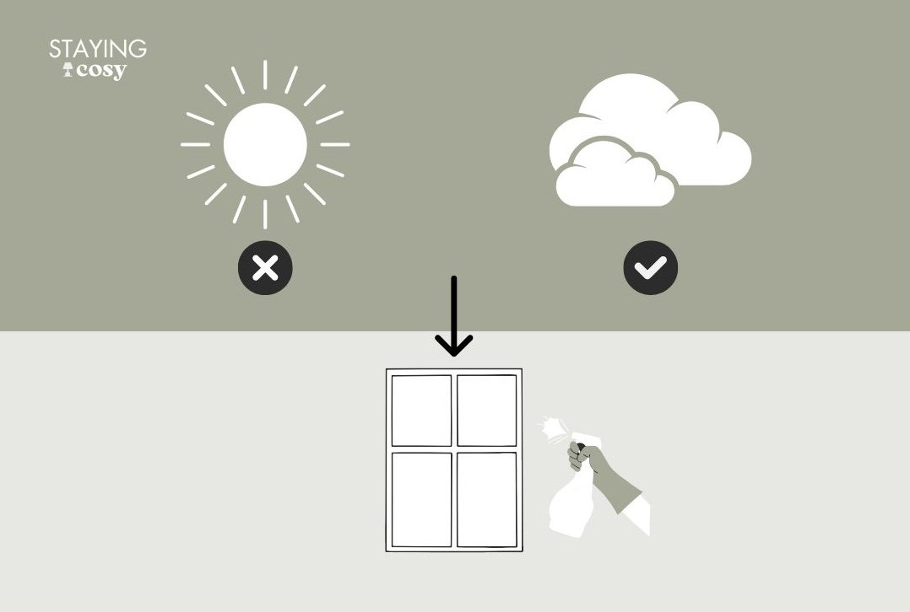
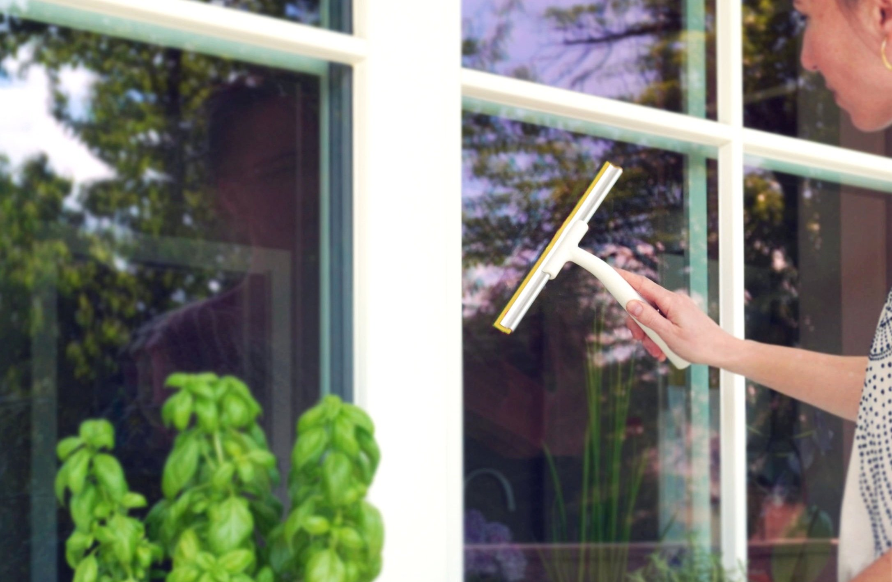
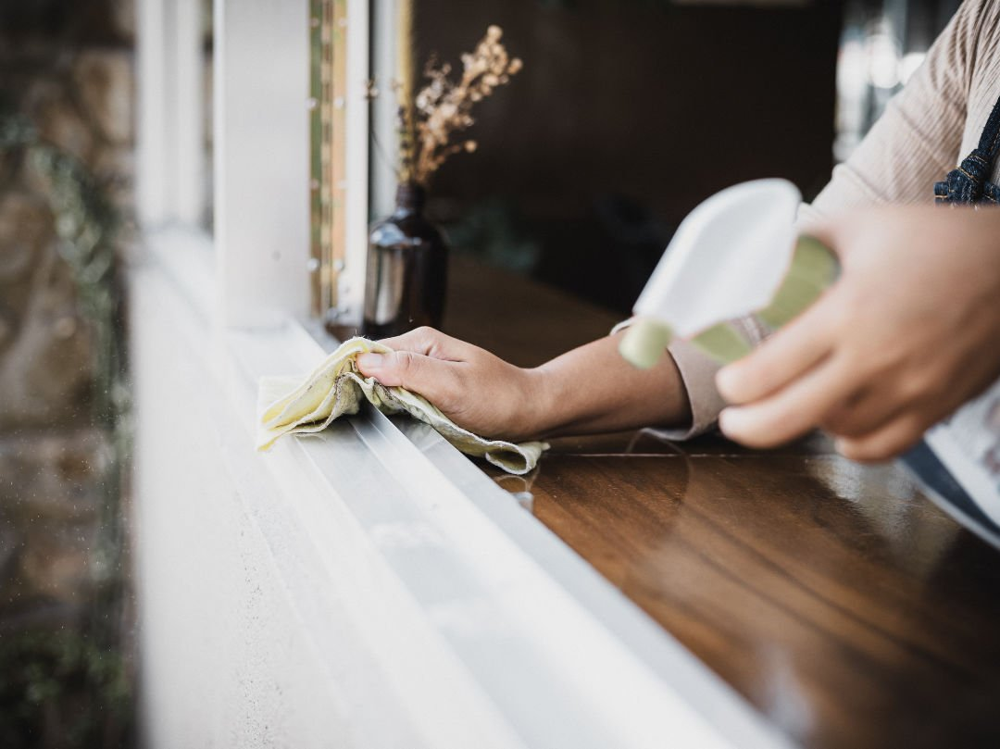
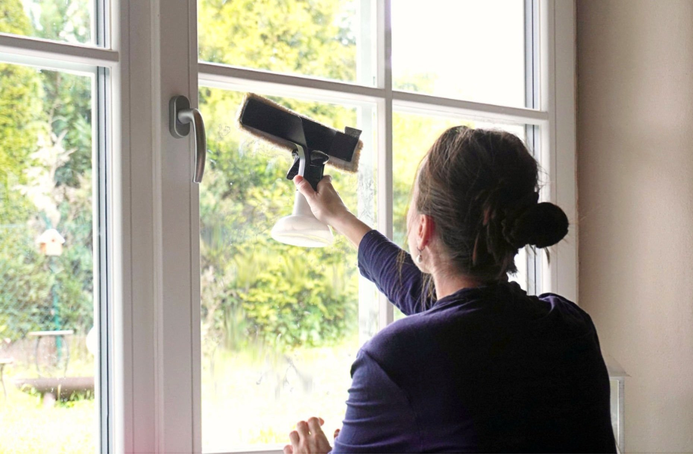
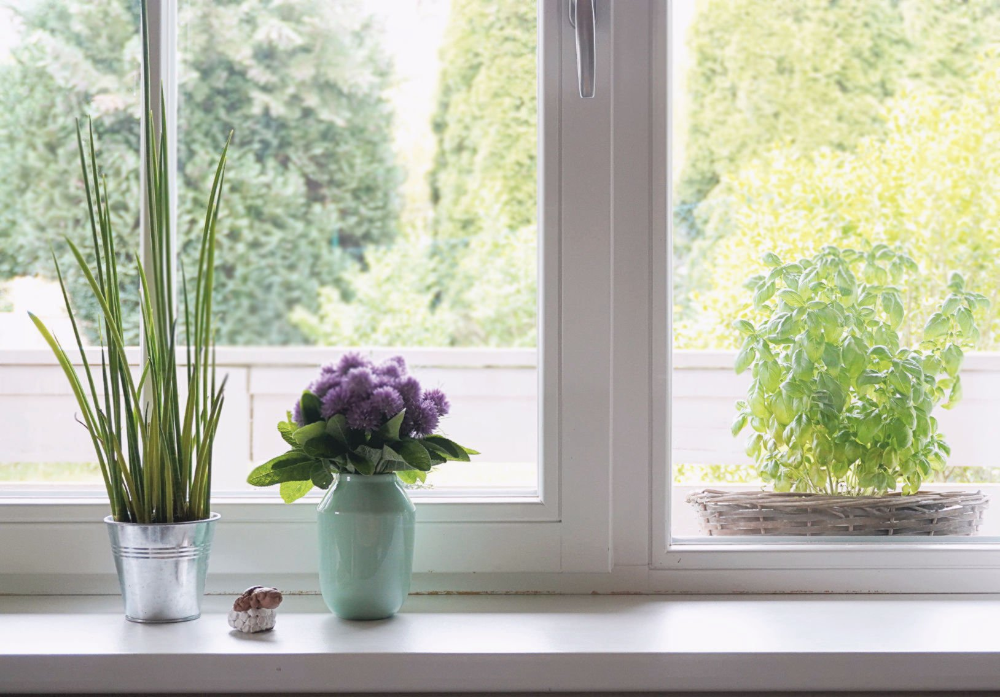

*Every year, the same story repeats itself. My window-cleaning dilemma creeps in from behind my dirty windows. I keep pushing it aside, trying to trick my brain into believing I can still see clearly through all that grime on the glass!*

<Caption>
Graphic: Staying Cosy - made in Canva
</Caption>

If you’re lucky enough to hire window cleaners—amazing! This post probably isn’t for you. But if you’re flying solo this spring, I’ve got some practical tips to help you clean faster and get better results, with way less effort.

Can we win this battle? I say yes.

If you’ve been around here for a bit, you know how much I love my pretty white windows with the decorative framing. I’ve heard countless times that I should’ve chosen something easier to clean—but I actually find the small panes quite helpful! I do a few at a time, and it’s easier to pace myself or take breaks without losing track.

Over the years, I’ve picked up a few tricks to make window cleaning quicker and less of a chore—and I’d love to share them with you.

> “Trust me, the satisfaction of crystal-clear windows is instant. You’ll notice the difference right away.”

## Prepare the Following Tools

- Distilled water
- Microfibre cloth
- Non-fibrous cotton cloth or paper towels
- Plastic container or a small bucket
- Window squeegee
- Old toothbrush
- Old newspaper
- Vinegar
- Battery-operated window vacuum

<Caption>
Image credit: Staying Cosy
</Caption>

Just one heads-up: *gather all your supplies before you start.* Realising you forgot something mid-scrub and having to run to the shop? Instant momentum killer.

You probably won’t need everything on the list — choose what works best for you and your style of cleaning—scroll down for my techniques to help you decide.

## When & How to Clean Your Windows

Yes—*when* and *how* you clean really *does* matter. If you are a newbie to the window-cleaning game, this might just be a life saver.

### Clean your windows when:

- the sun is *not* shining directly on them, or
- ideally, on a cloudy day.

<Caption>
Graphic: Staying Cosy - made in Canva
</Caption>

#### *Why?*

Because cleaning in direct sunlight can cause your solution to dry too quickly, leaving behind those dreaded streaks before you even have a chance to wipe them away.

It’s totally fine if it’s sunny—just avoid windows that are currently in the sun. I clean my south-facing windows in the morning and my east-facing ones later in the afternoon. Follow the sun’s path and you’ll naturally move around the house in the right order. On overcast days, you’re free to start wherever it suits you best.

### Always start from the top.

That way, any drips will fall on the yet-to-be-cleaned sections, not the spotless ones. Simple tip, big difference.

### Clean the indoor side of all windows first.

Indoor panes are usually less dirty, and it’s more efficient to do them all in one go. Swapping between inside and out wastes time—and risks getting your tools filthy from the outdoor muck.

Once you move on to the exterior, start with a quick grime-run using a separate cloth and bucket to wipe off the thickest layer of dirt. Then switch to your usual tools for a proper, streak-free clean.

<Caption>
Image credit: Staying Cosy
</Caption>

## Before You Start…

It sounds easy enough—but let’s make sure we don’t forget any extras before getting our hands dirty!

### Wipe down the window frames.

They’re are part of the windows too, right? If you have wooden windows like I do, use a standard wood-cleaning product. Even better, go for one that contains wax to give the wood long-term protection. I always use it on the exterior frames—keeps them looking good and lasting longer.

For aluminium or plastic frames, a universal, non-abrasive cleaner or a simple mix of mild soap and water will do the trick.

<Caption>
Image credit: Canva - edited
</Caption>

### Clean your mirrors and other glass surfaces too.

Don’t pack away your tools just yet! With everything out and ready, it’s the perfect time to tackle mirrors and any other shiny glass bits around the house—like tabletops, glazed cabinet doors, or interior glass panels. Same tools, same motion, same reward. Why stop at one job when you can knock off a few at once?

### Plan multiple sessions.

Got too many windows to clean in one go? Don’t push it. Split the job into manageable chunks—maybe a few evenings after work, or a couple of weekend mornings.

As a rough idea:\
– ***Prep*** takes around 5-20 minutes\
– ***Cleaning*** one side of an average-size window + frame takes about 5–8 minutes. – ***Tidying up*** afterwards takes about 10-15 minutes

So yes—it’s doable. Just not *all at once.*

<Caption>
Image credit: Canva - edited
</Caption>

### Put some inspiring tunes on.

I genuinely can’t clean without music. Whether it’s an upbeat playlist to power through, or some mellow tunes to match a slower mood, music keeps the rhythm going—and your mind off the task.

## Seven Simple Techniques for Sparkling Windows

Everyone’s got their own style, but after years of trial and error, these are the techniques I find the most effective. Pick one—or mix a few—to find what works best for you.

<Caption>
Image credit: Staying Cosy
</Caption>

### 1. Distilled Water For No Streaks

Streaks aren't always dirt-related—they often come from the minerals in regular tap water. Just like on your cutlery, those minerals dry into visible marks. That's why I always recommend using [distilled water.](https://www.amazon.com/Resway-Respironics-Humidifier-Demineralized-Antibacterial/dp/B07PLM98Y7/ref=sr_1_4_sspa?crid=36TKHEMCP4HCE&dib=eyJ2IjoiMSJ9.QBnbCHloGvu7UCI28vCftZHq6LqE5jyfMse8THLzSCYvpmmRM_IdUYfabc5tVRYst2CuE7PjLD02XGJrvZUb3FuYmv7d0f8tKJuMXt9EnefWVNQkrkgJ6pyztB2za7x6FmRr3qSgQo3JsrrfWEb5LpqkR8S1-pCmuM4N1DWbiPpcYr5-3q9CTmz-oaejqBwsnsKy-bA2OxnKOEZHXmxfBPiTbR4_svfko49-zVaqfs4t4iYNTp825wuwfJ1WEOjc3LOE2DItyYFsTK4hl6larDggwKEI9wUEdfrzLmf5Iak.WO8Zmr1NSvhnUIPYbHoQTUlfWgEJft1rJzoen6lDV7E&dib_tag=se&keywords=distilled%2Bwater%2Bfor%2Bcleaning&qid=1747903051&sprefix=distilled%2Bwater%2Bfor%2Caps%2C507&sr=8-4-spons&sp_csd=d2lkZ2V0TmFtZT1zcF9hdGY&th=1) If you don’t have it, don’t worry—just move on to the next tip!

### 2. Vinegar to the Rescue

A classic and eco-friendly alternative. Mix white vinegar and water in a 1:1 ratio. It not only cleans wonderfully but also balances out mineral residue, especially helpful if you're using tap water. No need for store-bought cleaners—this does the job beautifully.

### 3. Spray & Leave

Perfect for extra-dirty patches. Spray your cleaning solution and let it sit for a minute or two. It softens stubborn dirt so you don’t have to scrub like mad.

### 4. Squeegee or Vacuum—Your Choice

If you’ve never used a battery-powered window vacuum—please do. I use a [Karcher](https://www.amazon.com/karcher-window-vac/s?k=karcher+window+vac) model and honestly, it’s a game-changer. It cleans, vacuums up the water, and leaves barely any work behind. If you’re sticking to basics, a good old [squeegee](https://www.amazon.com/Squeegee-Cleaning-Squeege-Windshield-Extension/dp/B081BCV851/ref=sr_1_3_sspa?crid=3UNIF6HDS0QKB&dib=eyJ2IjoiMSJ9.ICM48y0Qh5SC8rTHS06vfn7Ui9GRZePOl2PeGUNL_V7Cu8zMuIXBraznbzC5KjlAtQrwxamKEKAKQaaJ8WLlmqqQ0jq-vKQsH-d8w9-wNxQMbRsTwzBKncu41IXNg7LstHAgc61EWd6OFMbjQ9UQcMXLlShX27StJxEferluwtJWy9m5bleub89TSGuSAAF8QYD1FeryJWuYRx_VCa63uov5xsdDNl9le-_Z61kp6AKLCXpWcJSsvEZZsKGf0VJgROLsFYdBKRzNURjEvzZhI4wN-t0_o3U3WSP98liMeSo.S99WXIk5-n1AFnRLZHQtrGX28PhZa4CwriOkYT6BW9A&dib_tag=se&keywords=squeegee&qid=1747903254&sprefix=squeege%2Caps%2C306&sr=8-3-spons&sp_csd=d2lkZ2V0TmFtZT1zcF9hdGY&th=1) works too—just remember to dry it off between wipes to avoid drips. Use a continuous *S* motion with your squeegee or cloth to avoid streaks.

### 5. Cotton Cloths or Old Newspaper

For drying edges, wiping frames, or giving one last polish, I repurpose old cotton t-shirts or bed linen. Newspaper also does a great final buff (just mind the ink may stain your hands!).

### 6. Toothbrush for Details

Don’t toss your old toothbrushes! They’re perfect for getting into the corners, cracks, and tricky spots where grime likes to hide—especially useful around decorative framing like mine.

### 7. Circular Buff with Microfibre Cloth

This is a non-negotiable in my kit. Microfibre cloths are unbeatable at polishing and soaking up those last streaks after you’ve cleaned or squeegeed. I always keep a few handy for both glass and frames. A circular buff with a dry microfibre cloth works wonders!

<Caption>
Image credit: Staying Cosy
</Caption>

## Wrapping Up — You’ve Got This

With the right tools & a few simple tips cleaning your windows will be a breeze. By using a homemade vinegar solution and old cloths or newspapers, you're going the eco-friendly route; and with an electric window vacuum, you’re letting technology do the heavy lifting.

Clean windows aren’t a luxury—they’re an easy win, and the payoff is instant. So go ahead, *let that light shine in!*

---

---

---

---
