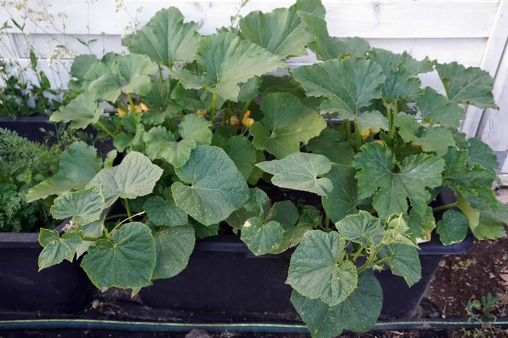
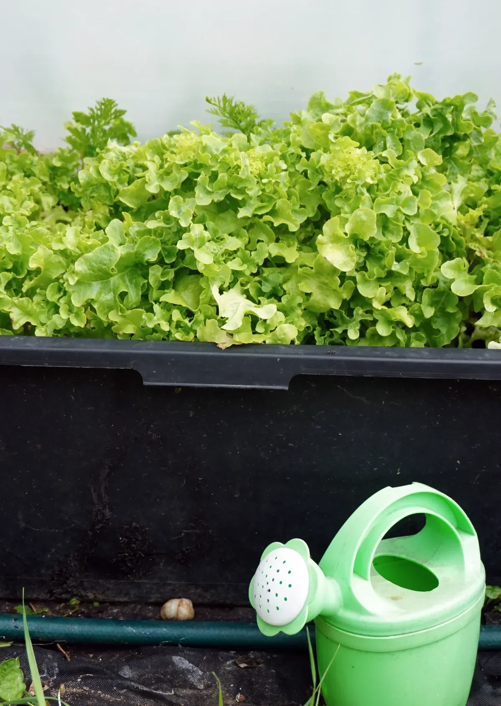
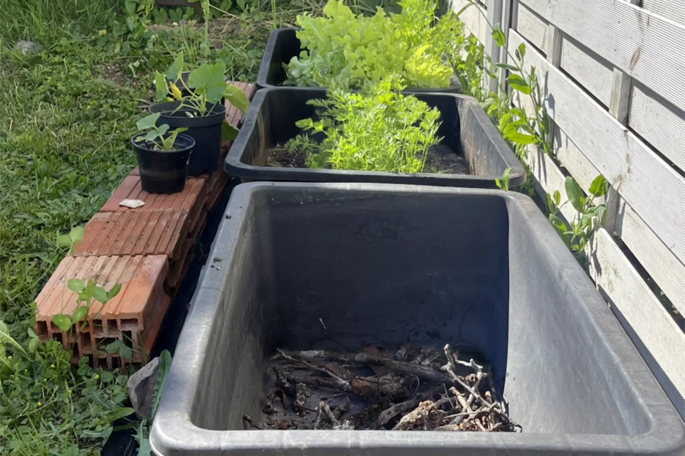
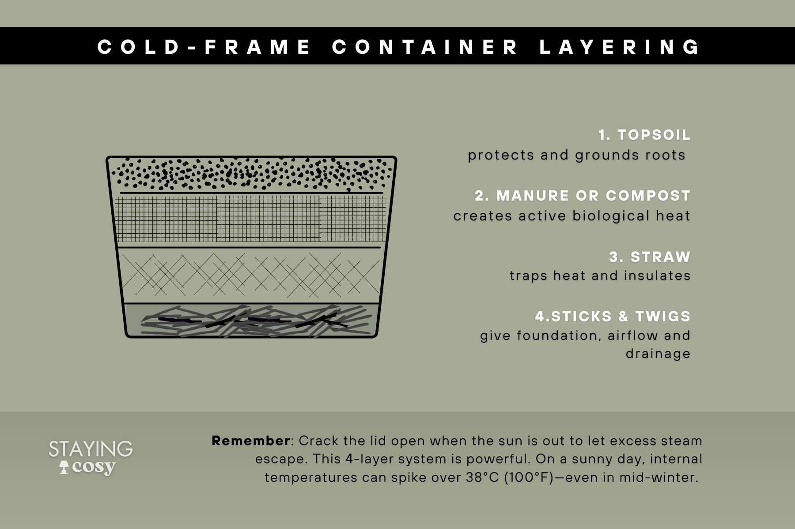
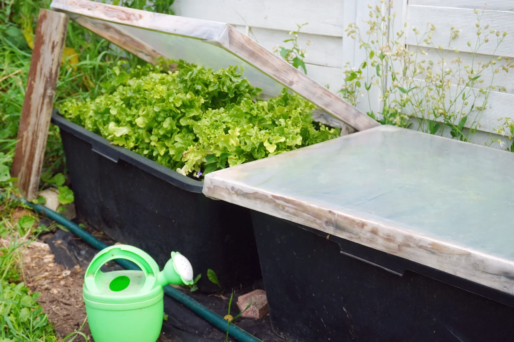
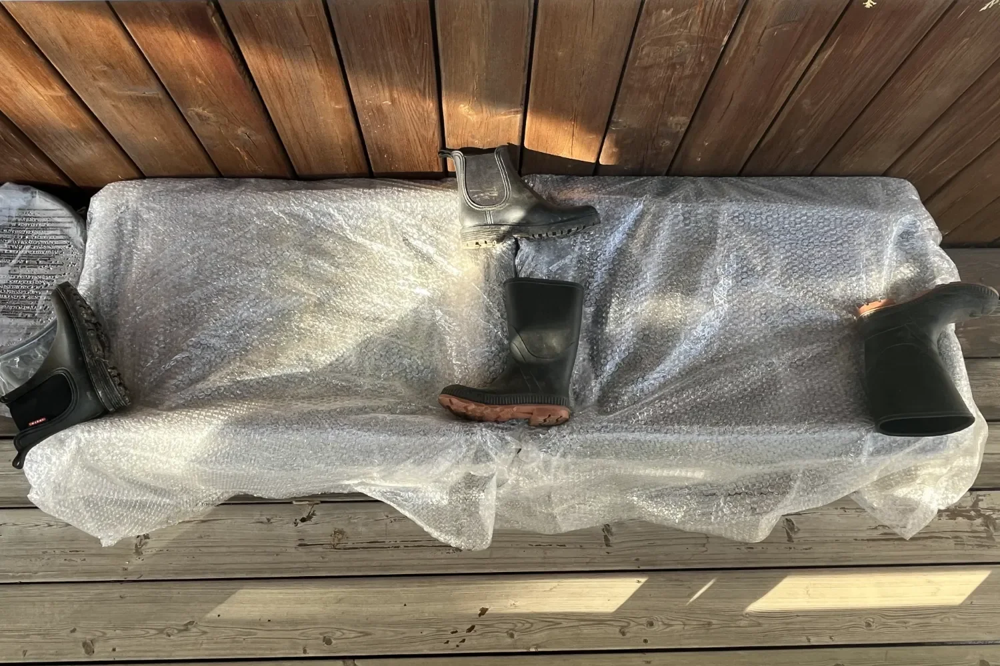
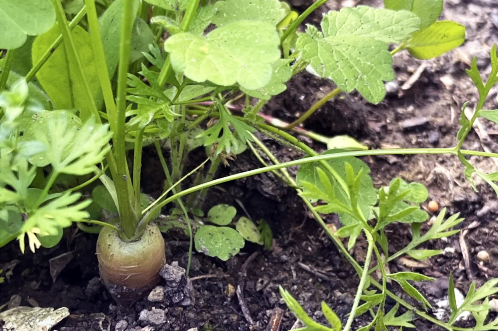
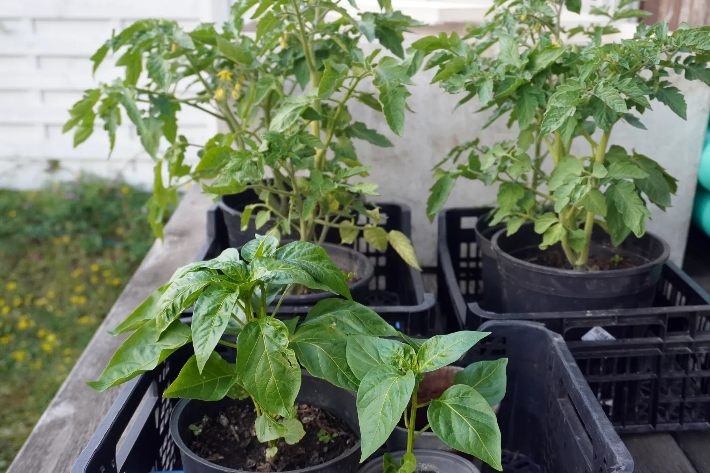

*The idea of growing your own food is undeniably romantic. It’s ecological and deeply rewarding, just not always in the way you expect. When we first moved into our house, I took an ambitious, slightly naive leap into large-scale vegetable gardening. Over time, I’ve happily gone the other way. My vegetable plot has slowly shrunk into a much simpler, more manageable space.*

<Caption>
Cucumbers & courgettes | Image credit: Staying Cosy
</Caption>

If someone tells you that growing vegetables is easy, they might be right, but they forget to mention they have years of experience or an enviable amount of free time. If you imagine simply popping seeds into bare earth and waiting for lush, effortless harvests, you’re usually in for a swift, humbling surprise.

Growing up around gardens didn’t exempt me from this reality. If anything, it taught me just how much attention a thriving crop requires. Even so, having my own little piece of land has always been part of my [holistic dream](/blog/shaping-a-green-home-with-purpose).

While a proper glass greenhouse is still on my long-term wish list, I’m perfectly happy keeping things small for now. Earlier this spring, I put together four simple container cold frames to see how far I could extend the growing season in my garden without turning my life upside down.

## Stretching the Season with Cold Frames

<Caption>
Image credit: Staying Cosy
</Caption>

If you live in a warmer part of the world, you’re lucky enough to grow things all year round. In a temperate climate like mine, the seasonal limits are unavoidable.

When you have a garden, you naturally become hyper-aware of these fine changes in light and temperature.

To prolong your harvests without a permanent greenhouse, large planters covered with sheer plastic are a brilliant, budget-friendly option.

Unlike plastic covers fixed over a normal garden patch, you can move these containers around to find the best sunlight or protect them under a porch during a heavy storm.

☘︎ **Extending the Season Works in a Few Ways**:

- Early spring pre-growing → Mid March starts under foil cover
- Peak summer abundance → Open air growth
- Late autumn harvest → Pre-frost protection back under wraps

These mini greenhouses are great for getting an early start on crisp lettuce leaves and reliably quick radishes, which happen to be some of the easiest vegetables to grow in planters. You can also use them to shelter crops or flowers that hate the cold, protecting them from unpredictable spring frost snaps until they are sturdy enough to be planted out in the open garden.

To make this work, I developed a simple system using things I already had lying around.

## My Improvised Mini Greenhouse Set-Up

<Caption>
Closest container with the first layer of twigs | Image credit: Staying Cosy
</Caption>

The foundation of the project relied on large, rectangular plastic containers. They weren't elegant planters; they were actually leftover builder-grade equipment from our house building. But the size felt right, the depth was generous enough for layering soil, and they were still reasonably small to manage comfortably day-to-day.

They became the base for my DIY container cold frame setup. I used a simple layering method to help the soil warm up naturally and add nutrients over time.

Here’s how I layered them for slow, steady heat release and healthy soil structure.

<Caption>
Graphic: Staying Cosy — made in Canva
</Caption>

### A. Removable Plastic Screen Containers

<Caption>
Image credit: Staying Cosy
</Caption>

This was my more structured setup. I covered two of the large containers with a thick transparent plastic screen stretched over a simple wooden frame to create a warmer microclimate.

- **What I grew:** Radishes, lettuce, and carrots.
- **The timing:** I started using this in March to push the season forward.
- **The result:** The cover did a great job of holding heat and moisture, which sped up germination and early growth.

### B. Sheltered Containers With Bubble-Wrap

<Caption>
Image credit: Staying Cosy
</Caption>

The second setup was even simpler. There was no special soil layering here yet; I just used these containers as a protective buffer for individual plant pots and summer flowers.

- **What I grew:** Courgettes, tomatoes, cucumbers, and summer annuals.
- **The insulation:** I lined the inside walls with leftover foam and threw two to three layers of bubble wrap over the top to act as a soft blanket against cold spring nights.
- **The timing:** I kept these on the terrace, completely protected from northern winds, until mid May.

Once the risk of frost passed, the bubble wrap came off. These containers then became fully layered, open-air mini-gardens just like the first pair, supporting the heavier summer crops.

> “Sometimes, all it takes is a small pocket of trapped warmth to give nature a bit of a helping hand.”

With a little DIY instinct and some leftover plastic, you can easily create a working micro-garden. It doesn't have to be perfect, just enough to get things growing.

## The Reality of Growing — The Waiting Game

Once the seeds were in the ground, the impatience set in.

The radishes, unsurprisingly, didn’t care at all about the makeshift setup. They pushed through early and steadily, even in the cold. The lettuce followed without any drama. The covers themselves turned out to be much more effective than I expected. They were nothing sophisticated, but they changed the timing of the soil significantly.

### Naturally, Not Everything Went to Plan

<Caption>
Image credit: Staying Cosy
</Caption>

One row of carrots came up so sparse and uneven that I ended up throwing a handful of dill and parsley seeds into the gaps just to fill the space. Another row didn’t come up at all. In fact, I completely forgot what I had even sown in there — most likely older seeds that should have been thrown away a year ago. Note to self, pay closer attention next time.

Under the bubble wrap, the courgettes took off incredibly well. The tomatoes, on the other hand, took their sweet time, lingering underground for over a month before suddenly waking up. I also tucked in a few small summer flowers I picked up cheaply, *my only store-bought addition*, just to give them a head start before moving them into outdoor pots later on.

If I were to adjust anything for next year, I’d add extra insulation on the northern side of the planters. That colder edge is almost certainly why some of my seeds struggled to germinate.

### Where The Garden is Now

A few months later, the little cold-frame containers are looking completely different. I’ve stored the plastic covers away, and they’ve transformed into ordinary raised planters. The early spring vegetables have finished their jobs, making room for the next round of crops.

<Caption>
Tomatoes & pepper plants in the foreground | Image credit: Staying Cosy
</Caption>

The lettuce has started to flower, so I’m gradually pulling it out and replacing it with two pepper plants. Four tomato plants in separate smaller containers have grown considerably and are flowering, so I’ll soon be moving them into much larger pots.

The carrots are finally ready to start harvesting, and one of the containers is now completely home to courgettes and cucumbers. I even picked my very first courgette yesterday, which felt incredibly satisfying after weeks of watching everything grow.

What I like most about this setup is how manageable it is. Weeding takes five minutes and I can actually enjoy the process instead of feeling like I’m constantly catching up. The plants are rotating, as one crop finishes, another takes its place. The garden keeps changing, and the little space keeps producing.

☘︎ **Valuable Takeaways from my Mini Container Garden**

- Microclimates don’t require a perfect setup.
- A little protection can create a surprisingly big seasonal difference.
- You don’t need a large greenhouse to start gardening earlier.
- A manageable garden is one you can enjoy long-term.

All in all, I’m really happy with how much these little containers have produced. Marketing is everywhere, even in gardening, but you really don’t need anything fancy to grow a few plants. Seeds are not picky about design; they just need good soil, moisture, and a bit of protection from the wind. That’s about it.

And if you’re reading this in the middle of summer, don’t think you’ve missed your chance. There is still plenty of time to sow another round of leafy greens, protect young plants, or put together a quick cold frame to help extend your harvests well into autumn.

For me, the biggest success of this little experiment wasn’t the actual harvest. It was finding a way to grow food without letting it become another demanding project on my weekly to-do list.

---

**☘︎ Continue Reading**

*•* [*Beauty of Desire Paths — Walking the Way We Feel*](/blog/beauty-of-desire-paths)

*•* [*Best Low-Maintenance Air Purifying Plants*](/blog/air-purifying-plants)

*•* [*What if a Town Could Lower Your Heart Rate?*](/blog/town-design-lower-heart-rate)

SEARCH THE BLOG

