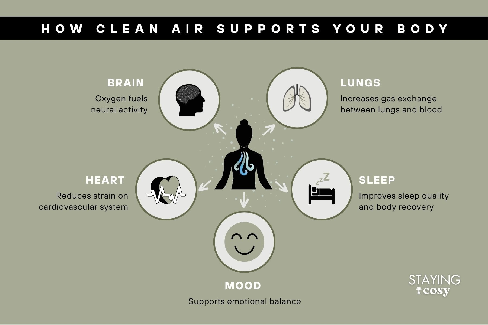
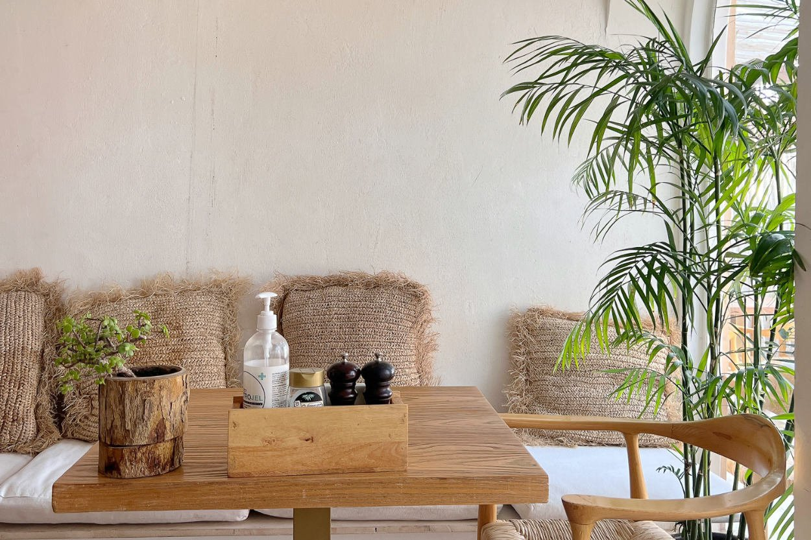
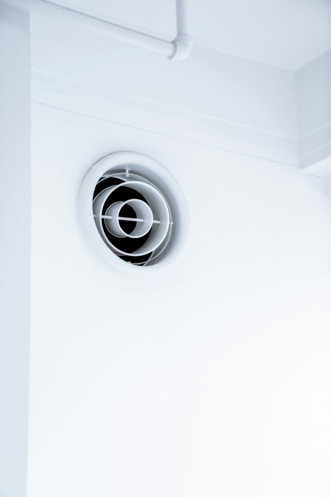
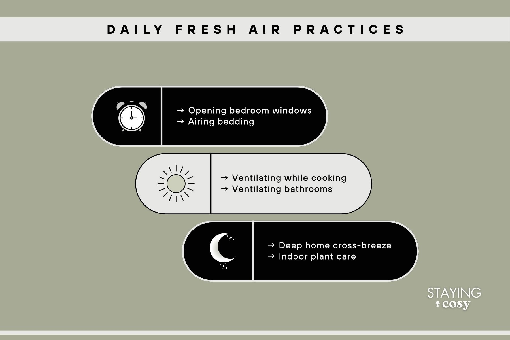

*You know that feeling of walking through a woodland, taking slow, deep breaths of cool, oxygen-rich air. Your lungs expand without effort. Your mind quietens. The raw scent of earth and pine feels both grounding and clarifying at once. But can our homes recreate even a fraction of that restorative effect?*

<Caption>
Image credit: Staying Cosy — made in Canva
</Caption>

I remember the tiniest flat I ever lived in. It had only one, though huge, window. The kitchen would turn stuffy within minutes of cooking, and the whole place felt heavy by evening. There was no way to create a cross-breeze. No way for the air to properly move through.

Most of us spend nearly 90% of our time indoors, yet we rarely consider the quality of the air we are breathing. Fresh air shouldn’t be a luxury reserved for forests and weekend escapes. It should be a given the moment we step inside, whether that space is a high-performance office or the quiet refuge of a bedroom.

The difference is simple. A forest breathes. Many modern homes don’t.

When air becomes trapped indoors, it slowly accumulates what we release into it — carbon dioxide, humidity, cooking fumes, cleaning residues, off-gassing from materials. The shift is invisible, but our bodies register it long before we consciously do.

Let’s look at what stagnant air really means for our health.

## What Happens When Indoor Air Stands Still

When air has nowhere to go, it collects. Slowly. Gradually. And that is precisely why we tend to ignore it.

Every breath we exhale raises indoor carbon dioxide levels. Every shower, simmering pot of pasta, or load of drying laundry releases moisture into the air. Furniture, paints, sealants, and synthetic fabrics continue to emit [volatile organic compounds](/blog/chemicals-that-pollute-our-living-rooms) long after we bring them home. Cooking creates fine particles; cleaning sprays linger.

In a well-ventilated space, much of this is diluted and carried away. In a sealed or poorly ventilated room, it accumulates.

### How Stagnant Air Affects the Body

For our biology, fresh air is a metabolic necessity. Oxygen-rich, balanced air helps our airways open fully, aids the lungs in clearing toxins, and supports healthy gas exchange.

Stale air, by contrast, quietly chips away at wellbeing. It can trigger:

- headaches
- poor sleep
- brain fog
- allergies
- respiratory issues

Research published in [National Library of Medicine](https://pmc.ncbi.nlm.nih.gov/articles/PMC7215772/) consistently links indoor air pollution to respiratory illness, cardiovascular strain and reduced cognitive performance. Even moderate increases in indoor carbon dioxide have been shown to impair concentration and decision-making. Scientists even gave it a name: *sick building syndrome*.

<Caption>
Graphic: Staying Cosy — made in Canva
</Caption>

### Children, Sleep, and Cognitive Clarity

If you’re a parent, your children’s health is paramount. Giving their bedrooms a quick evening refresh before bedtime is one of the simplest ways to support restorative sleep. The same goes for anyone — elderly, students, pregnant women and especially those whose health is already fragile.

Homes designed around holistic principles prioritise air quality from the start. I spent a long time thinking about this before we began building our own eco-home. We chose [moisture-regulating materials](/blog/natural-materials-around-my-home) throughout, so the room’s air regulates naturally. Waking up from a nurturing sleep in a space with balanced oxygen levels, night or shine, sets the tone for a productive day. The mental clarity, vitality, and long-term health benefits are absolutely worth it.

## Materials, Walls, and Breathing Spaces

The walls we build around ourselves do more than hold up a roof. In a home designed for slow living, every material, finish, and surface contributes to the invisible circulation of air and moisture. Natural, porous materials like lime plaster, clay, or untreated timber regulate humidity, absorb odours, and allow rooms to exhale, creating a subtle rhythm we can certainly feel but rarely name.

Before we move on to how a home actively circulates air, it helps to see how walls, floors, and surfaces set the stage, and why that matters for healthy indoor environment.

<Caption>
Image credit: [Mennah Aman](https://unsplash.com/@bluefear?utm_source=unsplash&utm_medium=referral&utm_content=creditCopyText) on [Unsplash](https://unsplash.com/photos/a-table-with-chairs-and-a-plant-2eTok6IGdvE?utm_source=unsplash&utm_medium=referral&utm_content=creditCopyText) — edited
</Caption>

### Natural Materials Don’t Off-gass

There is a difference between a composite [laminate floor](/blog/real-wood-vs-laminate-flooring-guide) and a natural oiled wood parquet. And I’m not talking about the look. While the latter has virtually zero emissions, meaning cleaner air, the laminate floor, made of glued layers of HDF, plywood, and a decorative wood print — can release the chemicals used in its production for months after installation.

The same goes for cement plaster and synthetic carpets, which do very little to regulate indoor humidity. Large surfaces in our homes, like walls, floors, ceilings, can and should act as natural indoor climate regulators. Instead of covering them with dry-board panels and sealed paints, we can choose materials that work in our favour.

Natural plasters and oil-treated wood cladding trap excess moisture when the air is heavy and release it as it dries, reducing condensation and the risk of mould. They work silently, day in-day out, subtly improving indoor air quality without any extra effort on our part.

Rooms set up in this biophilic standard, paired with thoughtfully placed windows and open layouts, invite a gentle flow of oxygen that our bodies and minds so desperately need. The calm, clarity, and effortless wellbeing that results is hard to measure, but unmistakable when it’s present.

### Synthetic Finishes Trap Moisture

Synthetic paints, sealed surfaces, and dense modern composites can do the opposite, trapping stale air and creating micro-climates that feel heavy and oppressive. They might look tidy and polished on the surface, but they’re non porous, unlike their natural counterparts. That means they lack any air regulating properties.

They trap moisture inside walls and floors, preventing natural evaporation, and are the main contributor to interior [mould growth](/blog/mould-keeps-coming-back-how-to-stop-it). Over time, this can create pockets of stagnant air, where humidity, smells, and chemical residues linger instead of dissipating. The result is a home that feels heavier and stuffy — no matter how picture-perfect it looks.

## Sensory Wellness — Psychology of Living Air

<Caption>
Imgae credit: [Niloufar Nemati](https://unsplash.com/@blueniloufar?utm_source=unsplash&utm_medium=referral&utm_content=creditCopyText) on [Unsplash](https://unsplash.com/photos/silhouette-of-woman-opening-window-xRSTUppvOfM?utm_source=unsplash&utm_medium=referral&utm_content=creditCopyText)‍ — edited ‍
</Caption>

I always secretly take pride when visitors mention how good the air feels in our home. When it comes from someone with long-term allergies, it feels like earning extra bonus points. There’s a distinct quality to our air, it’s like a cool breeze, a sensation that’s difficult to pinpoint, yet instantly recognisable.

Is it the ventilation system? Or the spruce ceilings and clay plaster that naturally absorb and release moisture?

A healthy home is never about one solution alone. It’s the combination of both — aided ventilation and raw materials. These wellness factors will outrank a new sofa or updated kitchen cabinets every single time. Even in feng shui, air movement is closely tied to the flow of qi, the life energy that supports clarity, balance, and wellbeing.

### Your Nervous System Thanks You

Our nervous systems are finely tuned to the atmosphere we inhabit. Static air can subtly raise cortisol levels, leaving us restless or claustrophobic without any obvious cause. Moving air, by contrast, provides a gentle sensory reset. Designers call this **Soft Fascination**. It’s the way a light breeze on the skin or the scent of rain through an open window grounds us in the present moment.

Our mood instinctively lifts as the brain receives its healthy flow of oxygen. We move from a sense of indoor confinement to atmospheric freedom, where the house seems to breathe alongside us. It is the ultimate luxury: a home that shelters, while gently restoring our mind.

## Natural vs Mechanical Ventilation — Do We Have to Choose?

If you’re standing at the crossroads of choosing between natural and mechanical ventilation, hear me out. I know the questions swirling in your head: Will it be noisy? Can the ducts trap moisture or bacteria? Will the air turnover be enough?

I’ve been in your shoes, so I understand the careful weighing of pros and cons. And even if you’re not currently renovating or building, knowing the options is valuable — whether for future upgrades or simply for understanding how your home breathes. We’ll break them down piece by piece.

My approach? Why choose just one? I like to combine the best of both worlds and adapt according to our needs.

<Caption>
How do natural and mechanical ventilation compare? Take a look.
</Caption>

### Natural Ventilation

When we say *natural ventilation*, most of us immediately picture open windows. It really can be that simple. But there’s a little secret: to fully unlock the benefits of natural airflow, a few key elements need to work together.

Here’s what to take into account:

- **Window placement:** Efficient cross-breezes rely on thoughtful window positioning. Without it, air stagnates, and movement is slow. This is especially critical in colder months when you want to refresh the air quickly without losing heat.
- **Seasonal airing:** Think beyond the daily open-window ritual. Deep seasonal ventilation, a thorough flush of rooms during spring and autumn, when temperatures are milder, helps remove accumulated pollutants, moisture, and indoor odours. It’s like giving your home a little reset button.
- **Micro-habits:** Human habits matter the most. The simple routines, like opening the bedroom windows first thing in the morning to replace eight hours of CO₂-rich air, or an evening purge in the living areas, play a large role in maintaining indoor air quality.

Natural ventilation is simple, free, and connects us to the rhythms of the seasons. But it works best when paired with a home designed to breathe: rooms with cross-breeze potential, lightweight curtains, and materials that don’t trap moisture or odours.

**☘︎ *Cross-Ventilation Routine***

*1. Open opposing windows. Create a direct path for air to flow through the room.*

*2. Encourage low-to-high air movement. Let cool air enter from lower openings and allow warm, stale air to escape through higher windows or vents.*

*3. Refresh for 10–20 minutes. Morning or evening works best. Adjust the duration depending on room size and airflow strength.*

### Mechanical Ventilation

<Caption>
Image credit: [Meritt Thomas](https://unsplash.com/@merittthomas?utm_source=unsplash&utm_medium=referral&utm_content=creditCopyText) on [Unsplash](https://unsplash.com/photos/round-white-exhaust-fan-0YhmNx1Q96I?utm_source=unsplash&utm_medium=referral&utm_content=creditCopyText)‍ ‍
</Caption>

With modern eco-buildings, rising passive standards and heavy thermal insulation give ventilation a completely new spin. In a tightly sealed home, relying on windows alone simply isn’t enough, and constant window airing can undermine the thermal efficiency that makes these buildings environmentally friendly.

Of course, we cannot spend entire days outdoors to guarantee perfect air quality. Our homes need to support us in real life — during workdays, cold winters, busy schedules, and long nights.

This is where technology and design become helpful allies.

Similar to systems in enclosed shopping centres, high-rises, or hospitals, a centralised duct system actively replaces stale indoor air with fresh outdoor air. It often features built-in filters to remove dust, pollen, and pollutants. There are also decentralised options, with individual units in each room, which can be ideal for retrofits or smaller homes.

Key benefits of mechanical ventilation include:

- **Constant air replacement**: Stale air is removed and replaced with fresh outdoor air continuously.
- **Filtration**: Removes dust, pollen, and other pollutants before they reach your living space.
- **Humidity control**: Many systems regulate moisture, reducing condensation and the risk of mould.
- **Energy efficiency**: Some units recover heat or energy, preserving warmth without extra cost.

Modern systems often include what’s called **MVHR — mechanical ventilation with heat recovery**. In simple terms, the warmth from outgoing air pre-heats incoming air, keeping your home warm without wasting energy. This creates a continuous, invisible flow of oxygen-rich air, that is quiet, efficient, and consistent, even in the coldest months.

From personal experience, we didn’t have a ventilation unit yet when we first moved in, and the difference was noticeable. Before, I could see condensation building up on the window frames every morning after waking up. Air felt heavier, slightly stuffy, and we would wake up groggy. Once it was switched on, the morning condensation disappeared, and the freshness in the bedrooms surpassed our expectations.

I had initially worried about noise — I can hear a fly flap its wings next door — but that concern faded quickly. With proper sizing and installation, the system runs so quietly that we barely notice it at all.

#### 💡 **Ideal CO₂ Levels**

The indoor CO₂ levels should be kept below **800 ppm** (parts per million). Levels above **1,000 ppm** lead to a significant drop in cognitive function and increased lethargy. Humidity should be kept between: 40-60%.

## Daily Practices That Keep Air Fresh

Clean air doesn’t stop at ventilation systems or healthy surfaces — those are just the foundation. Our daily practices help keep your home feeling fresh, vibrant, and alive.

<Caption>
Graphic: Staying Cosy — made in Canva
</Caption>

- **Morning window ritual**. Open bedroom windows for a few minutes and let the day in. It refreshes the mind and gently wakes the senses.
- **Air your bedding**. A quick flap of duvets or pillows adds subtle circulation and keeps things feeling light.
- **Cooking & shower ventilation**. Use an extractor fan or briefly open a window to whisk away extra moisture and odours.
- **Mindful greenery**. Take care of indoor plants. They provide subtle [air cleansing properties](/blog/air-purifying-plants) while adding calm and beauty to your living environment.

### Supporting Tools for Better Air Awareness

Variety of additional tools can help us monitor and improve indoor air quality.

**Air purifiers**\
These are particularly useful in urban areas, allergy-prone households, or during high pollution seasons. They filter fine particles, allergens, and in some cases volatile organic compounds. Some furniture brands now integrate filtration into everyday objects. For example, Ikea offers the discreet [Starkvind](https://www.ikea.com/gb/en/p/starkvind-table-with-air-purifier-stained-oak-veneer-dark-brown-smart-20501954/#content) air-purifying table, which blends into a living space while supporting cleaner air.

**Air quality monitors**\
To measure parameters like CO₂, humidity, and particulate levels in real time, use an air quality sensor. Many models connect wirelessly to a smartphone app, translating invisible air conditions into simple, readable data. The [Smart Air Quality Monitor](https://www.amazon.com/Introducing-Amazon-Smart-Quality-Monitor/dp/B08W8KS8D3/ref=sr_1_8?crid=16WAGZ3FFUKWN&dib=eyJ2IjoiMSJ9.9I1daN2fGnAfyu-Y7NzKkTsyfQtFI-Q0wEGdBshWPYI40kEKXuTfAk3ryEt_1fIsWaaPn8Wr36-1IN69SbUPGuk-JRFCfuegTnXwcR4J3qG3l2b48JkN7hBAS9YSHl-dGShdRaP2NKTKnxjUBGoetOpdzcH2plxVlZc2r3412abH4YDtyexO2TS4GDGmfnx-GI_Hj-GtKrEimTsDDHuYWjsYetdV7RETbM9EA5gFUwI.is3UhmFFjEgUckrRuKICDnwdN7kp2HG31HwrEtc2EZ0&dib_tag=se&keywords=air%2Bquality%2Bmonitor%2Bindoor%2Bstylish%2Bsleek%2Bmodern&qid=1772698279&sprefix=air%2Bquality%2Bmonitor%2Bindoor%2Bstylish%2Bsleek%2Bmoder%2Caps%2C243&sr=8-8&th=1) that integrates with the Alexa app is one accessible option. Monitoring removes guesswork and helps you understand when ventilation or additional filtration is needed.

## Designing a Home That Breathes From the Start

Now, let’s zoom out a bit. Some of you may be standing at the beginning of a major renovation, and clean air might not even be on your priority list. But it should be.

Over the years, through observing and implementing strategies that improve fresh air turnover, I’ve identified a few practical principles worth considering:

1. Window orientation
2. Cross-ventilation design
3. Ceiling heights
4. Room flow
5. Avoiding sealed-off layouts

These decisions outline how air moves through your home long before you get on with final interior touches.

Whenever possible, **include an exterior window** in bathrooms, utility rooms, and pantries. These spaces accumulate moisture and benefit from direct ventilation. If that isn’t feasible, install high-efficiency extractor fans or consider a central ventilation system.

Even wardrobes benefit really well from airflow — imagine that shoe storage. Enclosed areas without ventilation can trap odours and humidity. Ceiling height also plays a role. Higher ceilings increase overall air volume, allowing CO₂ levels to disperse more easily.

And lastly, remember that any exterior door, be it front door or french door leading to a patio, can act as effective ventilation openings for quick air flushes. If you’re designing strategically placed windows, **ensure they are operable**. In some newer developments or high-rise apartments, this isn’t always guaranteed.

<Caption>
Image credit: [IRa Kang](https://unsplash.com/@lifeinkorea?utm_source=unsplash&utm_medium=referral&utm_content=creditCopyText) on [Unsplash](https://unsplash.com/photos/open-window-reveals-a-lush-green-scene-6usX2ejzGH4?utm_source=unsplash&utm_medium=referral&utm_content=creditCopyText)‍ ‍
</Caption>

Fresh air is free. But modern eco-homes are built like sealed boxes.

Let’s open our windows wide and welcome clean air into our daily lives. When we do, our minds feel clearer, our breathing easier, and our homes lighter.

---

**☘︎ Want more healthy ideas for your home?**

*•* [*Holistic Interior 101 — Your Guide to a Mindful Living*](/blog/holistic-interior-design-guide-101)

*•* [*Decluttering Matters in a World of Too Much*](/blog/stuff-taking-over-why-decluttering-matters)

*•* [*Sustainable Living Room Upgrades*](/blog/sustainable-living-room-makeover-on-a-budget)

SEARCH THE BLOG

