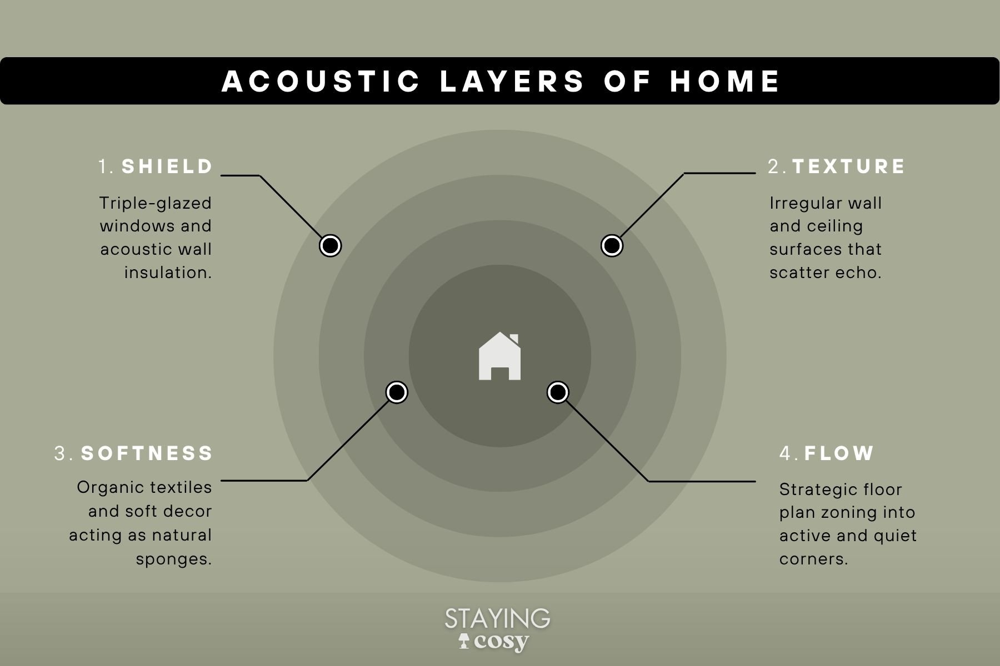
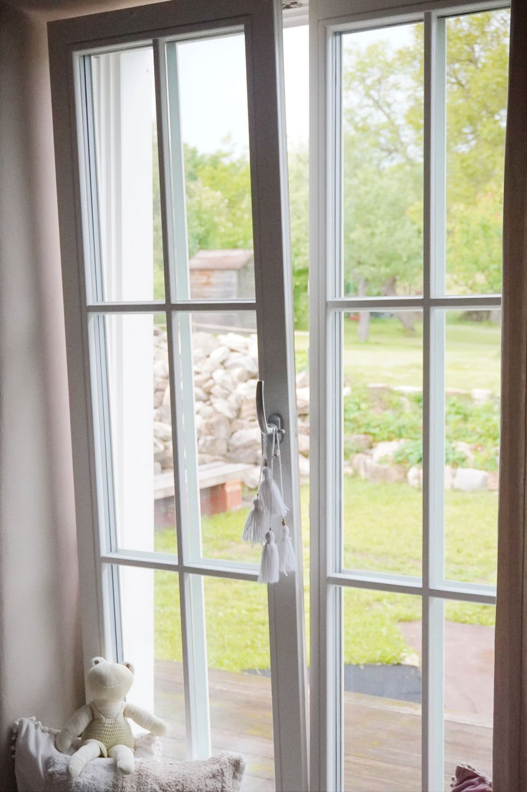
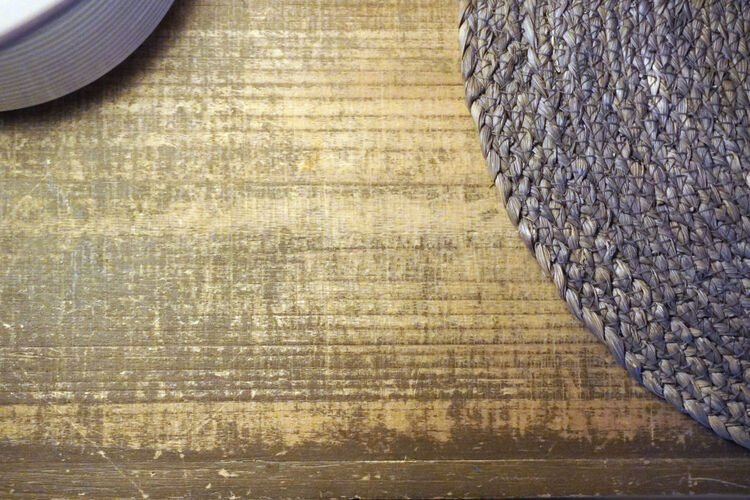
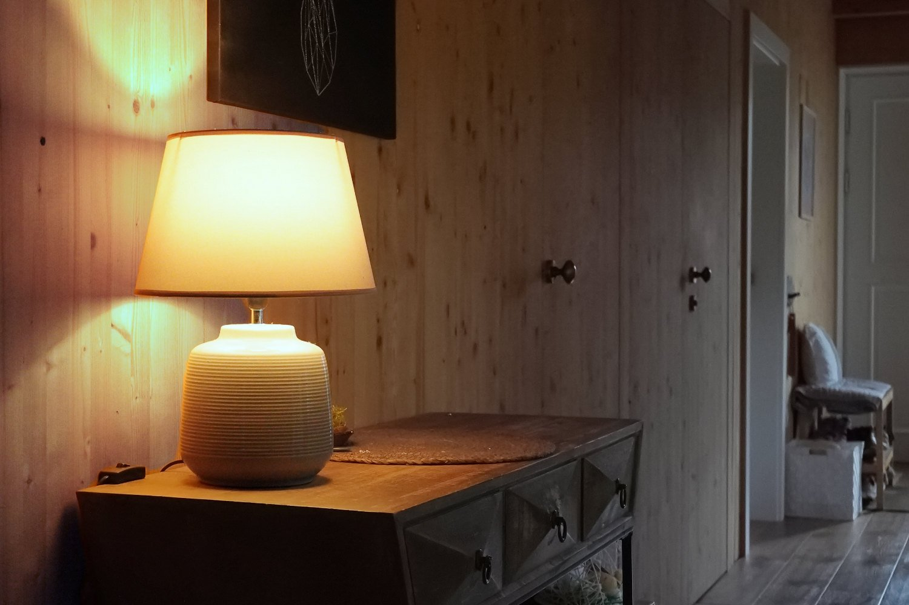

*A home can be a visual masterpiece and still feel entirely restless. While our main focus is primarily on aesthetics, our nervous systems are passively reacting to an invisible architecture of sound. If your home looks calm but feels chaotic, it’s time to talk about acoustics. The most overlooked sense in home design.*

<Caption>
Image credit: Staying Cosy
</Caption>

I remember a lesson from my film production teacher that stayed with me long after I left the school. *Sound in a movie is only good when you don’t notice it.*

He wasn't talking about grand cinematic music scores, of course. He meant the delicate balance of the sound mix — the crisp dialogue and the background atmosphere. When blended perfectly, the sound effects disappear into the story, and you simply feel immersed in the imaginary world.

It turns out that filmmaking and the acoustic comfort of a holistic home have a lot more in common than we think.

We live in an era dominated by the visual. We scroll through oddly imperfect AI images and immaculate minimalist feeds. We want to buy, have and chase the tangible. But so many modern spaces suffer from a silent flaw. They look lovely, but they sound like a canteen.

## When a Flawless Home Feels Restless

<Caption>
Image credit: Canva
</Caption>

I’ve always been incredibly sound-sensitive, let's just say I am a professional *hearer* of those hidden, high-pitched electronic hums. In fact, the chaotic acoustic clutter of a poorly designed restaurant can make me spin right around and walk out the door before I've even seen a menu.

Having lived in and rented [18 different homes](/blog/18-places-one-home-lessons) over the years, I became acutely aware of how a building’s construction dictates our daily stress levels. I learned firsthand that by inhabiting a certain space, you live with its entire acoustic environment.

When it came time to building our own home, I knew it wasn't going to be a sprawling mansion. But I knew, with absolute certainty, that quality acoustics were non-negotiable. We needed a space that could handle the messy, beautiful audio of real life on a small footprint.

> “Your walls hold the frequency of your life. If all surfaces are flat and hard, they are constantly reflecting fatigue back at you.”

A well-balanced house is pleasant without you being able to put a finger on exactly why, unless you happen to be acoustic-savvy. You aren't competing with a boiling kettle to finish a sentence, or disturbed by music from a neighbouring bedroom. Silence isn't a luxury you seek elsewhere, but a presence you live with every day.

## Managing Sound for Better Interior Atmosphere

<Caption>
Image credit: Canva - edited
</Caption>

We can spend hours choosing the right shade of white, but we rarely design for how a room sounds. Usually, we tend to treat acoustics as a technical issue for concert halls, forgetting that sound is the invisible layer that dictates our daily nervous system response.

The modern trend of vast, open-plan layouts and hard, shiny floors has done a great disservice to our interior sound quality. These spaces look free and airy, but in reality, they are often acoustically aggressive.

My parents’ house features a massive open hallway in the centre that leads directly to a TV in the living room while opening up into a grand, vaulted gallery. Architecturally, it’s a showstopper. Acoustically? It’s a struggle. From the guest bedroom upstairs, you can clearly decipher every kitchen clatter and every word of the nightly news. The echo bounces sharply across those flat, unyielding walls, making the house feel busy even when it’s empty. The sound discomfort is ever-present.

When a home suffers from harsh acoustics, our nervous system pays the price. It places us in a subtle, continuous state of alertness. We mistake this feeling for general life stress, completely unaware that our physical walls are constantly reflecting fatigue back at us.

**Hard Echo** →**‍ ‍***Subconscious Alertness***‍ ‍**→ ***Elevated Cortisol***

**Soft Diffusion** →**‍ ‍***Sensory Safety***‍ ‍**→ ***Nervous System Ease***

The core of [holistic design](/blog/holistic-interior-design-guide-101) is shifting the focus back toward human-centred, sensory spaces. When a home embraces soft acoustics, it wraps you in an immediate sense of intimacy; the moment you walk through the door, your shoulders drop. I am not talking about an artificial, dead silence, *which can feel eerie like a museum after hours*, but a space where the sounds of life feel cushioned and kind.

Since sound cannot be captured in a pretty 3D render, it is often forgotten in the excitement of a new project. But your subconscious brain rarely gets fooled.

**☘︎ *Design That’s Hostile to Our Senses***

*The famous* [*Camden Bench*](https://en.wikipedia.org/wiki/Camden_bench) *uses jagged, uncomfortable slopes to subtly force people to move along. Ignoring interior acoustics is simply the domestic version of this hostile design. When we sacrifice sound comfort for the sake of visual trends, we create stunning spaces that reject our nervous system's need for true psychological rest.*

## My 4-Layer Approach to Acoustic Home Design

<Caption>
Graphic: Staying Cosy — made in Canva
</Caption>

To bridge the gap between abstract theory and a real, lived-in interior, I designed our home around four practical layers. You don’t need to be an acoustic engineer to use them. You just need a little bit of basic knowledge, and a healthy dose of patience for the acoustic variables in your family — like singing teenagers, for example.

The four pillars of your home's sound mix are:

- **The Shield:** Quietens the outside world and traps noisy household clatter right at the source.
- **The Texture:** Breaks up harsh refractions by replacing flat, loud planes with tactile surfaces.
- **The Softness:** Uses organic decor and textiles as natural sponges to soak up daily chatter.
- **The Flow:** Maps out your layout so active spaces and quiet corners can peacefully coexist.

To put these pillars into perspective, it helps to understand the comfort zone for our ears measured in decibels.

#### 💡 **The Decibel Benchmark**

Sound is measured in decibels (dB). Most of us aim for a **holistic sweet spot of 40–50 dB** — the sound of a calm library. For restorative sleep, we want that to drop to a **whisper-quiet 30 dB**.

If your peaceful afternoon is peaking at 60 dB, or the level of a loud conversation just from the fridge hum and street echo, your acoustic layers are likely working against you.

### 1. The Shield — Keeping the Noise at Bay

Alongside good solid, acoustically sound exterior walls — windows and doors are the second in keeping the street noise out. To understand the power of a structural shield, you first would have to experience its absence.

<Caption>
Image credit: Staying Cosy
</Caption>

**External Barrier Helps Turning The Volume Down**

During my renting days in the UK, I lived in flats with standard double-glazing, and at some points, in typical brick Victorian houses with the notorious, drafty single-glazed sash windows. In those homes, it sometimes felt like living with the entire street. Every passing car and late-night conversation filters through the glass as if you were standing out on the pavement. It’s a constant, subtle drain on your mental energy.

When we built our current home, we decided on triple-glazed windows. Let me tell you, the difference is absolutely astounding.

Triple glazing is often sold purely as a heat-insulation benefit, which it certainly is, but the psychological benefit of sound insulation is the real game-changer. It gives you the power of choice. If I want to hear the morning birds or feel the breeze, I open the windows. But the moment I seek stillness, I click them shut and let the exterior world simply vanish.

**Internal Barrier Contains the Household Clatter**

While a strong external shield blocks out a busy street, a holistic home also needs an internal shield to contain the chaos we generate ourselves.

I remember the day we were insulating our internal walls. Before they were capped off with wood-paneling, I walked into our small, walk-in wardrobe, and it felt like stepping inside a high-end recording studio. The raw insulation acted like a massive acoustic sponge. It was a bizarre, wonderfully weird sensation of total sound absorption. At the same time, it confirmed that the mass and density we were adding were working.

We took great care to particularly insulate the internal walls around the central core of the house. In a small footprint, you have to ensure that the active noises, like the water heater, the toilet, or the washing machine, don't become the soundtrack to your living room.

Additionally, investing in thick, solid interior doors that seal properly can work absolute miracles for acoustic privacy between rooms. By prioritising mass and layering within the framing, you can create a home that doesn't have to be vast to feel private. It just needs walls that keep the noise at bay.

### 2. The Texture — Breaking the Sound Waves of Walls & Ceilings

<Caption>
Image credit: Staying Cosy
</Caption>

Once you have successfully built a shield against the outside world and dealt with the internal shield between the rooms, you have to look at how sound behaves in the interior itself.

We all love listening to music at home. The catch? We have vastly different tastes in our family. Between my own playlists and my daughters using the house as their personal choir practice background, being able to play three different tracks simultaneously without acoustic warfare was an absolute necessity. In a standard modern layout, this would be a chaotic nightmare.

> “Sound travels like water; it finds every gap, every hard surface, and every open doorway.”

Open-plan spaces are visually liberating, but they can be acoustically exhausting. When sound has nowhere to settle, it hits flat, shiny floors or barren drywall and bounces perfectly intact right back into your face. Suddenly, the simple clatter of a kitchen utensil or a boiling kettle feels aggressively amplified. You quickly find yourself speaking louder just to be heard over the room itself.

**Flat Surface →** *Sound Waves Bounce & Amplify Echo*

**Textured Surface →** *Sound Waves Scatter & Soften*

A healthy home needs broken sound planes. They’re tactile, irregular surfaces that interrupt sound waves before they can gather speed and turn into a stressful echo. To achieve this sensory relief, we rely on the beauty of imperfection, using texture at both a microscopic and macroscopic level.

We tend to treat walls and ceilings as forgotten, empty planes. But from an acoustic standpoint, leaving them entirely flat is a massive missed opportunity.

In our home, choosing hand-finished clay walls and a wood-cladded ceiling built with subtle gaps were deeply intentional acoustic decisions. The porous density of the clay walls introduces millions of micro-irregularities that gently ‘drink’ the sharp edges off high frequencies, while the timber grain on the ceiling acts as a macro-interceptor, catching rising sound waves before they bounce endlessly between the floor and the ceiling.

**Glass Fracturing — Dealing with Large Windows**

Giant, seamless sheets of modern glass act as massive acoustic mirrors, throwing sound straight back into the room. To counter this without sacrificing natural light, look into [window muntins](/blog/architectural-window-design-trends), the architectural bars that separate window panes. Beyond their aesthetic charm, breaking down a large pane of glass into smaller sections can subtly alter the way sound vibrates across the surface — doing your senses a hidden favour.

If you want to recreate these broken sound planes in an existing modern space without a total structural remodel, look to these alternatives to coat your surfaces:

☘︎ **Texture Upgrades to Try at Home**

- **Lime-wash or textured paints:** Creates a subtle, gritty, multidimensional layer that kills the flat reflectivity of plain drywall.
- **Heavy textured wallpapers:** Grasscloth, cork, or deeply embossed fabric options add a soft, microscopic relief that absorbs and scatters high frequencies.
- **Exposed structural brick:** Leaving an original stone or brick wall bare provides thousands of miniature nooks and crannies to fracture sound paths.
- **Acoustic wood slatted panels:** Felt-backed timber slats mix the acoustic warmth of wood grain with industrial-grade sound absorption.
- **Coffered or beamed ceilings:** Adding exposed wooden beams or a shallow grid pattern breaks up giant, flat ceiling planes to trap traveling noise.

### 3. The Softness — Using Decor as an Acoustic Sponge

While architecture and wall textures handle structural sound diffusion, the softness is where you turn your interior styling into your secret acoustic weapon. You do not need ugly, industrial foam panels to fix a noisy room. Instead, you look to organic materials and layering to act as natural sponges that drink up the daily clatter of a living home.

You can easily achieve this sensory relief through intentional decor choices. Think of these styling elements as your best friends for dampening unnecessary noise.

<Caption>
Image credit: Staying Cosy
</Caption>

**Fabrics & Upholstery**

For instance, large expanses of bare window glass can be improved by hanging floor-to-ceiling heavy [linen or cotton](/blog/natural-textiles-wool-cotton-linen) window drapes. They soften these hard perimeters and catch sound waves right at the edge of the room. Similarly, hardwood, tile, or concrete floors instantly amplify foot traffic and chair scraping. Introducing thick wool rugs with dense underlays grounds the space physically and acoustically, stopping those floor reflections before they bounce upward.

Your furniture choices can also double as hidden technical regulators. A plush, deep upholstered fabric sofa features dense foam and textured textiles that naturally absorb mid-frequency sounds, like human speech, preventing them from floating across large, open spaces.

Even your styling serves a dual purpose: an open, living bookshelf arranged with varying depths, heights, and paper textures functions identically to a professional studio diffuser, beautifully breaking up sound waves while showcasing your personal history. To finish the space, swapping out glass-framed prints for layered canvas artwork, textile wall hangings, or woven tapestries breaks up flat drywall planes without sacrificing your personal aesthetics.

The bottom line is that materials are not just for decoration; they can literally hold the sound. Look around your home this evening and see, where you could improve the acoustics with these simple fixes.

**Taming the Household Hum**

Even a small step like placing a dedicated, high-density rubber sound-dampening mat underneath your dishwasher or washing machine can kill structural vibrations right at the source. It prevents low-frequency hums from traveling through your flooring, making a massive difference to the daily background atmosphere of your home.

### 4. The Flow — Zoning the Layout to Diffuse Sound

<Caption>
Image credit: Staying Cosy
</Caption>

The final pillar moves away from textures and switches to layout. The flow is all about mapping out your floor plan so your family's different activities don't turn into immediate acoustic warfare.

Let’s be honest. When we look at open-plan designs on Pinterest, they look visually liberating. We imagine ourselves effortlessly gliding from the kitchen island to the dining table. But nobody shows the acoustic reality. In a totally open cavern with zero zoning, a food blender running, a television playing, and someone trying to read on the couch will violently collide in the center of the room. It’s exhausting.

When we design the physical flow of an interior, we are choosing whether our spatial layout will amplify the friction of a busy household or gracefully absorb it. Visual openness should never mean acoustic vulnerability. You don't need a house the size of a castle to find peace; you just need to be clever with your spatial layout.

Here is how you can guide the acoustic traffic in your home to create natural zones without building prison walls:

☘︎ **Spatial Layout Changes to Try at Home**

- **Embrace the broken-plan layout:** Uses architectural speed bumps like double-sided open bookshelves or internal glass doors to stop sound waves from picking up speed.
- **Create structural buffer zones:** Places hard-working spaces like walk-in wardrobes, pantries, or small bathrooms between loud living areas and quiet bedrooms.
- **Use the clever hallway trick:** Offsets bedroom doorways instead of aligning them straight across from each other to force sound waves to bounce and lose energy.
- **Cluster the household chaos:** Groups loud elements like television nooks, stereo systems, and kitchen appliances along the same well-insulated interior walls.

There is one major truth I took away from the journey of designing and living in an acoustically conscious home — comfort is not just what you see. Before, I used to think a well-designed interior was defined by a plush armchair, a high-end fabric, or a warm colour palette. Now I know the real reward is actually the feeling of sensory relief. It’s the deep, quiet peace of being able to retreat to a corner of your home and still hear your own thoughts.

The ultimate goal of holistic living is to cultivate a pleasant, soft sound where the natural activities of a living house are allowed to exist without turning into a chaotic mess. As homemakers, we must stop building solely for the camera lens. A floor plan can chart out precise metric space, but it can never map out the invisible acoustic comfort of a family home.

---

**☘︎ Looking for more holistic home inspiration?**

*•* [*Lighting Guide — All You Need to Know About Correct Interior Lighting*](/blog/interior-lighting-guide)

*•* [*Window Cleaning? Try These Simple Hacks to Achieve Spotless Results*](/blog/effective-window-cleaning-hacks)

*•* [*The Invisible Chemicals That Pollute Your Living Room*](/blog/chemicals-that-pollute-our-living-rooms)

SEARCH THE BLOG

