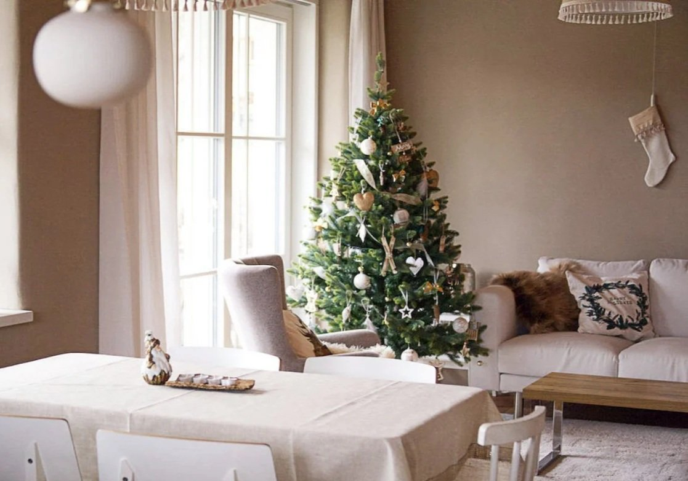
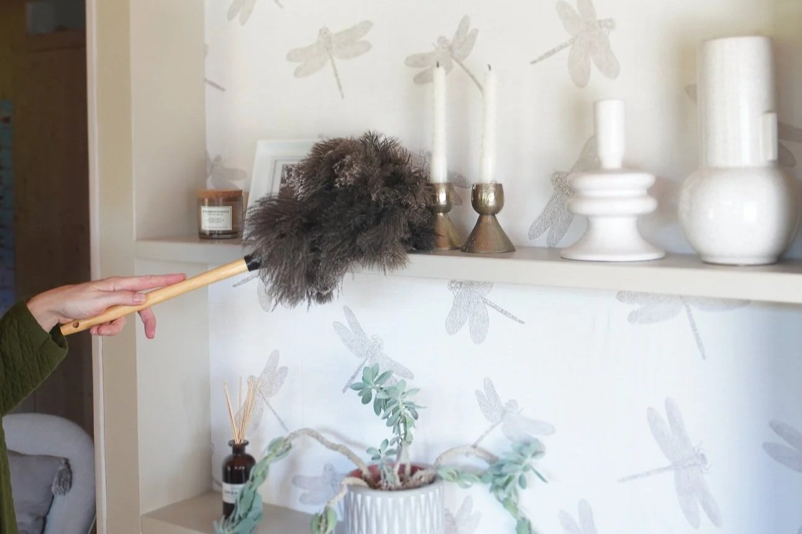
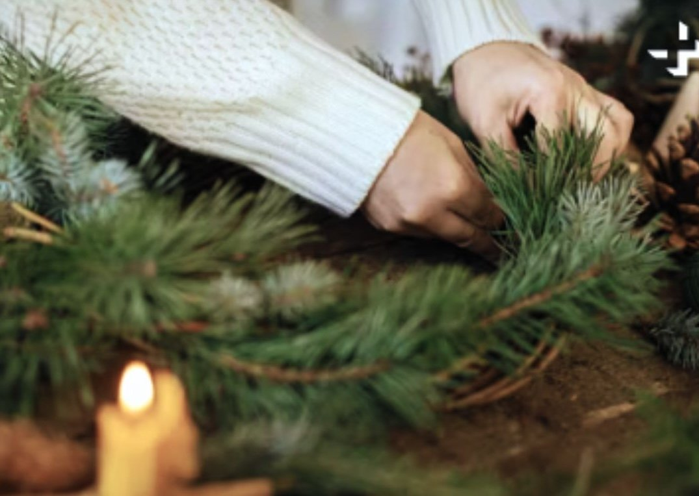
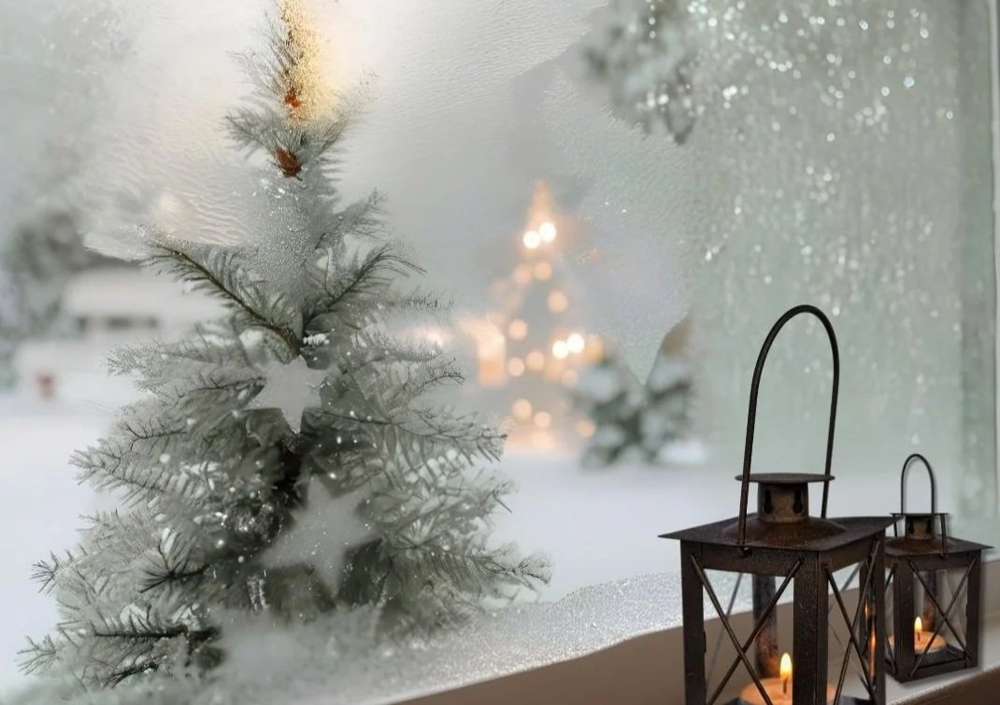
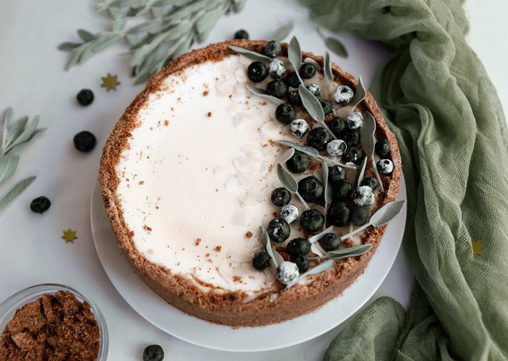
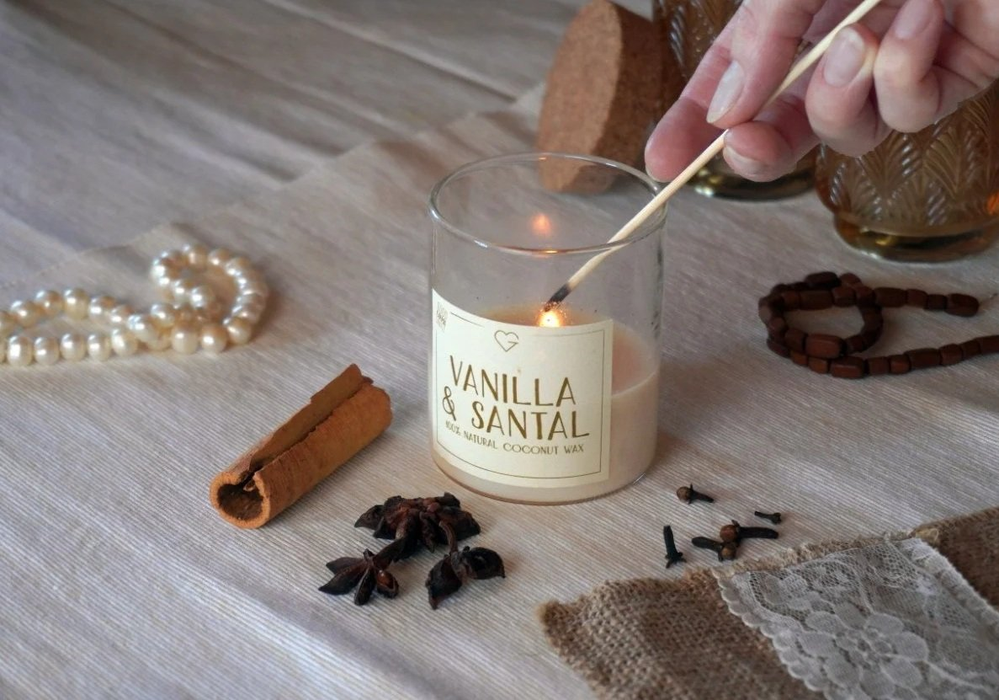
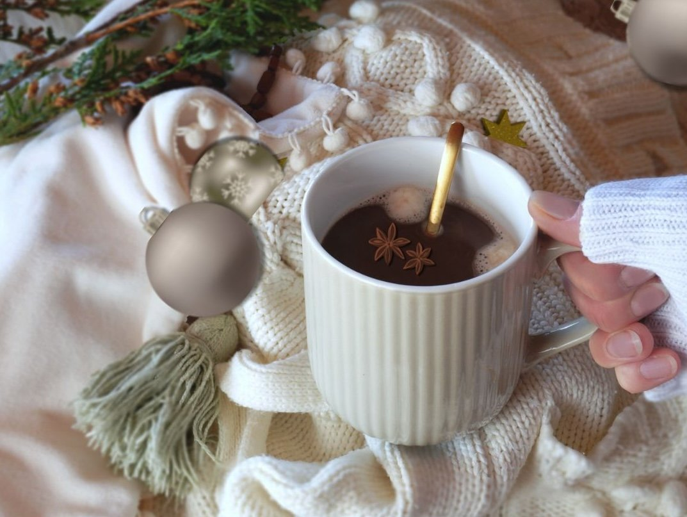

*The scent of pine drifting through the house, silver-foil-wrapped chocolates I used to hide behind our old sofa, and the thrill of searching for presents in my parents’ usual hiding spots—these are the memories of my childhood Christmases.*



<Caption>
Image credit: Staying Cosy
</Caption>

Those years have passed, and now it’s my turn to create meaningful moments for my own family. Some old traditions have quietly faded, while others have found new life in our hands. Yet, when December rolls around, I can’t help but reach back to that childhood magic, and even beyond, only this time with a deeper *“less is more”* attitude.

As the season draws near, I’ve realised that a slower pace, a bit of planning, and a touch of nature make the holidays feel so much calmer. Here’s how I balance it all to experience a holistic Christmas that’s true to my lifestyle and my beliefs.

## 1. Clearing Home for the Season

Before any decorating, prep your home as a blank canvas. Purge the clutter, gift items you no longer need, and clean every corner—*yes, even the cobwebs.* Breaking this into smaller sessions throughout the fall keeps it manageable and lightens the load.



<Caption>
Image credit: Staying Cosy
</Caption>

### Declutter with kindness

Start already in October. Notice what feels heavy or out of place and let it go. Release with love what no longer serves you, and if parting with certain items is hard, try the *“one in—one out”* approach: for every new item, let something old move on through gifting, donating, or recycling. This creates breathable space while lifting emotional weight.

### Clean in harmony with nature

By mid-November, focus on deep cleaning. Skip chemical sprays and open your windows wide. A simple natural blend of vinegar, lemon, and baking soda works for most surfaces—add a few drops of vanilla oil for a festive touch.

It will disinfect & deodorise. Follow by [cleaning you windows like a pro](/blog/effetive-window-cleaning-hacks) and for wood floors or carpets, choose quality eco-friendly products.

Refresh the air naturally by simmering pots of orange peel, cloves, and cinnamon, or use a humidifier with essential oils. Your home will smell amazing, and your air’s natural humidity will be restored.

### Take time to slow down

Overdoing it isn’t necessary. Spread your tasks over time\*,\* involve your family, and adjust your expectations to a healthy level. Engaging everyone teaches mindfulness, lightens the load, and helps you all slow down together. Preparing the home with intention is often the first true gift of Christmas.

[](/s/Infographic_Stress_Free_Xmas_sRGB.jpg)

<Caption>
This Xmas Calendar will guide you to a calm & joyful Advent.
</Caption>

**How to clear your home:**

> “declutter early • deep clean in sessions • involve whole family • slow down”

+++

## 2. Thoughtful Gift Giving

Slow gifting is about *meaning, not quantity.* Years ago, I found myself going overboard with presents for my children. It was a wake-up call: joy isn’t measured in money or piles of stuff.

### Gifts form the heart, not the mall

I can’t put into words how overjoyed my daughter was when she finally received the books she’d been eyeing for months—especially since they came from her uncle, who visited from abroad. How could he have known?! :-) Such a thoughtfully chosen gift meant far more to her than any random store-bought items.

It’s the little things, like a long-awaited winter hat, a small potted plant, or a carefully selected vintage pair of earrings, that matter. Shared experiences are even more valuable, because the memories you create together last longer than any gift. We often forget how sweet the simple joy of anticipation can be.


<Caption>
Image credit: Staying Cosy
</Caption>

### Note down gift ideas throughout the year

Instead of last-minute scrambling, jot down gift ideas as they arise. I keep notes in my phone and anything someone mentions wanting, needing, or loving goes on the list. By the time everyone else is frantically hunting for presents, you’re already done. I’m telling you, it’s been a lifesaver for me—and not just at Christmas. And on your own behalf, try writing a little Santa’s wish list to slip under a loved one’s door—*yes, even adults can have fun.*

### Creative wrapping

Extend care to the presentation. Recycled paper, natural twine, fabric wraps, and sprigs of evergreen or dried orange slices turn a chore into a creative ritual. Allocate enough time to enjoy this process so that each package becomes part of your seasonal décor.

**When gifting:**

> “focus on quality & meaning • add experiences • note ideas down • enjoy the wrapping”

+++

## 3. Decorating with Nature & Nostalgia



<Caption>
Image credit: Canva - edited
</Caption>

And here comes my favourite part! With the home prepped, presents sorted, and still ahead of the Christmas rush, it’s time to decorate. Ideally starting in early December, early enough to enjoy, but late enough for greenery to stay fresh.

### Gentle colour story

Stick with a natural, harmonious palette. This year’s Pantone colour of the year: [*“Mocha Mousse”,*](https://www.pantone.com/color-of-the-year/2025) makes a beautiful base when paired with other soft browns. Add aged gold, or brass, and muted green for traditional warmth without overwhelming the senses.

I love layering textures—wool, metal, and wood, with a hint of sparkle. If you lean toward brighter tones, add just one or two accents in natural hues, such as a cluster of baubles, candles, or soft textiles.

### Evergreens are the way to go

Choose real greenery over plastic, if possible. Not only do evergreens fill your home with natural scent, they also help to avoid the off-gassing that often comes with artificial trees and garlands. A foraged branch arrangement or a potted tree you can replant later is a sustainable alternative.

Bring in pine, eucalyptus, ivy, or fragrant rosemary. Reclaimed wood works perfectly as a rustic detail. Make sure you add real greenery last so it stays fresh, and remember to water the tree and vase arrangements regularly.

### Vintage baubles and handmade touches

Heirloom ornaments and handmade decorations carry a meaning unique only to your own family. Knitted stockings from grandma or paper garlands from years ago instantly bring nostalgia into the room, while small DIY projects created together have the power to become tomorrow’s family traditions. Organise a cosy afternoon of crafting—it can transform an ordinary winter day into much-needed quality time. Use biodegradable or recycled materials to keep the footprint light.

### Symbolism in small details

Walnuts for abundance, apples for luck, and a few bay leaves to complete the arrangement. Small touches with meaning. Resist the urge to fill every surface—a few meticulously chosen items create more impact than a crowded house. Soft Christmas music in the background can make even simple decorating moments feel absolutely magical.

**Natural décor is all about:**

> “real greenery • handmade touches • soft colours • meaningful symbolism • music”

+++

## 4. Warm Lighting Ambience



<Caption>
Image credit: Canva - edited
</Caption>

Every year, I avoid the winter blues by surrounding my home with lanterns and candlelight. The soft glow greeting me at the front door has become my staple annual décor.

### Fire up the flame

If you have a fireplace, light it whenever temperatures dip. Dim artificial lighting and take a moment to watch the dancing flames—they have a soothing, soul-cleansing quality.

Our fireplace has certainly transformed the cold evenings leading up to Advent. We didn’t have one for the first couple of years, and adding it made a world of difference. Even on ordinary nights, the glow brings warmth and a touch of magic. If you’re thinking of getting one, I highly recommend it—and I’ve put together a helpful guide on the different types [right here](/blog/the-best-type-of-fireplace-for-your-needs).

No hearth at home? Candles work just as beautifully and are much easier to set up!

### Candlelight to set the mood

Nothing softens the long evenings quite like flickering candles. Choose beeswax or [soy candles](https://www.amazon.com/Candles-Scented-Natural-Fragrance-Cinnamon/dp/B0F66HVPDY/ref=sr_1_5?dib=eyJ2IjoiMSJ9.nxLrugZXUc7UdlR8x_xpCYOf-67bD2BGBadbMvTvmlOyafNPPgoCjoXK12ShT_nDgho18kNpNFroBEZUQ-Po1bfkg38VFGh8hot-07arRZ0gkxdWUjm2tzYz2JFtP54GDzhlXG-YmrQ9d11Pp6PSK8jsjyiaGKSV6tAn6TkN3wLWNcK_HoBJzxwBDdZ_L_Z52QrENP7lhzQOFNH3lzZmIZZBpMMbIZxZML1xV9oCKaQMln42UXPS3avS7pGo82LToSIqG8Fzgmjv3QisGK3RF7OKu6cNiyHilv84t9nw8As.d14QEYzZSiUXgLpRLHhMvEyGAgNlwWgPHlOQlywe-9U&dib_tag=se&keywords=soy%2Bcandles&qid=1759503065&sr=8-5&th=1) for a cleaner burn and a warm, golden glow. Cluster them on tables, line a windowsill, or place in a dark nook. Glass, wood, ceramic, or brass holders beautifully complement greenery and vintage touches. Even a simple jar with a tea light and pine sprig tied around it feels enchanting.

### Layered glow

Instead of harsh overhead lighting, layer smaller sources: table lamps, fairy lights across a shelf, or terrace lanterns. They will keep shadows soft and your eyes rested. Skip cold white lightbulbs—*we’re not lighting an office,* rather choose warm tones reminiscent of firelight. This simple change will add depth and dimension, creating a cocoon-like atmosphere. Soft layered glow nurtures both a sense of calm and the festive spirit.”

**Ambient lighting asks for:**

> “real flames • warm candle glow • lifting dark shadows • fairy lights • multiple sources”

+++

## 5. Food & Festive Gatherings

After a hearty meal, my grandma used to say she’d eaten *“like on Christmas day.”* It always made us smile. Food in abundance has always been at the heart of winter holidays.



<Caption>
Image credit: Canva - edited
</Caption>

### A table of balance

Ever since I was little, our festive meals were baked and cooked from scratch, a tradition that continues today, with a few small adjustments. We’ve replaced some heavy meals with healthier options. Christmas meals don’t need to be extravagant to feel abundant, and as a home-cook who’s crazy about herbs and spices, I wholeheartedly recommend indulging in their unique flavours during the festive season.

Root vegetable roasts call for rosemary and thyme, spiced teas radiate ginger & cinnamon warmth, and cardamom-infused banana bread sits beautifully among other treats. Let wholesome dishes share space with richer treats so everyone leaves the table nourished, not drained.

### Warming drinks for comfort

Follow up with a mug of mulled wine, or try [mulled cider](https://cupfulofkale.com/maple-spiced-mulled-cider/#mv-creation-12-jtr) or spiced kombucha for change. Include warming spices in your drinks too, and don’t forget bitters before larger meals to aid digestion. For kids or non-drinkers, a family-friendly holiday punch works excellent. Or perhaps a spicy hot chocolate is more your style—sweet, comforting, and naturally healthier if you use dark cocoa. These little treats add variety, lift spirits, and keep energy flowing throughout the festive season.

### Cooking & eating together

No one should shoulder the entire feast alone. Invite guests to bring a dish, involve children in baking, or set the table together. Sharing the work turns a meal into a collective experience, rather than a performance, it reduces stress, brings more joy and everyone feels part of the celebration.

**Gatherings are all about:**

> “wholesome food • rich spices • warming drinks • shared cooking time • a lot of joy”

+++

## 6. Finding Your own Rhythm & Rituals



<Caption>
Image credit - Staying Cosy
</Caption>

Nothing is set in stone. Most traditions are inherited, carrying the echoes of our childhood homes, while others emerge on their own. I’ve realised that honouring our own pace, our family’s natural rhythm, is one of the greatest gifts we can give ourselves. Carving out moments of stillness, shared or solitary, transforms the season into something restorative. A personal pause amid the flurry.

### Traditions to ground us

I still remember walking through a frost-covered forest with my parents, snow crunching underfoot, feeling the peaceful serenity of the season settle in. A family walk on Christmas morning or story time by candlelight anchors us, reminding us of years past and inviting anticipation for those to come.

Here are a few ideas that have brought joy and presence to our holidays:

- **Nature walks** – gather pinecones, twigs, or moss for games or decor.
- **Mindful Advent calendar** – poem, note of gratitude, or act of kindness instead of treat.
- **Digital slow-down** – a few hours away from screens makes more room for connection.
- **Crafting afternoons** – cards, candle holders, or small DIY projects that become memories as much as decorations.
- **Cosy cuddle by the tree** – a kiss under the mistletoe or simply curling up with a warm blanket.
- **Gift of giving** – donate food, clothes, or time as part of your pre-Christmas clearing.
- **Baking evenings** – involving the whole family turns festive recipes into laughter-filled party.
- **Game nights** – board games, playing cards, or improvisational charades spark connection and play.
- **Storytelling** – inventing and sharing Christmas-themed stories keeps imagination alive.

### Rituals to feed our soul

Rituals are the heartbeat of the Christmas season, adding meaning beyond the material.  Our souls respond to simple, heartfelt acts like a whispered prayer or a warm word offered to a stranger.

Each year, I take a quiet time to write my wishes for the New Year, letting the words settle in my mind like a gentle promise of renewal. These small pauses steady the mind, soothe the heart, and remind us that *true peace lives in the present.*

**Holiday rhythm in a nutshell:**

> “quiet moments • family traditions • new rituals • connection with nature • screens off”

+++



<Caption>
Image credit: Staying Cosy
</Caption>

On Christmas Eve, as we gather for our festive dinner, we honour a ritual from my childhood: *a bite of raw garlic for health, a spoonful of honey for goodness of spirit.*

It’s a simple practice that bridges past and present. Of all the little magical moments of the season, it is the one I hold close to my heart. I’d love to hear — what small traditions do you treasure during the holidays?

---

```
SEARCH THE BLOG:
```

---

---
