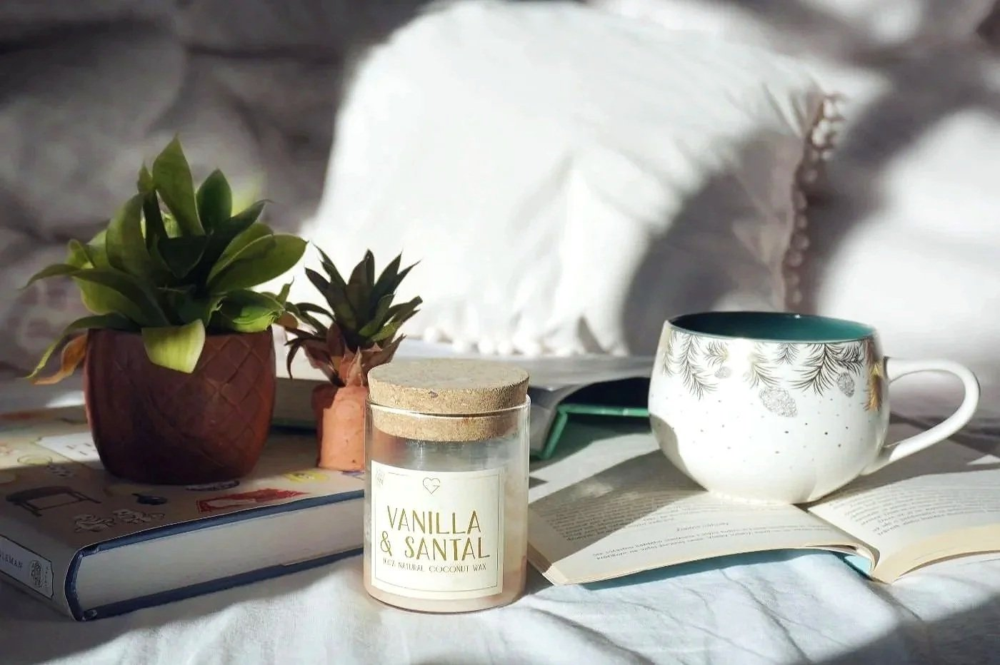
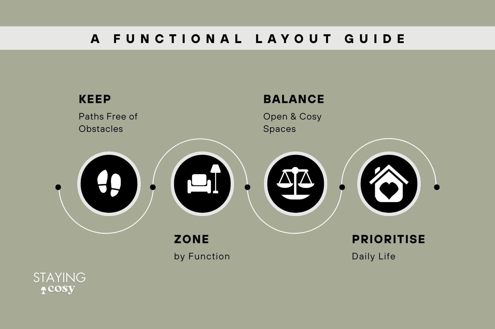
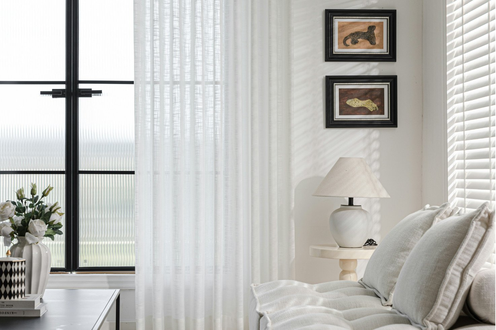
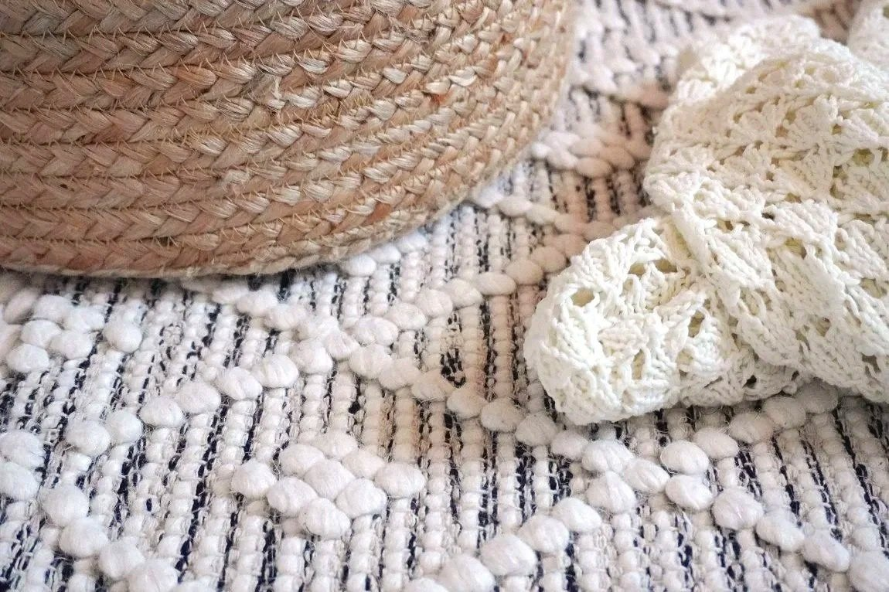
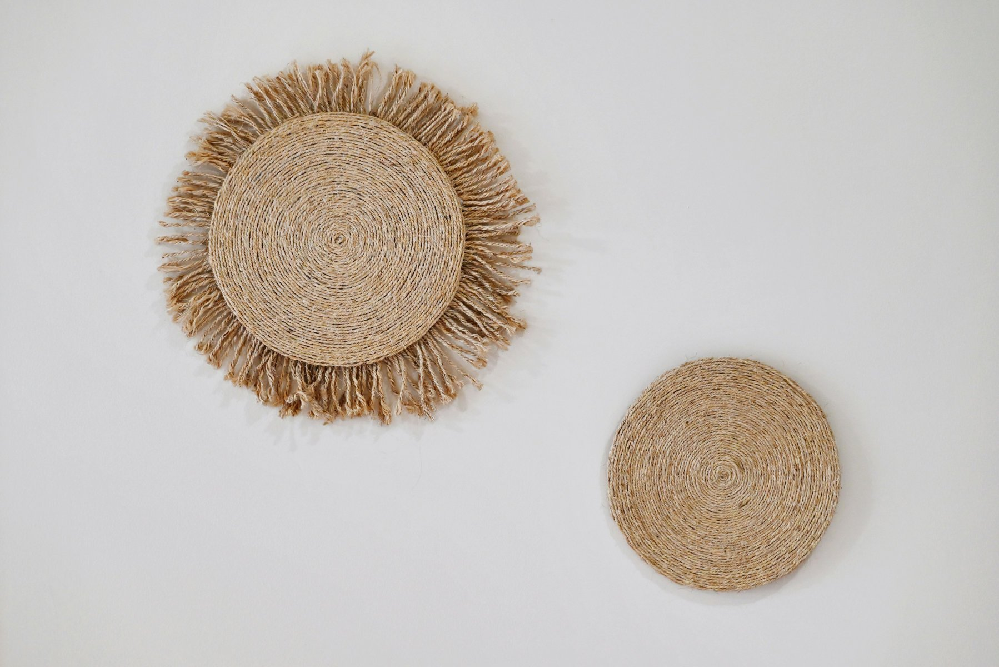
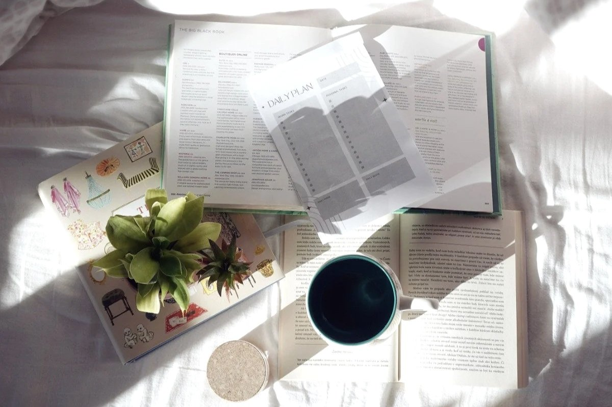

*Gone are the days when matching your home to magazine covers was the ultimate measure of good design. Today, the focus has shifted toward healthy living, sustainability, and conscious material choices — expectations that reach well beyond surface-level aesthetics. This is where holistic interior design comes in. It sees the home as a living system designed to support your well-being, not just your style.*

<Caption>
Image credit: Staying Cosy
</Caption>

Beautiful images can inspire, but they can’t capture the fresh air drifting through an open window, the pleasant warmth of a wooden floor under bare feet, or the subtle sensory balance that makes a room feel… *just right*.

Creating a [low-toxin](/blog/chemicals-that-pollute-our-living-rooms), balanced and rejuvenating interior doesn’t necessarily mean aiming for perfection or a complete overhaul. With a few tried-and-tested tweaks, you can slowly start making upgrades to benefit your whole family. After years of exploring these ideas, I am ready to share my insights — because a healthy home is a happy home. And that’s exactly what this space is about.

Stay with me, and you’ll find a **downloadable checklist** to help you start making small, meaningful changes today.

## What Is Holistic Interior?

At its core, a holistic, biophilic, or slow-living blends aesthetic beauty with mindful living. Its philosophy nurtures indoor air quality, acoustic comfort, textures, and even our biological rhythms. It is the vital difference between a room that looks fantastic in photos and one that feels genuinely restorative the moment you step inside.

<Caption>
Image credit: Staying Cosy
</Caption>

When we were designing our own house, we knew early on that health and comfort had to come first. Fascinated by **design psychology**, I treated the build as a real-life experiment. I spent years observing how materials, layout, light, and sound define the *feeling* of a space. That hands-on experience influenced my approach to holistic interior design today.

> “Think of it as designing your home to nourish body, mind, and spirit.”

By following these principles, you are creating emotional harmony in the spaces where you live, work, or relax.

## Creating a Calm & Functional Layout

In holistic interior design, flow and purpose are just as important as style and colour. Your layout needs to work for you, not against you. Here is how I approach creating a space that feels both organised and effortless.

### Plan for Movement and Flow

Think about how you naturally move through your home each day. Are there clear paths from the kitchen to the dining area? Can you reach your workspace without weaving around clutter?

In our own house, I noticed early on that the entryway was a bottleneck — shoes, bags, and coats created chaos every morning. By adding a simple bench with storage and moving less frequently used items to the main wardrobe, we instantly improved the home flow and made the space feel lighter. Clear walkways save time and reduce daily frustration.

<Caption>
Graphic: Staying Cosy - made in Canva
</Caption>

### Zone Spaces by Function

Each area should have a clear purpose, even if rooms serve multiple roles. I love using rugs to define *mini-rooms* within a larger space. In our open-plan living area, a soft, neutral rug anchors the seating circle, a large cowhide defines the dining zone, and a runner warms the area behind the kitchen island.

Furniture placement is another powerful tool. A snug corner chair can create a reading nook, while open shelving can separate a home office. You can even use a row of plants or clever curtains as dividers to distinguish zones without adding the visual noise of extra walls.

### Balance Open and Cosy Areas

Too much open space can feel cold, while too much furniture feels cramped. Holistic design is about finding the right balance. Think of open areas as breathing spaces, and cosy corners as spots for rest, reading, or reflection.

In our home, we kept the bedrooms small and focused on privacy. By creating a separate family walk-in wardrobe, we avoided bulky bedroom furniture, *and, let’s be honest, the messy clothes that come with it*, leaving the floor space open and calm. This allows each room to stay cosy and uncluttered, accommodating a work corner or a reading nook without feeling squeezed.

Clever built-ins and niches create instant breathing room. Don’t look for more space. Look for smarter solutions.

### Prioritise Daily Life, Not Just Looks

<Caption>
Image credit: Canva - edited
</Caption>

The pinnacle of a [wholesome home](/blog/shaping-a-green-home-with-purpose) is simple: it’s made for living, or in other words, for real, everyday life.

By *real life*, I mean authentic materials, like real wood instead of melamine, the genuine sounds, smells and rhythms of a home. Such spaces naturally bring people together.

In our house, the open kitchen-dining area encourages conversation while cooking, and our snug living room is a shared spot for quiet chats over tea. These small moments of connection are what make a space feel alive. When designing your layout, ask yourself: *Will this arrangement support how we live, relax, and interact?* Functional design considers lighting for reading and ease of cleaning. All the little details that make living feel effortless.

***Tips for an Ideal Layout:***

- **Keep walkways clear** and guide movement naturally with furniture.
- **Don’t be afraid to layer rugs.** Use smaller rugs on top of existing carpets or large area rugs to define zones.
- **Use multi-functional furniture.** Shelving can act as a room divider while freeing up much-needed breathing space.
- **Try the Week Test.** Live with a new furniture arrangement for a full week before committing to it. It takes time to see how a layout truly feels in your daily routine.

## Mindful Lighting & Acoustics

Most of us come home in the evening, switch on the lights, and carry on with our routine without thinking how the colour of a bulb or the hum of a fridge bouncing off a nearby cabinet affects us. Lighting and sound play a bigger role in our well-being than we realise.

<Caption>
Image credit: [EZcurtain Life](https://unsplash.com/@ezcurtainlife?utm_source=unsplash&utm_medium=referral&utm_content=creditCopyText) on [Unsplash](https://unsplash.com/photos/a-bright-airy-living-room-with-minimalist-decor-eLMSYhpAGEI?utm_source=unsplash&utm_medium=referral&utm_content=creditCopyText)
</Caption>

### Natural vs. Artificial Light

Whenever possible, I prioritise natural light. Sunlight directly affects our mood, sleep cycles, and energy levels. In our own home, we arranged the kitchen and living areas to capture the morning sun, while the bedrooms enjoy softer, indirect light to support restful mornings. When natural light isn't enough, layered lighting is key. Dimmable lamps and specific task lighting in workspaces help you control the ambiance and reduce eye strain.

### Circadian-Friendly Solutions

Light timing matters just as much as brightness. Cool, bright light in the morning energises us, while warm, soft light in the evening encourages relaxation. Simple tweaks, like [smart bulbs](https://www.amazon.com/gp/aw/d/B0DJG5HVBK/?_encoding=UTF8&pd_rd_plhdr=t&aaxitk=ec10f9086997fb0697fc37c85176b1f3&hsa_cr_id=0&qid=1770808916&sr=1-2-f02f01d6-adaf-4bef-9a7c-29308eff9043&ref_=sbx__sbtcd2_asin_1_title&pd_rd_w=WBV7t&content-id=amzn1.sym.e2c9099f-6964-4dbf-9ce9-8bc2c1a8ec1a%3Aamzn1.sym.e2c9099f-6964-4dbf-9ce9-8bc2c1a8ec1a&pf_rd_p=e2c9099f-6964-4dbf-9ce9-8bc2c1a8ec1a&pf_rd_r=SZH0H36DT8B96HHNTKR5&pd_rd_wg=Zy1e6&pd_rd_r=1c08c20b-81af-4584-a7ff-235c72be47e7&th=1), can help your home align with your natural circadian rhythms without a major renovation. For a deeper dive into these techniques, check out my guide on [lighting made simple](/blog/interior-lighting-guide).

### Sound & Acoustic Comfort

Good [home acoustics](/blog/holistic-acoustic-home-design-guide) are rarely seen, and when they work, they are barely noticed — which is exactly the point. You know something is off if you can’t hear conversations at the dinner table because of clattering cutlery, or if your walls echo. This constant acoustic noise can be surprisingly stressful on a subliminal level.

In our home, we used textured wooden ceilings and effective wall insulation to dampen sound. Thanks to this acoustic balance we could place the washing machine right in the heart of the house without any disruption. Even if your layout is fixed, simple additions like wall hangings, bookshelves, or large plants can subtly offset echoes and bring a sense of calm to your space.

By paying attention to both light and sound, you can transform your home into a quiet sanctuary. The one that supports focus, rest, and the juggle of daily life.

***Tips to Improve Light & Acoustic:***

- **Use heavy drapes.** Blackout curtains or thick natural fabrics help control both light levels and outside noise.
- **Layer soft furnishings.** Rugs, cushions, and upholstered chairs are great at absorbing sound and reducing echo.
- **Strategic placement.** Consider portable dividers, open shelving, or plants to break up large open spaces that tend to bounce sound.
- **Task-specific lighting.** Position reading lights and workspaces to match your daily activities, ensuring you have light exactly where you need it.

## Choosing Materials & Textures

Wouldn’t it be boring if there was only one material of furniture in the whole world? Let’s say cork. Imagine homes full of cork chairs, cork floors, cork plates. It would get dull rather quickly. Luckily, we live in a world full of options, and experimenting with textures and materials is one of the most rewarding parts of crafting a truly nurturing home.

### Non-toxic, Natural & Low-VOC Materials

Since we are inside our four walls for most of our waking hours, healthy materials are a necessity for clean air. Low-VOC paints, natural wood, stone, and cork all reduce toxins in your home and improve air quality.

In [our house](/blog/natural-materials-around-my-home), I prioritised natural finishes wherever possible. Wooden flooring, wool rugs, and clay-based paints made a measurable difference in our daily comfort. These were large projects, but even minor changes, like swapping electro-statically charged polyester curtains for heavy cotton drapes, can make your home feel fresher and cleaner.

<Caption>
A quick-glance comparison: The sensory and health benefits of natural fibres vs. synthetic alternatives.
</Caption>

### Textures That Soothe and Inspire

Textures influence our mood in ways we don’t always consciously notice. Smooth surfaces feel modern and minimal, while tactile materials like linen, leather, or velvet invite us to slow down and relax. I love layering natural textures in neutral tones to create spaces that are visually calm yet welcoming to the touch. Mixing contrasting elements — a rough-hewn wooden table with sleek metal legs, or a stone backsplash paired with natural oak cabinetry — adds a necessary sense of human warmth to a room.

### Colours That Promote Calm

Colours are a [wonderful tool](/blog/your-guide-to-beautifully-layered-home), whether you’re a painter or an interior decorator. They work hand-in-hand with textures. I remember [shopping for a sofa](/blog/sustainable-living-room-makeover-on-a-budget) just a few months ago and noticing how the same model looked completely different depending on its shade. Some colours made it sing; others fell completely flat.

Muted, earthy tones — soft greys, warm beiges, gentle greens — have a grounding effect. Brighter accents can spark creativity or highlight functional zones. In holistic interiors, it’s all about harmony. Think of it like nature: a bright flower captures our attention for a brief moment, then quietly recedes into the greenery. In bedrooms, I favour soft, muted shades that encourage rest, while kitchens can handle a few lively accents to energise the space.

<Caption>
Image credit: Staying Cosy
</Caption>

***How to Use Materials & Textures:***

- **Mix old and new.** Pair vintage or reclaimed pieces with modern materials to add character and a sense of history.
- **Tactility in unexpected places.** Add texture to small details like drawer fronts or stair risers to create subtle sensory interest.
- **Rotate textiles seasonally.** Swap cushions, throws, or rugs to refresh the feel of a room and connect with natural rhythms.

## Decor That Supports Wellbeing

Is there a home without at least one decorative cushion or a simple vase? Possibly, but even the most pared-back interiors tend to hold something decorative: a practical kitchen tray, or at best a living plant. Decor has a way of sneaking in whether we plan for it or not. Haven’t we all, at some point, been gifted a fluffy throw blanket by a friend or our mum?

In holistic interiors, these items aren’t there just to fill space. They influence our mood, evoke memories, and affect how comfortable we feel within our surroundings. The difference lies in choosing them with intention.

### Plants, Art & Meaningful Objects

<Caption>
Image credit: [Chalo Garcia](https://unsplash.com/@photosbychalo?utm_source=unsplash&utm_medium=referral&utm_content=creditCopyText) on [Unsplash](https://unsplash.com/photos/a-straw-hat-and-a-round-straw-hat-on-a-white-background-xtQGgvc1n3Y?utm_source=unsplash&utm_medium=referral&utm_content=creditCopyText)
</Caption>

Decor works best when it has a story. Plants bring life, purify the air, and soften the hard surfaces of a room. Art adds personality and **emotional connection**, especially when it’s created by local artists or tied to personal memories. Objects collected slowly, over time, add a sense of originality that trend-driven accessories bought all at once simply cannot replicate.

### Engaging the Senses Gently

Our senses respond constantly to our surroundings. It’s simple. Texture invites touch, colour influences mood, and scent delicately enhances the overall atmosphere. Natural materials are true to their imperfections, and the smell of home-baked cookies will always beat an artificial, overpowering fragrance. Soft colour palettes tend to calm the nervous system, whereas overly bright colours or visual clutter can feel overstimulating over time.

A locally-crafted leather coaster within easy reach, used daily rather than just displayed, or a faint natural home scent from a favourite essential oil can ground a space subtly, without demanding too much attention.

> “I always encourage choosing fewer pieces carefully, rather than filling shelves just to make a room feel finished. ”

### Personal Style Without Overstimulation

A holistic home doesn’t mean stripping away personality. It means editing with care. Leaving breathing room between objects and allowing some surfaces to stay clear helps both the eye and the mind to rest.

When decor supports rather than dominates, your home feels both expressive and calming — a place that reflects who you are, without overwhelming your senses.

***Tips to Support Wellbeing:***

- **Keep daily items within reach.** Frequently used items should be visible and accessible to create comfort and reduce the frustration of *searching*.
- **The *One In, One Out* rule.** Try to remove or relocate an existing item before adding something new to maintain an intentional space.
- **Let decor evolve slowly.** Live in your space first. Add pieces over time to ensure your home feels authentic rather than *staged*.

<Caption>
Image credit: Staying Cosy
</Caption>

Slow living is, at its core, a return to real values. The value of silence, of genuine human connection, and of raw, honest materials. These are qualities we instinctively recognise in nature, and it’s up to us to bring them more deliberately into our homes.

It is a concept I’ve been growing into over time and applying to my own life. As the years fly by and our priorities shift, chasing the idea of a *magazine*-*perfect* house feels increasingly unnecessary.

What stays with us instead are the homes filled with joyful memories we can cherish in good health, long into our later years. Remember how a framed family photo or your [child’s artwork](/blog/how-to-frame-your-kids-art) can instantly melt your heart? That is the kind of home worth investing in.

---

**☘︎ Start your holistic journey today!**

*If you’d like a gentle way to begin making your own healthy changes, I’ve created the* [*Holistic Home Reset*](/sign-up-holistic-reset) *checklist. It’s a simple guide to help you assess your space, spot small wins, and start creating a sanctuary — one mindful step at a time.*

SEARCH THE BLOG

