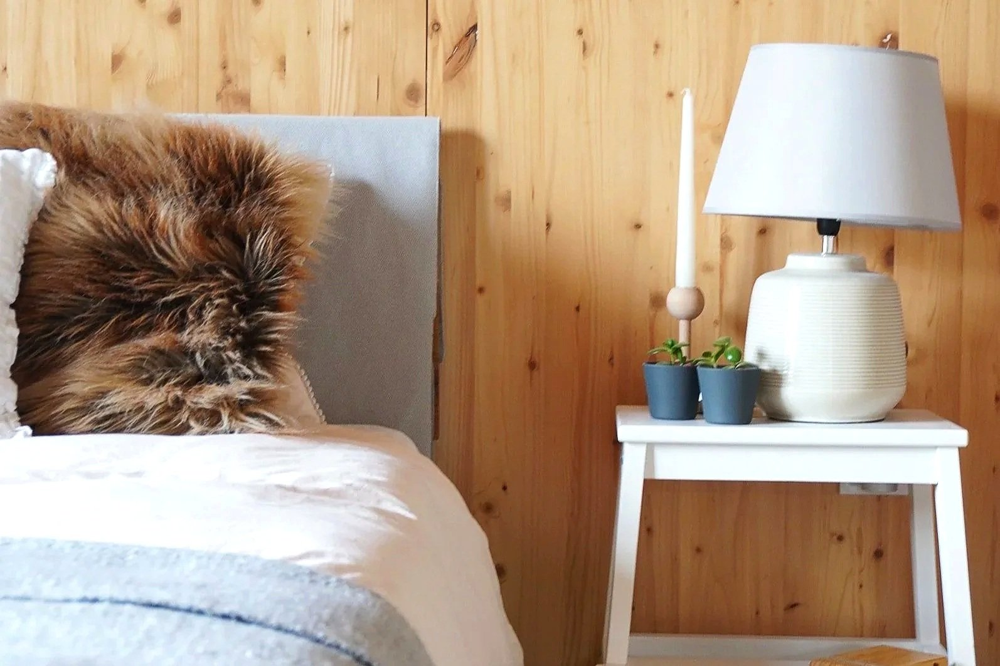
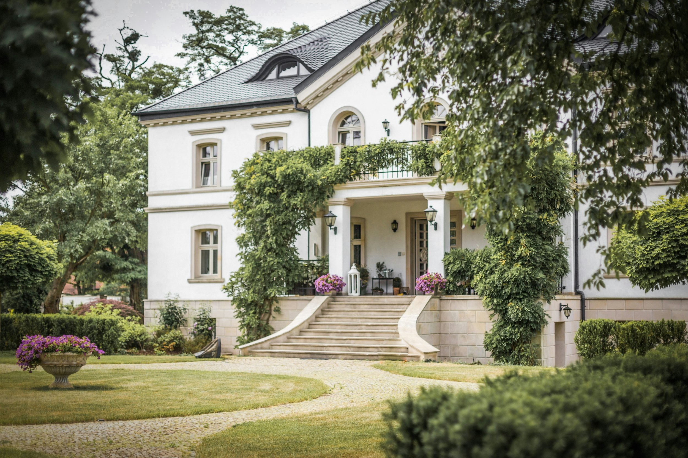
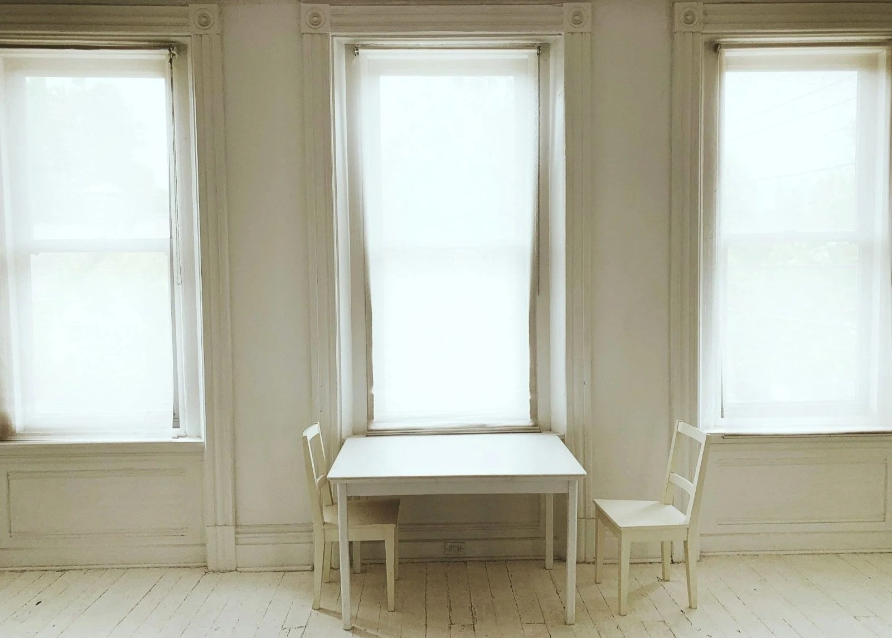
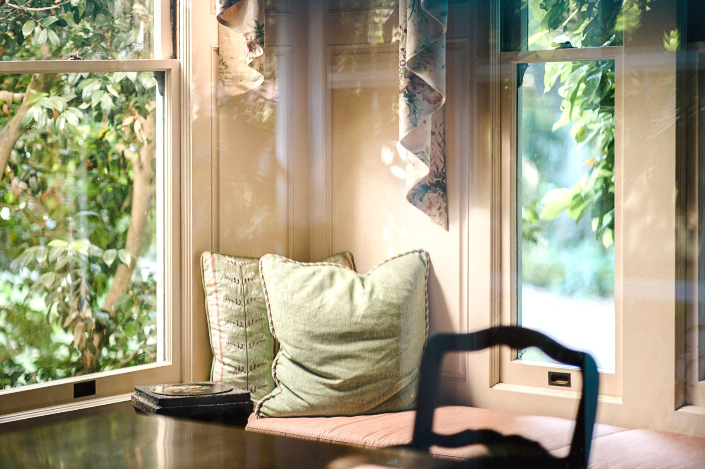
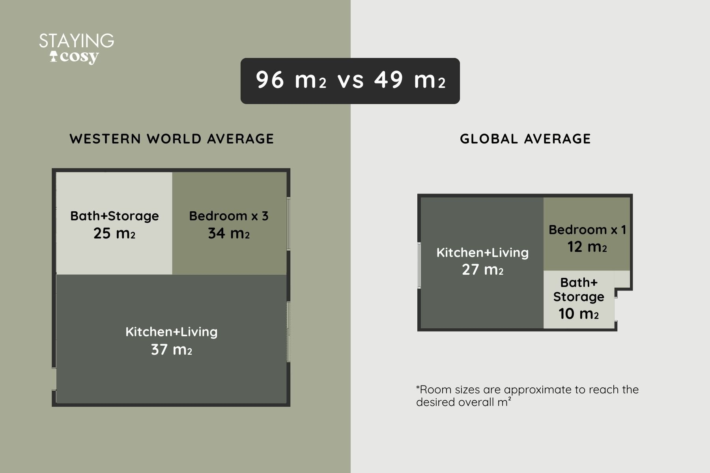

*If you could design your ideal home, how large would it be? A roomy house with a backyard for summer barbecues, or a cosy apartment where every nook earns its keep? Our sense of space is funny that way—what feels generous to me might feel like a shoebox to you. But is bigger always better? Or are we sometimes chasing square meters we don’t really need?*



<Caption>
Image credit: Staying Cosy
</Caption>

A larger home has always been seen as a sign of success. The more money you have, the bigger the house you can afford—or so we’re told. Having moved around 17 times, I’ve had my fair share of homes, from tiny apartments to larger family houses.

What stands out to me is that the size matters far less than the comfort created by the people sharing the space. The mood, the energy, the light, the way everyone fits together—those things define a home rather than square meters. As the saying goes: “*there’s always room for one more.”*

And because this wouldn’t be a true slow-living musing without bringing it back to human scale, let’s peel this whole *perfect home size* idea back to the bones.

## From Tokyo Flats to Texas Mansions

Our current house has roughly 130 m2 (1400 sq ft) of living space. It feels to me like a very manageable size. It is moderate to small in the US, but perfectly adequate in the rest of the western world even for a family of 4.



<Caption>
Image credit: [Bartłomiej Balicki](https://unsplash.com/@bartsplash?utm_content=creditCopyText&utm_medium=referral&utm_source=unsplash) on [Unsplash](https://unsplash.com/photos/white-concrete-house-near-green-trees-during-daytime-7icYxbgI9qk?utm_content=creditCopyText&utm_medium=referral&utm_source=unsplash)
</Caption>

So, while in the U.S. the average new home is around **200 m²** (2,150 sq ft), often with a separate dining room, multiple bathrooms, and even a bonus “*just in case*” guest room; across the ocean in the UK the average is closer to **70-80 m²,** with every square inch carefully utilised. Head further east to Japan, and a **40 m²** Tokyo apartment might house a family of three, complete with compact kitchen, sliding doors, and cleverly hidden storage.

### The average home sizes around the globe

To put things into perspective according to [world population review](https://worldpopulationreview.com/country-rankings/house-size-by-country):

- **Australia:** ~210 m²/2260 sq ft —one of the largest average sizes globally
- **USA:** ~200 m²/2150 sq ft— for new homes, often larger in suburban areas
- **Germany:** ~90–110 m²/1180 sq ft
- **UK:** ~70–80 m²/860 sq ft
- **China**: ~60 m²/640 sq ft
- **India:** urban apartments ~40–60 m²/640 sq ft, rural homes often smaller
- **Japan (Tokyo):** ~40 m²/430 sq ft
- **Hong Kong:** ~20–30 m²/320 sq ft micro-apartments

These differences are shaped by **culture, family structures, and urban density.** In sprawling countries like the U.S. or Australia, land is plentiful, and bigger homes are part of the dream. Meanwhile, in places like Tokyo or Hong Kong, space-saving design is an art form because every square meter counts.

## How Big Is Big Enough?



<Caption>
Image credit: [Hannah Skelly](https://unsplash.com/@ivelisseskelly) on [Unsplash](https://unsplash.com/photos/two-vacant-white-wooden-chair-in-room-9lgT6Hl1pPE)
</Caption>

The smallest apartment I’ve ever lived in was just about 25 m² (270 sq ft), and I loved it! At the time, it was just my husband and I, and our little studio was flooded with sunlight thanks to a huge south-facing window with a view of central London in the distance. The layout was clever, and the fact that it was our first own place added to the magic.

It wasn’t luxurious, but it was warm *(yes, we’re talking about UK here),* located in a safe area and never felt cramped. Everything we needed was within reach, and the absence of extra rooms made life feel, well—simpler. That space taught me that real comfort isn’t measured by size, but our own individual perception.

### Perceived spaciousness

This is where the idea of *“perceived spaciousness”* comes in. Natural light, a thoughtful layout, multifunctional furniture, and a clutter-free environment can make a smaller home feel expansive, calm, and full of life. A well-designed 60 m² apartment can feel more open and inviting than a cluttered 150 m² house.

> “There’s also the mental weight of excess. Minimalism and slow living teach us that more space often means more stuff, more maintenance, and equally more stress. ”

A smaller home encourages us to live intentionally—to choose the objects and routines that really matter to us, rather than filling every corner with pretty decor simply because we can.

### Most frequently used areas

Psychologists have noted that we only use a few key zones of our home on a daily basis:

- a place to prepare food and eat,
- a comfortable place to sit,
- a restful place to sleep & do hygiene, and
- a storage corner to keep our essentials.

Everything beyond that is a luxury, not a necessity.

A game of Scrabble by a tiny coffee table squeezed between the sofa and armchair can create memories like no other. Sure, a dedicated playroom for the kids sounds fantastic, but how often does it really get used enough to justify itself?

## The Ultimate Luxury Gap


<Caption>
Image credit: Canva- edited
</Caption>

I often tell my kids that we live in a world of luxury, even as a middle-class family. Of course, it’s not easy for them to fully grasp this, so I sometimes turn to documentaries to make the idea more real to them.

When we compare our lives to much of the world, we don’t just have more space—we also have **freedom, clean drinking water, fresh food, reliable healthcare and education, safety, human rights and most importantly—peace.** These things are not small—they are huge, and they’re the true markers of comfort, unlike the visible square feet or granite countertops.

### Geographical privilege

When a single western kitchen is larger than someone’s entire home, when it is stocked up on food more than an annual food consumption elsewhere, it is a reminder of how lucky we are. And how easily we forget that what we consider “*normal*” is, in many places, an unattainable dream.

#### *This shouldn’t make us feel guilty, of course, but it certainly calls for gratitude—and perhaps, a shift in perspective.*

Whether we like it or not, the idea of “*enough*” is primarily shaped by culture and privilege. What feels small to us might feel enormous to someone living in an overpopulated, resource-limited part of the world.

## Perfect Home Size Through A Slow Living Lens



<Caption>
Image credit: [Jason Leung](https://unsplash.com/@ninjason?utm_content=creditCopyText&utm_medium=referral&utm_source=unsplash) on [Unsplash](https://unsplash.com/photos/white-throw-pillow-on-brown-wooden-armchair-yyWjx0O73Wk?utm_content=creditCopyText&utm_medium=referral&utm_source=unsplash)
</Caption>

When we were in the design stage of our house, I remember asking friends for any useful tips they might have. One piece of advice stuck with me: *don’t build huge bedrooms if you only use them for sleeping.* Even for kids’ rooms, there’s rarely a need for a massive floor area. Children love cosy corners, and the space they really need to run around is outside, not in a giant indoor playroom.

Precious advice like this can help chisel down your perspective home size—and save you money on future bills, maintenance, and even hours of cleaning.

### The magic number

Before I started writing this post, I desperately wanted to boil home size down to a single number. And—well, here it is. If we go by the global average I mentioned earlier, we arrive at a comfortable home size for a 3–4 person family without too much trouble:

#### It’s 96 m², or just over 1000 sq ft.

But let me remind you—this is about comfortable living, not excess. And another question naturally follows: *does this average actually reflect the reality of the world as a whole?* Not quite. Western countries account for just a fraction of the global population—about one-sixth, to be exact.

Zoom out to include the rest of the world, and the numbers tell a different story. The global average home size drops to around **49 m²**—about half the space we consider “*standard*.”

Pretty small, isn’t it? Even our average 96 m² feels like a palace in comparison.

#### Let’s take a closer look



<Caption>
Graphic: Staying Cosy - made in Canva
</Caption>

### How to get most out of the floor area

Let’s be honest—house sizes have been shrinking over the last few decades, even in our capitalist, bigger-is-better world. Yet the influence of cultural expectations and the picture-perfect homes we scroll past on social media often leave us with an unrealistic idea of what *“enough space”* looks like. Add financial readiness into the mix, and we can easily find ourselves chasing something that’s simply out of our reach.

#### *This is exactly where slow living comes in. Reminding us to stop chasing ‘bigger the better’, but rather focus on ENOUGH.*

Paying attention to certain design aspects, rather than square meters alone, often leads to a much better sense of harmony. So, if you’re like most of us—working with limited space, here are five smart tips to help you stretch it further.

1. **Layout:** A [smart layout](/edesign) can work miracles. A smaller home where every corner is utilised to its maximum can feel far larger than a big house with awkward, unused north facing rooms. Good design is like a secret ingredient—it either makes it or breaks it.
2. **Natural light & ceiling height:** Both are powerful in shaping how spacious a room feels. Large windows, high ceilings, balconies, or even a garden view, they all blur boundaries and visually expand a home.
3. **Lifestyle:** Your lifestyle plays a huge role. Do you spend most of your time outdoors, exploring or socialising? Or do you thrive on snug evenings at home? Someone who loves hosting big family dinners might crave a generous dining space, while someone else may prefer a sunny reading nook over a formal living room.
4. **Family dynamics:** The number of people under one roof matters, but so does how well everyone gets along. A small home can feel warm and connected with the right dynamic—or uncomfortably cramped if tensions run high.
5. **Room purpose & organisation:** A space that serves multiple functions (kitchen-dining-living combined) often feels bigger than a home with divided rooms. Keeping it clutter-free and adding reflective surfaces or mirrors can further enhance that feeling of openness.

Paying attention to these aspects, rather than square meters alone, often leads to a much better sense of harmony.

### When less space means more life


<Caption>
Image credit: [Andrés Salas](https://unsplash.com/@casrphotography?utm_content=creditCopyText&utm_medium=referral&utm_source=unsplash) on [Unsplash](https://unsplash.com/photos/a-woman-and-a-child-lying-on-a-bed-_vWe8wtGNLM?utm_content=creditCopyText&utm_medium=referral&utm_source=unsplash)
</Caption>

In the end, the question *“How much space do we need?”* should always be balanced with *“How much space can we care for—both emotionally and responsibly?”* Bigger homes don’t just cost more; they also consume more energy, require more maintenance, and often lead to more waste and less time for fun and hobbies.

> “Sometimes a compact home in a fancier area can offer more peace of mind and a stronger sense of community than a sprawling farmhouse in the middle of nowhere. ”

When I think back to my tiny, sunlit rental, I remember how easy it was to live in. And what a contrast it is to our current, albeit small, family home with a garden and all the responsibilities that come with it. Well, it’s all down to our choices.

The perfect home size isn’t about having more, but about having *just enough*. Enough space to gather around the table, share a simple meal with loved ones, and live free from the constant stress of debt and endless upkeep. Isn’t that the kind of freedom we’re all looking for?

---

```
 SEARCH THE BLOG:
```

---

---
