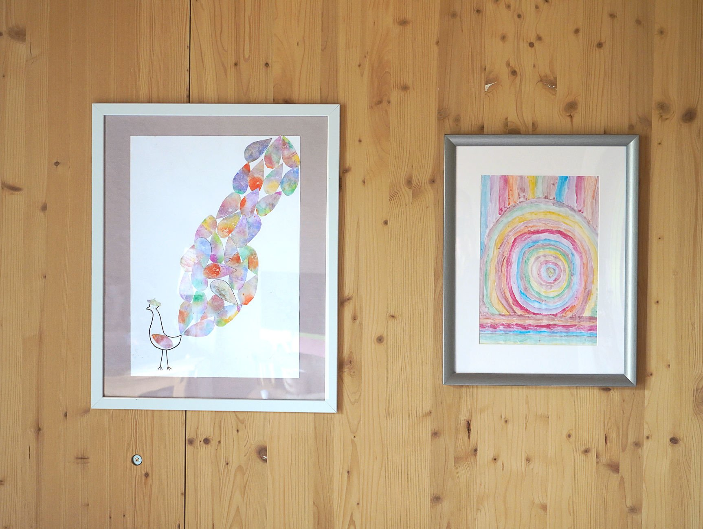
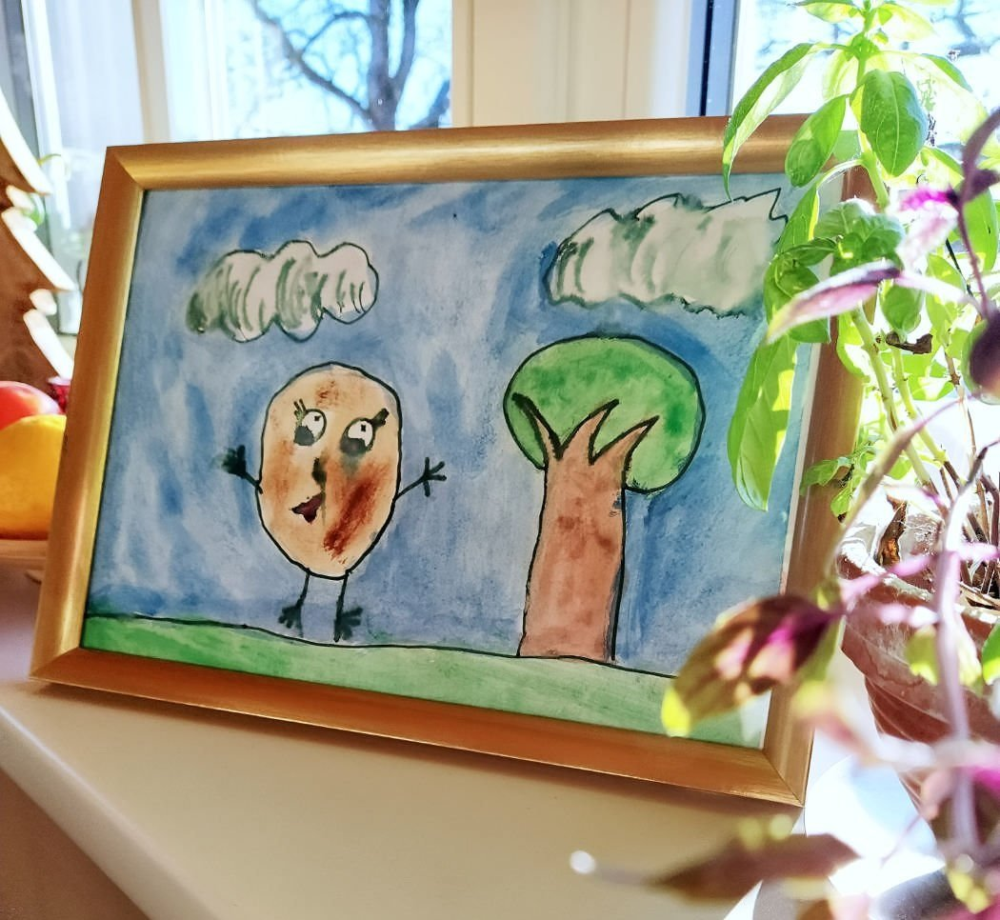
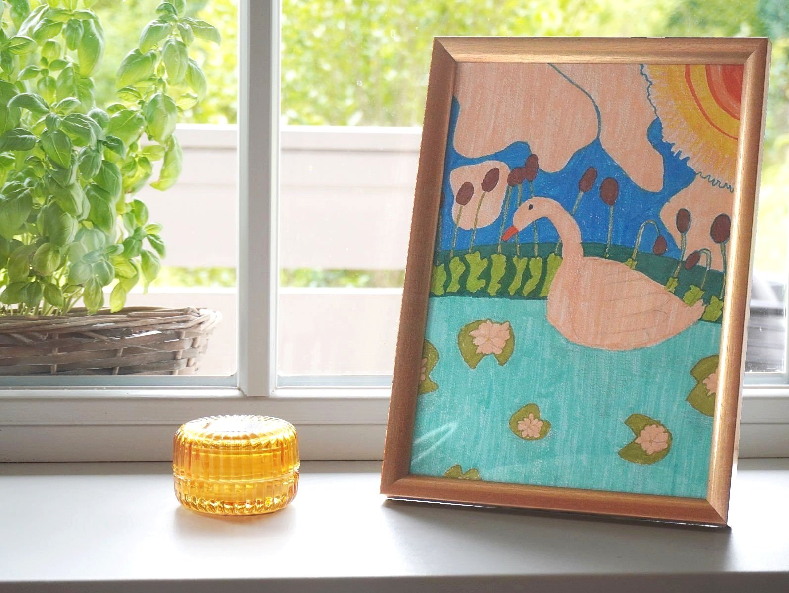
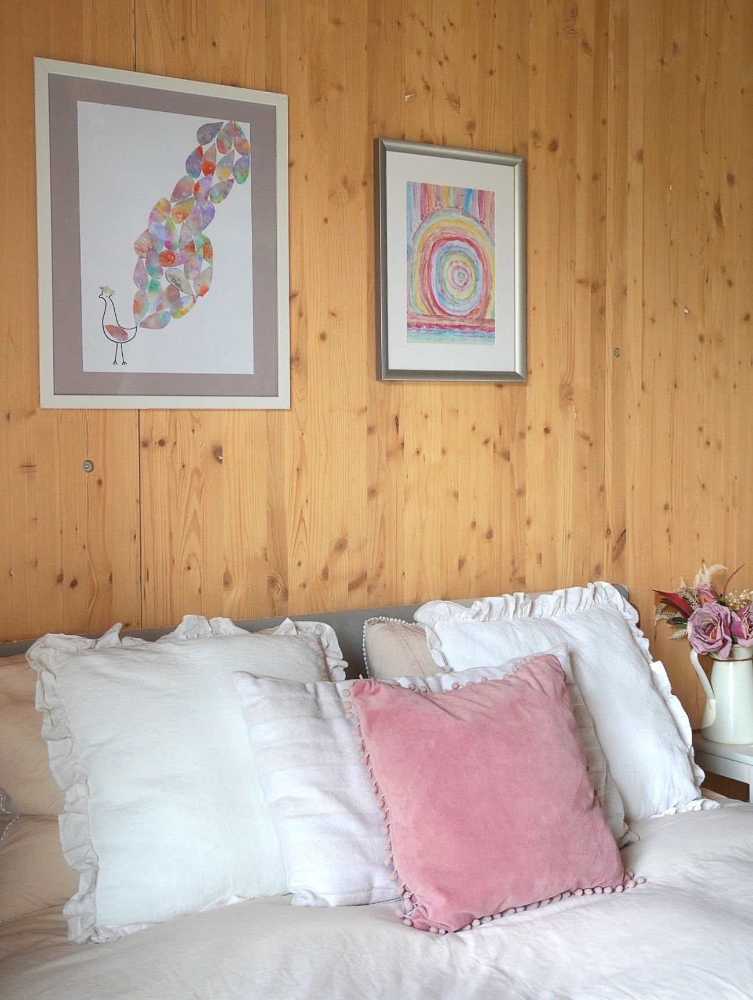
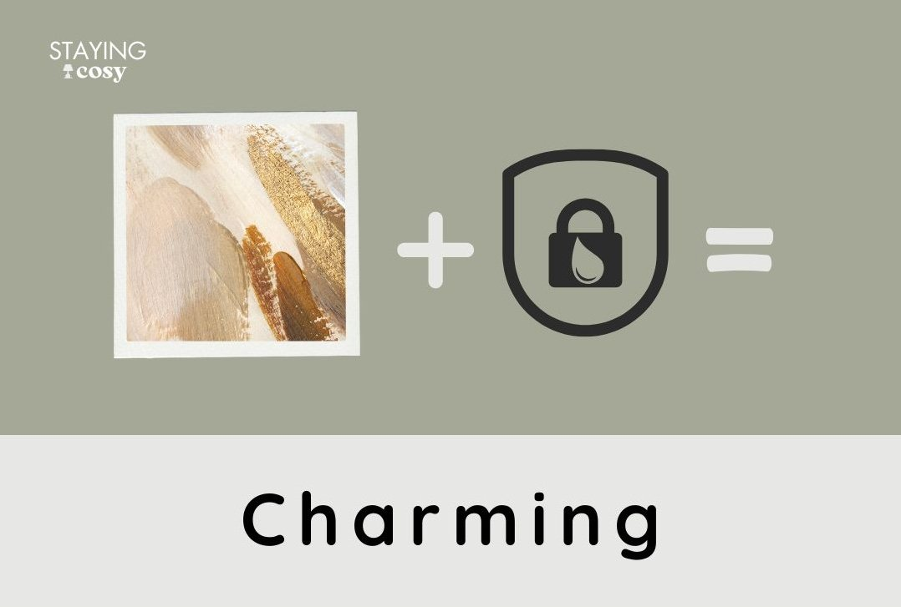
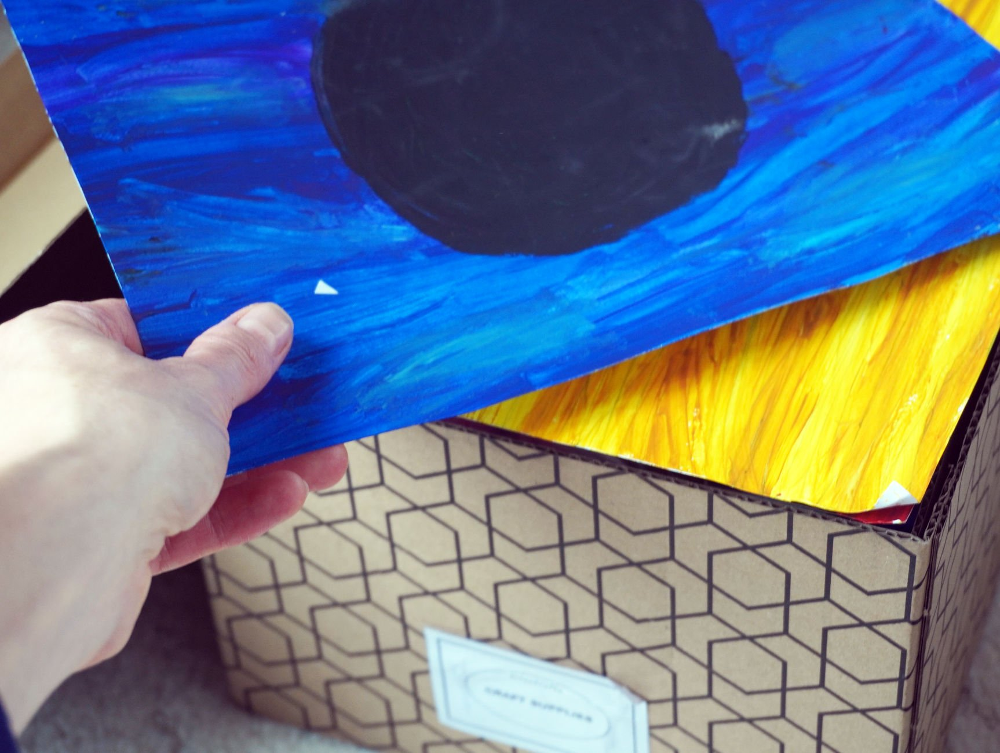

*Not only world-famous artists deserve to have their work framed—our kids' masterpieces are just as precious. Personally, my children are my favorite artists in the world! If you're a parent, you already know that anything your child makes holds a special meaning. Even the simplest scribble can melt your heart, no matter their "skill level."*

<Caption>
Image credit: Staying Cosy
</Caption>

I’ll admit, I sometimes struggle with deciding what to keep and what to quietly recycle.

Besides Lego, a simple sheet of paper seems to be my children’s favorite creative outlet. They cut it into tiny bits, glue it, draw on it, paint it, fold it into origami, make shapeless-yet-gorgeous collages, and yes—sometimes even dunk it in water and try pushing the soggy remains down the sink *(not proud of this)*.

Fortunately, more often than not, they pull out our polka-dot protective sheet, toss it over the dining table, and grab the box gracefully labeled *‘paints and brushes.’*

## From Messy Scribbles to Artwork

Their paintings often surprise me—adorable, hilarious, even deeply expressive. Many times I’m torn about which artworks to frame and which ones just won’t make the cut.

I keep a pile of my favourites, and when it feels like time for a refresh, I pick a few to frame and pop them on display. Visitors often comment on the funky shapes and colours, but truthfully, it doesn’t matter whether anyone else *thinks*—what matters is that it makes *you* happy.

### Framing Brings It to Life

Putting your child’s artwork behind glass instantly elevates it. It helps the colors pop, makes the piece look intentional, and adds a burst of your child’s personality to your home. They are just as much a part of your home’s identity, after all.

<Gallery columns={2} images={[{"src": "/src/assets/library/0116ec-blackcat.jpg", "alt": "blackcat"}, {"src": "/src/assets/library/2404e6-cat-pink-frame.jpg", "alt": "cat pink frame"}]} />

*Image credit: Staying Cosy*

Why not turn your next craft session into a spring or summer-themed art project? Use a lovely [pink frame](https://www.amazon.co.uk/dp/B0BLK3ZZGW/ref=sspa_dk_detail_3?pd_rd_w=O5ZCk&content-id=amzn1.sym.46187d6a-4306-4bc6-830c-7b2085e0e39f&pf_rd_p=46187d6a-4306-4bc6-830c-7b2085e0e39f&pf_rd_r=SSKQVQR6G46SC4T5640W&pd_rd_wg=0N6WX&pd_rd_r=044f40d2-9682-481c-a2c6-5a3a4185cb98&s=kitchen&sp_csd=d2lkZ2V0TmFtZT1zcF9kZXRhaWw&th=1) to bring the spring indoors. From flower gardens to beach scenes, there’s so much inspiration this time of year. You'll spend quality time with your child, spark some creativity, and end up with display-worthy pieces that bring the season indoors.

### Give Them Ownership Over the Frame and Display

I love asking my kids, *“Oh, you painted a… (fill in whatever you think it is)?”* You know how many times I’ve been wrong? Way too often. So here’s a little heads-up: give your kids a chance to curate their own art, but instead of guessing, try asking something like, *“What do you want to call this one?”* Their titles are often absolutely hilarious.

<Caption>
Image credit: Staying Cosy
</Caption>

Another fun and valuable thing to teach them is:

- how to sign and date their work
- how to add titles under the frames—just like in a real gallery

I guarantee you, the results will be both charming and surprisingly impressive.

## Benefits of Displaying Kids’ Art

Not only is it heartwarming for you, but most importantly, putting your kids' artwork on display brings them a multitude of psychological benefits. And no, they don’t have to be particularly skilled at art for it to work!

<Caption>
Image credit: Staying Cosy
</Caption>

### Emotional and Developmental Reasons Why it Matters

- Boosts kids’ self-esteem and pride in their work
- Encourages creativity and motivation to keep creating
- Makes them feel seen, valued, and part of the home
- Creates lasting memories of their growth

### Instant Colour & Mood Change

I’m one of those people who thrives on change. I swap frames every season together with cushion covers — it’s like our home has its own little gallery opening. Need red and green for Christmas? Easy. I just dive into our stash of saved masterpieces and pull out something that fits.

Right now, we’re doing a spring series of pink, purple and yellow hues, flowers, peacocks and lots of rainbows. I picked a few of the most vibrant pieces for our master bedroom and ended up with this cheerful, joy-filled wall:

<Caption>
Image credit: Staying Cosy
</Caption>

### Cheap and Surprisingly Effective

Another reason I love displaying my kids’ drawings—besides their cuteness and colour-matching potential—is that it’s wonderfully budget-friendly. Compared to original art, *which I still dream of and save for*, this costs nothing but a joyful burst of creative energy. No price tag, just priceless memories and whole lot of personality on your walls.

## Where to Display the Framed Pieces

Depending on your lifestyle and the size of your home, some areas are better suited for framed art than others. Whether hung, leaned, or placed on a shelf, these are my favourite display spots to make the masterpieces shine.

### Kitchen or Family Command Centre

We spend the most time in our open-plan kitchen, so naturally, it's where I rotate artwork most often. I recommend using whichever area is most active in your home—maybe a living room side table, a spot near the calendar, or even part of a gallery wall. The more you walk by it, the more it lifts your spirits.

My kitchen windowsill hosts an affordable [golden Ikea frame](https://www.ikea.com/gb/en/p/silverhoejden-frame-gold-colour-40370396/#content) of 21×30 cm/8×12 inches that fits an A4 artwork perfectly. It works just about anywhere. Lately, I’ve been thinking of replacing it with a sleek metal frame to balance out all the wood we have.

### Entryway for a Lasting First Impression

Have a blank wall in your entry or hallway? Turn it into a cheerful greeting spot with your child’s art. Whether it’s a single bold piece or part of a gallery wall, it’s a great way to make a warm first impression and spark conversation. Even a quick coffee run past it can bring a smile.

Although—now that I think of it—I just realised our entryway still has a Christmas tree drawing in the frame! *Oops.* Definitely time for a refresh!

#### *My front entry wall before & after.*

<Gallery columns={2} images={[{"src": "/src/assets/library/62834c-xmas-tree-painting.jpg", "alt": "xmas tree painting"}, {"src": "/src/assets/library/8a23fb-butterfly-painting.jpg", "alt": "butterfly painting"}]} />

### Kid’s or Even a Master Bedroom

Of course, kids’ rooms or play areas are a logical place to showcase their creations—it’s their domain! But surprisingly, one of my favourite display spots is in our own bedroom. That’s my second most rotated wall.

Part of it is practical, as I’ve temporarily set up my little office nook in there. Yet, more importantly, every night when I wind down, my eyes glance over my daughters’ vibrant paintings. And my heart instantly softens. It’s like a quiet, daily love note from them to me.

### Bathroom

This might sound surprising, but hear me out—everyone uses the bathroom, frequently! And since the space is usually small, any artwork becomes instantly noticeable.

Just one tip — moisture. Protect the piece by using a waterproof sheet, if it doesn’t happen to have a glass front. Then you’re all set for a charming mini-gallery moment in a place you wouldn’t expect.

<Caption>
Graphic: Staying Cosy - made in Canva
</Caption>

## How to Store the Rest

I’ll admit it — I’m a total sucker for keeping the originals. As someone who truly appreciates art, it would be a sin to frame a copy! And besides: *What if … one day … who knows?*

Between their at-home masterpieces and the *colossal* amount of artwork my kids bring home from school each year, I’ve had to get smarter about what to keep and how to manage the overflow.

<Caption>
Image credit: Staying Cosy
</Caption>

### Keep the Best — Let Go of the Rest

I know it’s hard. But really — keep only your *absolute favourites.* One helpful rule of thumb is to try to keep a good variety of art styles, colours, and formats. You’ll thank yourself later when you’re not drowning in a sea of stick figures and fingerprint trees.

It also helps to sort through older piles once a year. That way, as time passes, you maintain a neat, curated collection rather than a chaotic stash.

### Use a Labeled Portfolio

You don’t need anything fancy — a binder, a large envelope, a sturdy paper bag, or a flat [storage box](https://www.amazon.com/Pioneer-Jumbo-Scrapbook-Storage-Black/dp/B0013Z9EBC/ref=sr_1_44?crid=3C4TVHY6793BG&dib=eyJ2IjoiMSJ9.isJGpavuMqoysrDR62syKt0WLzXi4zMB_Poy36cmS_h7lm5RIlsgDy0E2zBN1kbxeAdoIFVNd_1MmM3_iKfyY126mg3T1LISIVskd_YINpCrbu3Gj7FDUQSxpxJrZthqplHpOFh_p9G4hxYyjkwR2WgL4t6vK053qwqZjJ9GZPnJ0wA4nj_YY3O_ZLmFCdav0J4iWkfBix-9BHbZOFRJRnNilWLv9QO95LofVnhPMCAe_CJttqtRujSFS5CSY5dTdqRB29HkrlkiU_kpJoY34WIpj0KWcOuOkqvM0ZiwGfw.NZb_ZI7DHPp5YNOCUJQrkUCP9-coCuM_foRKqAbNq4M&dib_tag=se&keywords=flat%2Bpaper%2Bbox&qid=1749114479&sprefix=flat%2Bpaper%2Bbox%2Caps%2C197&sr=8-44&th=1) will do. Just label one per child, per year. This makes it easy to flip through later or pull out for those nostalgic moments.

### Take Photos and Create a Digital Archive

I’m all for using tech to make life easier, though I’m not super religious with this one myself. I usually snap a photo of my favourites when I want to share them with my mum.

But if this option rocks your boat, go for it! Just make sure to back up your phone or cloud folder so those precious scribbles don’t disappear forever.

<Caption>
Image credit: Canva - edited
</Caption>

### Make a Yearly Photo Book

One step ahead of the digital archive is for the super-organised or the sentimental among us. Take your top picks, scan or photograph them in high quality, and create a little printed photo book. There are plenty of services available like [Shutterfly](https://www.shutterfly.com/) or [Mixbook](https://www.mixbook.com/).

It makes a great keepsake — or even *a heartfelt gift* for grandparents.

## Picture Frame Ideas

Most of the frames I use are from IKEA. You can find plenty of great-quality ones in stores or [online](https://www.amazon.com/Metal-Picture-Frames/s?k=Metal+Picture+Frames). Just be sure to check the right size—and whether you’ll need a passe-partout *(wide inner framing)* or not. I recommend going for wood or metal; high-quality materials never let you down.

### Fun & Creative DIY Frames

In case you want to go beyond store-bought options, there are so many fun and creative ways to frame your kids’ art — and you don’t have to spend much at all.

Here are a few playful ideas to try:

- **Washi tape frame wall** - easy to change, no nails needed.
- **Clipboards for rotating art** -great for seasonal displays or quick refreshes.
- **Painted cardboard frames** - let your kids paint or decorate them.
- **Magnetic wall strips for fast switching** - perfect for modern spaces.

<Gallery columns={2} images={[{"src": "/src/assets/library/5ce671-frame01.jpg", "alt": "frame01"}, {"src": "/src/assets/library/4d74b3-frame02.jpg", "alt": "frame02"}, {"src": "/src/assets/library/74ee9c-frame03.jpg", "alt": "frame03"}, {"src": "/src/assets/library/343a6d-frame04.jpg", "alt": "frame04"}]} />

*Graphics: Staying Cosy - made in Canva*

Framing your children’s art isn’t just about decorating your home — it’s about celebrating their creativity, preserving memories, and letting them know their efforts matter. Whether it’s a bold rainbow scribble or a surprisingly deep portrait of a cat, these little masterpieces deserve a place on your walls and in your heart.

So go ahead — give their art the spotlight it deserves, and let your home tell the joyful, ever-evolving story of your family.

---

---

---
