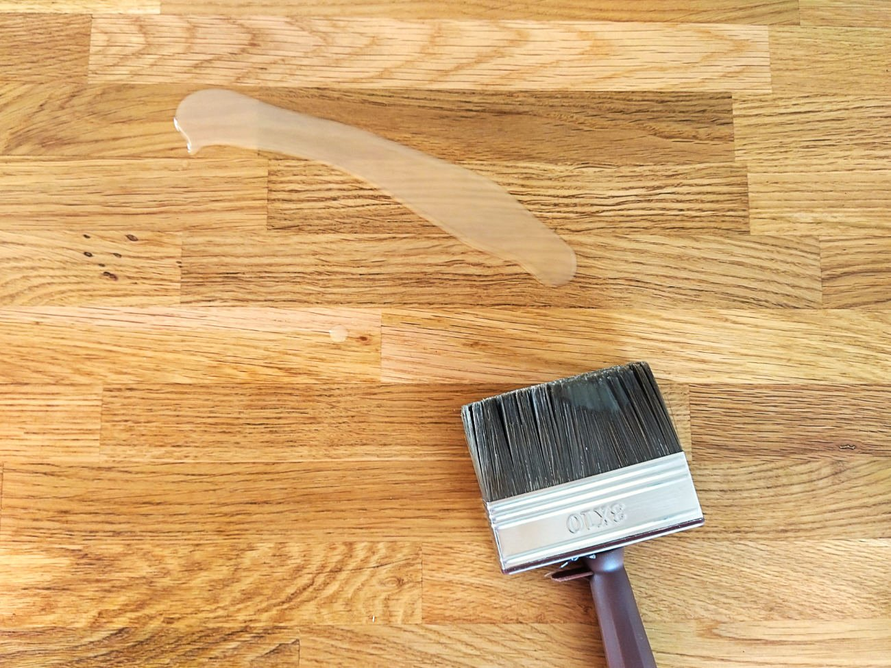
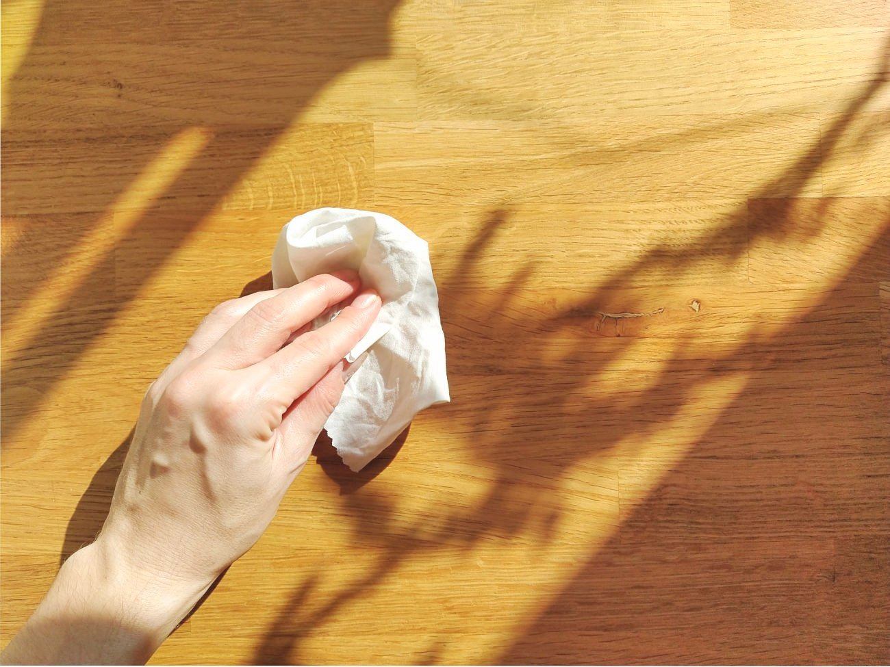
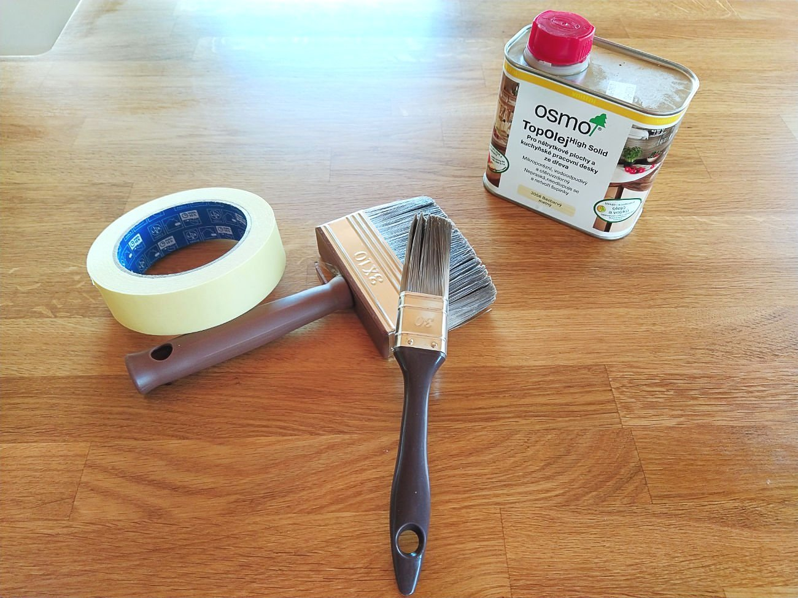
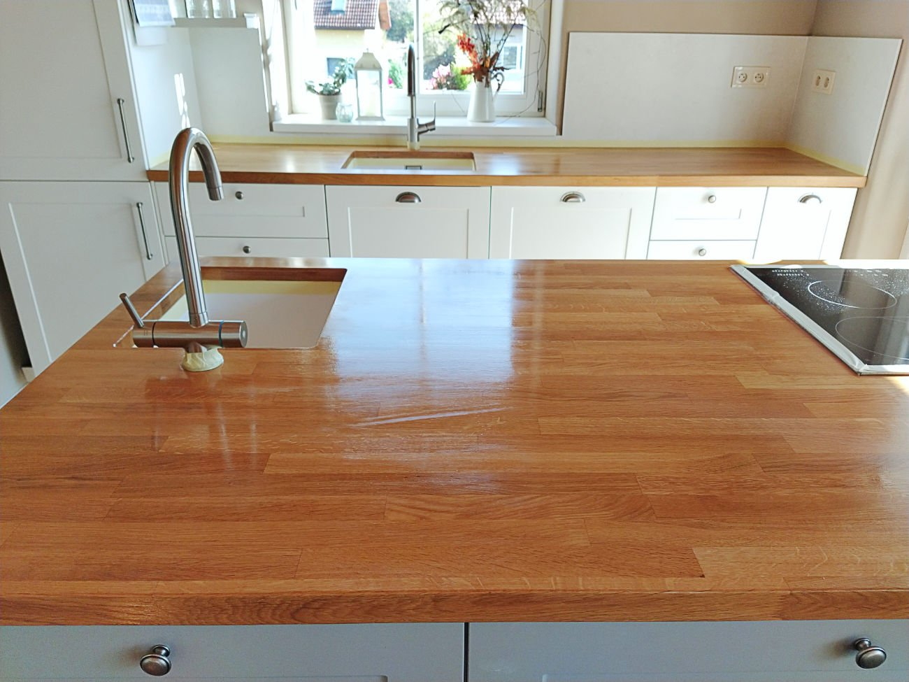
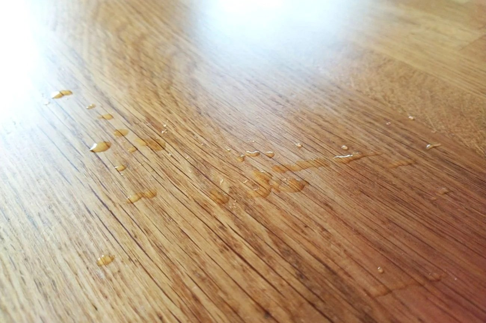

*My wooden countertops were starting to tell on me. The dry patches and the dull surface were the clear signs that my rushed oiling session some years ago needed a proper refinishing.*

<Caption>
Image credit: Staying Cosy
</Caption>

I love my solid oak countertops. They feel soft and warm, and they’re easy to repair. If the surface gets scratched, a simple touch of oil — even one you use for cooking, usually does the job until the next proper refinish. It’s hard to say exactly when that deeper treatment is needed, as it depends entirely on how intensely your kitchen is used each day.

**☘︎ *How Often to Oil?***

*Generally, it is advised to oil the wooden counter tops annually, before any damage to the wood has a chance to develop. My recommendation is at least every other year. You can also re-oil just the heavily damaged areas when needed.*

My re-oiling was overdue by more than half a year, and there were visible dry patches across the wood. That’s a clear warning sign not to wait any longer, because at this stage the surface has been stripped of its protective oil and is more vulnerable to damage. I’ll walk you through my re-oiling process so you can avoid the mistakes I made.

This routine also applies to the very first oiling of brand-new hardwood countertops. If you’re already getting your hands dirty and looking for quick tips, I’ve put together a short guide to follow while refinishing your kitchen surfaces. If you have the time, though, I recommend reading through the full process below for a more detailed breakdown.

<Caption>
My step-by-step guide to oiling wooden countertops
</Caption>

## 1. Plan Your Oiling

This may appear unnecessary, but believe me when I say that each step is essential. I recommend planning the oiling when:

- your kids are not around
- the place can get well ventilated
- and there is plenty of natural daylight pouring in.

Good lighting is very important, as it will allow you to easily distinguish between the oiled and raw areas. Keep in mind that one layer will most likely not be enough. The planning period also requires you to get hold of the correct tools, see the step number 4 for details.

**Plan for at least two coats, with an 8-hour drying period in between.**

## 2. Prepare the Counter Tops

<Caption>
Image credit: Staying Cosy
</Caption>

To begin, thoroughly wipe your hardwood counter tops with soapy water before drying them with a clean, non-fibrous cloth. Now is the time to sand any areas that have considerable water damage or staining. Wood filler should be used to fill large or deep scratches. Leave the minor cuts alone; the oil will take care of them.

Clean and de-dust the surface once again, then allow it to dry completely.

## 3. Protect the Surrounding Areas

<Gallery columns={2} images={[{"src": "/src/assets/library/56c8da-oil17.jpg", "alt": "oil17"}, {"src": "/src/assets/library/6aeed5-oil19.jpg", "alt": "oil19"}]} />

If you're concerned about spilling oil on the floor, cover it with plastic sheeting or a piece of cardboard that you can move around as needed. Protect any surrounding areas — the sink, the tap, and the backsplash with masking tape.

## 4. Get Your Tools Ready

Make sure you have the right kind of oil ready. There are special food-safe ones for counter tops specifically. I used [Osmo Top Oil](https://osmouk.com/product/topoil/).

<Caption>
Image credit: Staying Cosy
</Caption>

Thick fine brushes are the best to use for oiling. Have a large size for the large areas and a smaller one for the edges. I have tried applying the oil with a cloth too, but I find brushing much easier and more thorough.

A respirator may also come in handy to protect you from inhaling the fumes.

## 5. Oil the Surfaces

<Gallery columns={2} images={[{"src": "/src/assets/library/a2996d-lady-oiling-wood-countertop-with-brush.jpg", "alt": "lady oiling wood countertop with brush"}, {"src": "/src/assets/library/a17330-wood-oiling-brush-detail.jpg", "alt": "wood oiling brush detail"}]} />

Make sure to shake the oil can before pouring any oil out. Put a conscious effort into doing this regularly. It may be difficult to guess the correct amount of oil at first, and I think I naturally tend to use a bit too much, but once you get into it, you will find your technique. Use the oil sparingly and keep brushing it in the grain direction until the brush itself feels dry.

**Oil in a well-lit and well-ventilated area.**

#### 💡 **Remember**

Oil is not a varnish or paint. It is supposed to **soak into the wood**. Use the oil sparingly and keep brushing it in the grain direction until the brush itself feels dry.

## 6. Ventilate and Wait

Have a break. Depending on the time of day, you may decide to go outside to avoid inhaling the evaporating oil, have an afternoon cup of tea, or perhaps go to sleep if it's late.

Whatever you decide to do, make sure to ventilate well before, during and after applying the oil.

<Gallery columns={2} images={[{"src": "/src/assets/library/38b15b-oil06s.jpg", "alt": "oil06s"}, {"src": "/src/assets/library/4f17f2-oil05.jpg", "alt": "oil05"}]} />

## 7. Prepare for the Second Coat

Now, you should be able to see how well the first layer of oil has seeped into the wood. You may also notice that some areas remained dry despite the initial layer. These were probably the most dehydrated, and they will require at least one more layer.

Once the surface is completely dry, you may want to wipe it down with a dry cloth to remove any excess oil and perhaps remove any bristles that have become loose and adhered to the surface during the drying process.

## 8. Oil Again

Repeat the steps number 5-6. Make sure you focus on the dry areas and the areas that are frequently exposed to water.

**Depending on the state of wood before oiling, you may need to repeat this step again.**

When treating the wood for the first time, you will apply a minimum of three coats. If you are re-oiling, like me, I recommend two layers. A third one might be applied locally to the most damaged areas.

<Caption>
Image credit: Staying Cosy
</Caption>

## 9. Ventilate and Wait Again

Once the surface is dry, you may proceed to remove the masking tape.

Test your freshly oiled hard wood counters by sprinkling a small amount of water on the surface. Water droplets should remain on top of it, like this:

<Caption>
Image credit: Staying Cosy
</Caption>

## 10. Job Done — Time for a Break

Before you start cleaning up, and I know the temptation is to rush through it, pause for a moment and admire your work. Let it settle. In my case, that small reward is a piece of dark chocolate. Give yourself a little well-earned indulgence.

Your countertops are ready! I’ll see you again at the next oiling.

---

**☘︎ Would you like more inspiration?**

[*Mindful Living at Home*](https://bluebird-hawk-as8j.squarespace.com/blog/shaping-a-green-home-with-purpose) *|* [*Effective Window Cleaning Hacks*](https://bluebird-hawk-as8j.squarespace.com/blog/effective-window-cleaning-hacks) *|* [*Sculptural Lamps Guide*](https://bluebird-hawk-as8j.squarespace.com/blog/sculptural-lamps-light-personality)
