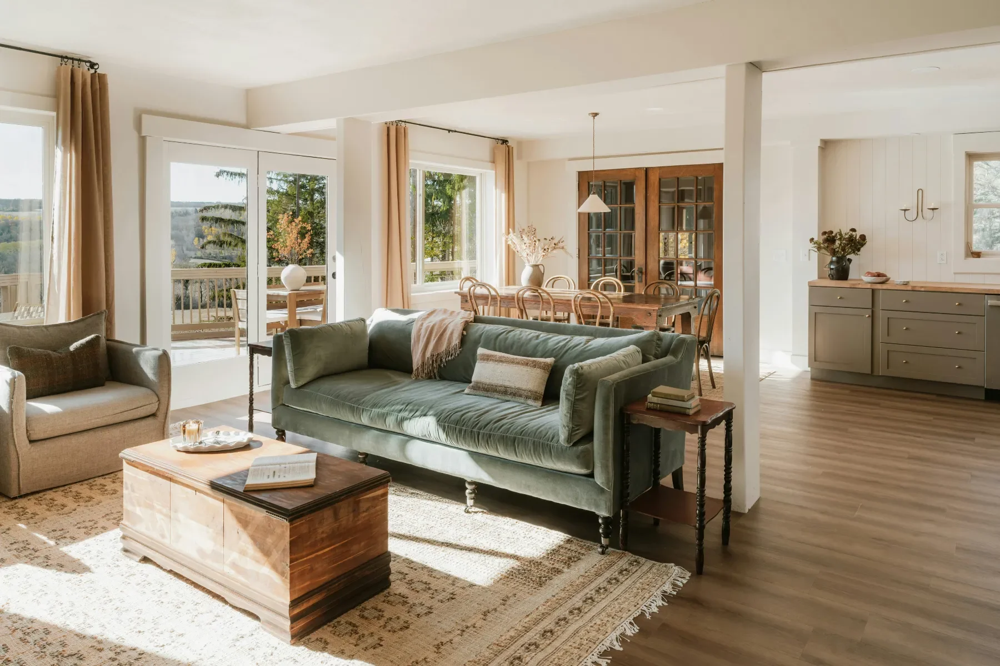
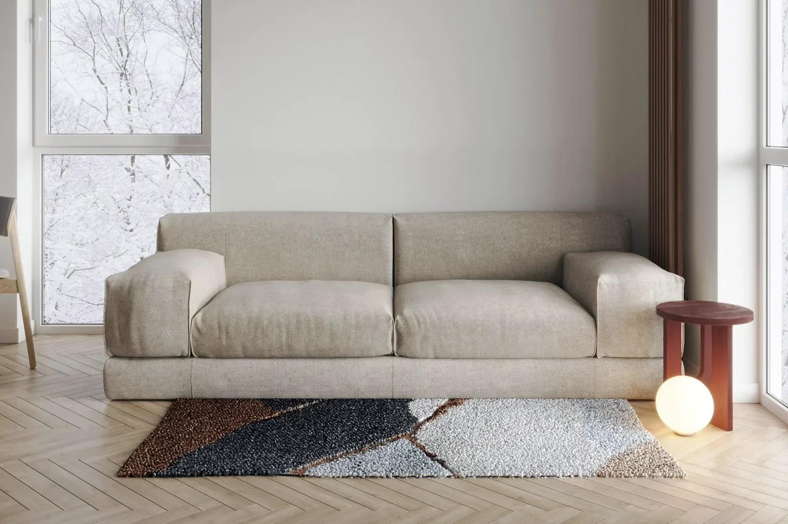
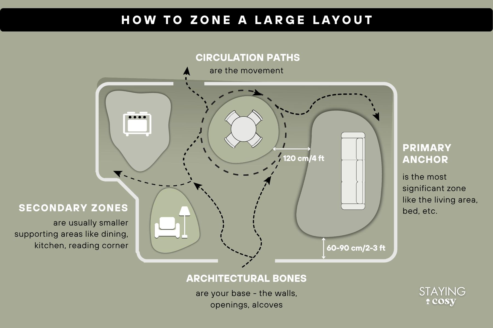
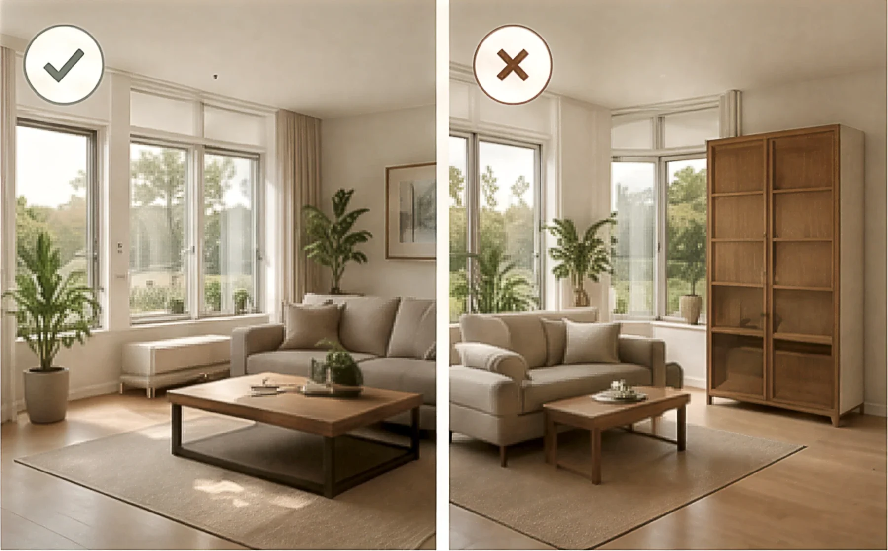
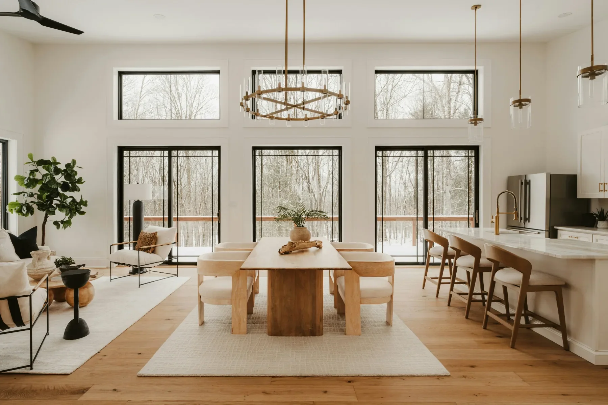
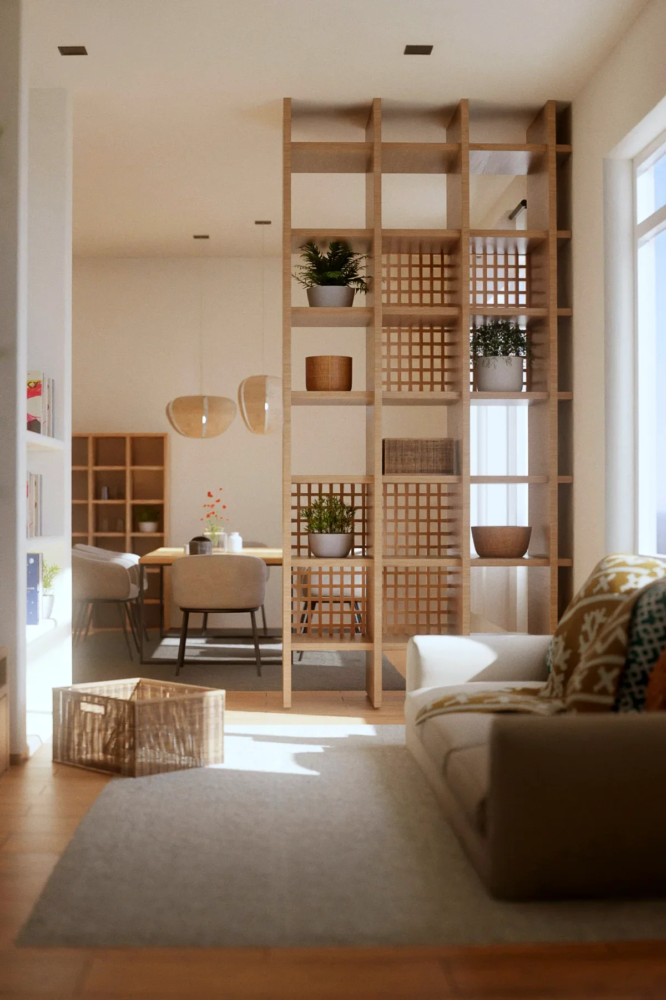

*Hand anyone the choice between a modest 20-square-metre living room and a massive 45-square-metre open space, and they’ll grab the bigger option without a second thought. At least initially. I probably would too. But size alone does not guarantee comfort. In many cases, it is the larger room that is much harder to get right.*

<Caption>
Image credit: [Clay Banks](https://unsplash.com/@claybanks?utm_source=unsplash&utm_medium=referral&utm_content=creditCopyText) on [Unsplash](https://unsplash.com/photos/cozy-living-room-with-plush-sofa-and-wooden-chest-E0pZm6b2z7A?utm_source=unsplash&utm_medium=referral&utm_content=creditCopyText)
</Caption>

I learned this firsthand after [moving 18 times](/blog/18-places-one-home-lessons), and later designing our own home. Spaces that are on the generous side aren’t necessarily easier to design. In fact, I’d argue they’re oftentimes the opposite.

Large open rooms do not automatically grant a better lifestyle; but they certainly demand a clearer plan. Particularly, they are easy to misread. Without structural walls to guide you, furniture placement, scale, and human movement become a tricky trio you have to carefully work through. Unless, a vast open flight terminal happens to be your main inspiration.

## The Fallacy of More Space

I think, that for a long time, we’ve had this cultural belief that more space automatically means a superior home. A bigger living room, a wider kitchen, a long hallway — it all sounds like progress. But only up to a point.

I’ve already written about this exact dilemma when I looked at [how much space we actually need](/blog/how-big-should-your-home-be) to live comfortably.

Extra square metres are never free. They cost more to heat, more to furnish, and more to maintain. Perhaps less obviously, they also create decision fatigue. Every extra empty corner begs the question: *what is this supposed to be?*

Unlike smaller rooms, where structural limitations naturally dictate where the sofa or the table must go, large spaces strip those boundaries away. You are left with total freedom, but very little direction. Without intentional zoning, what should feel open and generous quickly ends up feeling vague, cold, and unfinished.

## Why Scale Matters More Than Square Metres

<Caption>
Wrong scale sofa and rug | Image credit: [Prydumano Design](https://unsplash.com/@prydumanodesign?utm_source=unsplash&utm_medium=referral&utm_content=creditCopyText) on [Unsplash](https://unsplash.com/photos/a-living-room-with-a-couch-and-a-table-yOx4oPNUR10?utm_source=unsplash&utm_medium=referral&utm_content=creditCopyText)‍ ‍
</Caption>

Once you start working with larger rooms, square metres stop being the most important factor. In a small room, size is obvious. You feel it immediately. But in a massive room, the design hinges entirely on shape, proportion, and architectural features.

A long, narrow space behaves rather differently from a perfect square. Even if they have the exact same floor area. High ceilings change the dynamic again, sometimes adding beautiful volume, and other times creating a cold chasm that needs to be visually tamed.

A common mistake I’ve noticed over the years is buying furniture based entirely on how it looks on a a laptop screen, without checking how it relates to the actual room size. A large living area may comfortably accommodate a massive sectional sofa or an oversized rug, *who doesn’t love those*, but that doesn’t mean the proportions will feel right once everything is placed together.

> “It is easy to get scale right on paper. The real test happens when physical furniture enters the room.”

And this is where things start to go wrong in spacious homes.

When proportions are misjudged, furniture usually ends up scattered in isolated clusters. Each piece might be high quality on its own, but nothing feels connected and no clear anchor is created. The room looks like it has been filled with objects rather than intentionally designed.

The opposite is also true. Overfilling a space out of fear of emptiness. Instead of achieving clarity, you get congestion, and walking through the room becomes awkward. The goal is to let the proportions guide where things naturally belong. Taking a step back always pays off before you start buying furniture. Once the scale makes sense, you can thank your tape measure, and move on to the actual zoning.

## How to Zone a Large Living Room, or Bedroom Without Walls

Zoning sounds like an intimidating design term. In practice, it is quite simple. It is just about giving a large room a sense of organisation without putting up drywall. It is how you decide what belongs where, and why. To better visualise it, think of creating a few cohesive *mini-rooms* within one open landscape. The larger the area, the more zones you can accommodate.

For successful zoning, it helps to map out the space in distinct, practical layers:

<Caption>
Graphic: Staying Cosy — made in Canva
</Caption>

The geography of the room:

1. Architecture → ***The fixed structural bones***
2. Circulation Paths → ***The invisible human trails***
3. Primary Anchor → ***The main purpose like sofa or table***
4. Secondary Satellites → ***Nooks for specific function***

### Natural Architectural Bones

Long before furniture arrives, the house usually drops a few hints about where things should go. An alcove, a dropped ceiling beam, a sudden L-shaped layout, or a bay window all offer natural invitations.

These are fixed spatial conditions, but they are not always obvious if you are just staring at an empty white box. Instead of fighting these architectural quirks or wishing for a perfectly symmetrical room, work *with* them. Use an odd recess as the baseline for a built-in bookcase, or let a lowered ceiling naturally define where the dining table sits. It saves you from making fifty extra layout decisions down the line.

Long before your furniture even arrives, the house usually drops a few hints about where things want to go. Imagine an alcove, a dropped ceiling beam, a weird L-shaped corner, or a bay window. They all offer a natural invitation.

The problem is, these architectural cues are easy to miss when you're just staring at a cold, empty white box. And instead of wishing for a perfectly symmetrical room, you should lean into such quirks. Use an odd recess as the perfect spot for a built-in bookcase. Let a low ceiling beam naturally dictate where your dining table sits. Honestly, it saves you from making fifty extra layout decisions down the line.

> “Every single piece you bring in needs a clear purpose for that specific patch of floor plan.”

### Movement and Circulation

Before dragging a heavy sofa into place, just stand still and observe the empty room. Where do you naturally walk? Where are the doorways? How do you access the windows? What paths get repeated daily, almost like [worn grass tracks](/blog/beauty-of-desire-paths) in a park?

These walking paths are the invisible skeleton of your whole layout. Even if you don't map them out on purpose, your daily routines will carve them into the room anyway. Let's be real. Nothing is more frustrating than awkwardly sidestepping a bulky coffee table every single time you want to get out onto the terrace.

But once you lock down these clear footpaths on your floor plan, the puzzle is solved. The leftover spots instantly reveal themselves as the absolute best locations to place your furniture.

#### 💡 **Spacial Comfort**

To maintain a natural, comfortable flow in a large room, primary walkways should have **60–90 cm (2-3 ft)** of clear space. High-traffic paths benefit from up to **120 cm (4 ft)**, allowing two people to pass each other easily.

### The Primary Anchor

In most living spaces, this is the main event. The primary anchor is the most significant area in the overall choreography of the room. It is often the largest zone, although it may sometimes be similar in size to the supporting areas. What makes it primary is the role it plays in giving the space its centre of gravity.

In open-plan layouts an anchor is primarily seating area — a sofa arrangement facing a fireplace, a dining table, or whatever your strongest natural focal point happens to be. Because it often takes up the largest footprint, this zone needs to be locked in first. Then the rest of the room has something to organise itself around. And don’t be mistaken, if your space is really large, you may even end up having two seating zones within it. The same goes for shared kids’ bedroom where multiple beds need to be accommodated.

### Secondary Satellites

With the main anchor established, secondary zones can branch off into the remaining pockets of space. Think of a solitary reading chair tucked under a window, a minimal desk for remote work, or, if you’re currently surviving a chaotic parenting phase of life, an indoor toddler swing.

The point here isn’t to panic and pack out every single square inch just because you're scared of a blank floor. Empty space is a good thing. It lets the room to breathe. Every extra piece you bring in needs a genuine purpose, otherwise you’re risking that your layout ends up looking like a random pile of furniture you had leftover from your last move.

### The Choreography of Light

<Caption>
Graphic: Staying Cosy — made with AI assistance
</Caption>

Windows can be a game changer, and the sun does not care about your furniture layout. In many cases, the most effective large rooms respond to light first and walls second.

Positioning key zones near windows is the best thing you can do. A morning coffee corner bathed in eastern light will always feel inherently right, whereas pushing your main seating area into a permanent dark shadow is a quick way to ensure that part of the room feels abandoned by 3:00 PM. Bring light into the equation early, and you will naturally prevent darker corners from becoming forgotten dust-traps.

### In-Between Space

Not every area in a massive room needs a strict job title. Leaving a small corner completely open and undefined doesn’t ruin your zoning, it saves it.

Think of it as an architectural buffer. It’s a flexible, lightly defined spot that shifts to suit whatever you need in the moment. It might be a corner where you drop your bags after shopping, a makeshift afternoon workspace, or just a place to set down a stepping stool. Essentially, it is the spatial equivalent of a sweatpants day — unstructured, highly adaptable, and absolutely necessary.

Generous layouts instantly feel warmer when there’s a bit of room left for these ad hoc moments. In fact, it goes for the entire house. These flexible corners let your space naturally adapt to whatever day-to-day life throws at you.

## Arranging Your Furniture — How to Map Out an Open Plan

<Caption>
Image credit: [Clay Banks](https://unsplash.com/@claybanks?utm_source=unsplash&utm_medium=referral&utm_content=creditCopyText) on [Unsplash](https://unsplash.com/photos/modern-dining-and-living-area-with-large-windows-y8j0gmhtS-4?utm_source=unsplash&utm_medium=referral&utm_content=creditCopyText)‍ ‍
</Caption>

I mentioned earlier that zoning gives a large room its underlying structure. Now, furniture is what brings that structure to life.

### Furniture as Soft Architecture

Take your sofa, for example. It can easily double as a divider without blocking the view or closing anything off. You can do the exact same thing with a low bookshelf — it splits the space up while keeping the people inside connected. Even a heavy dining table changes the dynamic by cutting a clear boundary line between a loud kitchen zone and the quiet calm of your living area.

The single biggest layout mistake people make is shoving every single piece of furniture flat against the walls. Don't fall into that trap. Try letting your pieces breathe and float. Especially in a fairly large room, pulling your seating right into the centre is a very confident move. It makes seating so much more inviting.

Try testing these few anchoring ideas on your own floor plan:

- Position sofas facing inward toward each other rather than outward.
- Place slim console tables behind floating seating arrangements to define their edges.
- Use open, double-sided shelving as an airy divider.
- Group chairs into small conversational clusters instead of spreading them evenly across the room.

What you are really doing here is creating small centres of gravity within a larger landscape. It is the exact remedy for how to make open concept cosy.

### Rugs as Distinctive Borders

Rugs are often underestimated, but they are one of the simplest and most effective zoning tools available. A large open space can easily hold several distinct floor zones just through texture and scale changes underfoot. And let me tell you, it is incredibly satisfying to step from a crisp, woven sisal rug onto a thick, soft wool one.

Here is a simple rule that works almost every time. One rug equals one function or mood.

Instead of scattering small rugs randomly, think in terms of distinct islands. Create a soft, grounded island for seating, a more structured, smooth island for dining, and a calm, minimal island for reading or working. It also saves you from the visual tragedy of the *floating sofa island*, where a tiny rug sits stranded under a coffee table like a lonely postage stamp on a vast floor. Even when your colour palette is subtle, the change underfoot is noticeable. The body reads the change in texture before the mind does.

### Light as Invisible Zoning

Although [lamps](/blog/sculptural-lamps-light-personality) are great for zoning primarily during darker evening hours, when you pair them with the right furniture placement, they become a secret ingredient dividing up a massive room without using physical wall.

A single, central ceiling light tends to flatten a large layout into one continuous, boring function. Layered lighting does the exact opposite. It creates pockets of attention. One thing I’ve noticed over the years is that large spaces always need more lamps than people expect.

Take a reading chair paired with a low, warm floor lamp. The pool of light instantly turns that corner into its own private room. By scattering these glowing checkpoints across a large layout, you change how the space is experienced. One corner feels active and social, while another feels slower, darker, and quiet — all within the exact same four walls.

### Vertical Cues and Subtle Boundaries

<Caption>
Image credit": [Puscas Adryan](https://unsplash.com/@adryan_studio?utm_source=unsplash&utm_medium=referral&utm_content=creditCopyText) on [Unsplash](https://unsplash.com/photos/modern-living-room-with-natural-light-and-wooden-accents-2cfj0Y5ch00?utm_source=unsplash&utm_medium=referral&utm_content=creditCopyText)‍ ‍
</Caption>

Zoning is not just a horizontal game played on the floor. Differences in height\*\*,\*\* even very small ones, completely alter how we perceive a room.

Open shelving that stops at shoulder height, pendant lights dropped significantly lower over specific tables, tall plants used as soft vertical markers, or even varying your ceiling fixtures can all signal subtle transitions between zones.

These vertical cues help the eye understand where one island ends and another begins, without ever blocking the open, airy feeling of the room.

### Material and Colour Changes Instead of Walls

Rather than shifting furniture around, you can zone a large layout by subtly switching up your materials. And let me emphasise the word *subtly* here.

Splashing a loud paint colour onto a single accent wall is a bit much. Instead, let the raw textures do the talking. It makes for a much classier transition. Imagine swapping floor wood for cold tile, letting matte surfaces sit right against shiny ones, or matching smooth plaster with rough brickwork. You can pull this off on the floor, up on the ceiling, or just within your furniture choices.

For example, you could run rugged stone under the kitchen cabinets, then let the floor soften into warm oak once you step into the lounge area. That floor change acts as your border. And it works on your sense of touch, too. You want a quiet, polite conversation between your materials, not a chaotic visual slap in the face. Experiencing a total layout whiplash every five steps is definitely not what we're going after.

If you want the whole space to feel calm, the underlying styling needs a common thread. The entire floor plan should feel like a single, unified story told through a few distinct chapters.

## When Large Spaces Work Well

I remember moving into a shared flat years ago that had this massive central hallway opening straight into a huge living room. One long stretch of wall in that corridor sat completely empty for weeks. Since the place didn't have a proper dining area, we started wondering if that main pass-through could somehow become our eating hub.

My husband and I ended up building a rough, two-metre narrow dining table ourselves, pairing it with benches that tucked completely out of sight. We hung a massive mirror on the wall above it to catch what little light we had and almost overnight, that dead hallway gained a purpose.

<Caption>
Image credit: [Daniel](https://unsplash.com/@unsplashbydan?utm_source=unsplash&utm_medium=referral&utm_content=creditCopyText) on [Unsplash](https://unsplash.com/photos/a-table-topped-with-plates-and-bowls-of-food-6YcRBzLmgzA?utm_source=unsplash&utm_medium=referral&utm_content=creditCopyText)‍ ‍
</Caption>

Looking back, I don't really think about the table itself. I think about everything that happened around it. The lazy weeknight dinners, birthday parties, friends dropping by unannounced, and wine-fueled conversations that ran way past midnight.

That corridor turned into the most heavily lived-in spot in the entire flat. It proved that you don't need real walls to carve out a much-loved space.

---

**☘︎ Want to keep exploring your space?**

*•* [*The Art of Playful Details: Bringing Character with Pom-Pom Whimsy*](https://bluebird-hawk-as8j.squarespace.com/blog/tassel-and-pompom-home-upgrades)

*•* [*Shaping the Shadow: A Grounded Guide to Home Lighting*](/blog/interior-lighting-guide)

*•* [*The Mindful Home: A Step-by-Step Approach to Holistic Space*](/blog/holistic-interior-design-guide-101)

SEARCH THE BLOG

