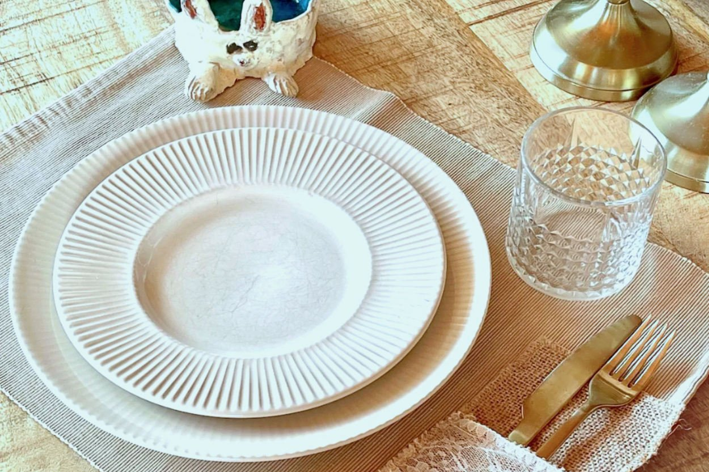
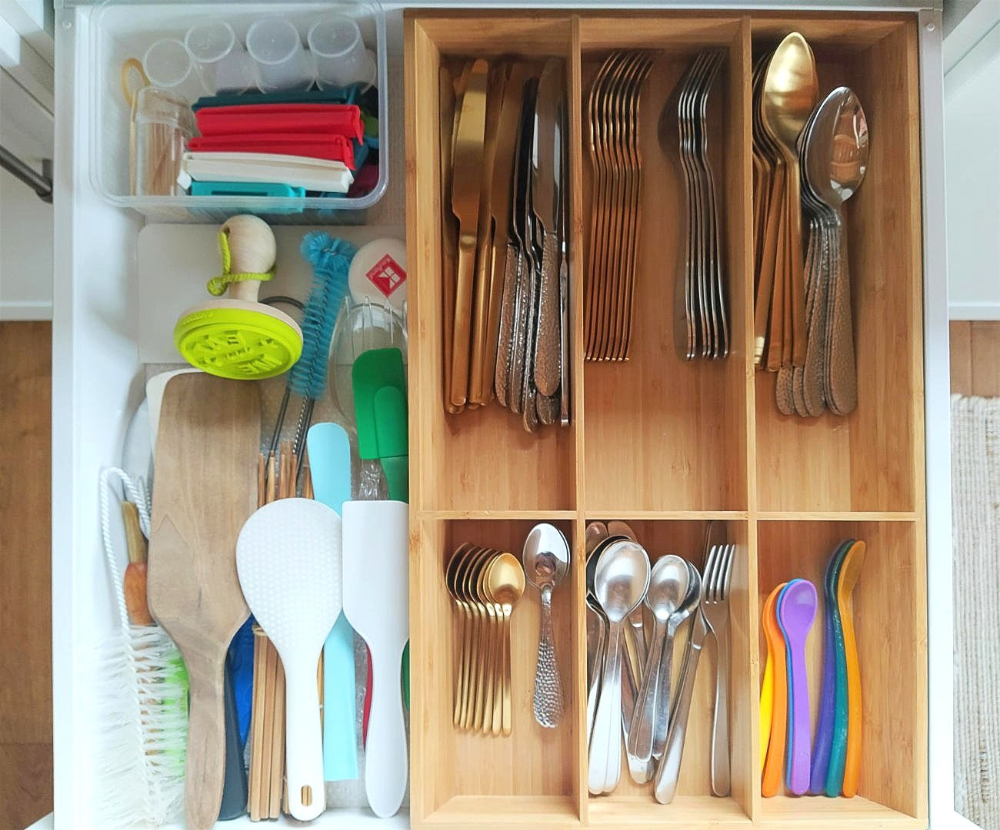
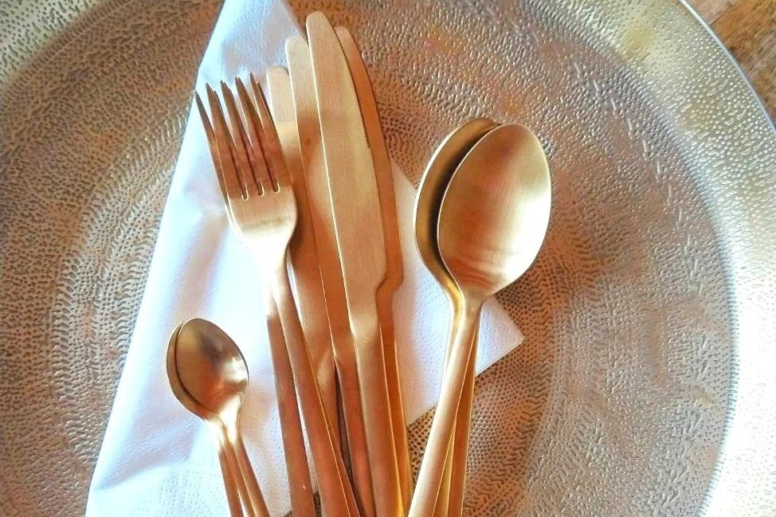
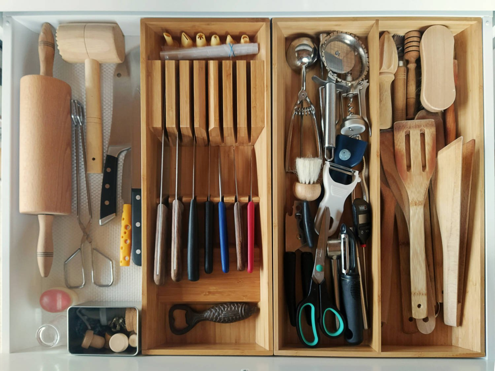
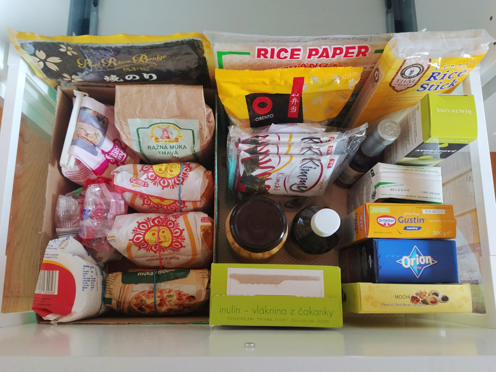

*Looking to reclaim your kitchen or just find some peace in the daily chaos? This Japanese method makes the big clean feel less like a clinical task and more like a trip down memory lane. Here is my KonMari method experience with a realistic twist.*

<Caption>
Image credit: Staying Cosy
</Caption>

Two years ago, while visiting a friend, I read [Marie Kondo’s book](https://www.amazon.com/Life-Changing-Magic-Tidying-Decluttering-Organizing/dp/1607747308/ref=sr_1_1?dib=eyJ2IjoiMSJ9.LkTjqe6JPBdz61pLDytUkIhx-s4Ow5vHjhDtBB4C-CSl5SjE7PaXzVzDFpc7MBdxHecD45XbxBoEpzPmP6VWBLM68P1lgBURmDeEOlvGp2BIHDftLEs8Xb-F1j77CHwDGm7JEsePacGVZi72z884lWsEleaLwq2rP5hbYafCIHmsEZqQff94ke7o5lSJuaPYN36xp9BDTn28Wpg32lYn0VNfZCEiUP_Tv7B2ZDgGS1A.nh40qpuYiATIVic_2UAlxr3fy6iDW-4Mf2b9aG6ko-Y&dib_tag=se&qid=1747821557&refinements=p_27%3AMarie+Kondo&s=books&sr=1-1) about her KonMari organising technique. From then on, I have been slowly trying to put some of her tips into practice, particularly in our walk-in wardrobe setup.

And since we finally decided to get a new set of plates and cutlery as a present for Christmas, we realised our kitchen drawers desperately needed tiding and reorganising. What better way to tackle this situation than by using the popular system.

## An Organised Kitchen

My dream house is an organised house — the kind where you know exactly where to search for a specific item. It is in this room, in that drawer, and you find it there, because whoever used it last kindly put it back. *Talk about an ideal world!*

Unfortunately, the reality is somewhat different.

When I was younger I remember spending hours tidying a single drawer so that when you opened it, it looked like puzzle pieces put together *— pure perfection.* I guess back then, when I was a teen, I obviously had a lot of spare time, and possibly a hint of OCD. Now, a husband, two kids and one house later, the idea of such perfection seems like a distant dream.

<Caption>
I love these Ikea bamboo [drawer organisers](https://www.ikea.com/au/en/p/uppdatera-cutlery-tray-utensil-tray-light-bamboo-s69500905/)
</Caption>

### KonMari Method

The main principle of the KonMari method is to declutter and keep only the things we love and use frequently. You'd think that when we go shopping, we only buy items we like, but that's not always the case. If you're wise, you'll limit your purchases to only high-quality items that you both need and love.

It is a win-win scenario, which improves not only your organisational skills, but the overall quality of your life. As you become clutter-free you open yourself up for new opportunities, *and I don’t mean the shopping ones.*

After [de-cluttering](/blog/stuff-taking-over-why-decluttering-matters) you feel like you can breathe again. When you no longer need certain things, like cracked plates or single cups without a pair, you can resell them or give them away. Other items you can recycle, depending on their condition.

<Caption>
Image credit: Staying Cosy
</Caption>

Every day, I spend a lot of time in my kitchen preparing meals. It is the room I naturally gravitate towards, even when I am visiting someone I always end up in there. As this is such a busy place, it requires *a very well-coordinated storage.*

My kitchen drawers weren't in the state of a complete disaster, yet there is always room for improvement. It's nice to be surrounded by beautiful things, using good quality stoneware and lovely glasses on a regular basis rather than saving them for special occasions. It is even nicer to find all these lovely items exactly where they should be. That way, we can make a special occasion every day.

> “We’re healthy and together. Why not enjoy the good things now? ”

So, after getting all the new serveware, I simply didn't have the heart to put it in messy drawers. I am at the moment in my life when I am confident that, as a family, we can finally pull off a tidy house.

<Caption>
Image credit: Staying Cosy
</Caption>

While going through the old utensils, I realised at one point: *Wait a second, I live in the middle of Europe with no fresh sea food available. Why do I need an oyster shucking knife?*

The last time I used it was around 14 years ago, when both my husband and I got oyster food poisoning.

As I held each item in my hands, little jewels like these kept popping in my brain.

We did, however,  keep a cheese knife we bought in Amsterdam, as it has sentimental value, and, yes, we can wow our friends with its cheesy cheese-shaped yellow plastic handle. This one is a keeper!

<Gallery columns={2} images={[{"src": "/src/assets/library/31f153-cheeseknife.jpg", "alt": "Funky cheese knife"}, {"src": "/src/assets/library/a6ddd0-elephant.jpg", "alt": "Elephant corkscrew"}]} />

## Time to Purge the Old Things

The old plates were pretty much meant to go even before the purge, as we had just bought two new sets. Our old Ikea cutlery met the same fate. To satisfy the needs of our new larger dining table, we rewarded ourselves with a matte gold eight piece cutlery set.

The good news is that once you start going through each drawer or cabinet, *you'll be motivated to clean, declutter and organise even more.* I only have drawers in my kitchen, and some open shelving. Half of them are hiding **shallow inner drawers**, so overall I have a third more drawers than what you can see on the outside.

<Gallery columns={2} images={[{"src": "/src/assets/library/b7b34a-plates.jpg", "alt": "plates"}, {"src": "/src/assets/library/0fcffd-serviets.jpg", "alt": "serviets"}]} />

> “I love their accessibility and the fact they fully open, so I can see their whole content all at once. ”

This was hard-core planning. I kept myself well informed of all the available kitchen storage options. I wholeheartedly recommend the inner drawers. Mine are *crammed* and using them is a breeze as opposed to inconvenient deep cabinets.

### Storage Challenges

I'm never really sure what to do with half-opened dried fruit, pasta or flour packages, or anything else we’ve used recently. We usually close them with plastic kitchen clips, or elastic bands. I'm not completely satisfied with this solution, but I haven't come up with anything better yet. Plastic containers are impractical, plus they take a lot of space and, are after all plastic - rather a thing to avoid.

Let me know in the comments if you’ve found any *good quick fixes* for this! I always need to see what’s in each bag before I actually use it. Part of the problem, I’ll admit, is that we tend to leave tiny amounts behind — like literally five cranberries. Ridiculous, I know!

<Caption>
Image credit: Staying Cosy
</Caption>

Organising the kitchen has become my favourite pre-Christmas ritual. I want to spend the festive season actually *enjoying the process* — baking cakes and prepping holiday meals — rather than fighting for counter space. With the windows sparkling and the kitchen finally neat, the whole house feels ready for winter. Next on my list? The bedrooms. I’m bringing that same Marie Kondo magic there to make sure the rest of the home feels just as light.

Decluttering your kitchen is one thing, but bringing joy back into your daily cooking? That’s the real win. I really believe this method can help you reclaim your home without losing your sanity. A simple and effective way, and, dare I say, a little bit of fun too.

---

**☘︎ Want more ways to improve your home? You might enjoy:**

[*Is Your Stuff Taking Over?*](/blog/stuff-taking-over-why-decluttering-matters) *|* [*Clever Tips for Tiny Kitchen*](/blog/tiny-kitchen-clever-design-tips) *|* [*Sculptural Lamps Guide*](/blog/sculptural-lamps-light-personality)

SEARCH THE BLOG

