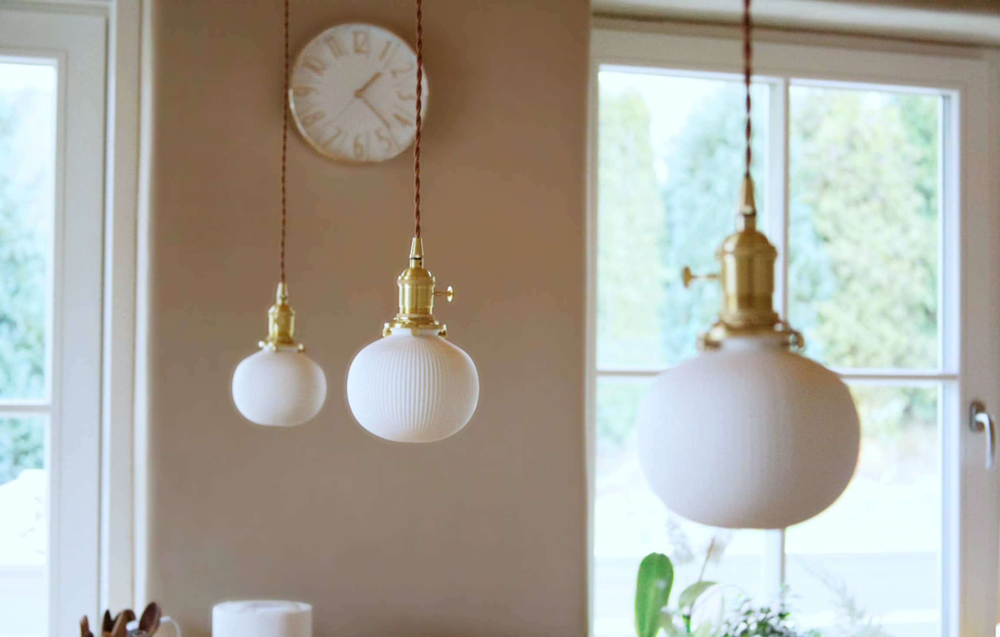
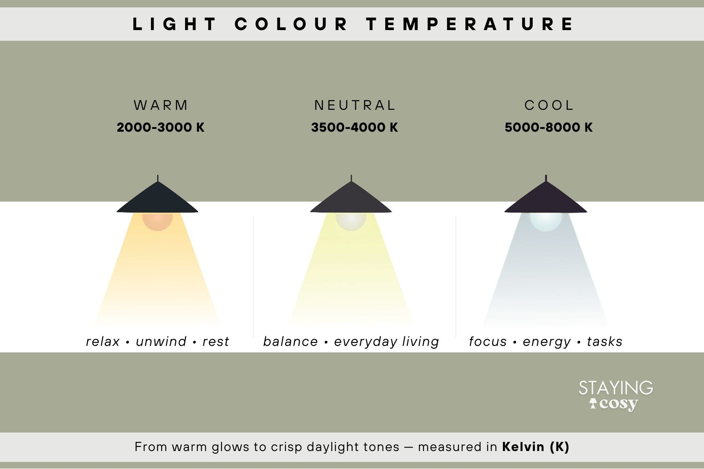
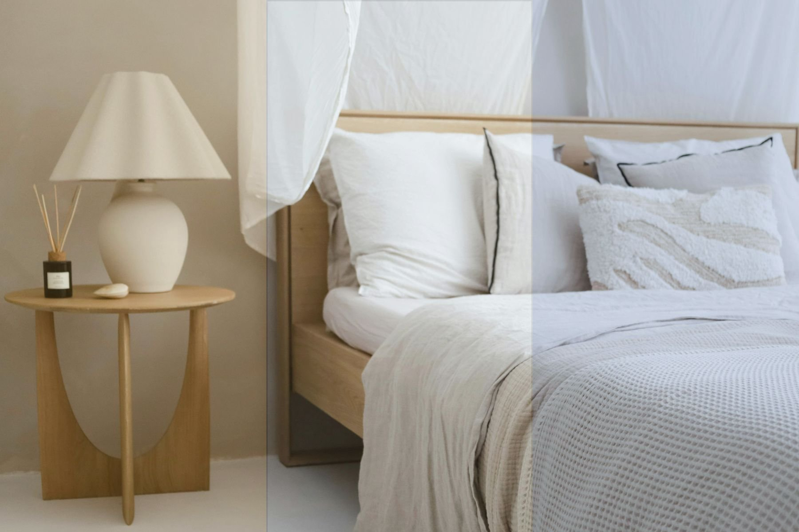
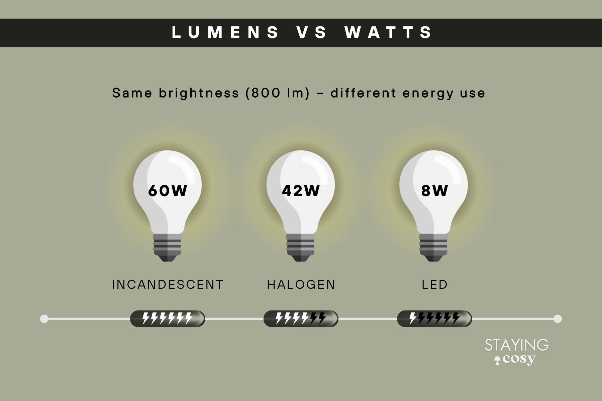
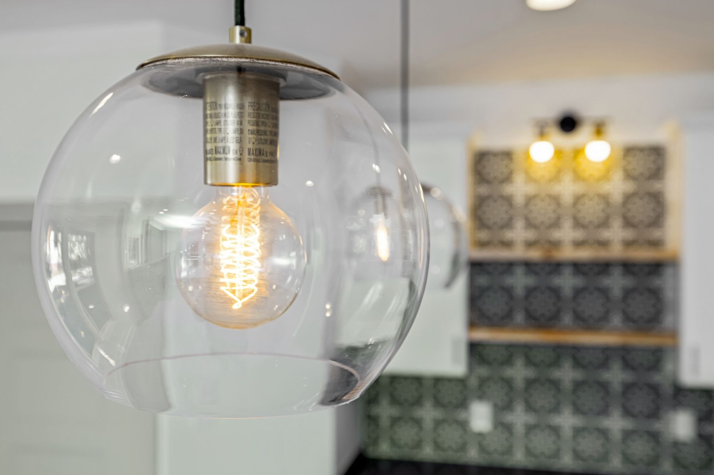
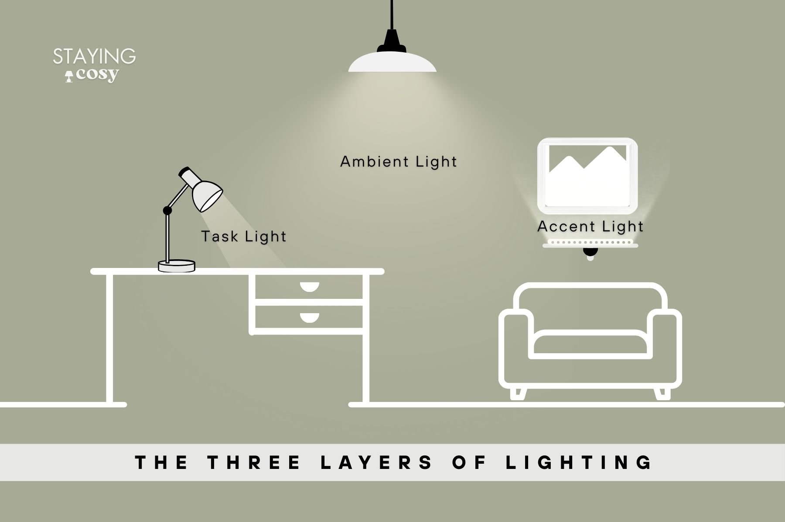
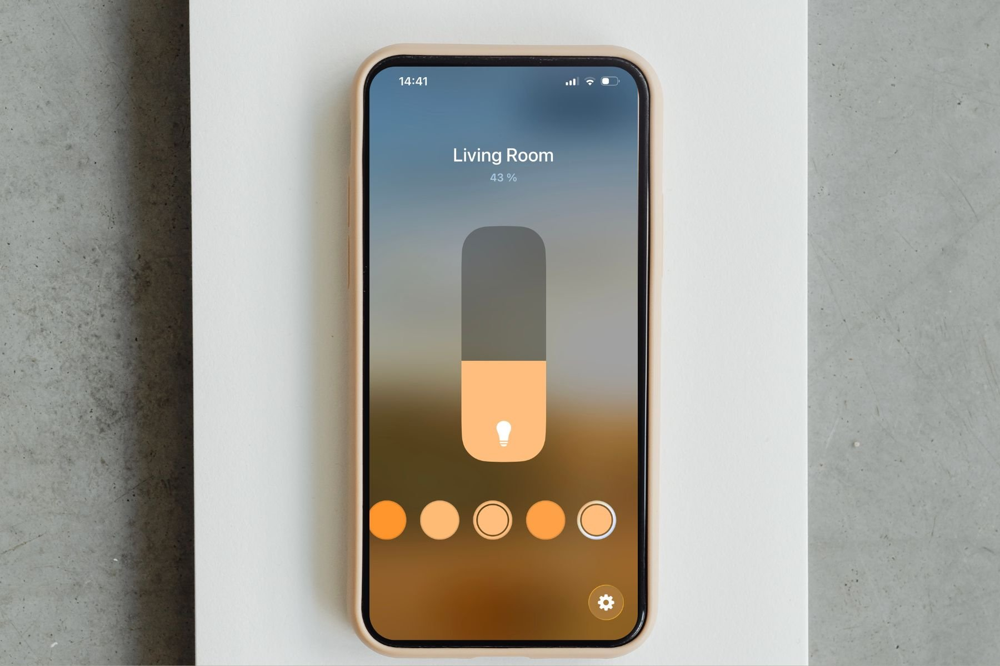
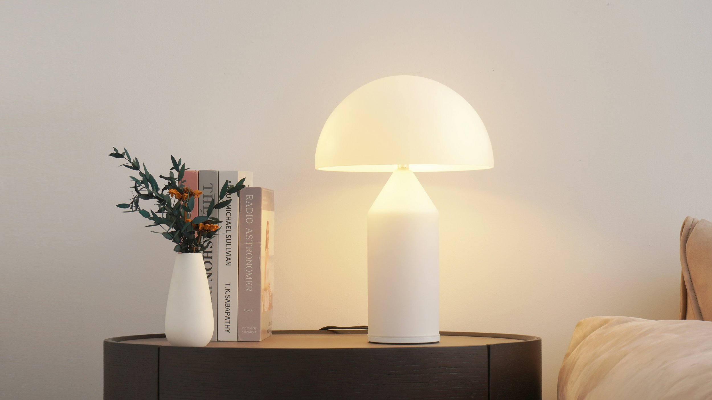

*Ever feel oddly tense under a buzzing overhead light, only to feel your whole body relax the moment you flip on a warm floor lamp? It’s instant. Beyond making things visible to your eyes, the right light recalibrates your nervous system and literally dictates the mood.*

<Caption>
Image credit: Staying Cosy
</Caption>

While I do love a nice textured shade or the pretty ceramic pendants over my kitchen island, the real magic is in the light itself, its warmth and brightness. That’s what sets the mood the moment you walk into your home.

Today I’ll show you how to choose the right light bulbs for every room, from morning through night, and how to layer your lighting for the perfectly balanced glow. Let’s start with warmth.

## Colour Temperature in Your Home

The hue of light naturally leans either golden and soft or cool and crisp, and it can make a room appear energetic, tranquil, or anything in between. Understanding it helps you create the perfect lighting ambiance. Here it is, in a nutshell.

<Caption>
Graphic: Staying Cosy - made in Canva
</Caption>

- **Warm** light (2700–3000K): Cosy, calming, perfect for bedrooms, living rooms, or dining areas — [this warm LED](https://www.amazon.com/DEGNJU-Equivalent-Standard-Non-Dimmable-Bedroom/dp/B0CCB442CF/ref=sr_1_6?crid=202R0DL5TM8&dib=eyJ2IjoiMSJ9.rdny-os3rI4nz9HQIAjQ8i2-7iQBLUZX0Wi-GG171SiASl9T98rXbsmFtH-hfpj9-vfnWp0wO7MptiHKE3f84sqT8NxbejRTyTve3K675qu82Ih3E9nE8mnZ2wNs0CijAM9o5m8DY-mHHbneWUDsF57-Cnfk15_EqoubiMFIkJtILVd1Euo6vHsut74D9PsOKENHGepySi4JhO9YFjiBJEiehA3pp45NMupLWcnzdi85U7uLGBlBilQE-Ku_XrqkfiyxC5gUv3vL9r3ErswKXYESHFqGhte9lN9bOXgnu2U.TGC6dPTMP5sjGiHKQpijMUMc-k62HMwbym-I4PkSQOU&dib_tag=se&keywords=warm%2Bled%2Bbulb%2B2700k&qid=1766057513&sprefix=warm%2Bled%2Bbulb%2B2700k%2Caps%2C213&sr=8-6&th=1) fits the specs. It feels similar to sunrise or sunset.
- **Neutral** light (3500–4000K): Balanced and versatile, [ideal bulb](https://www.amazon.com/Equivalent-Lumens-Listed-Standard-Non-Dimmable/dp/B08KG2TVPB/ref=sr_1_4_sspa?crid=3E3S0XM5EDH2E&dib=eyJ2IjoiMSJ9.GTCo_P55zadnPtLZ72kUrAkBxasmj-mo5f2TlvfY3BJQPjzq4y04k2Y7urnykIoiWBa6F7bHMOxKJfIzfsff7leaPUyJ1FhkTGzY8DPn031cW3nQ1z1TOtKo77mVMn_VZTlhqSp91Wpr9dCjhQHDpCkktTv9tc0j85X0yS06sBbCzfI2b9eCgrHn-bpwNEvTwpYuDpnedMbyJzEkfRH9-irQSsRLi-2Ep9jZ4WIEYKq2hrqGOi2h3RHMXiIug0tGMaIwk5TjcvrEfGtig2oec1Zk6jTRR-5QZwOi7C_yAfw.FMwlwYC1gCXtKQYuAu2E5OyK9hnKtmaUiIjEVZEbBg0&dib_tag=se&keywords=warm%2Bled%2Bbulb%2Bneutral%2Blight%2B3500%2Bk&qid=1766057589&sprefix=warm%2Bled%2Bbulb%2Bneutral%2Blight%2B3500%2Bk%2Caps%2C175&sr=8-4-spons&sp_csd=d2lkZ2V0TmFtZT1zcF9hdGY&th=1) for multipurpose spaces like kitchens or hallways. Mimics mid-morning daylight or a bright overcast sky.
- **Cool** light (5000K+): Bright and energising, ideal for home offices, workshops, or task-heavy areas. This [cool daylight bulb](https://www.amazon.com/Equivalent-Daylight-Non-Dimmable-Listed-4-Pack/dp/B07Q4HRJ3Q/ref=sr_1_4_sspa?crid=1AEK88JKPM05H&dib=eyJ2IjoiMSJ9.i9DC8yxDtJyi2zqvky0OZ5SDtmRiXD0VajtKptDKPtxBtR9fyDOujBJNydg9VsaTkdxgZcTizUmQHzaxKg9RuWNWhnH1mtXrnfmgVFywJ6Pl71AH1r-coyJG9S9COva0nIE8NwMEGjell895UoNJU0Qzeh11WLQE1YZ_rnnapSc8r1OznwOoeOKjOYGR5BPWCTAcz5MQwmJfapNJ2RmCPnjBMBGFdLONWbludPnJKdXi39Fz3e4FsBN8T_9Axm-da-y_xVbKuPazlnxj4r7EGZI4AHQCHdxA8MuzBAZkEEA.2-C6kkpYqg-O_woTu1dEMF40_krj-sBFhn25CNE4_4g&dib_tag=se&keywords=cool%2Bled%2Bbulb%2B5000k&qid=1766058014&sprefix=cool%2Bled%2Bbulb%2B5000%2Caps%2C212&sr=8-4-spons&sp_csd=d2lkZ2V0TmFtZT1zcF9hdGY&th=1) is comparable to midday sun or a cool overcast day.

#### 💡 **Kelvins Explained**

Colour temperature describes whether the light looks: **warm** — yellow/orange, or **cool** — blue/white. It’s measured in a unit called **Kelvin (K)**. The lower the number, the warmer the colour.

**Why colour rendering matters**

If you spot a CRI, or Colour Rendering Index on your light bulb box, it basically tells you how true does the bulb make colours look compared to natural sunlight. A high CRI (80+) means everything from your fresh salad to your favourite artwork looks vibrant, crisp, and just *right.* In other words, good CRI makes things look better. It makes your interior feel lively, welcoming, and easy on the eyes — a small detail, but a surprisingly big difference.

In photography and lighting, 5000K-6500K bulbs are often used to mimic natural daylight for the most accurate colour representation.

**How warm vs cool light affects atmosphere**

We’re all familiar with [Christmas](/blog/holistic-christmas-guide) lights. You buy a new set to match last year’s, only to realise the colours are completely different. Usually, the manufacturer gives only a vague hint about whether it’s warm or cool, so perfect matching is tricky. Generally, cooler tones create a contemporary festive vibe, while warmer ones feel traditional and cosy.

<Caption>
Image credit: Canva - edited
</Caption>

This is a perfect example of how the same type of bulb — just with a different Kelvin value — completely changes how the light is perceived. If you’ve never paid attention to the warmth listed on packaging, now might be the time to start.

Generally speaking, it’s best to match the light bulb to the room’s purpose. Warm light encourages us to unwind, while cooler light naturally boosts alertness. Picture yourself settling into a softly lit living room in the evening versus sitting down at a bright home-office desk in the morning — each warmth supports a different task.

<Caption>
Warm → Neutral → Cool Lighting | Image credit: Canva - edited
</Caption>

**Tips for the correct light warmth**

It’s easy to buy light bulbs on a whim and hope for the best. But one-off choice usually doesn’t do much for you. Let’s fix that with a few key tips on colour temperature:

1. Check the Kelvin (K) value. Lower K is warmer, giving a cosy glow; higher K is cooler and feels clearer. Please, refer to my infographic above for detailed values.
2. Match the warmth to the room’s purpose. Warm light for unwinding spaces, like living room or bedroom; neutral/cool for focus, like kitchen or office.
3. Consider your lampshade. Light fabrics keep the colour true, while darker, coloured, or textured shades soften the glow and can slightly dim the light.

## How Bright Should Your Room Be?

Kelvins covered, great! Now let’s tackle brightness, with another important number in the world of lighting.

Remember when we picked bulbs by wattage, assuming higher meant brighter? Those days are gone — now, it’s all about lumens. Don’t worry if it feels a bit technical; once you understand the difference, choosing the right light bulb becomes super easy.

<Caption>
Graphic: Staying Cosy - made in Canva
</Caption>

Simply put, watts measure energy use, lumens measure brightness. A traditional [60W halogen light bulb](https://www.amazon.com/Vinaco-Edison-Bulbs-White-2200K/dp/B07PS386YX/ref=sr_1_2_sspa?crid=1G7EWY92CK99S&dib=eyJ2IjoiMSJ9.JQohudIwe1Dya9b8JIuuX8JxRQGvOb_BPJn1Arc-DDxa0I0eoNSeeoiShaKrMcxdjcjAXe8CcI28FHLZYyefcdhM0yje4Sco2e6XgsIAXuchdmARxz-nUPZmR2nTL2itDvSdk-DGx1ejQnmkTQRzbU1ZJLnCBjv4reyGI82XnvHgchk-cxMe4-nZR8BwSdel0Otn-fZbsPEPSF9aIuV87SYriUVEr3ZDCMLdOhKxMI5bQx-PbLcOr-caYvN-eFXVKXygOul79E2GNhPC9TzQiLEf3gfx4sB04cnil6s-Q6I.dqkatC3wZ2gdilojdo28jxnu7tDNxjOTeZXLfioGpoc&dib_tag=se&keywords=halogen%2Bbulb&qid=1766058582&sprefix=halogen%2Bbul%2Caps%2C200&sr=8-2-spons&sp_csd=d2lkZ2V0TmFtZT1zcF9hdGY&th=1) and a modern LED that uses only 8W can give off roughly the same amount of light. That’s why the number to check for brightness is — *lumens*. It tells you exactly how well-illuminated the room will be.

The good news is, you don’t need to memorise these numbers. My simple manual below will do the job.

- **Living room:** ~2,000–4,000 lumens total — floor lamps, table lamps, and wall lights
- **Kitchen:** ~3,000–6,000 lumens total — bright overhead + task lighting on counters
- **Bedroom:** ~1,500–3,000 lumens total — soft ambient + warm bedside lamps
- **Bathroom:** ~2,000–4,000 lumens total — spots + especially around the mirror
- **Home office:** ~3,000–6,000 lumens — desk lighting + ambient

#### 💡 **Watts vs Lumens**

- **Watts (W)** measure energy consumption. A low-watt LED can be as bright as a high-watt halogen.
- **Lumens (lm)** measure brightness — the number that matters when choosing a bulb’s illumination. The higher the value, the brighter the light.

**Choosing the correct light bulb**

Halogen bulbs are brighter than standard incandescents for the same wattage, but LEDs dominate today because they use far less energy, last longer, and now come in a full range of warmth and output.

So yes, it’s usually a good idea to opt for [LEDs](https://www.amazon.com/DAYBETTER-Equivalent-Dimmable-Brightness-Filament/dp/B0BQJBST36/ref=sr_1_31?crid=1Q4BCWMKDSCJY&dib=eyJ2IjoiMSJ9.6A96rWyaPyORkTxFP6gblDTDmsISefRNEGkLaIo-UwhmvVykidEDoHtMmLE4miR9aPmEzNHIWdkSiKEeWUvht_DQfHKWAo4hRxsMsZVHpuvUI2z-WY5tasveWFaYZyjyQwi9fwgogQr9qwGIPXaFEINw9Ld_dxtGOBRPyacN-c5tn28DZXzeLWd-d1RN361ktarTIDdEDQp6z1a2xzpTxGJp5lgUNORR38-uJR-oI_Vbe7OQlwleFSJbX54_Yxy2Yi24Ddgx3zEwfBp3rRtFex-rqtRKQNdZbRhRsZPDc8c.2DTWlbyznDEKbwFj2Odky8bDvLW-wa0xrCv5g4bt8D0&dib_tag=se&keywords=led%2Bbulb&qid=1766058653&sprefix=led%2Bbul%2Caps%2C211&sr=8-31&th=1), dimmable if possible. I know, the price tag can look a little daunting, but one of these bulbs *really lasts forever*. They produce high lumens with very low watts, meaning a brighter room with lower energy bills.

<Caption>
Image credit: Canva - edited
</Caption>

**Tips for getting the brightness right**

1. Think in lumens, not watts. Focus on how bright you want a space to feel.
2. Match brightness to the activity. Higher lumens for cooking, reading, or detailed work; softer light for relaxing or winding down.
3. Use dimmers if possible. Adjust the light to match the time of day or your mood.
4. Start slightly lower, then adjust. It’s easier to add light than take it away if a room feels too bright.

## Mixing Warmth and Brightness for Perfect Ambiance

Now that we’ve covered the basics of warmth and brightness, the real magic happens when they’re combined through layered lighting. Using multiple light sources — ambient, task, and accent — helps create spaces that feel balanced, functional, and comfortable, without relying on a single light.

I’ve already hinted at preferred lighting combinations for different rooms, and now it’s time to dig a little deeper.

**Three layers of lighting**

In order to mix brightness and warmth for perfect illumination, we need to understand the basic types of interior lighting and their preferred use.

<Caption>
Graphic: Staying Cosy - made in Canva
</Caption>

**Ambient light**\
This is your room’s overall light — soft, even, and never harsh. Typically a [ceiling fixture](https://www.lumens.com/stella-semi-flushmount-by-mitzi-MTZP164192.html) or larger floor lamp works well. For most average sized rooms, you’re looking at around **2000 lumens** and neutral colour temperature. If it’s a workshop, home office or task-focused area, you might consider going up in both values.

**Task light**\
This is your focused, no-nonsense beam of light — perfect for reading, chopping vegetables, sewing, or any other detail-oriented job. [Desk lamps](https://www.potterybarn.co.uk/sherman-metal-library-task-table-lamp?quantity=1&attribute_1=Bronze), under-cabinet kitchen lighting, or bedside reading lamps all fit here. Task lights usually range from **450–800 lumens**, depending on the activity and your eyesight. As for warmth, it depends on function and preference: neutral to cool light works well in most cases, but as a rule of thumb — warmer for private, relaxing spaces and cooler for task-oriented areas.

**Accent light**\
Decorative or mood-enhancing light. It’s less about brightness, more about highlighting features and adding depth. Think spotlights on artwork, [small wall lamps](https://www.potterybarn.co.uk/remington-iron-shaded-sconce), or LED strips along shelves. Their purpose is mostly for atmosphere. In general, warmer light works best here, but neutral or cooler tones are great in contemporary designs. Around **100–300 lumens** is usually enough, depending on the effect you want.

**Practical tips for layering**

1. Start with ambient light. Then add task and accent lights as needed.
2. Mix warmth strategically. A slightly cooler task light can complement a warmer ambient glow.
3. Experiment in small steps. Even layering one corner of a room can transform the feel of the whole space.

*Once you’ve learnt everything about the light bulb magic, get inspired by* [*sculptural lamps*](/blog/sculptural-lamps-light-personality) *to bring artful lighting into your home.*

## Smart Bulbs — Effortless Control of Light and Mood

If layering sounds like a lot of work, there’s a simple way to get it right. Smart, tunable or multi-spectrum bulbs. These modern light bulbs let you adjust both warmth and brightness with just a tap or a phone app, giving you full control over your room’s appearance and function.

<Caption>
Image credit: Staying Cosy - made in Canva
</Caption>

I have these [Ikea smart bulbs](https://www.ikea.com/us/en/p/tradfri-led-bulb-e26-1100-lumen-smart-wireless-dimmable-white-spectrum-globe-50545678/) in our open-plan area, and I’m more than tempted to add more throughout the house. They’re absolutely amazing! A full spectrum of choice at your fingertips. Every light bulb should work this way. Circadian rhythm support, anyone?

Here’s a straightforward approach to using a smart bulb throughout the day:

- **Waking up:** Soft, warm light to ease into daylight
- **Morning:** Cooler, brighter light for focus and energy
- **Afternoon:** Neutral light for balance
- **Evening:** Warm, softer glow to relax and wind down

A single smart bulb can replace multiple lamps, or make your existing setup more flexible, so you can enjoy perfectly layered light without fuss. Think of it as a quick, practical shortcut to achieving the cosy, functional spaces you’ve been secretly imagining.

## Little Light Goes a Long Way

The amber glow that hits my spruce ceilings every evening reminds me how much light affects our mood. I often pause and dim it slightly as it reflects across the walls, softening the corners and making the space feel like it’s exhaling after a long day. Warm tones invite me to relax, but when the morning comes again, I switch to brighter light to match the energy of a day in full swing.

<Caption>
Image credit: [Andy Bob](https://unsplash.com/@hioozlight?utm_source=unsplash&utm_medium=referral&utm_content=creditCopyText) on [Unsplash](https://unsplash.com/photos/a-glowing-lamp-sits-next-to-a-vase-and-books--Gem15xQAE4?utm_source=unsplash&utm_medium=referral&utm_content=creditCopyText)‍ ‍
</Caption>

I must admit, I do enjoy tinkering with lamps around our house. But if that’s not your thing, [smart home lighting](https://www.amazon.com/Philips-Hue-Ambiance-Compatible-Assistant/dp/B0BZS38KNQ/ref=sr_1_8?crid=2Q14S3XUI3340&dib=eyJ2IjoiMSJ9._VVBTbf5Td_I5lYM4fgkxVEFb9KEVeeEd3-cdy0b1dtX6zF0c1ljkA5YMEZuWGY2E3DnrGXhdlD_cI2vIE7n46Yuy06pJOtPvGCs-OZrzDtmPH5gRMiY1Lf-ihujsfUhW0Hugns0dMNi5HdZvxJVE2HmqnjVr3ceI16LZ19o1LjhiMN9AFCil82XBucz7C0xccuGvR5hm6qEk5E9Tpl6oRNmpHU7piFbAL92M2DNexFS0kuUzeMbrZYCQFfdOHReeewmWBE4cY5L9FdyAA-pMcs47VfeYXEPa5oxUXfcbxo.VE3rfjAFYfK6L9K0P48jD0XvEZTaEv0TzomC84qHZZs&dib_tag=se&keywords=smart%2Blighting%2Bstarter%2Bkit&qid=1766059680&sprefix=smart%2Blighting%2Bstarter%2Bki%2Caps%2C203&sr=8-8&th=1) can do the work for you. Tuning your interior lights to your body’s natural rhythm supports wellbeing and it’s definitely something every wholesome home deserves.

---

**☘︎ If you enjoyed this post you might find interesting:**

[*Invisible Chemicals in Your Home*](/blog/chemicals-that-pollute-our-living-rooms) *|* [*How to Stop Mould From Spreading*](/blog/mould-keeps-coming-back-how-to-stop-it)

SEARCH THE BLOG

---

