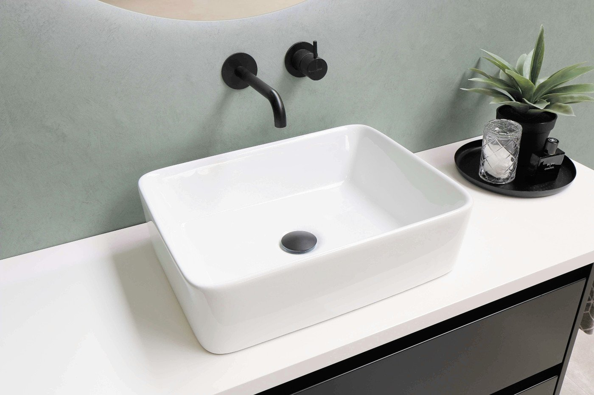
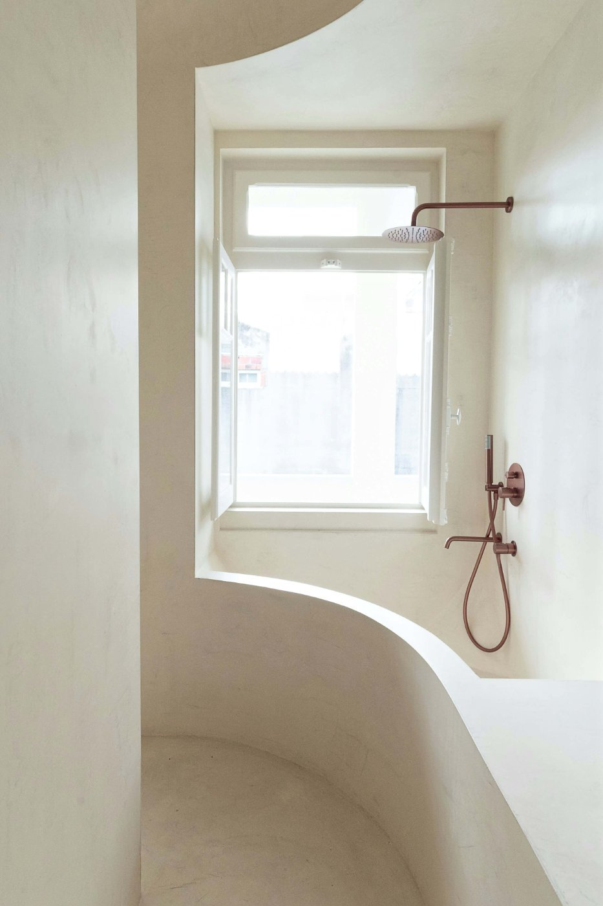
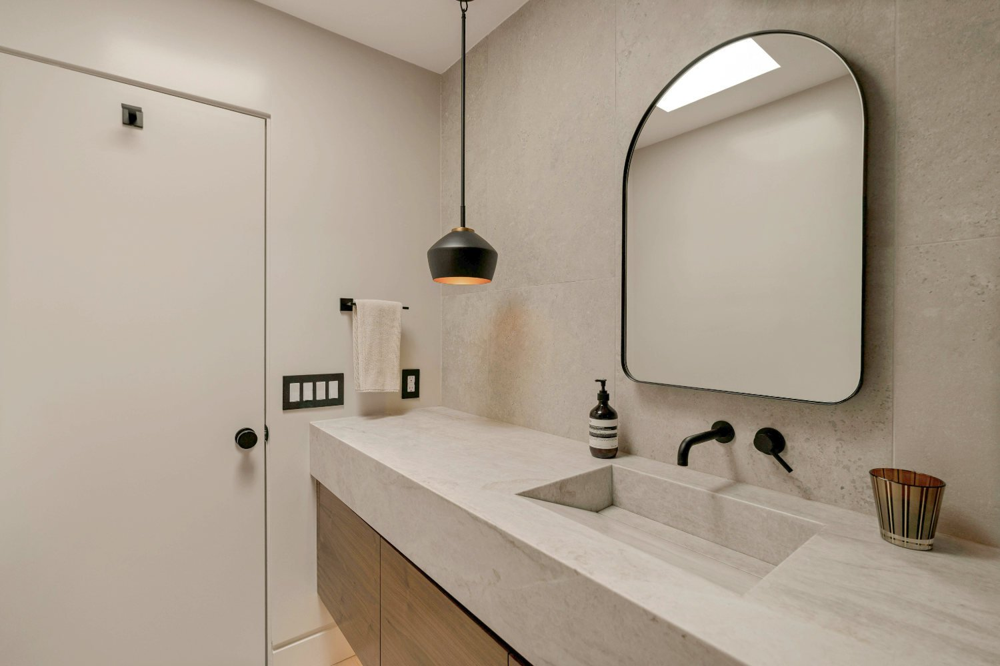

*Bathroom tiles are an unbeatable classic. Sustainable, versatile, and timeless. But as someone who isn't a fan of hard surfaces and, let’s be honest, hates cleaning grout, I’ve been looking for a way to eliminate those lines completely. And I found it. It’s called micro-cement.*

<Caption>
Image credit: [Sanibell BV](https://unsplash.com/@sanibell?utm_source=unsplash&utm_medium=referral&utm_content=creditCopyText) on [Unsplash](https://unsplash.com/photos/white-ceramic-sink-with-stainless-steel-faucet-mFQo2uJNf2c?utm_source=unsplash&utm_medium=referral&utm_content=creditCopyText)
</Caption>

We’re eagerly waiting to finally get around to planning our master bathroom. And while we rushed our guest shower with standard tiles, it’s functional, yes, but looks a bit slapdash, I’m determined to be more intentional this time. My friend has had micro-cement walls for a few years with zero issues, which got me thinking: *Does it fit a healthy, eco-conscious home?*

## From Industry to Interior

Micro-cement bathroom walls offer a seamless finish, applied in a thin plaster-like layer that creates a smooth, continuous surface. It’s not a new material, and certainly didn’t appear overnight.

Its roots go back to the mid-20th century, evolving from high-performance industrial floor coatings used in factories where durability was the only priority. Over the last two decades, however, the technology was refined, shrinking the thickness and adding polymers to bring that concrete or stone aesthetic into our homes without the weight or the cracking of a massive slab.

But is it the most natural flawless wall-coating? Not quite.

If we look for a traditional, truly ecological counterpart, we find **Tadelakt**. This ancient Moroccan lime plaster is the original seamless finish. It’s unique, waterproof, and completely chemical-free. However, Tadelakt is a labour of love. It requires a very specific professional skill set, like polishing the lime with stones and olive oil soap, that simply isn't available in most places. Plus, its raw, boho-organic look is a very specific vibe that doesn't fit every modern home.

Micro-cement is essentially the modern, more accessible answer to Tadelakt, offering that seamless mineral look but with a refined, cleaner finish and a more predictable installation process.

## Why Microcement Fits a Healthy Home

Since I’m obsessed with what’s inside our walls — wood fibre and cellulose insulation, I’m not letting the top layer slide. When we look past the *concrete look*, in a high-performance home, micro-cement offers some compelling ecological arguments.

<Caption>
Image credit: [Carla Heyworth](https://unsplash.com/@carlaheyworth?utm_source=unsplash&utm_medium=referral&utm_content=creditCopyText) on [Unsplash](https://unsplash.com/photos/modern-shower-design-with-a-window-4uucop9dsbk?utm_source=unsplash&utm_medium=referral&utm_content=creditCopyText)‍ ‍
</Caption>

### Hygiene and Thermal Comfort

In a high-performance timber home, moisture management is our primary mission. Traditional grout is porous; it’s a magnet for moisture, bacteria, and [mould](/blog/mould-keeps-coming-back-how-to-stop-it). By creating a seamless mineral skin, we remove those weak links entirely. We’re not thinking just about aesthetics, but a cleaner, more hypoallergenic environment.

Plus, unlike thick stone or porcelain, which can feel like an *ice-cold heat sink*, micro-cement has low thermal mass. It adopts the ambient temperature of our insulated rooms quickly, making the bathroom feel much more inviting underfoot.

### Resource Efficiency and Footprint

Think about the mass of a standard bathroom: heavy ceramic tiles, bags of mortar, and grout. Micro-cement achieves a similar durability with a layer only 3 mm thick (1/8“). This massive reduction in material weight means fewer resources extracted and lower carbon emissions in transport. Even better, it can often be applied over existing surfaces, meaning zero demolition waste.

Being largely mineral-based, micro-cement is potentially recyclable at the end of its life cycle, though the presence of resin and sealers can complicate this compared to pure stone.

### VOC Gatekeeper

While the core is mineral-based, the health of the system depends on the final finish. When choosing a sealer, it’s worth looking for ecological water-based, high-performance PU formulas. These provide a waterproof barrier without the heavy off-gassing ([VOCs](/blog/chemicals-that-pollute-our-living-rooms)) associated with traditional solvent-based resins.

## Layered Cake Reality

Don't let the sleek look fool you. It’s not a ‘one-and-done’ bucket of paint. To make it durable and waterproof, especially in a wood-frame house that may naturally move, it is a sophisticated layering process.

<Caption>
Image credit: [A65 Design](https://unsplash.com/@huutin23?utm_source=unsplash&utm_medium=referral&utm_content=creditCopyText) on [Unsplash](https://unsplash.com/photos/man-in-blue-shirt-and-brown-hat-holding-gray-metal-pipe-NqSvtqi7WgM?utm_source=unsplash&utm_medium=referral&utm_content=creditCopyText)‍ ‍
</Caption>

The micro-cement layering consists of:

1. **Primer & Fibreglass Mesh**: Crucial for preventing cracks.
2. **Base coats**: The structural foundation.
3. **Finishing coats**: Where the texture and colour happen.
4. **The top sealer**: A high-performance ceramic varnish that makes it waterproof.

All-together, it comes down to about 7-9 layers totalling 2-3 mm (1/8").

It starts with a primer and a fibreglass mesh to create a stable foundation. Then come the base coats for strength, followed by the finishing coats where the actual texture and colour come to life. Finally, it’s topped with that critical **polyurethane or epoxy sealer** to lock everything down and make the finished wall waterproof and stain-resistant. Without this high-quality varnish, you’re just looking at a very expensive sponge.

The whole layering process requires a skilled hand and patience. In return, the result is a unified monolithic finish that requires minimal upkeep.

### How It Differs From Tiles

When we talk about those seven layers, it sounds like a lot, but traditional tiling is its own heavy-duty assembly. A professional tile job involves everything from backer boards and tanking systems to thick beds of adhesive and grout. It typically involves 5 to 6 layers.

The real difference is that tiling is heavy and stiff, while micro-cement is light and flexible. It creates a soft skin of only 3 mm (1/8”), as opposed to tiles that on average end up being around 10-15 mm thick (3/8”–5/8”).

In a wood-frame house, the rigid nature of tiles can sometimes lead to cracked grout or popping tiles if the building shifts. Micro-cement is reinforced to allow for those slight movements. Instead of a grid of porous grout lines, you’re left with a continuous surface that is as durable as it is thin.

## Practicality and The What If Factor

As much as I love the aesthetic, I’m a realist. A bathroom needs to work for real life, not for a photoshoot. When I started looking into the long-term performance of micro-cement, three main concerns came up: repairs, slipping, and that all-important drainage.

### What Happens if It Chips?

This is the ultimate fear, right? You drop a heavy glass perfume bottle and... *crack*. While micro-cement is incredibly tough, it is still only a 3mm skin. If you hit it hard enough, can it chip or indent?

*Yes, it can.*

This is where the comparison to tiles gets interesting. If you crack a large-format tile, you’re often looking at a nightmare. You have to chip out the grout, break the tile, hope you don't damage the waterproofing membrane underneath, and then seamlessly fit a replacement tile.

Micro-cement is surprisingly repairable. Because it’s applied in layers by hand, a skilled contractor can often patch a chip. They fill the indentation with a bit of the original mix, sand it down, and re-apply the local sealer. If you’re hands on, you may be able to do this DIY.

#### Patina vs Damage

It might not be 100% invisible, but it blends into the mineral texture far better than a broken tile ever could. Many fans of the material even say that small signs of wear contribute to a *natural patina*, much like stone or wood.

That being said, if you’re worried about high-traffic areas, the secret is in the hardness of the base layers and the quality of the PU varnish. A cheaper DIY kit will chip easily; a professional-grade system with a high resin-to-cement ratio is built to take the hits.

### Slip Factor and Drainage

The other big question I keep coming back to is the floor. If the whole point is that seamless look, it feels like a missed opportunity to break it up with a traditional shower tray. However, a smooth mineral skin can be intimidating when wet.

The solution for this dilemma is usually in the sealer. You can add **anti-slip aggregates**, in a form of tiny invisible beads, to the final varnish to give it grip. It keeps the look but gives the floor a fine, sandpaper-like texture that makes it much safer.

Finally, there is also the slope to consider. With a shower tray, ‘the fall’ is factory-guaranteed. With micro-cement, you are relying entirely on the skill of your installer to build that slope into the substrate perfectly. One tiny mistake and you have standing water, the ultimate enemy of any timber build.

<Caption>
Image credit: [Peter Muniz](https://unsplash.com/photos/modern-bathroom-with-concrete-sink-and-black-faucet-Uq1Sa_lHmSA) on [Unsplash](https://unsplash.com/@petepxl)‍ ‍
</Caption>

I’m currently leaning towards a hybrid approach. A flush-mounted mineral shower tray in a matching colour, with micro-cement flowing across the rest of the wet areas; or perhaps micro-cement shower floor and water resistant cork for the warmth under-foot in the rest of the bathroom. We have [cork floor](/blog/natural-materials-around-my-home) in our smaller bathroom already, so I know exactly why I like it.

Have you lived with a micro-cement floor? Does the *no-grout dream* actually hold up over time, or have you found yourself missing the reliability of a classic tile?

Drop your thoughts, or your fears, in the comments below. Let’s figure this one out together!

---

**☘︎ Exploring more eco ideas?**

*•* [*Designing a Modern Green Home with Heart and Purpose*](/blog/shaping-a-green-home-with-purpose)

*•* [*Clever Tiny Kitchen Ideas that Actually Work*](/blog/tiny-kitchen-clever-design-tips)

*•* [*A Sustainable Living Room Upgrade that Changed How We Live*](https://bluebird-hawk-as8j.squarespace.com/blog/sustainable-living-room-makeover-on-a-budget)

SEARCH THE BLOG

