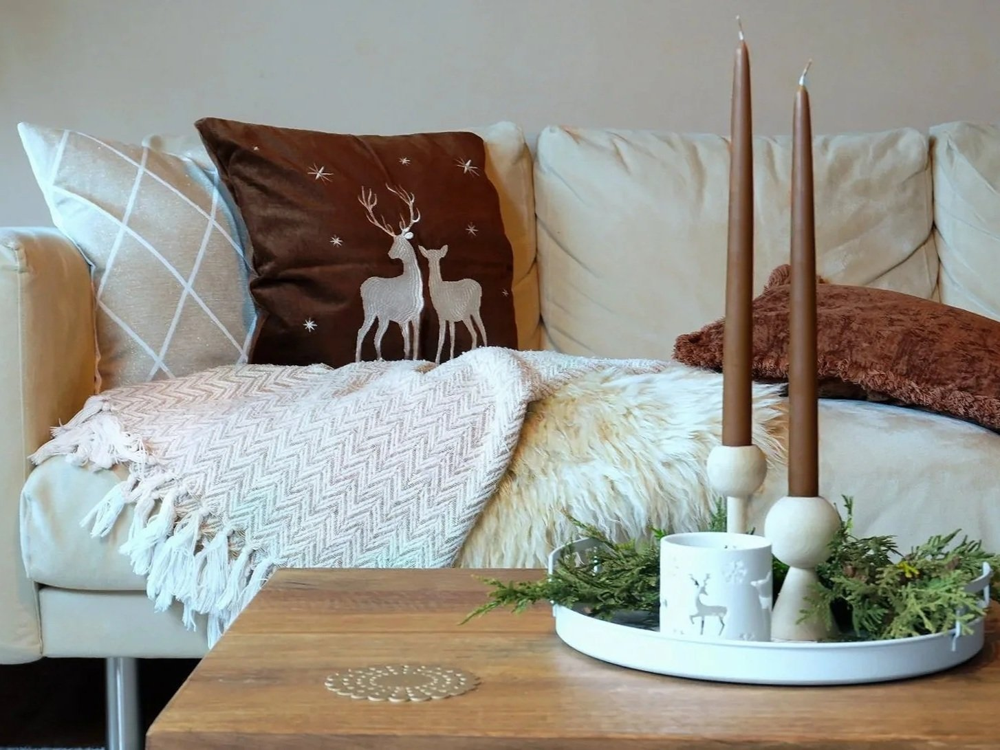
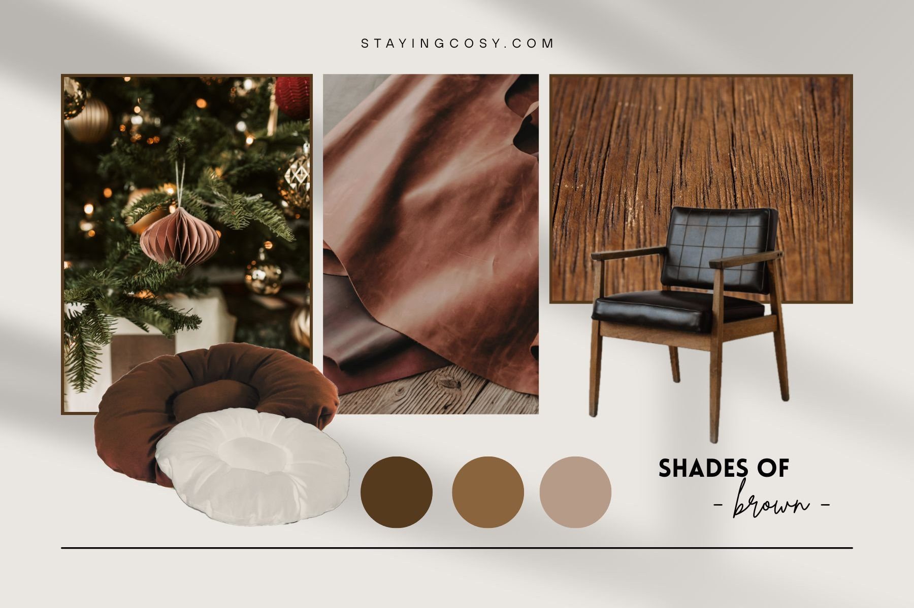
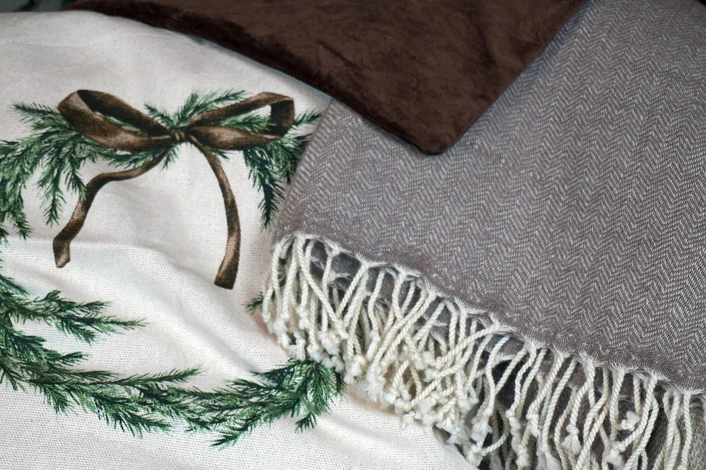
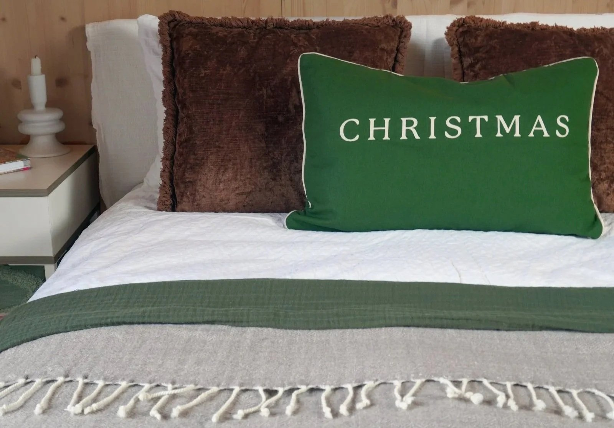
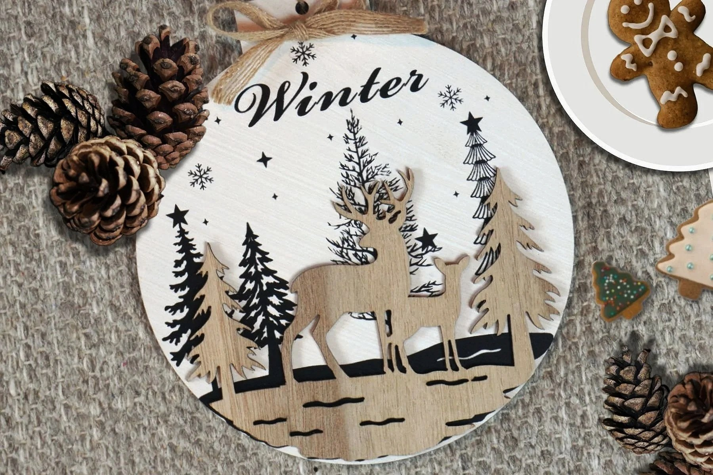
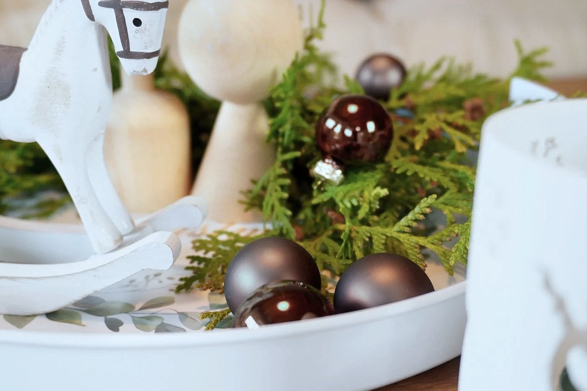
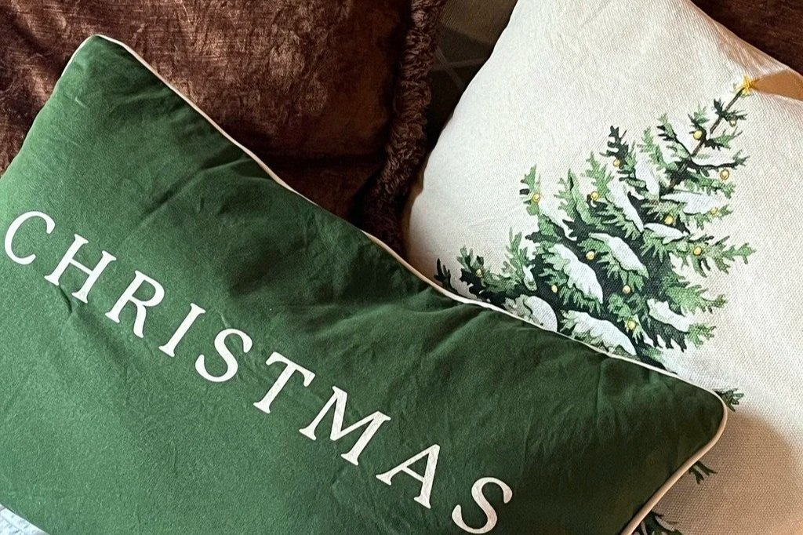

*Do you love brown as much as I do? It’s warm, earthy, and effortlessly calming; the colour of wood and all things natural. And this year, it takes centre stage for Christmas. Yes, mocha tones are having their well-deserved moment!*



<Caption>
Image credit: Staying Cosy
</Caption>

At first glance, brown may seem a little plain. I get it. It doesn’t shout like red or black. But that’s exactly its charm. It pairs effortlessly with natural shades, highlighting the true star of the season — **the green Christmas tree.**

Brown has been everywhere this year. From fashion, to makeup trends, and of course in home decor. *And I absolutely loved this, since chocolate brown has always been my black.* With its endlessly versatile tones, I couldn’t be happier to welcome mocha into my already soft, taupe-and-wood-toned home. Have I mentioned I’m a lifelong brown enthusiast?

### Working with Shades of Brown



<Caption>
Image credit: Staying Cosy - made in Canva
</Caption>

While mocha is getting all the attention this season, I’m really all about **the whole brown family**, from soft beiges and tans all the way to rich chocolate.

> “Layering these shades adds instant warmth and depth. ”

Wooly throws with velvet cushions bring softness to the eye and touch, while a hint of green in a wreath or garland keeps the look grounded and connected to nature. It’s all about creating nooks and corners that beg you to curl up with a cup of cocoa.



<Caption>
Image credit: Staying Cosy
</Caption>

If you have wooden floors, lucky you, that’s already a perfect base. If not, a few crafted wooden pieces like candle holders, bowls, or a rustic tray go a long way. They age beautifully, work with classic Christmas colours, and honestly, for me, brown shades will always be my top pick for a timeless interior.

### Create Soft Contrast to Whites

As opposed to black, which creates a stark contrast, **mocha *softens* white beautifully.** The combo is like coffee and cream, with each enhancing the other. Together, they create that clean, understated elegance we love in natural Christmas decor.



<Caption>
Image credit: Staying Cosy
</Caption>

Add greens in moss, subtle khaki, or traditional forest hue, and you’re all set to balance out the cool white.


### Follow up with the Festive Red

Want a touch of the traditional Christmas theme? Go for it!

Throw in a deep red cushion, or add just a few minimal red accents, like a ribbon or small ornaments, to instantly add a subtle festive spark without overwhelming your neutral palette.

### Natural & Handmade Decor

If you enjoy DIY touches, edible ornaments are the most charming and sustainable way to decorate. Think **gingerbread, dried oranges or hazelnuts, and cinnamon sticks.** The scent alone fills the home with festive warmth, and they naturally come in shades of brown. Hang a few gingerbread cookies on branches to add dimension and a cosy, homey feel, evoking grandma’s kitchen while keeping it effortless and chic.



<Caption>
Image credit: Staying Cosy - edited in Canva
</Caption>

But take my word for it: last year, I organised a honey cookie evening for my younger daughter and her friends, and by the end of it, they had eaten nearly everything! So, **plan at least two baking sessions**—just to be safe.

You can also dedicate an evening to small handmade crafts like paper ornaments, tassels, or even a little faux-fur detail on your velvet cushions. These simple touches blend beautifully with natural tones, adding a touch of whimsy and personality.

### Mocha Christmas Details

To complete the look, mix brown glass baubles with ceramic ornaments and textured pieces like faux fur, leather, or soft upholstery. I like to cluster three to five baubles in varying mocha shades together rather than scattering them around. It feels more intentional and collected.



<Caption>
Image credit: Staying Cosy
</Caption>

Even a simple branch in a beige-coloured vase, dressed with a few paper stars, can look effortlessly elegant.

And finally, don’t forget the calming effect of scent. Choose **natural coconut or soy wax candles**, and if you can, add a few in deep coffee brown to tie the whole mocha-inspired look together.



<Caption>
Image credit: Staying Cosy
</Caption>

For me, this Christmas theme feels like coming home. The nurturing, lived-in palette of browns mingled with shades of green is particularly close to my heart, and I hope it provides the perfect backdrop for the cosy, connected feeling I want to carry throughout December.

So if mocha tones and natural Christmas details speak to you too, feel free to weave them into your own home.

---

```
SEARCH THE BLOG
```

---

---
