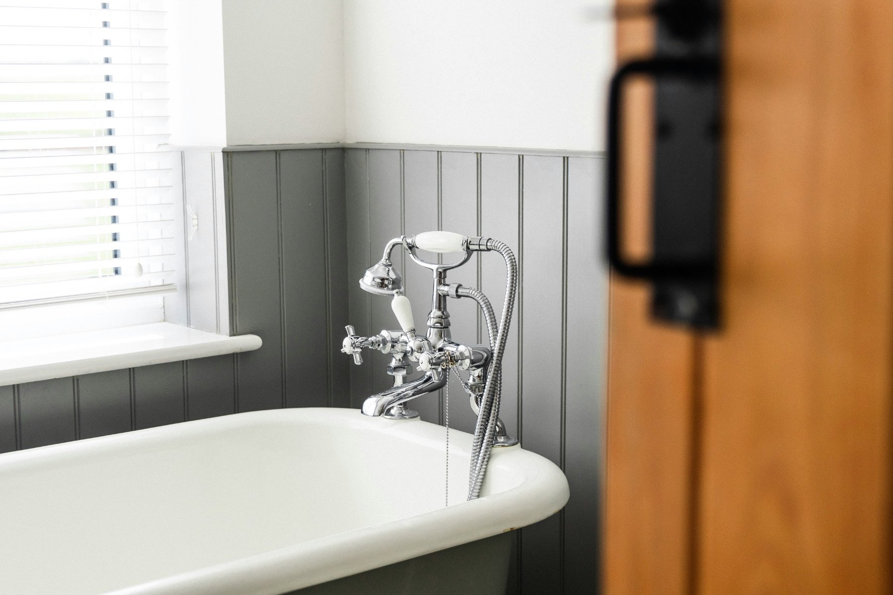
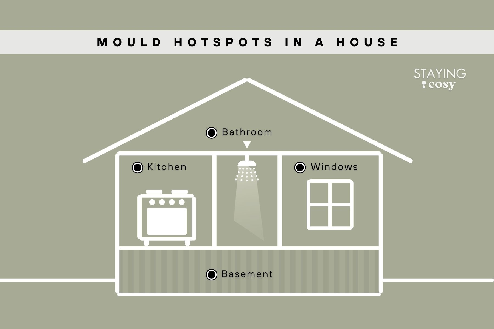
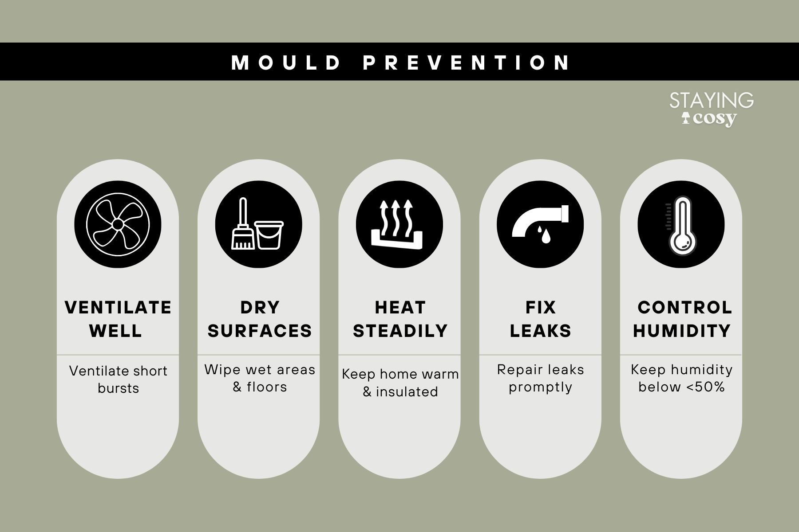
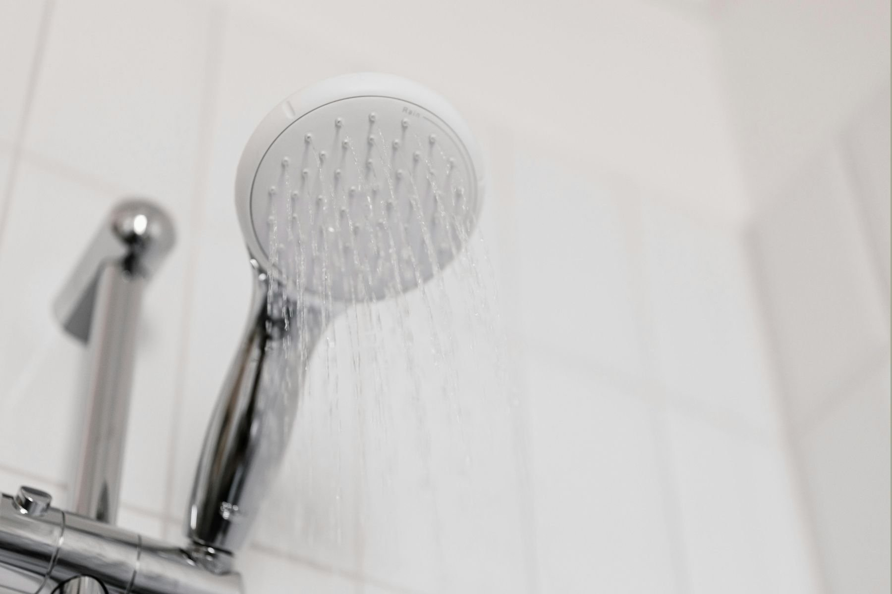

*Back when I lived in the tiniest apartment imaginable, we had this beautiful, oversized south-facing window. Every now and then, a thin black growth of mould would appear along the frames and I knew it was a telltale sign to pull on my rubber gloves and tackle the cleaning.*



<Caption>
Image credit: [Dan Smedley](https://unsplash.com/@nadyeldems?utm_source=unsplash&utm_medium=referral&utm_content=creditCopyText) on [Unsplash](https://unsplash.com/photos/a-bathroom-with-a-claw-foot-tub-and-a-wooden-door-N28_W8cQn5M?utm_source=unsplash&utm_medium=referral&utm_content=creditCopyText)
</Caption>

Mould is persistent. Unlike dirt, it somehow always manages to sneak back sooner or later. We all have our little tricks to fight it, but how effective are they really? Only once we understand the real cause can we take steps that actually prevent it from returning.

Why bother?

Because, as you probably guessed, it’s not exactly doing wonders for your health—or your patience, after scrubbing the same corners week after week.

## Mould Is Not the Root Problem

Here’s something that might surprise you. **Mould spores** are virtually everywhere. They’re not some exotic invader—they’re simply waiting for the right conditions to grow. Think of them as tiny opportunists. Treat the conditions, and mould simply cannot thrive. Remember:

- Mould spores are everywhere
- They only grow when conditions are right
- Killing visible mould ≠ fixing those conditions

Understanding where mould prefers to grow—and why—lets us prevent it from establishing itself in the first place. Without that knowledge, any cleaning is just a temporary victory.

> “Did you know that nearly half of all homes have dealt with mould issues at some point in the past decade?”

The statistics say that up to 27% of homes in [Europe](https://www.eea.europa.eu/en/analysis/publications/beating-chronic-respiratory-disease/indoor-environment-mould-and-dampness) and UK, and up to staggering 50% in the [US](https://iaqscience.lbl.gov/prevalence-building-dampness) and Australia are affected by mould? Mere data, you might think, but it’s more of an indication that mould is a symptom, not the disease itself. These numbers are big and we should actively try to lower them.

## The Real Reasons Mould Comes Back



<Caption>
Graphic: Staying Cosy - made in Canva
</Caption>

Cosmetic fixes, like mould sprays or wipes, rarely solve the problem. Unless we look closely at our homes and the environments we’ve created, mould will always find a way back.

### What Creates a Perfect Playground for Mould?

**Moisture that never fully dries**\
Bathrooms are the usual suspects, ever fought black shower corner silicone lining? What a treat. Don’t forget kitchen steam from cooking and clothes drying indoors. Even areas that seem dry can hold hidden moisture. So, be mindful of spills on carpets, upholstery or poorly stored clothes.

**Water damage**\
Active roof and pipe leaks are one of the main culprits of deep rooted moisture. Sometimes we ignore them for too long, but fixing these leaks is often the first and most important step in stopping mould for good. I am sure this is no news to most of us, but sometimes it’s just good to be reminded — to finally fix that roof, right?

**Condensation on cold surfaces**\
External walls, corners, and poorly insulated window frames often trap condensation. Sometimes it’s a construction or material issue that’s harder to solve—but noticing it early can save you headaches later. Growth on walls can cause a major hit to your wallet, so inspect a property well before you commit to it.

**Dampness in basements**\
Having a basement can be a blessing, or a curse. They’re prone to mould because of poor insulation, cold temperature, little ventilation, and trapped moisture. Even a small gap in airflow can turn a cosy cellar into a breeding ground for spores.

**Poor air circulation**\
Furniture pushed tight against walls, closed-off rooms, or thickly insulated new builds without proper ventilation can trap air and moisture. With modern eco-construction standards, ventilation is more critical than ever. Simple bathroom fans or briefly opened windows, can make a surprising difference.

## What Stops Mould Long-Term



<Caption>
Graphic: Staying Cosy - made in Canva
</Caption>

Once you’ve identified the underlying causes, the next step is action. Most long-term solutions are surprisingly preventative — small, steady changes that stop mould from settling in again.

### Tips to Genuinely Make a Difference

- **Ventilate effectively**: Short bursts of airflow rather than leaving windows cracked all day. Fans and well-designed HVAC systems are especially useful in modern, well-insulated homes.
- **Let surfaces dry properly**: Walls, floors, and corners need time to breathe, 24-48 hours is ideal to prevent mould from reappearing.
- **Adjust furniture layout**: Keep airflow around cold walls.
- **Change habits thoughtfully**: Avoid indoor drying of clothes in humid rooms, wipe up spills promptly, and keep fabrics dry.
- **Fix leaks and condensation sources**: Sometimes minor repairs are enough; other times it may require larger renovations.
- **Keep humidity in check**: Aim below 50%; dehumidifiers are your best friend if natural ventilation isn’t enough.
- **Use mould inhibitors**: Adding them to paints or bathroom cleaning products, they offer extra protection in high-risk areas.
- **Avoid carpet in damp zones**: Bathrooms, basements, or anywhere moisture tends to collect are better off without them.
- **Get digital moisture sensor**: A simple [digital](https://amazon.com/JEDEW-Hygrometer-Thermometer-Humidifiers-Dehumidifiers/dp/B07GR65CNT/ref=sr_1_1_sspa?crid=357PPLXVF7QUT&dib=eyJ2IjoiMSJ9.ew-bu6PyGKu2HQAV-w8bzTHSN93XEHTejmS_4cPogim5dlLQSjqDChOhBI3YPB6qfkb_GRBh72K3T1dU4ZgHumoTQn73RT0omMhFSmB8AEf2wv__GqrJ1RgebXVmH8AB6kb9I02jhFGClC4erbc_xpf50ciUR_w8t_dUrX4m8Zq1kSeFhL0upS9K4rtvwemuvfSox6Jnt1UK6H7oJsO0e2z-pE962j2t8jBKyUzBFZgqYAkWnifbLTR9JpsruCPbjDoHHZ4NMHvu7SiagbScpsaYNAEUlc_99WgTSRasT1w.0xGsEtzyKpxLFe62CWCLVH8pKxAlLy27E3aCuLqfTZk&dib_tag=se&keywords=hygrometer+stylish&qid=1768565734&sprefix=hygrometer+stylish%2Caps%2C202&sr=8-1-spons&sp_csd=d2lkZ2V0TmFtZT1zcF9hdGY&psc=1) or [this stylish hygrometer](https://www.amazon.com/HELYZQ-Round-Hygrometer-Humidity-Surface/dp/B0957W5ZV7/ref=sr_1_4?crid=357PPLXVF7QUT&dib=eyJ2IjoiMSJ9.ew-bu6PyGKu2HQAV-w8bzTHSN93XEHTejmS_4cPogim5dlLQSjqDChOhBI3YPB6qfkb_GRBh72K3T1dU4ZgHumoTQn73RT0omMhFSmB8AEf2wv__GqrJ1RgebXVmH8AB6kb9I02jhFGClC4erbc_xpf50ciUR_w8t_dUrX4m8Zq1kSeFhL0upS9K4rtvwemuvfSox6Jnt1UK6H7oJsO0e2z-pE962j2t8jBKyUzBFZgqYAkWnifbLTR9JpsruCPbjDoHHZ4NMHvu7SiagbScpsaYNAEUlc_99WgTSRasT1w.0xGsEtzyKpxLFe62CWCLVH8pKxAlLy27E3aCuLqfTZk&dib_tag=se&keywords=hygrometer+stylish&qid=1768565734&sprefix=hygrometer+stylish%2Caps%2C202&sr=8-4) helps you understand your home’s moisture patterns without turning it into an obsession.
- **Avoid portable gas heaters:** They release large amounts of moisture into the air and often make mould problems worse, not better.
- **Insulate:** Seal gaps around windows and use thermal blinds to keep heat in and surfaces warmer.

## Why Changing Habits Matters Most

This is where progress often comes fastest.

When I had mildew built-up along my bedroom window every winter, cleaning helped, but only briefly. Spotting a small crack in the frame, sealing it, and keeping the room evenly heated was my solution. The frames stayed dry ever since.

Make a habit of keeping an eye on moisture-prone areas. Turn on extractor fans while cooking, and wipe down shower frames or squeegee the floor after showering to keep surfaces dry.



<Caption>
Image credit: Canva - edited
</Caption>

### Consistent Heat Prevents Mould

Steady background heat keeps surfaces above the dew point, reducing cold spots on walls and windows and stopping warm, moist air from turning into water droplets.

> “Mould thrives where moisture meets cold surfaces. ”

Insulating gaps around windows or using thermal blinds works hand in hand with heating, making surfaces less prone to condensation.

It doesn’t mean overheating — just maintaining 14–15°C, combined with ventilation and extractor fans. Mould doesn’t need chaos to thrive; it needs consistency. Change the pattern, and it will go away.

### Mould Spray is Just the Final Step

Once you’ve tackled the root cause, the leftover mould is much easier to deal with. For small patches, I usually reach for a simple, 1:1 ratio homemade water & vinegar solution—it’s gentle, eco-friendly, and often does the trick.

For more stubborn spots, sometimes a stronger [chemical-based cleaner](https://www.amazon.com/Lysol-Mildew-Remover-Spray-Bleach/dp/B005IWRX3M/ref=sr_1_1?crid=2A1N058MCZQYX&dib=eyJ2IjoiMSJ9.nqa4OIX0sqxU_RDJwRXs1pTXC6kcnXxRQjJKn4Fis6BAxdgpazTIoy-gNGjF8Rn7_eHwTa4Ky3r1pQ0xflR0IXd1N9o1A-_zgavtY5uHnxQ5WAi-zUgCTAQ6aG-sG4E2.On5vx7sB11fhwlgAAq8972mrKuBNGGUOWi011iikFTc&dib_tag=se&keywords=mould%2Bremover%2Bspray%2Bpreventative&qid=1768565557&sprefix=mould%2Bremover%2Bspray%2Bpreventativ%2Caps%2C270&sr=8-1&th=1) is necessary. I always try to start with the gentler option, but don’t be afraid to use something more powerful if the mould just won’t budge—just handle it carefully, and make sure your space is well-ventilated.

## Is Mildew the Same as Mould?

Not exactly. While mildew is more surface level and easier to remove, it can develop into a deeper, invasive mould infestation if left untreated. It is often considered and early stage of mould as they are both signs of excess moisture and should be treated. They’re certainly not just cosmetic issues.

#### 💡 **Mould vs Mildew**

**Mildew** is usually lighter in colour and stays on the surface — often appearing in bathrooms or on window frames. **Mould** tends to be darker, thicker, and more persistent, and it can grow deeper into materials.

Mould is simply a form of feedback. It’s your home’s way of pointing out stagnant air, lingering moisture, and lost balance. When you stop scrubbing and start listening, your home rewards you with lasting warmth and health. And honestly? Understanding your space is far more satisfying than fighting it.

---

```
SEARCH THE BLOG
```

---

---
