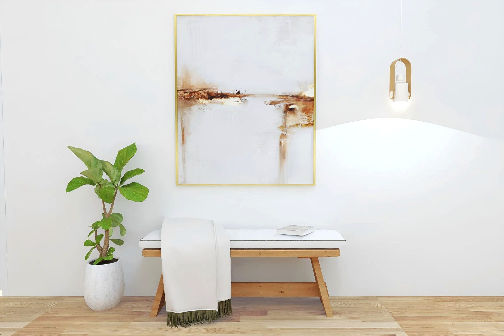
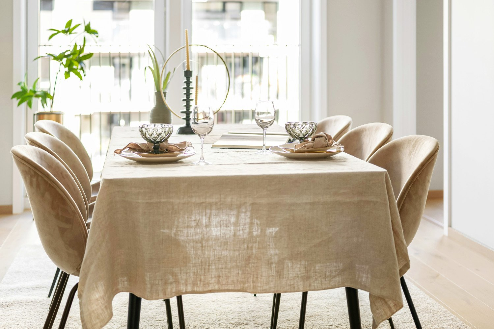
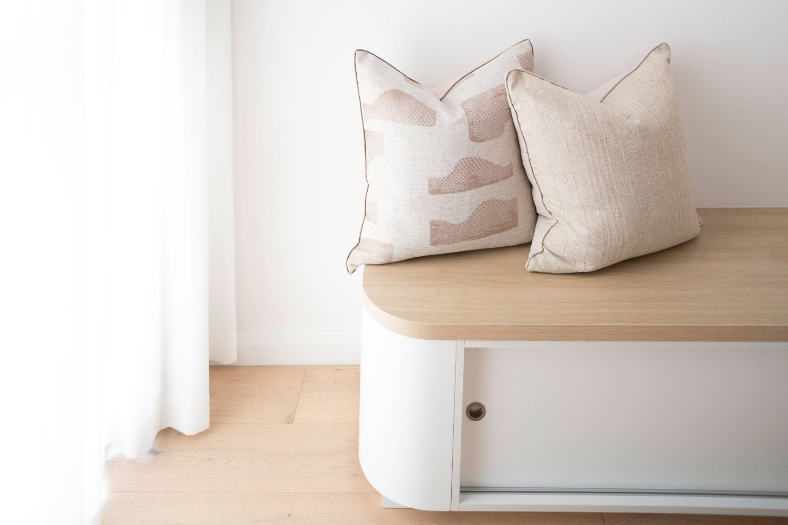
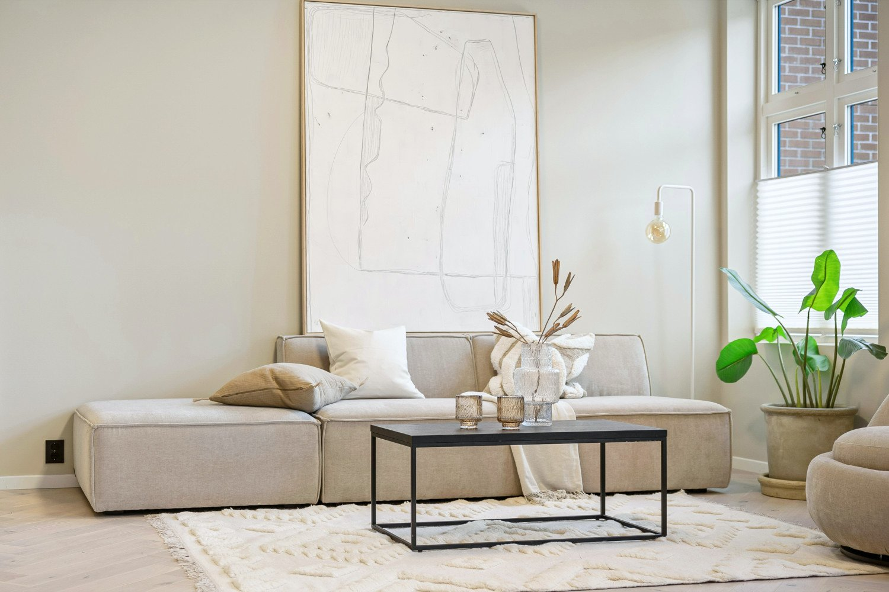
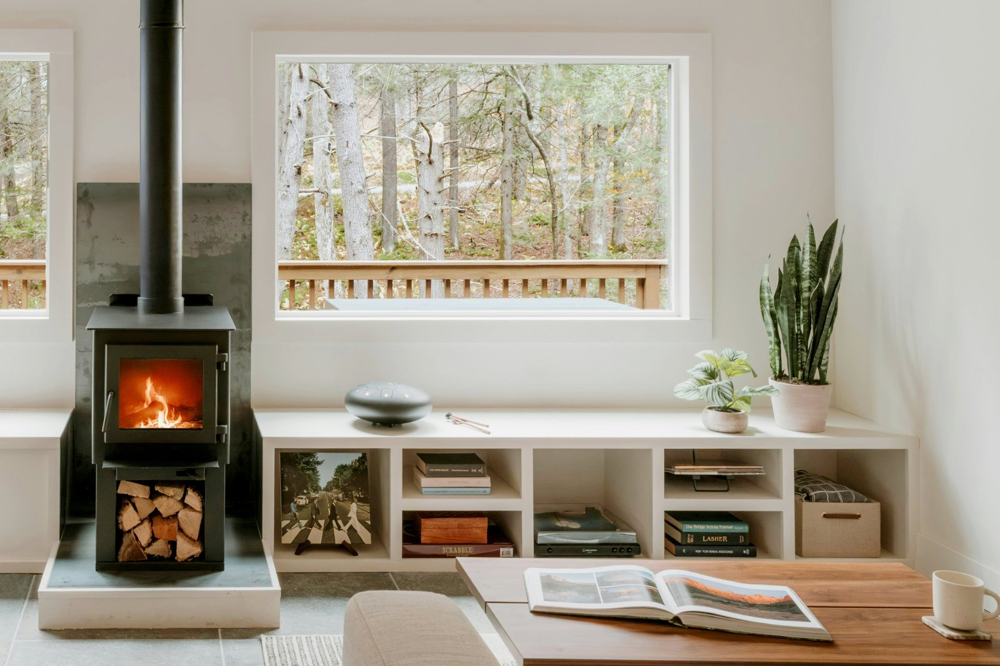
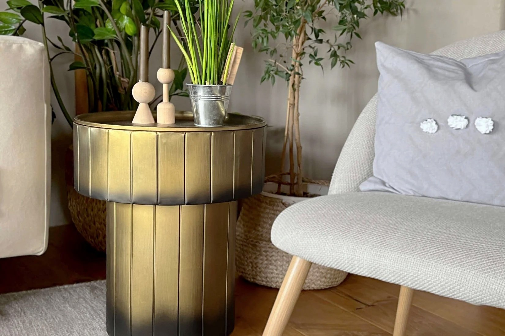
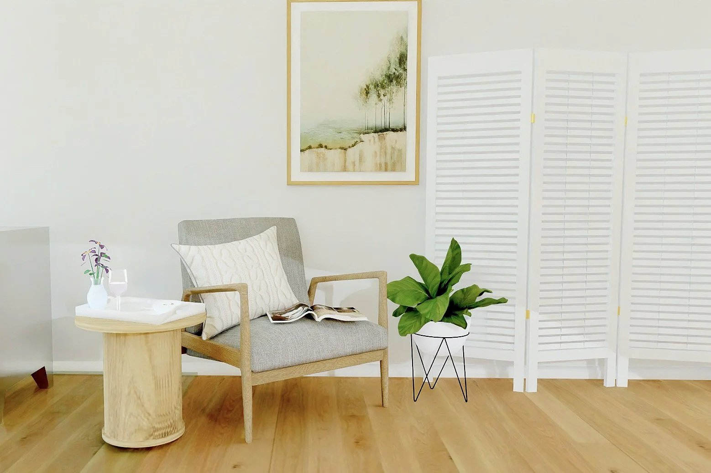

*Do you feel that specific spring-related fatigue of ‘too much’? Too many objects to navigate, too many surfaces demanding a dusting. I believe it is time for flexible, multifunctional pieces to shoulder the burden. Living with less usually means living with more focus and, fewer things to trip over.*



<Caption>
Image credit: Staying Cosy
</Caption>

Starter apartments, larger family homes, and even pet-friendly flats are all great candidates for adaptable furniture. Space-saving, or double-duty pieces benefit every household, not only smaller homes or temporary rentals.

A quick clean-up? Hidden storage. Unexpected guests? An extendable table.

When furniture is well-designed to multitask, it becomes that subtle, daily favourite you rely on, and find nearly impossible to part with over time.

## The Core Multifunctional Furniture Pieces Worth Investing In

While every household item has its primary job, it doesn’t need to do *everything*. It just needs to do the right thing. Flexible furniture is the exception. These pieces are the true workhorses of our homes, able to grow and transform with you. They adapt effortlessly to everyday demands, routine changes, and different stages of life.

### Extendable Dining Tables



<Caption>
Image credit: [Lisa Anna](https://unsplash.com/@lisaanna195?utm_source=unsplash&utm_medium=referral&utm_content=creditCopyText) on [Unsplash](https://unsplash.com/photos/a-dining-room-table-with-a-beige-table-cloth-VcrZ9bdqA7o?utm_source=unsplash&utm_medium=referral&utm_content=creditCopyText)
</Caption>

The [dining table](/blog/5-best-dining-table-styles) is often the hardest-working surface in a home. It hosts meals, homework, workdays, and gatherings — all in the same footprint. Chosen well, an extendable version can become a true family treasure.

**Why it works:**

- Expands only when needed
- Supports everyday routines and social moments
- Avoids permanent bulk

**What to look for:**

Focus on durable materials like solid wood, or glass paired with a smooth extension mechanism — these age gracefully and make everyday use effortless. You don’t want to be struggling with it while juggling cooking or kids. Check that the proportions are balanced, and most importantly, measure your dining area so the table still fits comfortably when fully extended.

**My favourite picks**\*\*:\*\* [Kave Home Lennon Table](https://kavehome.com/en/en/p/lenon-extendable-table-in-natural-fsc-mix-credit-solid-oak-wood-and-veneer-160200x90) (EU) | [Expand Furniture Luxe Pillar Table](https://expandfurniture.com/products/luxe-pillar) (US)

### Storage Benches



<Caption>
Image credit: [Anna Manson](https://unsplash.com/@leafyinteriors?utm_source=unsplash&utm_medium=referral&utm_content=creditCopyText) on [Unsplash](https://unsplash.com/photos/two-decorative-pillows-on-a-modern-wooden-bench-qo_6MwyzpaA?utm_source=unsplash&utm_medium=referral&utm_content=creditCopyText)
</Caption>

Storage benches discreetly solve multiple problems at once: seating, storage, and visual order. In our entryway, an open storage bench for shoes and a hidden storage stool have been doing the heavy lifting for a while. Our daily comings and goings are smoother, and the small entry feels roomier. Benches are an ideal space-saving furniture that makes a big difference without taking up extra space.

**Why it works:**

- Conceals everyday clutter
- Adds flexible seating
- Keeps circulation spaces clear and open

**What to look for:**

Choose durable materials that handle frequent use, like solid wood or upholstered finishes that are easy to clean. Ensure the bench height works for seating comfortably, and that the storage compartment is easy to access so it doesn’t create friction in daily routines.

**My favourite pick**\*\*:\*\* [Finish Design Shop A Line Storage Bench](https://www.finnishdesignshop.com/en-us/product/a-line-storage-bench-111-cm-white-oak) (EU/US)

### Modular Sofas



<Caption>
Image credit: [Lisa Anna](https://unsplash.com/@lisaanna195?utm_source=unsplash&utm_medium=referral&utm_content=creditCopyText) on [Unsplash](https://unsplash.com/photos/a-living-room-filled-with-furniture-and-a-painting-on-the-wall-87YpaqLhnic?utm_source=unsplash&utm_medium=referral&utm_content=creditCopyText)
</Caption>

A modular sofa adapts as life changes. It’s a perfect addition to a well-rounded holistic interior. Sections can be rearranged for everyday comfort, movie nights, guests, or changing room layouts, without replacing the entire piece. What is there not to love?

**Why it works:**

- Reconfigurable for different rooms or layouts
- Adapts to evolving family needs or routines
- Extends the lifespan of one major investment

**What to look for:**

Look for sofas with removable, replaceable covers for easy cleaning and style updates. Neutral bases with modular add-ons let you change the configuration without overwhelming the room. Check that pieces are easy to move and stable when reconfigured; and lastly, opt for a trusted manufacturer and a popular, long-standing sofa model to make sure add-ons remain available as your configuration evolves.

When it comes to re-arranging furniture, modular sofas are wonderful for an [instant home refresh](/blog/10-ways-to-give-your-home-instant-refresh).

**My favourite picks**\*\*:\*\* [Westwing Wolke Modular Sofa](https://www.westwing.de/modulares-ecksofa-wolke-4-sitzer-aus-boucle-159798.html) (EU) | [Maiden Home Breuer Modular Sofa](https://maidenhome.com/products/the-breuer-modular-sectional-belgian-linen-agate?variant=43341418037433) (US)

### Flexible Shelving Systems



<Caption>
Image credit: [Clay Banks](https://unsplash.com/@claybanks) on [Unsplash](https://unsplash.com/photos/cozy-living-room-with-fireplace-and-large-windows-vNecZJJQRLE)
</Caption>

I strongly believe shelving units are an absolute necessity for any home — at any stage.

We’ve used [Ikea Kallax storage units](https://www.ikea.com/gb/en/p/kallax-shelving-unit-white-80275887/) in several ways over the years. One started as a vertical bookcase in our living room, later moved to the kids’ playroom, and now serves as a TV unit upstairs. Another sits horizontally in our utility, holding baskets full of laundry supplies. Watching these pieces shift and adapt shows their flexibility and longevity. Needless to say, they’re still going strong after almost ten years.

**Why it works:**

- Adapts to different rooms and uses over time
- Encourages mindful ownership and organisation
- Reduces the need for constant furniture replacement

**What to look for:**

Choose adjustable or modular units that can grow with your space. Durable materials and simple lines make it easy to move or repurpose, while open designs keep the room feeling light. Ensure shelves are sturdy enough for varying items, from books and storage baskets to decorative pieces, so your investment continues to serve multiple functions over time.

**My favourite picks**\*\*:\*\* [Nordic Nest M Rack Bookshelf](https://www.nordicnest.com/brands/ethnicraft-nv/m-rack-bookshelf-small/?variantId=532321-01) (EU) | [Article Mysen Shelving Unit](https://www.article.com/product/25650/mysen-64-shelving-unit-short-natural-oak) (US)

### Variable Side Tables



<Caption>
Image credit: Staying Cosy
</Caption>

Smaller pieces often do the most work. Our round brass side table in the living area holds card games hidden underneath a removable tray. It’s a simple addition that keeps the room tidy while adapting to different daily needs — from drinks and magazines to evening game nights.

**Why it works:**

- Flexible and easy to reposition for different rooms or purposes
- Adds extra surfaces without visual clutter
- Can serve multiple functions as bedside, sofa-side, hallway, or even plant stand

**What to look for:**

Choose tables that are stable yet easy to move, like a flexible table for sofa, for example. Consider nesting tables or pieces with removable trays for added versatility, and pick finishes that coordinate with multiple spaces so they feel purposeful rather than temporary.

**My favourite picks**\*\*:\*\* [Kave Home Pada Side Table](https://kavehome.com/en/en/p/pada-white-terrazzo-side-table-o-40-cm) (EU) | [Crate & Barrel Kahn Side Table](https://www.crateandbarrel.com/kahn-cream-ribbed-concrete-and-oak-wood-18-side-table/s427110) (US)

### Dividers Without Walls



<Caption>
Image credit: Staying Cosy
</Caption>

Open shelving, curtains, or sliding panels allow rooms to shift function without cutting off light or movement. They’re especially useful in open-plan or small foot print homes, helping define areas without permanent walls.

**Why it works:**

- Creates functional zones while maintaining visual openness
- Supports changing routines and multi-purpose spaces
- Offers subtle separation without heavy construction

**What to look for:**

Choose dividers that complement your existing decor and let light pass through to keep spaces airy. Look for options that can be moved, reconfigured, or removed as your needs evolve, so your home can adapt without costly renovations.

**My favourite pick**\*\*:\*\* [Ikea Nämmarö Room Divider](https://www.ikea.com/gb/en/p/naemmaroe-privacy-screen-light-brown-stained-indoor-outdoor-20532743/) (EU/US)

## Space to Breathe — Why Versatile Furniture is a Slow Living Essential

The slow-living approach encourages us to shift our focus from *having* to *living*. When we prioritise quality over quantity, we move away from the noise of fleeting trends. That’s why opting for practical double-duty furniture is not just space-saving — it is the ultimate sustainable choice.

By choosing pieces that are easy to handle and built to last, they will withstand years of daily comings and goings. We should never have to sacrifice aesthetics for utility; a designer side table with hidden storage is the perfect example of how high-quality design and clever function can coexist. By investing in multifunctional furniture, you buy less and leave a little more room for your interior to breathe.

Which versatile staple in your home is currently working the hardest? Share in the comments below.

---

**☘︎ If you enjoyed reading about my top multipurpose furniture picks, you might also like:**

[*Sculptural lamps that add personality*](/blog/sculptural-lamps-light-personality) *|* [*Clever design tips for small kitchens*](/blog/tiny-kitchen-clever-design-tips)

---

```
SEARCH THE BLOG
```

---

---
