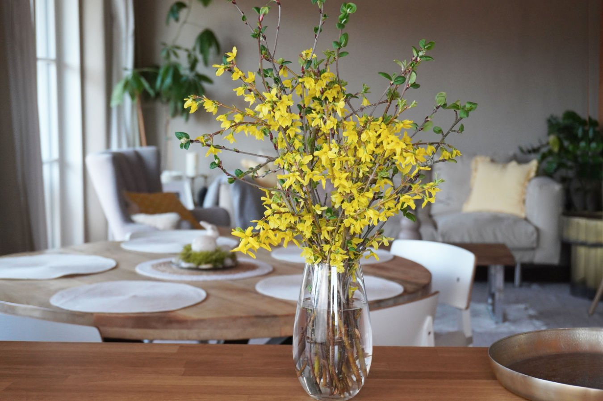
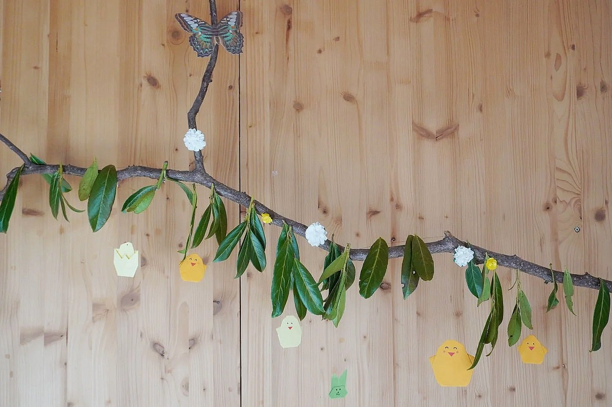
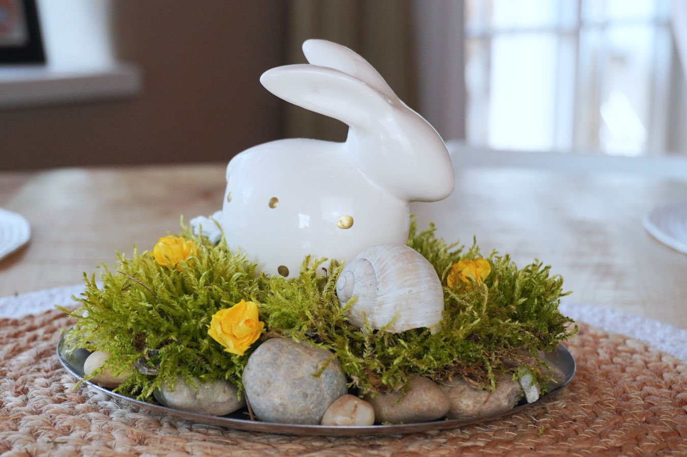
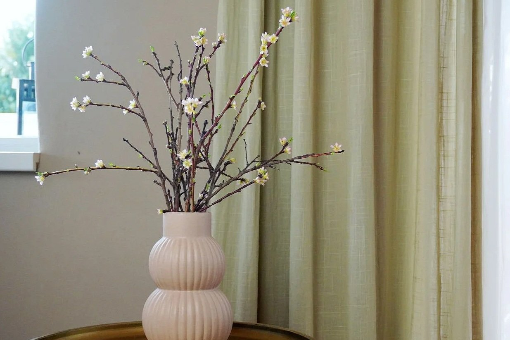
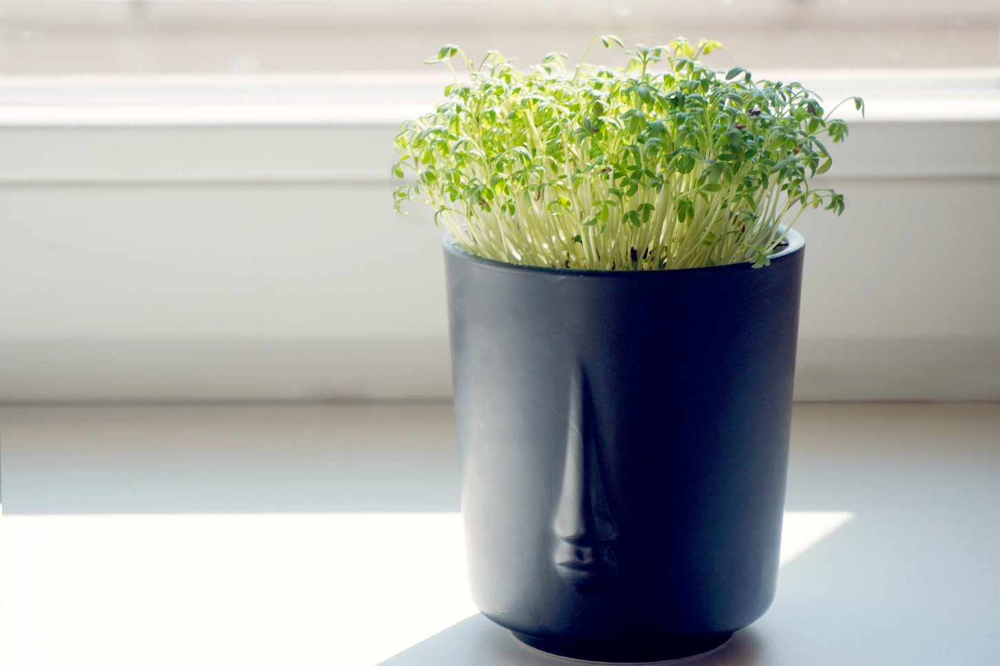
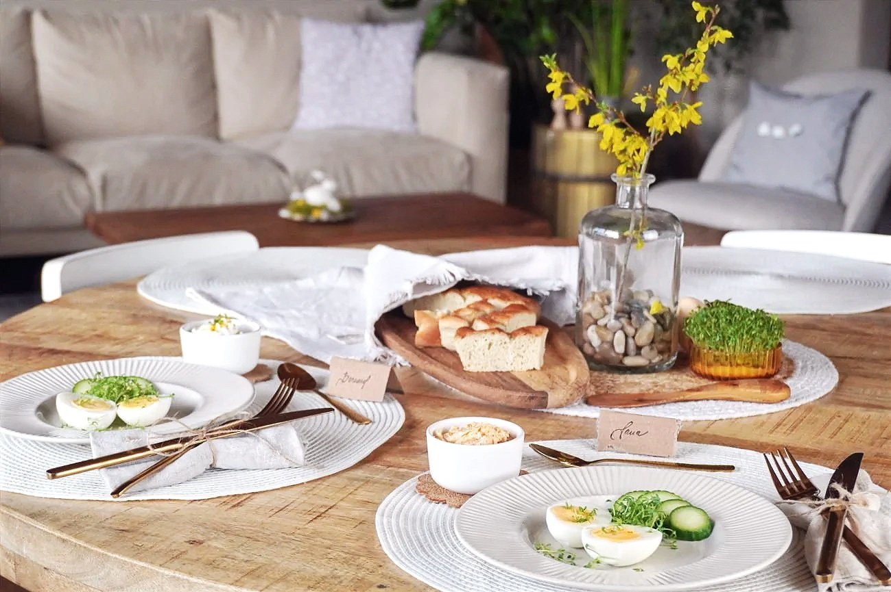
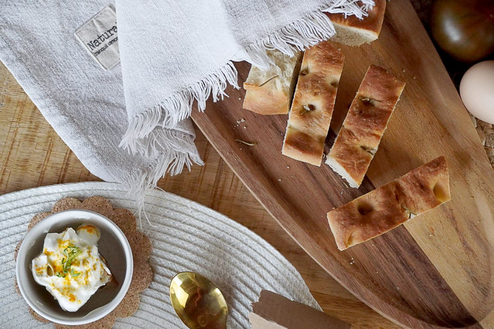

*Spring has officially arrived, yet outside it is still kind of… muddy. Before the green properly reaches our gardens, we can invite nature indoors instead. Easter is the perfect excuse. While shops are full of artificial grass, the reality outside is still bare branches. As always, we’ll skip the synthetics and choose sustainable home decor that celebrates the raw, honest beauty of the season.*

<Caption>
Forsythia blooms | Image credit: Staying Cosy
</Caption>

Bright yellow Easter eggs in a bed of fresh green grass. It’s a beautiful sight, no doubt. But where to we find that vibrant green when the garden hasn't woken up yet?

Holistic homes don’t fight the seasons. They lean into the honesty of the landscape at every step, and right now, that means embracing foraged home decor ideas. Instead of reaching for synthetic shop-bought filler, we can work with what is naturally available. Or, with a little bit of gentle coaxing, we can help nature along to create our own sustainable Easter decorations right on the windowsill.

Before you start decorating, make sure your home is refreshed, the air is clear, and your surfaces are ready for a new season. You can do this easily by following my [Sensory Spring Reset](/blog/eco-friendly-spring-cleaning-rituals).

## The Permanent Branch for Spring Season

<Caption>
Origami and Laurel leaves | Image credit: Staying Cosy
</Caption>

A few years ago, during a local walk, we brought home a slender branch to decorate a wall. The idea stuck; the branch stayed with us, and it now evolves as the seasons shift. Since then, the room has grown into my daughter’s *teen hub*, complete with a leafy twinkle-light chain.

This spring, we gave it a soft seasonal home decor refresh, leaning into her love for Japanese culture. Instead of anything artificial, we used what the garden offered after a small trimming session: fresh cuttings of English laurel, woven into a simple, slightly imperfect garland. You could just as easily use ivy or a few stems of eucalyptus — whatever happens to be within reach.

From the branch hang **delicate origami chicks** and bunnies, folded in shades of green and yellow. An enjoyable DIY session turned into equally joyful results. Nothing elaborate, just light, playful, and very fitting for Easter.

A few leftover paper flowers found their place too, tying everything together without trying too hard.

I can already imagine how, as the April sun grows stronger, these light layers will catch the shadows and bring the wall to life. The key is to choose a branch you love and let it evolve with the seasons. No need to start from scratch each time — just add, take away, and respond to what is around you.

## Stones, Moss and Mudroom Treasures

<Caption>
Pebbles & moss Easter bunny | Image credit: Staying Cosy
</Caption>

Following muddy paths often reveals the most interesting river stones and pebbles. We keep many as a lining for our terrace, mingled with a few cherished finds from summer holidays by the sea. This time, however, we brought a few interestingly shaped stones indoors, ones that simply caught our eye in the mild April light.

After a quick rinse in warm water to wash the mud away, I began layering them into a shallow metal dish. A base of **pebbles, topped with a soft layer of moss** — a fitting substitute for the fresh grass we are still waiting for outside. It brings that vibrant green we associate with spring, without forcing the season to arrive too early. To keep it fresh, simply mist it daily with water.

> “Sometimes a patch of moss is all the spring we need indoors.”

On top, a small white ceramic bunny found its place, accompanied by a snail shell discovered in our garden and a few more leftover paper flowers in bright yellow tones. Nothing perfectly styled, just gathered, placed, and left to settle into its own balance.

In a world often dominated by plastic, these small arrangements feel grounding. A stone is simply a stone — cold, smooth, and honest. It doesn’t pretend to be anything else. Yet its ability to hold and slowly release warmth makes it one of the most soulful foraged additions we can welcome into our homes.

Instead of buying seasonal decor, try composing a small scene from what you find outside. A handful of stones, a bit of moss, something handmade. It’s a simple way to create a natural focal point for spring.

## The Flowering Force of Nature

<Caption>
Peach blooms | Image credit: Staying Cosy
</Caption>

When I mentioned the outdoors is still muddy, much of that brown, colourless feeling comes from the fact that the trees haven't yet budded. I know it’s only a matter of weeks before they transform into a palette of rich, vibrant colours, just as the north winds finally ease and the warmth of the south begins to take over. I love these *in-between days*, where spring is just around the corner and the anticipation of sunshine is palpable in every living thing.

Easter itself symbolises renewal, and we can honour that by bringing in bare twigs of early fruit trees, willows or any other spring flowering bushes to create a striking focal point.

I picked a few **peach and Forsythia branches** for my decor. The latter’s bright yellows flowers are stunning, though fleeting, while peach carries delicate pink blossoms. Watching the tiny green leaves unfurl is like seeing spring happen in fast-forward right on your dining table. It’s a beautiful example of living home decor at its most raw. Once those first leaves or flowers appear, we can officially declare winter over.

☘︎ ***Forcing Branches to Bud***

Cut the stems at a sharp angle and place them in lukewarm, rested water. Keep them away from radiators but in plenty of soft sunshine. For the perfect timing, start them on Good Friday to see green leaves appear in **7 to 10 days**. Be gentle when changing the water, as flowers are fragile and can fall off easily.

## Edible Foraging of Sprouting Greens

<Caption>
Windowsill cress | Image credit: Staying Cosy
</Caption>

Every spring, I grow cress. Last season, I found a head-shaped ceramic pot, actually an ex-candle, that works perfectly. The playful contrast of the bright green sprouts against the dark ceramic is such fun to look at. If you are looking for a subtle seasonal touch this Easter, try growing cress in cracked eggshells or vintage ceramic egg cups.

There is nothing quite like the peppery freshness of cress on a soft-boiled egg for breakfast. A nutritional powerhouse packed with **vitamins C and K**, it’s functional decor at its best. Vibrant greenery gives us the spring lift we crave while nourishing our bodies. Alive and intentional, it feels a world away from anything manufactured.

☘︎ ***Windowsill Sprout Plan***

Give your seedlings a sunny start! **Cress** is the ultimate quick-win for edible Easter decorations. Simply sprinkle seeds onto damp cotton wool. Keep them moist on a sunny windowsill, and you’ll have a lush, edible forest in just **7 to 14 days**.

## A Table for Easter Morning

<Caption>
Natural Easter table setting | Image credit: Staying Cosy
</Caption>

Once the branches are budding and the cress is ready to harvest, we can finally turn our attention to the table. A simple, intentional setting brings a little extra flair to the festive meal without the need for anything fancy. On Easter Sunday, we turn to textures that feel as real as the garden outside.

It doesn’t take much to create a soulful atmosphere, just a few thoughtful details that honour the season’s renewal. My natural Easter decor for the table includes:

- **Linen napkins:** Loosely tied with a simple jute string or twine.
- **A single bud:** Placed in a glass jar to catch the morning light.
- **Handwritten name cards:** Using torn, textured paper for a tactile feel.
- **Home-baked bread:** Served simply on a worn wooden board.

If you have a little spare time on your hands, a loaf of homemade bread will be your ultimate winner. I baked a quick rosemary focaccia, and the scent alone feels like a celebration. Keep your table styling effortless by focusing on raw materials and, of course, quality food.

<Caption>
Home-baked focaccia | Image credit: Staying Cosy
</Caption>

Easter does not need to be loud to be joyful. A single branch, a few stones, and something green on the windowsill are often enough. Decorating with the season’s natural offerings creates an indoor reflection of the life waiting just beneath the soil.

In the end, the most meaningful spring decor is simply paying attention.

---

**☘︎ Interested in more decor ideas?**

[*Holistic Interior 101*](/blog/holistic-interior-design-guide-101) *|* [*Pom-pom Home Upgrades*](/blog/tassel-and-pompom-home-upgrades) *|* [*5 Timeless Dining Tables*](/blog/5-best-dining-table-styles)

SEARCH THE BLOG

