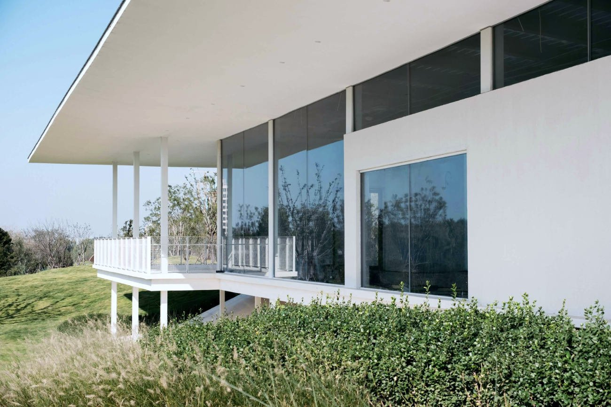
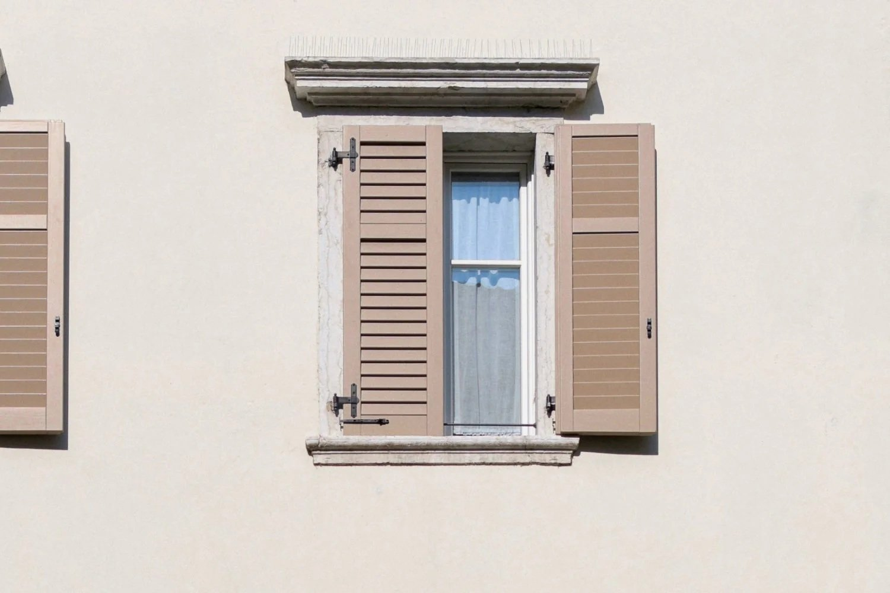
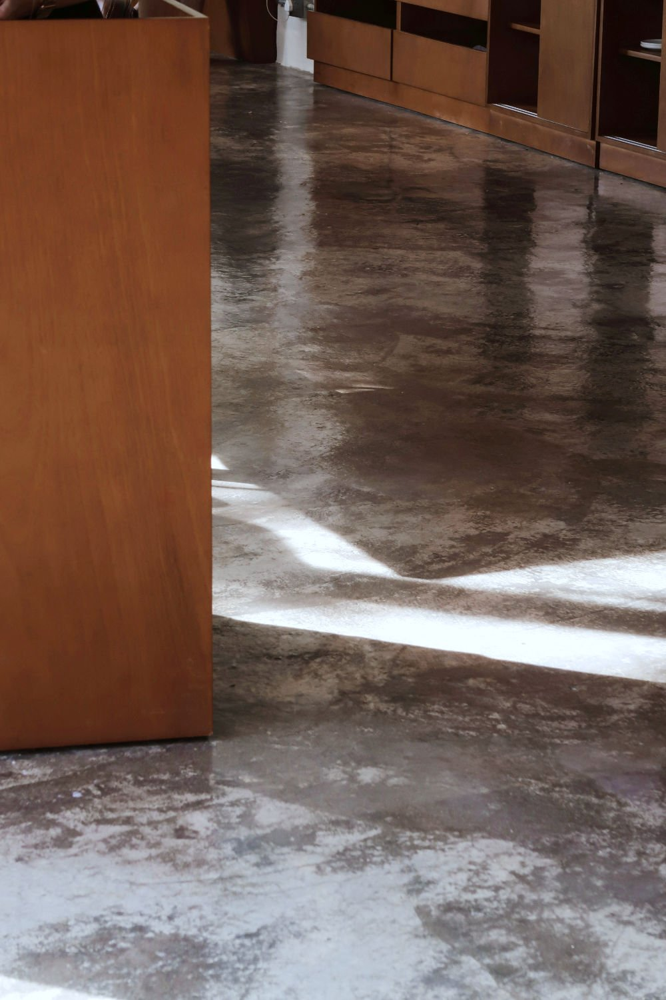
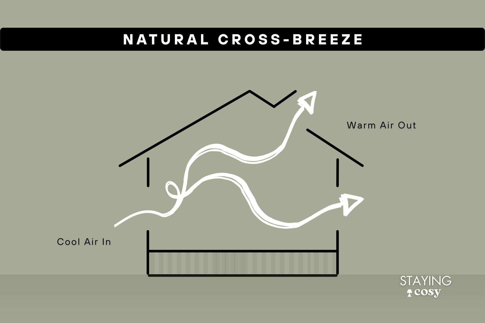
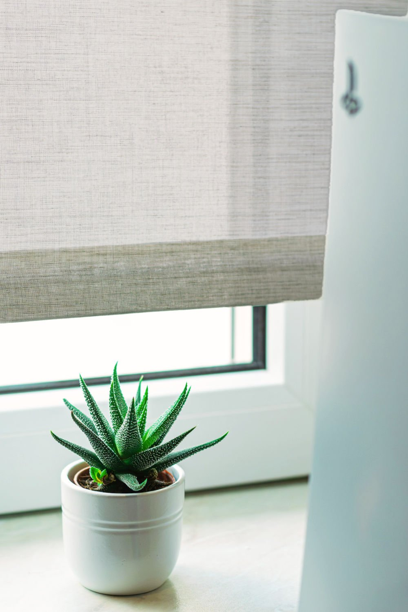
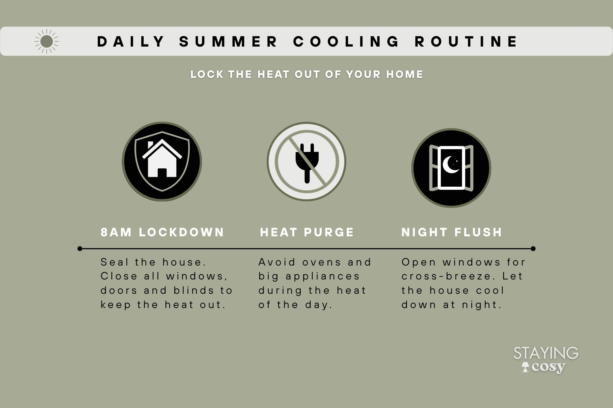

*Summer heat has a sneaky way of overstaying its welcome. One minute your house feels fine, and the next, your living room is holding onto heat like it’s a prized possession. Let’s face it. Walking into a stuffy, overheated home at the end of the day is the ultimate expectation vs reality fail.*

<Caption>
Image credit: [wen qiao](https://unsplash.com/@a2bba2bb?utm_source=unsplash&utm_medium=referral&utm_content=creditCopyText) on [Unsplash](https://unsplash.com/photos/modern-white-house-with-large-windows-and-balcony-dZNtwW0X7X8?utm_source=unsplash&utm_medium=referral&utm_content=creditCopyText)
</Caption>

But is there a remedy aside from living in a wind tunnel of noisy fans or the constant hum of a bank-breaking AC unit? Absolutely.

Keeping a home chilled out is more about playing chess with the sun than overcomplicating your electricity bill. By leaning into **natural ways to cool your home**, you can stay perfectly comfortable without the constant background noise. It comes down to smart architectural planning, tactical shading, and letting your house breathe deep when the air temperatures drop.

A quick health check before we carry on. We’re aiming for a refreshing air, not a frozen food aisle. Your body hates that supermarket-style heat shock, so we'll look at how to keep things at healthy, comfortable levels. Stick with me to the end to see exactly how to hit that healthy indoor temperature sweet spot.

## Stopping the Heat at the Gate by Mastering External Shading Solutions

Any good architect will tell you that mastering the sun’s rays at the planning stage is the ultimate secret to a comfortable home climate. While we all crave that natural light during the winter months, keeping the summer sun out is often a much bigger challenge than heating the house.

> “Follow the golden rule. Stop the sun before it reaches the window pane. That is the end-game for most effective shading.”

I learned this the hard way. We were convinced by our window manufacturer to install extra solar-gain glass on our east-facing windows to boost passive heat in the winter. And I can attest — they work like a charm in January. But when summer rolled around, all hell would break loose in my [sunny kitchen](/blog/sunny-kitchen-design-best-friend). Without shading, those same windows quickly turned into radiators you simply couldn’t switch off.

### Overhangs and Shutters — Your First Line of Defence

<Caption>
Image credit: [Amel Majanovic](https://unsplash.com/@just_amelo?utm_source=unsplash&utm_medium=referral&utm_content=creditCopyText) on [Unsplash](https://unsplash.com/photos/white-wooden-window-wCbm0cjNTx0?utm_source=unsplash&utm_medium=referral&utm_content=creditCopyText)
</Caption>

Overhangs are a brilliant architectural tool. Not only do they block high-angled summer sun from invading your home, but they also protect your window frames from UV and weather damage. Plus, having a shaded exterior just feels cooler. The only trade-off? They are fixed. If not designed perfectly, they can sometimes block that low, precious winter light we want most.

For a more flexible approach, we can take a cue from the picturesque villages of Italy. Their homes stay remarkably cool because they are literally shut off from the sun using simple wooden shutters. It’s centuries-old technology that works. Today, you don't even have to walk outside to close them; they can be mounted on remote-controlled rails to make life easier.

### Awnings, Shade Sails and Smart Shading for Modern Homes

If you need something retractable, awnings are a fantastic way to cast a wide shadow over both your windows and your patio. For a more modern and budget-friendly look, [shade sails](https://www.maanta.eu/) have become very fashionable. Just keep in mind they require a bit of height and permanent mounting poles, which might not fit every garden layout or aesthetic.

As for exterior blinds, they’ve gained huge popularity lately. They are usually made of sturdy aluminium slats or PVC and very easy to operate. Though, design-wise, industrial metal isn't everyone’s cup of tea. If you want something more natural, there are fantastic retractable, sliding or [folding wooden panels](https://enviroblinds.co.uk/products/louvers-and-panels/), or louvres, that work like vertical blinds. They give you that soft, organic look while acting as a heavy-duty barrier against the heat.

## Thermal Mass — Home’s Natural Cooling Battery

<Caption>
Image credit: [Jojo Yuen (sharemyfoodd)](https://unsplash.com/@jojoyuen?utm_source=unsplash&utm_medium=referral&utm_content=creditCopyText) on [Unsplash](https://unsplash.com/photos/brown-wooden-door-near-gray-concrete-floor-j1bVaypoFk0?utm_source=unsplash&utm_medium=referral&utm_content=creditCopyText)‍
</Caption>

If shading is your first line of defence, thermal mass is your secret weapon for the long game. The concept is simple. It’s about using heavyweight materials like **stone, brick, or concrete** to act as a thermal battery for your home.

When you have exposed concrete floors or thick brick walls inside your shaded home, they actively pull heat out of the room. Instead of that warmth making you sweat, it gets stored in the floor.

This dampens temperature swings, keeping the air steady while the world outside is baking.

Here’s what’s happening behind the scenes:

#### 💡 **The Science of Thermal Lag**

Dense materials have a high **thermal lag**. They act as a heat sponge, [soaking up enough heat](https://www.sciencedirect.com/science/article/pii/S0360544220300918) to drop daytime temperature peaks by over **3°C (5.4°F)** before that warmth ever reaches the air.

When you have exposed concrete floors or thick brick walls inside your shaded home, they actively pull heat out of the room. Instead of that warmth making you sweat, it gets stored in the floor. This dampens temperature swings, keeping the air steady while the world outside is baking.

### Storing the Night’s Chill

The magic happens when the sun goes down. Once the outdoor temperature drops, those materials slowly begin to release the warmth they’ve stored. This is where the strategy comes full circle. By opening your windows at night, you flush that released warmth away and reset your battery for the next day.

Think of it as a natural flywheel. You’re essentially storing the night’s coolness in your floors to use during the hottest part of the following afternoon. It’s silent, it’s effective, and best of all, it doesn't add a cent to your electricity bill.

## The Night-Time Flush — Strategic Cross-Ventilation and Airflow Hacks

Once the sun dips below the horizon, it’s time to flip the switch. This is the moment you stop defending and start refreshing. The night-time flush is the process of swapping out the stale, warm air trapped in your home for that crisp, cool night air.

### Creating Airflow Highways

<Caption>
Graphic: Staying Cosy — made in Canva
</Caption>

The key to a successful flush is cross-ventilation. And don’t get mistaken, just opening windows here and there won't cut it. You’re aiming at creating a highway for air to travel through. By opening windows on opposite sides of the house, you create a natural pressure difference that pulls the breeze right through your living spaces.

If you want to take it to the next level, you can use the **chimney effect**. Since heat naturally rises, opening a window on the ground floor and another at the highest point of the house — like a skylight or a top-floor window — creates a vertical vacuum.

Some days, you can actually feel the hot air being pushed out the top while the cool air literally rushes in from below. It’s like your house is finally taking a deep breath after holding it all day. But good ventilation does far more than cool. It also clears out stale air, excess moisture, and some of the [invisible pollutants](/blog/chemicals-that-pollute-our-living-rooms) we rarely think about.

**So, what’s the secret to waking up refreshed?**

The real trick is in the timing. By letting the house breathe all night, you are cooling down the very bones of the building. You’re essentially resetting your floors and walls so they can act as that natural heat sponge I mentioned before.

If you get it right, you’ve trapped that cool night air inside before the sun has a chance to take over. It’s a simple, low-tech reset that ensures you wake up in a space that feels fresh and energised.

## Easy Ways to Cool Your Home Without Renovating

If you aren't planning to remodel your home into a stone fortress this weekend, *don’t worry,neither am I*. But you can still make a huge dent in the temperature with a few low-tech, tactical solutions.

### Best Interior Window Shields to Keep the Heat Out

While stopping the sun outside is the gold standard, your next best bet is a high-quality interior barrier. Here are a few effective options:

<Caption>
Image credit: [Manu](https://unsplash.com/@r_manu?utm_source=unsplash&utm_medium=referral&utm_content=creditCopyText) on [Unsplash](https://unsplash.com/photos/a-potted-plant-sitting-next-to-a-window-WN1GkkLOtko?utm_source=unsplash&utm_medium=referral&utm_content=creditCopyText)‍ ‍
</Caption>

- Blackout curtains
- Cellular or Honeycomb blinds
- Reflective window film

These interior barriers act as your second armour. Blackout curtains with thermal backing can reflect a massive chunk of incoming heat, while cellular blinds trap a layer of air to act as a buffer. They can work with up to 40% efficiency.

If you don’t want to sacrifice your view, [reflective films](https://www.amazon.com/rabbitgoo-Privacy-Blocking-Reflective-Control/dp/B0CX56MV8Z/ref=sr_1_5?dib=eyJ2IjoiMSJ9.ViQE7TaiI7xlbfpKlFVPybdJcQByQ2OSM4WB8Y6mz11O8Ut27VYJnExdyCYbHDfz5oAM01yu_yAUkoMPW7y28y2ZHZTf8Dcy-HOKZ6EWyYT9d-AQhX81EXR_gnDwY21vqcum-FHGbr40ZT0NbYWrLTU_yKAa5hvGohu1ydgb7oZ72vBJv-VVqm02_gDCbG4gpnRbj5iDMLCsvCch2MUQjBYptlruLZX_6-m0iPJDWvOuO9w-u1XuODycJ4VT0XXI7eRImbRTqF3w55O_TqdJPImgfmYfMAym0XInlGoGNCA.myFu4C6lkWWjqiIH_Mz_MvMTnH5rkfWDh6ZWinRE-f0&dib_tag=se&keywords=uv%2Bwindow%2Bfilm&qid=1778488317&refresh=1&sr=8-5&th=1) are a great DIY way to bounce solar heat away before it even enters the room. But beware, on double and triple-glazed windows, they can only be applied externally using a special film designed for outdoor use. Otherwise, you risk damaging the glass.

### Seasonal Home Styling for Better Cooling

I remember reading once that we should dress our homes like we dress ourselves for the weather. In winter, we want layers and fluff; in summer, we want skin.

Heavy, plush rugs are fantastic insulators — which is great during winter holidays, just not right now. If you have stone, tile, or [hardwood](/blog/real-wood-vs-laminate-flooring-guide) underneath, rolling them up for the season lets those surfaces stay cool to the touch. Similarly, swapping velvet or heavy sofa fabrics for a **linen throw** stops that stuck to the seat feeling.

But the cheapest cooling trick at all is simple discipline. Follow this daily practice when heats soar high:

<Caption>
Graphic: Staying Cosy — made in Canva
</Caption>

**The Summer Heat Cooling Routine:**

- **The 8 AM Lockdown:** By this hour, the battle is usually lost if your windows are still open. Shut everything — windows, blinds, and curtains, and keep them sealed tight until sunset.
- **Kill the Heat Vampires:** Ovens, dishwashers, vacuum cleaners and large TVs are internal radiators. Save the heavy cooking and laundry for the late evening when you can vent that extra warmth straight back out.
- **The Nigh-time Flush:** Once the outdoor air finally cools, open windows on opposite sides of the house for a cross-breeze. This overnight air swap helps pull stored heat out of surfaces and resets the home for the next hot day.

I usually aim to shut everything tight between 6-8 AM, right before the heat starts its daily climb. If you miss that window, you’re just inviting the rising warmth back in for coffee. And trust me, you don’t want that.

But as we lock out the heat, we have to be careful not to overcorrect. Our bodies can naturally handle only a certain amount of temperature shift, without consequences.

## Healthy Cooling — Why You Should not Go Below 5-6°C

A comfortable home should feel like a relief, not a walk-in freezer. Your body actually hates that fridge-shock caused by aggressively pumped-up air conditioning. Natural cooling is gentler; it keeps you comfortable by creating a realistically balanced indoor climate that works with your biology.

Even with natural methods, there is a sweet spot for staying healthy.

**☘︎ The Sweet Spot for Health**

To avoid thermal shock and keep your respiratory system happy, aim to keep your indoor temperature no more than **5–6°C (9–11°F) cooler** than the outdoor shade. This is the healthy limit recommended in [global health guidelines](https://www.who.int/news-room/fact-sheets/detail/climate-change-heat-and-health). It’s the sweet spot where you feel refreshed without sending your internal thermostat into a panic.

Don’t worry if built-in architectural cooling isn’t an option right now. Even a series of small changes can still significantly reduce indoor heat. Combining effective shading with a proper night-time flush will keep your home comfortably cool throughout the summer.

---

**☘︎ Looking for more Eco ideas?**

*•* [*Interior Lighting Made Simple*](/blog/interior-lighting-guide)

*•* [*What You Need to Know Before Building an Eco House*](/blog/eco-friendly-building-guide-materials-principles)

*•* [*Effective Window Cleaning Hacks Everyone Needs*](/blog/effective-window-cleaning-hacks)

SEARCH THE BLOG

