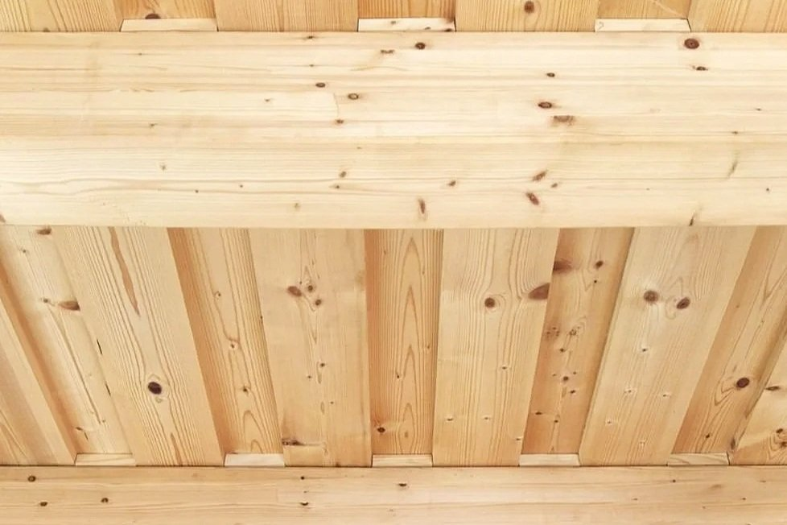
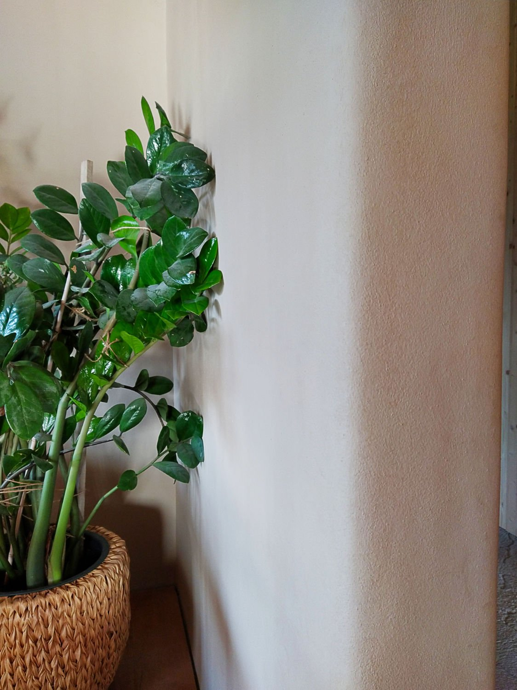
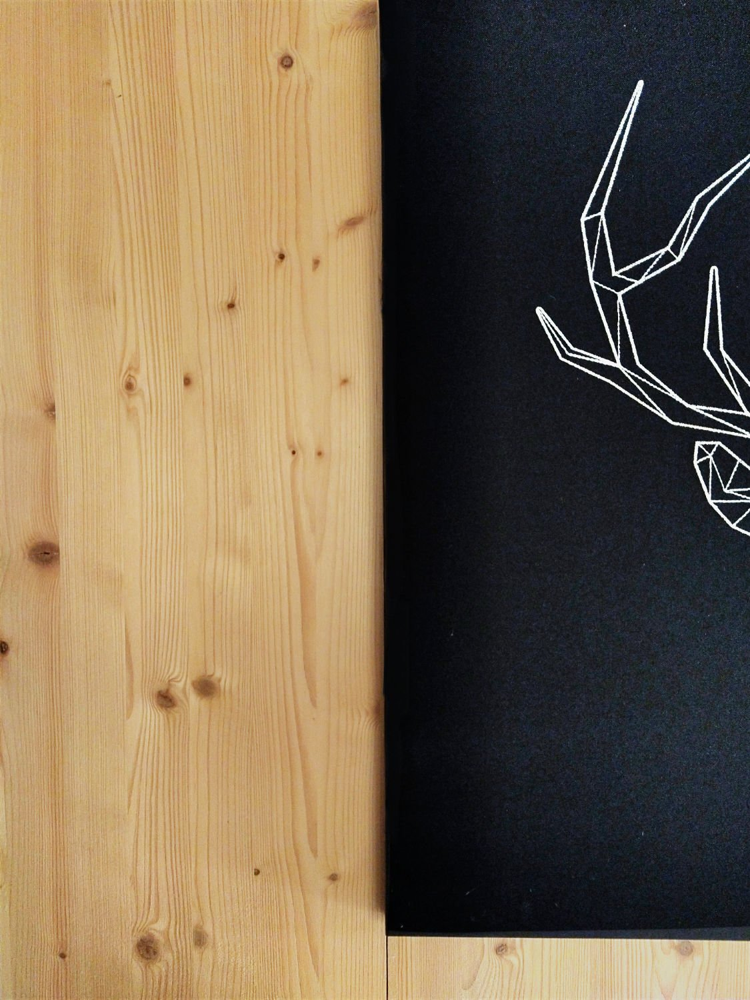
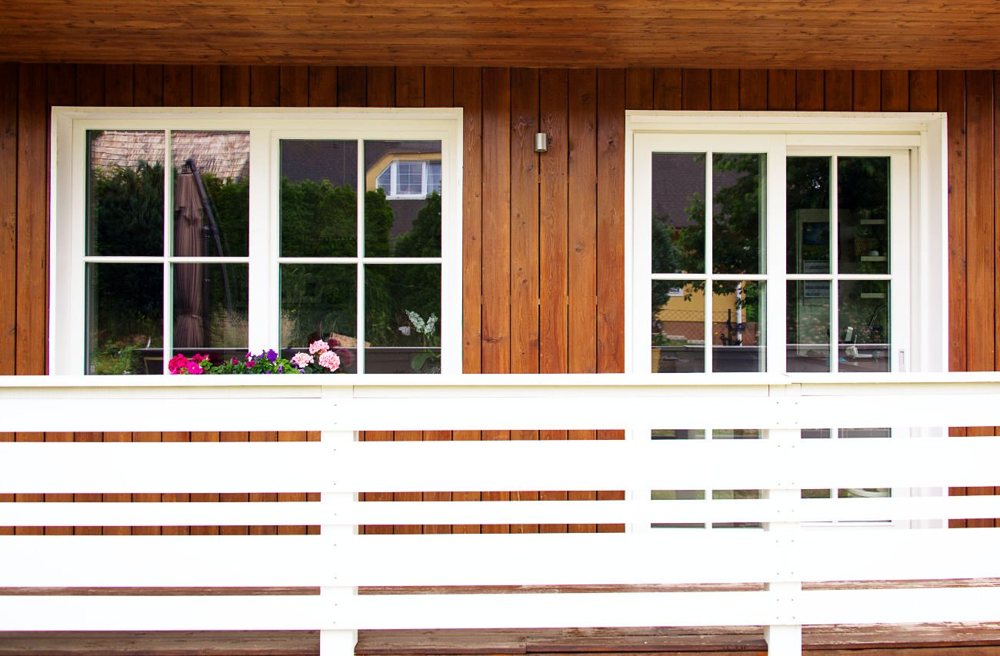

*Surrounding ourselves with natural materials brings visual warmth and a sense of calm and authenticity that is hard to replicate with synthetic finishes. Since my husband and I focus on eco-friendly choices, there is plenty of it in and around our home — in the structure itself, on the walls and under our feet.*

<Caption>
Image credit: Staying Cosy
</Caption>

Beyond their raw beauty, one of the main reasons we preferred these materials is their impact on health and indoor air quality. In this post, I’m sharing the key natural materials used around our home, and why we chose them.

## Wooden Ceilings

Our house is built from natural timber. The main load-bearing beams that stretch the length of the home, along with the timber ceilings, are left exposed. Both are made of solid spruce and treated with natural oils, which preserves the wood’s natural **moisture-regulating qualities**.

Wood also absorbs sound exceptionally well. It helps prevent echoes and reduces noise, which is a big deal in our house, where music is always playing. Sometimes there are three different tracks in three rooms at once. It’s a vibe, and the good acoustics make it possible.

Another *invisible* benefit of wood is that it doesn’t generate static electricity. Its non-conductive nature makes it a healthier, more comfortable material to live with.

## Clay Plaster

I absolutely love our walls. Clay plaster is not perfect and has its quirks, but it’s so worth it.

We literally used the sticky clay dug from our house foundations on the walls. And you know what? It’s amazing. Along with the wood, it helps regulate indoor humidity, which is especially important in a timber structure where the air could otherwise get too dry.

I have proof it works: my husband, a total tech enthusiast, has been tracking climate data with hidden sensors around the house. The moisture balance is spot on.

> “At the heart of our home stands a clay wall that naturally regulates indoor air quality.”

<Caption>
A full clay wall in our living room. The edges of the hand-finished clay plaster are round and soft. · Image credit: Staying Cosy
</Caption>

Given the size of the house, our clay plaster specialist suggested leaving one of the brick walls entirely made of clay. The mass of the wall helps regulate moisture far better than plaster alone. Using clay also provides several benefits:

- Heat accumulation
- Sound absorption
- Non-conductivity

These properties go hand in hand with another fascinating effect of clay: its ability to support indoor air quality by influencing negative oxygen ions.

### Negative Oxygen Ions — Nature’s Air Vitamin

Have you ever heard of them? Neither had I before we plastered our walls.

These ions keep the air clean, support oxygen absorption, and create the same fresh, mountain-like feeling you get in a forest or by the seaside. It is a subtle but powerful boost for the body and overall well-being, and a win-win since you don’t need any additional air purifier.

High concentrations of negative ions also support psychological health, increase productivity, and help keep dust at bay. Sometimes I notice a fresh coolness on my face inside the house, even in warm weather. I used to wonder what it was, and now I’m pretty sure it’s the air ions at work.

💡 Untreated or oiled natural materials help **keep indoor air rich in ions**, improving air quality.

## Cork Floors

When designing the flooring, we knew we didn’t want any tiles. They are made of clay, they are natural, robust and nearly indestructible, and come in a variety of designs. I could go on and on. We don't wear shoes indoors and mainly walk barefoot. I can’t even get my kids to wear socks! Simply put, walking on hard surfaces damages the spine.

### **Why are flexible timber parquets used for dance floors?**

Well, exactly for this reason. When we step outside, the dirt, grass, sand and stones all massage our feet while maintaining our spine's flexibility.

<Gallery columns={2} images={[{"src": "/src/assets/library/6718b7-cork01s.jpg", "alt": "cork01s"}, {"src": "/src/assets/library/69283f-cork02s.jpg", "alt": "cork02s"}]} />

*Image credit: Staying Cosy*

### Cork is softer than wood

It’s not as hardwearing, but as long as you don't poke it with anything sharp, it stays pretty intact. I probably wouldn’t put it in the main pathways and activity areas, and that’s the reason why it ended up being our bathroom and utility floor. I couldn't imagine myself stepping onto a cold, hard flat tile after getting out of a shower or sorting the laundry. Even though we have underfloor heating, in summer the tile floor would stay cold regardless. Unless, we want to waste unnecessary energy to keep heating it despite the warm weather.

I also love the softness of cork underneath my feet. Doing laundry, I have to kneel on occasion and it's extremely nice to touch a soft surface like that. I honestly can’t recommend cork enough. I really think that as a flooring option, it is a little bit underrated.

## Hardwood Floors & Countertops

All of the above also applies to our lovely oiled oak floor. It is made of layered solid wood boards with combed surface to give it an uneven texture. The difference between varnished and oiled wood in this case is really to our advantage. Any damage can be easily repaired by filling with wood filler and re-oiling it.

In fact, I'll be refinishing and re-oiling our solid wood counter tops very soon. Keep an eye out for this [upcoming project](/blog/how-to-oil-wooden-counter-tops).

**Wood is one of the most versatile materials. It is:**

- aesthetically pleasing
- easy to fix and work with
- strong yet durable
- electricity and heat resistant
- renewable and biodegradable

<Gallery columns={2} images={[{"src": "/src/assets/library/ea5858-counters.jpg", "alt": "counters"}, {"src": "/src/assets/library/967f89-woodfloors.jpg", "alt": "woodfloors"}]} />

*Image credit: Staying Cosy*

## Wood Cladding

The cladding on our walls was not really considered for aesthetic purposes, but rather as a wall finish instead of a standard plaster or dry wall. It was meant to be painted, varnished or wall papered. Well, it still is. For now, we’re happy with how it looks and the warmth it brings.

I am considering, however, to wallpaper it in some areas. As it is not a priority number one right now, we’re still going to be enjoying the lovely spruce look for some time. Our *cladding has not been treated* with any oil or varnish, so it still offers amazing moisture regulating properties and even after a couple of years it sill gives off the unmistakable raw wood smell.

<Caption>
Solid spruce cladded walls are a joy to look at.
</Caption>

*Image credit: Staying Cosy*

## Wooden Windows

Wooden windows appeal to me because of their timeless look, and the technologies utilised by manufacturers today make them far more robust than they used to be.

I remember having the option of choosing between a wood-aluminium combination window frame, plastic frame, pure aluminium frame, and wooden frame windows. Obviously, the plastic alternative was ruled out right away. Metal, especially on the inside, did not strike me as very appealing. The combination of aluminium and wood was OK, and we were considering it for a while, but in the end, solid wood won over all of them.

*I guess I am a conservative traditionalist when it comes to windows. They are my secret pride and joy.*

Yes — the thin dividing strips are permanent, but they don’t complicate cleaning. If you care about your windows, you’ll take the time to look after them. And thankfully, there’s no shortage of gadgets to help.

Having lived with my wooden windows for almost eight years now, I couldn't be happier with my decision.

<Caption>
Image credit: Staying Cosy
</Caption>

## Wool Carpets

I’m saving carpets for last, mainly because we don’t have them yet. They’ve always been part of the plan — they just haven’t quite made it high enough on the priority list. So far, we’ve only had temporary, low-cost synthetic carpets. In fact, one of them is a 20-year-old hand-me-down that still looks surprisingly good.

We do, however, have a few lovely wool rugs dotted around the house. Their dense, comforting pile reassures me that wool is the right choice for the future. And while I can’t wait for the real thing, part of me is actually glad we don’t have our proper *and expensive* wool carpets just yet. When the kids were little, these floors saw their fair share of pee, puke — and worse.

I hope you enjoyed this look at the materials in and around our home. I focused mainly on the larger wall and floor surfaces, as they have the greatest impact on how a space feels and functions.

I’ll be sharing more about the properties of raw building materials soon — stay tuned.

---

**☘︎ Would you like more inspiration?**

[*Mindful Living at Home*](/blog/shaping-a-green-home-with-purpose) *|* [*Effective Window Cleaning Hacks*](/blog/effective-window-cleaning-hacks) *|* [*Sculptural Lamps Guide*](/blog/sculptural-lamps-light-personality)

SEARCH THE BLOG

---

