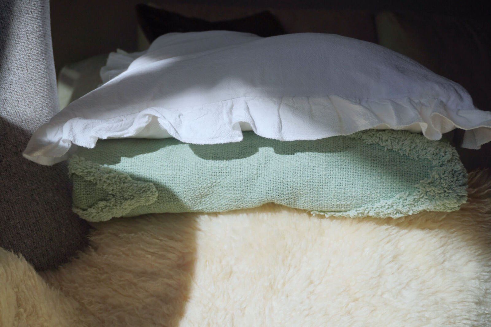
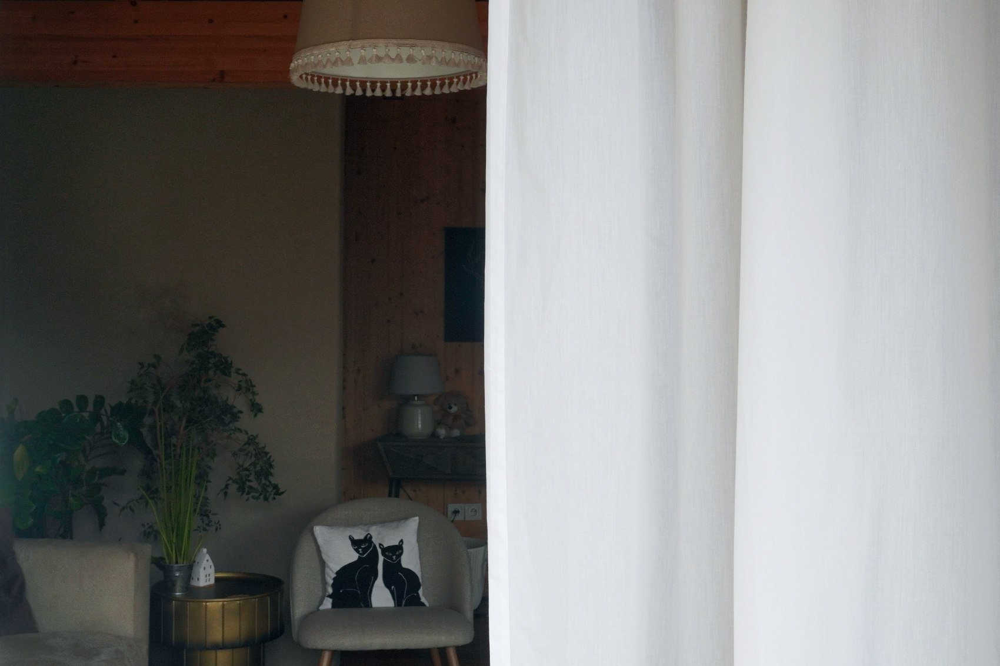
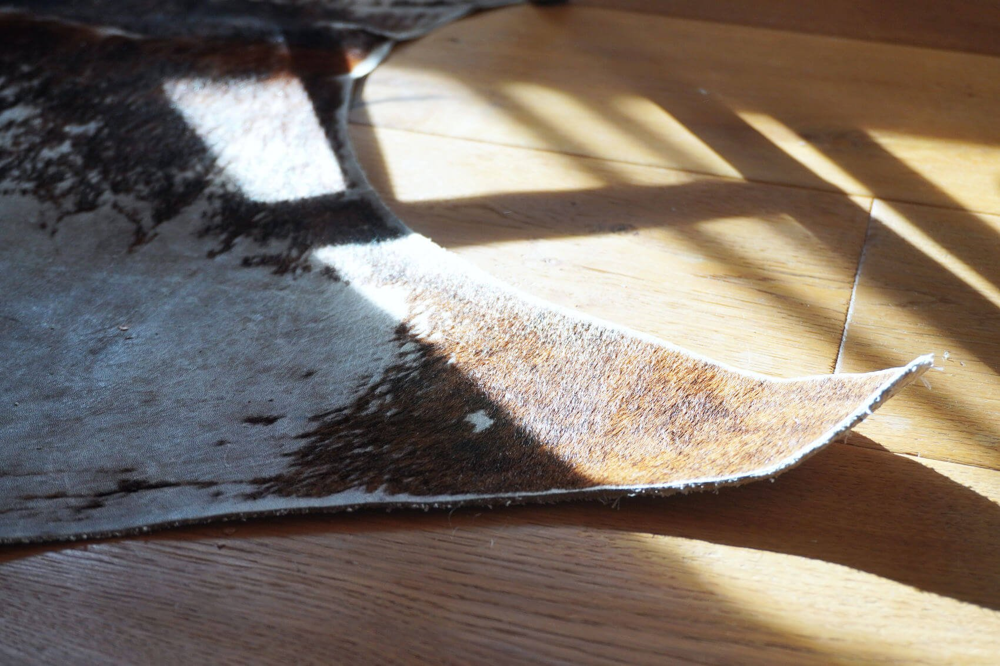
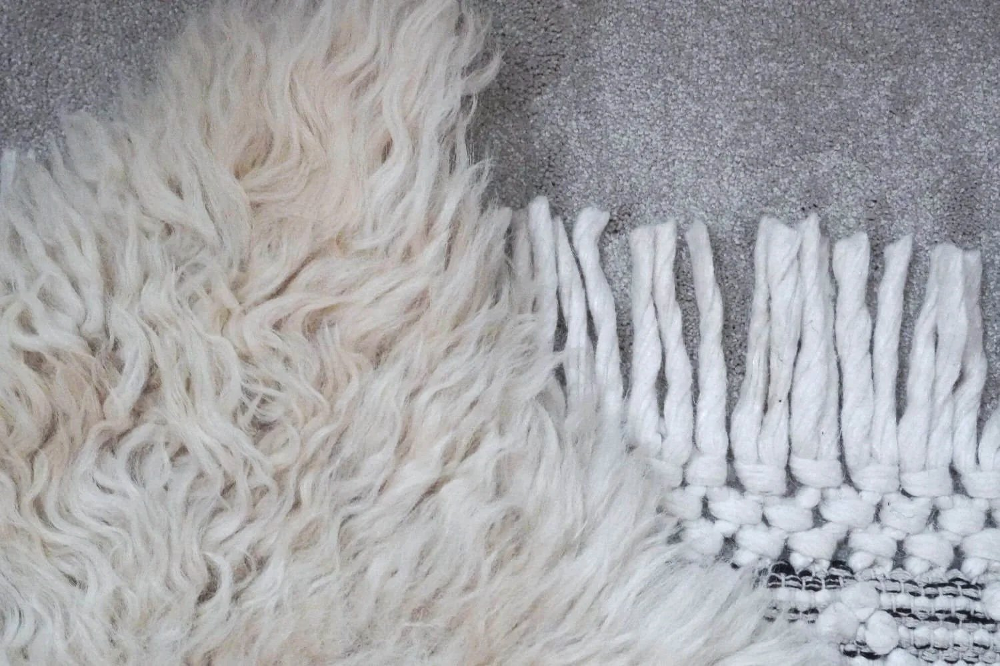
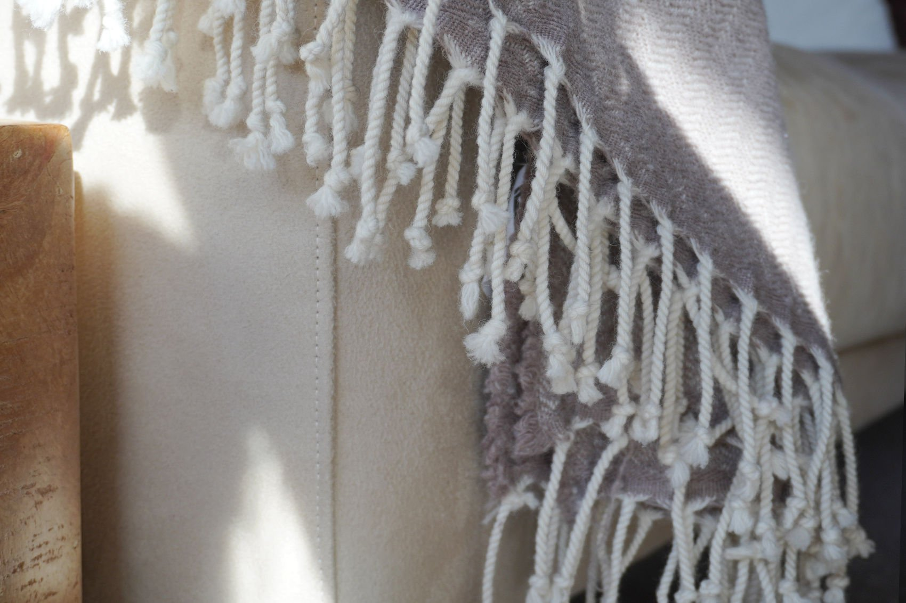

*If wood and stone are the bones of a home, then cotton, linen and wool are its skin. Home fabrics are the materials we touch most; the first thing our feet meet in the morning and the last thing we feel before bedtime. In a world filled with synthetic, petroleum-based fabrics, returning to natural textiles is the ultimate slow-living choice for a healthy home interior.*

<Caption>
Image credit: Staying Cosy
</Caption>

For a long time, I didn't pay much attention to the labels on my home fabrics. I once bought a set of beautiful velvet curtains, only to realise they were 100% polyester. They felt stagnant and lacked weight, and they certainly didn't breathe. Today, those synthetic curtains are tucked in a cupboard, and my windows are dressed only in natural cotton and linen.

Natural fibres just feel **more genuine**. They don't shed microplastics into the corners of our rooms, and they have this beautiful way of aging alongside us. Even at the end of their lifecycle, they can be repurposed as wiping cloths — becoming the perfect, soft companion for polishing our wooden furniture.

In everyday spaces like our family rooms or kitchens, natural fibres tend to age better, feel better, and live better than their plastic-heavy counterparts.

Eco-friendly fabrics may seem like a style choice, but they’re an irreplaceable part of any [holistic](/blog/holistic-interior-design-guide-101) slow-living interior.

## Breathability & Versatility of Cotton and Linen

I’ve never been a fan of synthetic tights. They just compress my body too much and feel like — well, plastic. I much prefer the soft touch of natural cotton against my skin. In our homes, the stakes are just as high. Even when we aren’t touching fabrics directly, they influence the static charge in a room, dampen sound, and give off the sincere look of a real, natural weave.

<Caption>
Image credit: Staying Cosy
</Caption>

### The Lesson of the See-through Cushion Cover

Not all fabrics are created equal. Lately, I’ve noticed a shift in quality. Last year, I bought some cotton Christmas cushion covers from a high-street brand I’ve used for years. But when they arrived, they felt different. They were much thinner, almost see-through compared to my older ones.

This is cost-cutting in real-time. A thinner fabric simply doesn't have the same longevity as a dense, heavy weave. When shopping for sustainable home materials like curtains or throws, it’s always worth looking for that extra weight and thickness.

### Why Natural Fibres Hang Differently

There’s a specific grace to cotton and linen that synthetics just can’t mimic. Thanks to their natural structure, they soften the light beautifully and help regulate moisture in our rooms\*.\* These are the endurance stars of a holistic home. They are designed to be used, lived with, and washed repeatedly. Unlike synthetic blends that tend to pill or lose their shape, natural fibres usually become softer and full of character as they age.

## Grounding Power of Wool & Hides

<Caption>
Image credit: Staying Cosy
</Caption>

Beyond the light layers of cotton, I look for the grounding weight of wool. For me, nothing replaces the thermal comfort of a heavy wool rug or a real sheepskin. Unlike synthetic faux-fur alternatives, which are essentially plastic fibres, **natural hides are breathable, biodegradable**, and incredibly durable. They are ancient materials that have sheltered us for centuries, providing a tactile warmth that feels structurally ‘right’ in a mindful home.

### Durability in Real Life

Wool has superior self-cleaning and moisture-absorbing properties, which I recently put to the test. My daughter spilled cocoa all over her new wool rug. In the moment, I tried to stay calm *(mostly!)*, knowing that wool usually handles these kinds of occasions really well. Because the fibres have a natural protective layer, the spill came off easily with cold water and a bit of fabric spray.

The only downside? The drying took a full three days because wool traps liquid so super effectively. But once dry, the rug was as good as new.

### Sourcing Leather with Intention

We source our sheepskins from local markets, supporting the herding industry that has existed around us for generations. We’ve had three skins for over a decade now. They are a true investment in longevity. My love for natural textures also extends to hides and leather.

Having worked in a sofa shop surrounded by thousands of upholstery material samples, I always returned to the smell and touch of real leather. Its quality and longevity are undebatable. While leather is a deep topic for another day, it shares that same honest quality as wool. It is a byproduct of the food industry that would otherwise go to waste, and when cared for properly, it can last a lifetime. Surely that’s better than ending up in a landfill after a few seasons — like their polyester look-a-likes.

## Is There a Downside to Natural Textiles?

<Caption>
Image credit: Staying Cosy
</Caption>

Cost is the obvious hurdle, but if I’m being completely honest, natural materials also ask a bit more of us. Because they are not coated in plastic-based stain guards, they can be ‘thirsty’ and sensitive. The spill on the wool rug I mentioned earlier? Fortunately, we cleaned it right away, so it came off easily. But in any such scenario you have to act fast — you can’t just walk away and deal with it later.

### Sun, Months and the Patina

There is also the reality of sharing your home with nature. Real wool can occasionally attract moths, which means you might find yourself tucked into a new ritual of tucking cedar blocks or lavender sachets into your cupboards. And then there is the sun. A 100% linen curtain will eventually fade in the bright light of a hot blasting summer window.

I’ve always felt that this is just another form of patina. Much like our [wooden floors,](/blog/natural-materials-around-my-home) these textiles are allowed to age. They have to. Nothing lasts forever, a slightly sun-bleached linen that shows its years is not a ruined product. It’s the trade-off for having a house that breathes. A little extra care in exchange for a lot more soul.

## A Home that Breathes

<Caption>
Image credit: Staying Cosy
</Caption>

Sometimes, I feel that being surrounded by natural materials can feel like an indulgence. Especially in a world where plastic items are heaped high on every shop shelf. But it shouldn't be that way. When I think of the heavy ecological footprint of the global fabric industry, our choices simply need to be more mindful.

In the long run, opting for natural materials is the best of both worlds. We gain a healthier, more pleasant home environment with better [indoor air quality](/blog/fresh-air-in-home)**,** while also doing our part for a more sustainable future.

Our daily comfort doesn't come from having an endless variety of synthetic accessories in every imaginable colour. That often feels more like a distraction than a privilege. Instead, our homes should be places where the textures are real, the materials age beautifully, and every layer feels as honest as the life inside them.

---

**☘︎ Looking for more slow-living inspiration?**

*•* [*Tassel & Pom-pom Home Upgrades to Add a Bit of Whimsy*](/blog/tassel-and-pompom-home-upgrades)

*•* [*Are You up for an Instant Home Refresh?*](/blog/10-ways-to-give-your-home-instant-refresh)

*•* [*Sensory Cleaning Tips Your Home May be Asking For*](/blog/eco-friendly-spring-cleaning-rituals)

SEARCH THE BLOG

