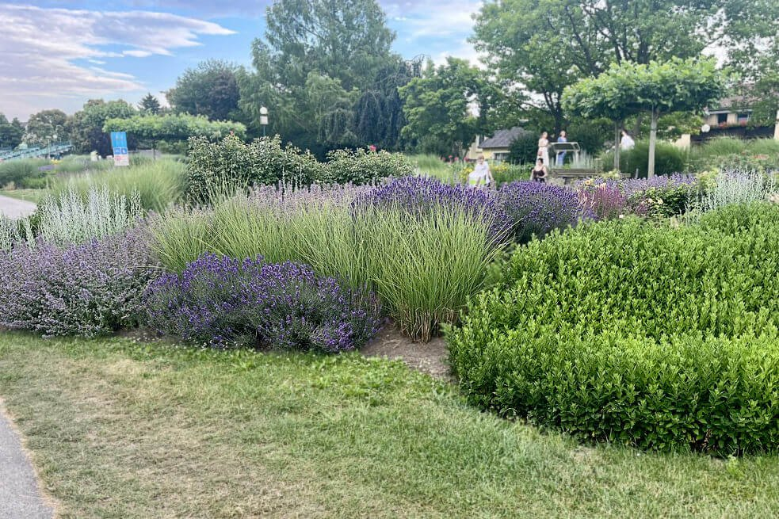
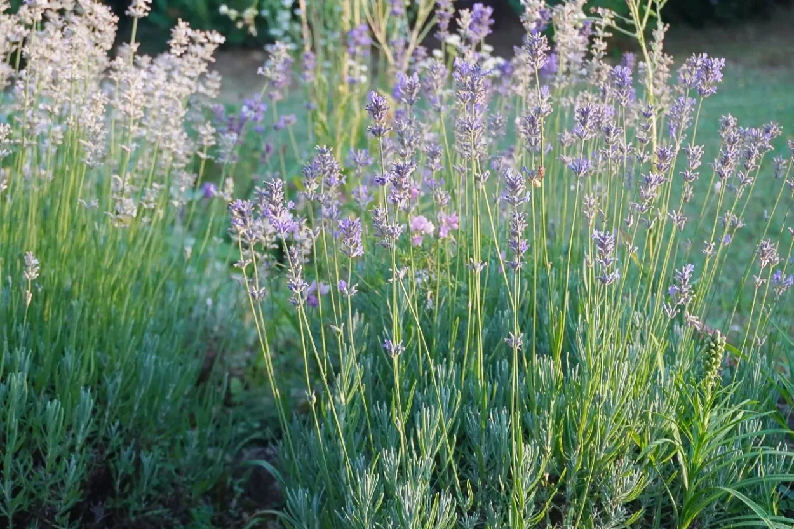
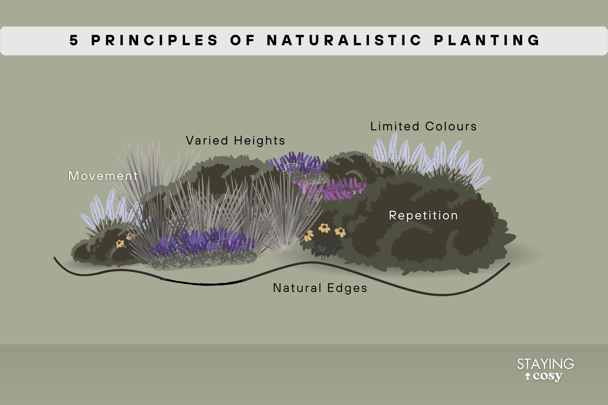
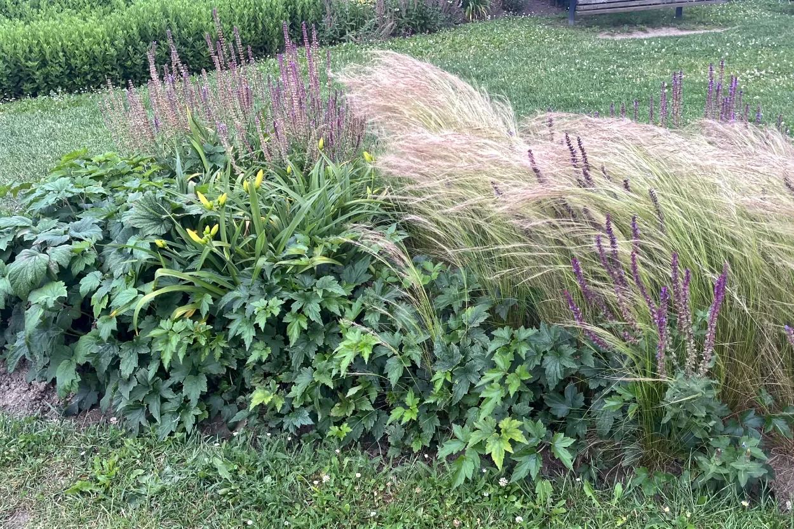

*If you love imperfect, natural gardens filled with hazy purple blooms, soft movement, and easy-care perennials, I have a feeling you’ll want to stick around. Pristine, razor-sharp flower beds can look great. No question. But they suit modern, cubic architecture down to the ground. On the other hand, relaxed, nature-inspired borders grab you instantly and make you stop and admire.*

<Caption>
Tulln’s Perennial Border | Image credit: Staying Cosy
</Caption>

My early summer visit to Tulln gave me exactly the kind of clarity my own garden needed. I returned home thinking less about individual species and more about the atmospheric weight a garden carries when it collaborates with nature.

But first, a bit of context.

Tulln is a small Austrian town nestled right on the banks of the Danube. Around those parts, people call it *the town of gardens*. And for good reason. The planting philosophy here handles the local climate beautifully. We are talking about perennial borders that evolve completely naturally through the seasons, growing richer with age and requiring next to no intervention once they get their roots down.

But the riverfront borders are merely the warm-up act. Tulln itself sits on a wonderfully human scale, where the concrete and the green world just exist in a casual, unforced harmony. I explored this whole concept recently in my piece about whether [a town's design can lower your heart rate](/blog/town-design-lower-heart-rate). It has always fascinated me how much our surroundings impact our nervous systems, so it’s worth a look if you have five minutes.

Today, though, we are talking about the landscape. The plants. These naturalistic perennial borders are a masterclass in how colour, movement, and structure can keep a garden feeling alive from the first flush of spring right through the dead of winter.

## What Makes Naturalistic Garden Design Work So Well

I arrived in late June, just as the lavender was bursting into bloom. The town’s loose and organic approach to landscaping caught my eye immediately. Curvy flower beds separated from the grass simply by an angular trench felt refreshing and so different from the rigid, boxed-in concrete borders we often see around more formal town architecture.

<Caption>
The lavenders | Image credit: Staying Cosy
</Caption>

These plants had movement. They had softness.

Now, a confession. Combining different flowers has always been my Achilles' heel. I suffer from classic gardener’s greed. I want every single plant in the garden centre. All of them. As a result? They end up competing for attention in my garden, looking completely lost and cluttered.

What Tulln taught me is that the secret to a successful perennial bed isn’t endless variety. It is occasional, disciplined repetition.

By repeating the exact same plant combinations across neighbouring beds, the designers achieved this beautiful, rhythmic flow. A modest garden border does not require an army of ten different species squeezed into a frantic queue. No. It performs way more elegantly with a tight palette of three or four. Choose them for contrasting shapes and staggered flowering times, then echo them throughout the space.

> “The magic almost always lies in restraint. Fewer varieties, repeated throughout, create a much more striking impression”

The trick is simply to step back. Stop messing with it. Resist the urge to over-egg the pudding and just let the plants look a little bit wild.

I kept wobbling on my bike, slamming the brakes on to snap photos and excitedly open my plant-ID app. I was obsessed with figuring out what could survive *and thrive* in my own garden plot back home.

## The Planting Palette Worth Borrowing

Once my eyes adjusted to that imposing wall of intense purple, I started noticing the taller ornamental grasses catching the breeze off the Danube. They were glorious. Slender, fluid, and doing all the heavy lifting behind the scenes. They acted as a sort of scaffolding for the whole bed.

I think that without them, the flowers would just be a flat, chaotic blotch of colour. But the grasses changed the entire game. They gave it height, rhythm, and real movement. Especially there, where the land is almost completely flat and needs all the help it can get.

Among the plants I recognised were:

☘︎ **Flowering perennials**

- Lavender (*Lavandula*)
- Catmint (*Nepeta*)
- Woodland sage (*Salvia nemorosa*)
- Caspian sage (*Salvia yangii*)
- Rudbeckia *(Coneflower)*
- Yellow daylily (*Hemerocallis*)
- Japanese anemone (*Anemone hupehensis*)

☘︎ **Structural grasses**

- Finestem needlegrass (*Nassella tenuissima*)
- Several other ornamental grasses

The other purple tones came from the ornamental sages and hazy catmints, tying the whole look back to the lavender. A few of the species were still holding back when I cycled past. But I did catch occasional flashes of bright yellow — early rudbeckia just starting to show those characteristic dark centres.

<Gallery columns={3} images={[{"src": "/src/assets/library/8f936a-persian-catmint.webp", "alt": "Persian catmint"}, {"src": "/src/assets/library/fa8020-woodland-sage.jpg", "alt": "Woodland sage"}, {"src": "/src/assets/library/0dd20c-caspian-sage.jpg", "alt": "Caspian sage"}]} />

Only a blossom or two had actually opened. Still, it wasn't hard to imagine how this classic purple-and-yellow combination would mature by the time August rolled around. It is a colour pairing gardeners have leaned on for generations. And honestly, it’s absolutely justified. It feels cheerful. Warm. Perfectly in tune with the summer sun.

### Structure Behind the Softness

As someone who loves beautiful gardens but also values a realistic amount of free time, I found myself studying the plant combinations.

<Caption>
Graphic: Staying Cosy — made in Canva
</Caption>

The effortless feeling of these borders was not accidental. Every species had its role in creating a harmonious composition. Different heights created depth, from low flowering plants at the front to taller grasses adding architectural height and movement in the background. The other plants filled the spaces in between.

It was abundant without feeling crowded — arguably the hardest balance to achieve in a perennial border.

### Achieving That Effortless Colour Harmony

One of the things I loved about these borders was that they did not feel designed around one single moment of peak beauty. At first glance, they looked wonderfully relaxed, but there was a thoughtful planting logic behind them.

The colour story slowly unfolds throughout the year. The whole show starts off with a cool, almost monochromatic wash of purples. Then, as the season goes on, the warmer yellows start creeping in. Eventually, those vivid tones give way to something much softer, mature, tactile grasses and maybe even a cheeky second flush of purple later in the year.

Think of it like three distinct acts:

- **Early Summer Purples**: It is all about the lavender, catmint, and those deep ornamental sages.
- **Late Summer Yellows**: This is where the rudbeckia and yellow daylilies step up to brighten things up.
- **Autumn Textures**: The stage belongs to the ornamental grasses, rich foliage, delicate Japanese anemones, and a welcome late wave of purple blooms.

To my eye, the whole thing gives you that romantic, soft-focus feel of a traditional English cottage garden. But the absolute best part? It completely strips away the endless, back-breaking maintenance usually needed to keep a traditional garden alive.

## Bringing the Inspiration Home

<Caption>
Tulln’s Perennial Border | Image credit: Staying Cosy
</Caption>

I cannot describe how much I adore purple shades in the garden, and this is definitely a direction I would like to explore further in my own planting.

I already have some lavender, salvias and grasses growing, so this inspiration is something I hope to develop gradually.

What I particularly appreciate about these plants is that once established, they remain relatively easy to manage, creating low-maintenance perennial borders that suit gardeners who want beauty without constant upkeep.They are reliable choices without the tendency to take over the entire garden, which is something I always consider when selecting plants for my flower beds.

> “A garden feels relaxed and spontaneous when structure and movement work together.”

One thing I keep reminding myself is that garden needs patience. A lot of patience. Plants rarely reach their full potential in the first year. It takes a solid two to three cycles for the roots to find their footing, fill the voids, and settle into the right proportions originally envisioned.

I have witnessed this in my own garden. The evergreen near our terrace has never really settled into its spot. It refuses to thrive, and visually it doesn’t connect with the surrounding plants.

After seeing how beautifully catmint works between grasses, I am considering replacing the sulking evergreen with a taller catmint variety that will hopefully feel more at home there.

Honestly, my absolute favourite thing about learning how to design a perennial bed is realising that you have to actively welcome a bit of a mess. A garden shouldn't look like it’s being rigidly policed. Life isn't like that. Those floppy, softer edges and that slight, late-summer untidiness make a plot feel genuinely alive. Healthy. Real.

I am gradually learning that selecting suitable plants is the ultimate hit-and-miss game. It is certainly not about what looks pretty on a Saturday morning at the local plant nursery.

---

**☘︎ You might also enjoy reading:**

*•* [*How I extended My Growing Season with a Simple DIY Garden Setup*](/blog/extend-growing-season-diy-containers)

*•* [*Best Low Maintenance Air Purifying Plants*](/blog/air-purifying-plants)

*•* [*Sensory Cleaning Tips Your Home May be Asking For*](https://bluebird-hawk-as8j.squarespace.com/blog/eco-friendly-spring-cleaning-rituals)

SEARCH THE BLOG

