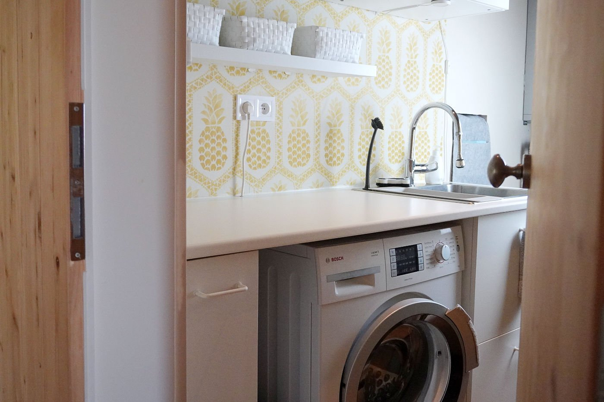
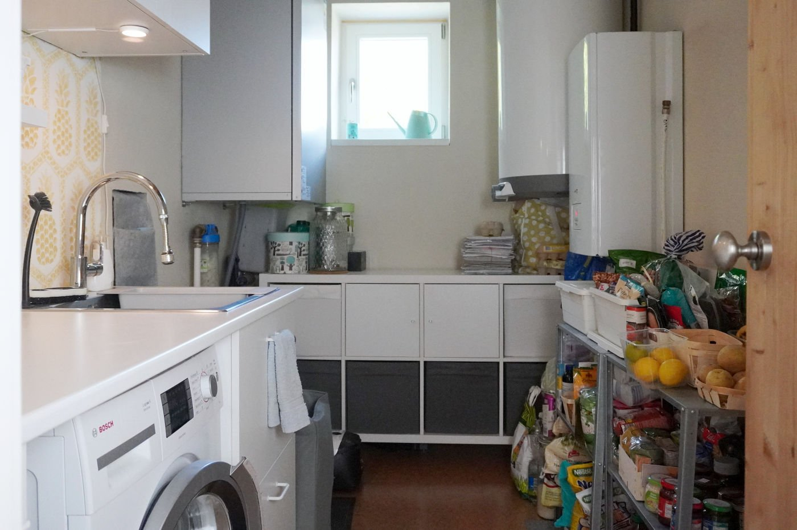
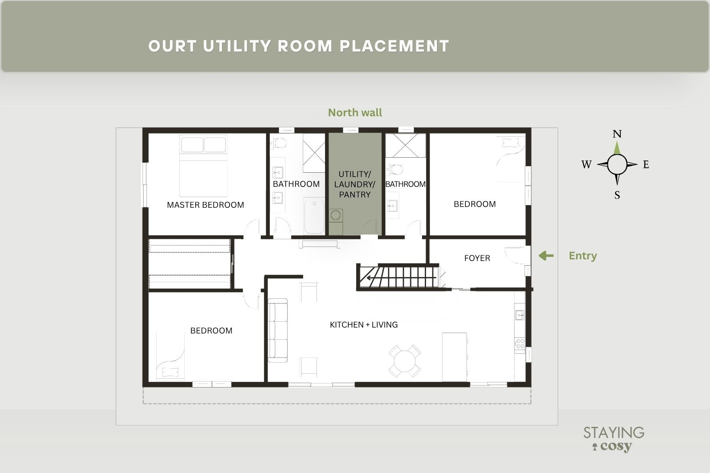
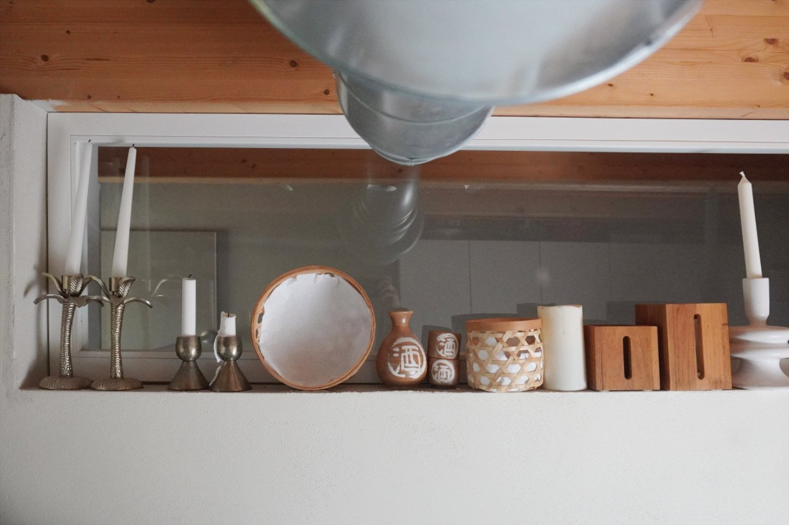
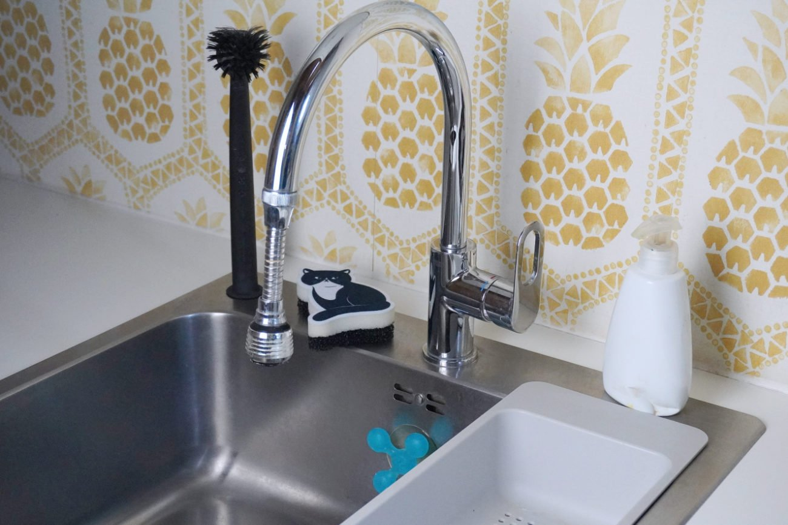
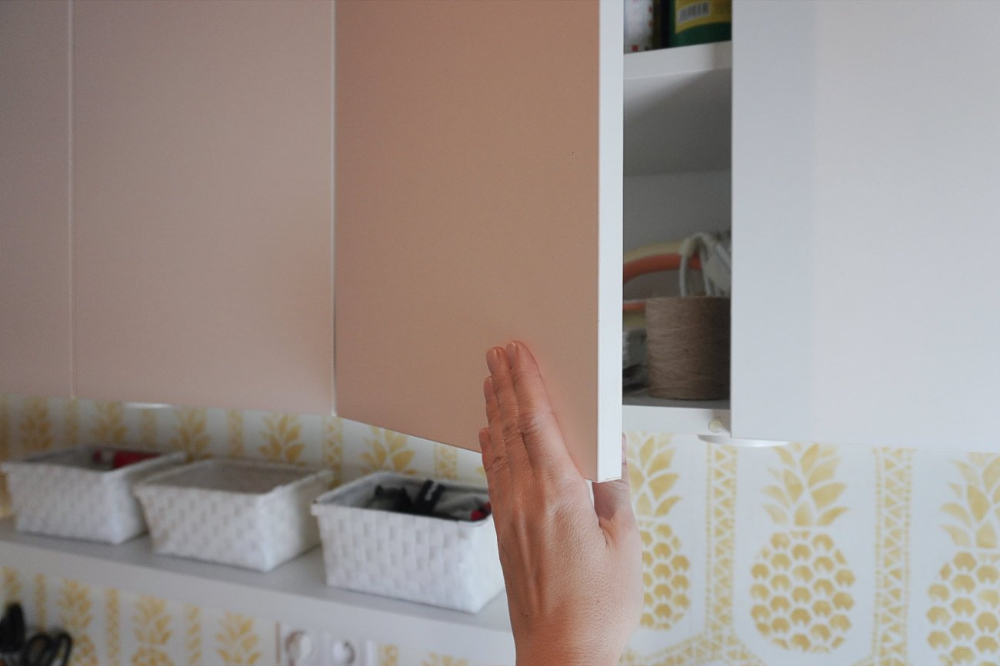
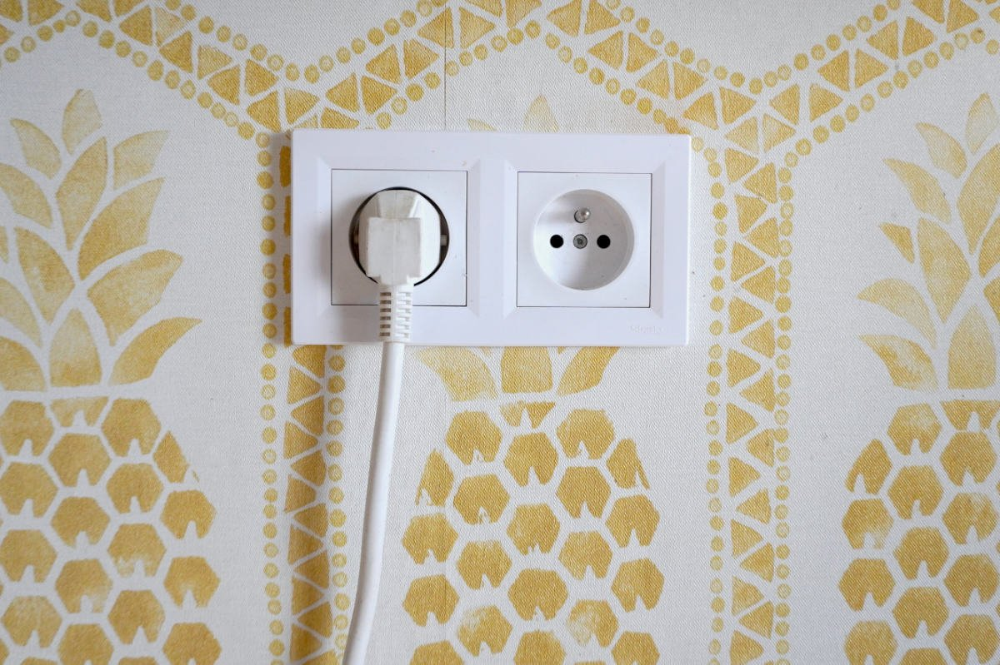
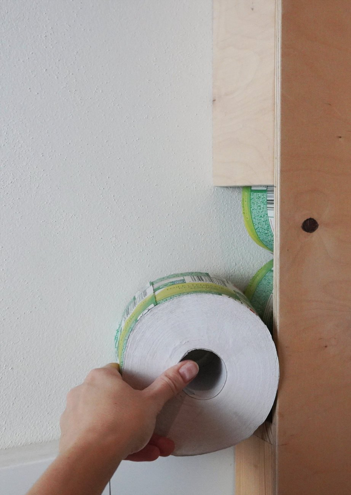
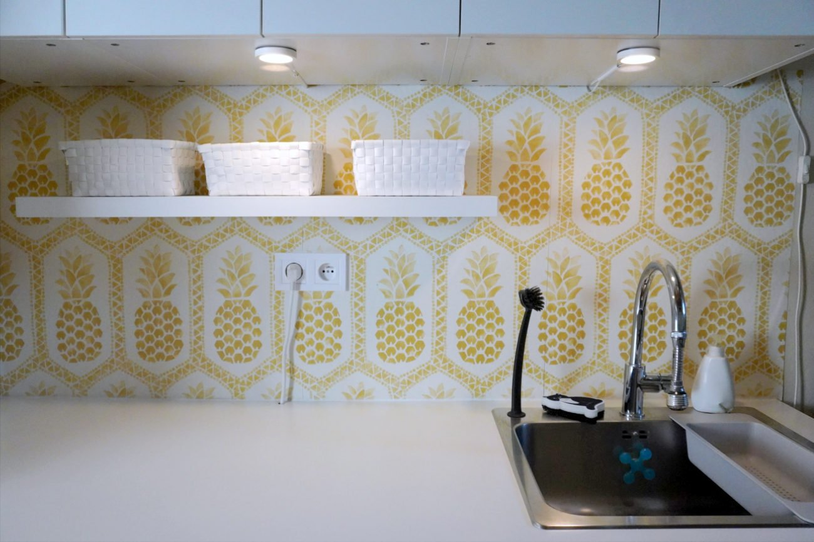

*There is one room in our house that will never win a beauty contest. It lacks the carefully styled open shelving or that vintage chair everyone seems to have. No curated design details here. Nobody is showing off detergent bottles or a washing machine violently trying to escape its spin cycle. And yet? After more than ten years of living here, it’s the one space I value above almost all others.*

<Caption>
Image credit: Staying Cosy
</Caption>

I am talking about the utility room. That messy, multi-purpose, completely unglamorous engine room every real house needs. It’s the one spot behind a closed door where life can just sit. Untidy. No judgment.

But before we get into why I dug my heels in on this space during our home build, we need to go back to day one.

Look at any property listing. The mainstream idea of a home is closer to a fantasy than real life. It's all impeccably fluffed-up linen pillows and woolly throws draped just so. Everyone praises the living room. But backstage? The utility room is keeping the whole show running.

## Home's Engine — The Humble Technical Layout Deserves Proper Status

Right in the middle of working with our architect, we went through a much-needed visiting stage. It is exactly what it sounds like. We toured newly built houses in our area because we needed to get a proper feel for scale. We wanted to touch the materials with our own hands. Staring at a computer screen just wouldn’t cut it.

While chatting with the homeowners, I always slipped in this question: ‘Which room do you use the most?’

I expected them to say the kitchen. Or maybe the living room. Instead? The utility room kept coming up. House after house.

> “Before you sketch your floor plan, listen to seasoned homeowners. Square footage spent on utility is the best investment you’ll ever make.”

It was one of the first hard lessons we learnt while planning our own build. Those neighbourly chats made us tear up our layout plans more than once.

Utility room goes by many names. Technical room, laundry room, mud room, or a chaotic combination of all three. For simplicity, let’s just call it the *utility*.

Whatever name you pick, the space deserves proper status in a floor plan. It shouldn't be banished to some awkward, dark corner of the cellar that requires a head torch and a map to find. It needs to be easily accessible. Why? Because this is where the boring, repetitive grind of everyday life takes place.

Let's be clear. There is no universal blueprint for this space. No magic square footage. The layout depends entirely on your circumstances. Some homes just need a basic laundry cupboard, others require a heavy-duty plant room for technical kit. Most of us, though, need it to handle absolutely everything at once.

## Our Homes’s True Work Horse

The quiet humming of the central ventilation unit? Utility. The cat bowl washing area with all those cleaning sponges? Utility. Grass-stained T-shirt that needs soaking? Utility sink. Charging lawn-mower batteries? Hmm… where could that possibly be?

<Caption>
Image credit: Staying Cosy
</Caption>

And I could keep going on and on.

Needless to say, our utility was a non-negotiable from the very beginning. Hiding the boiler and heating equipment inside a bathroom cabinet never made sense to me.

Yes, we could have saved some floor area by doing that, but our HMRV unit alone is a rather substantial piece of equipment. Add all the industrial-looking pipework around it, I wasn’t convinced any bathroom would benefit from becoming its new home.

The advice we received from other homeowners only cemented our decision. Having a dedicated, decent-sized utility was worth the space it would take.

We placed ours on the central north edge of the house, between two bathrooms, within a modest footprint of 6 m² (around 65 sq. ft). It combines:

- technical room
- laundry
- pantry
- household storage

> “A utility room isn’t wasted space. It’s four functions in one room instead of four squeeze-me-where-you-can afterthoughts.”

One space, multiple jobs. Idealised living meets reality face-to-face, and reality wins. After living with ours, I understand why every home needs a utility room.

## What Makes Our Utility Function so Well

There were a few decisions that helped this room function well. Some were specific to our plot and our house layout, but I believe they can still offer enough inspiration.

### North Placement

We placed our utility on the central north edge of our house, between two bathrooms.

<Caption>
Graphic: Staying Cosy — made in Canva
</Caption>

From a design perspective, this made perfect sense. Since it is a purely functional space, we could reserve the southern exposure for the rooms where we spend most of our time. The central position also gave us easy access from the rest of the house and helped keep the ventilation ductwork more efficient, with shorter and more balanced routes throughout the home.

This was also one of those pieces of advice we received from other homeowners, technical decisions often have a surprisingly big impact on everyday comfort.

If you’re looking for more utility placement ideas within your home’s blueprint, check at my [eco home layouts](/blog/single-storey-eco-house-layouts), which are suitable for every plot orientation.

### Strategic Windows

A small window was essential for natural ventilation and already brought a moderate amount of daylight into the room. But to brighten it even further, we added an elongated transom window high up near the ceiling, connecting the utility with our smaller bathroom.

<Caption>
Image credit: Staying Cosy
</Caption>

This bathroom have similarly sized north-facing window, and the transom allows borrowed light to travel between them. It was such a simple decision, but it made both spaces feel much brighter and more pleasant.

If you have the possibility, bring natural light wherever you can. Almost every room benefits from this small but impactful improvement.

### Cork Flooring

Because this room also handles laundry, I find myself kneeling down quite often.

As you might know, I am not particularly drawn to flooring tiles. We chose [soft cork](/blog/natural-materials-around-my-home) underfoot instead. And while it cannot compete with ceramic tiles when it comes to durability and resistance, I still stand by that decision completely.

The floor is a pleasure to walk on, to kneel down on, and it even helps absorb most of the washing machine’s turbulent spin cycles.

I just love it.

### Large Utility Sink

Having at least one massive, deep, mercilessly hard-working sink in a house is pure gold. No exaggeration. Go for industrial stainless steel. You shouldn't have to baby a utility sink. It needs to handle harsh chemicals, raw dirt and total abuse without you worrying about scratches.

<Caption>
Image credit: Staying Cosy
</Caption>

Just having a proper basin to soak muddy clothes is a win already. But it goes way beyond laundry. It’s where I wash delicate flower vases, oversized baking pans that won't fit anywhere else, cat bowls, and paintbrushes covered in crusty acrylics from my kids' art projects. It’s where filthy gardening gloves get a rinse and muddy hands get scrubbed before they track dirt across the house.

A giant sink isn’t exactly the most glamorous thing to plan during a home build. But once you have one? You genuinely wonder how you survived without it.

### Sound Proofing

Because our utility sits right in the dead centre of the floor plan, noise was always going to be an issue. It needed [heavy-duty soundproofing](/blog/holistic-acoustic-home-design-guide) from the surrounding rooms. Honestly, nobody wants to listen to a washing machine violently fighting for its life on a final spin cycle while they're trying to unwind on the sofa in the evening.

I obsessed over this long before the first beam was laid. Soundproofing isn't some high-brow design theory. If you don't deaden the walls properly, that spinning drum will vibrate straight through your home.

To fix it, we boxed the space in using dense, insulated walls. Even the door is a heavy, solid wood piece fitted with acoustic seals right round the edges.

The result? After more than ten years, I can only hear the washing machine if I really listen out for it. Considering our model is a bit of an ancient relic now, and definitely not the quietest machine on the market, I’d call that a massive success.

Getting the acoustic details right meant we could put a hardworking engine room exactly where it made sense geographically, without destroying the peace and quiet of the rest of the house.

### Built-In Storage

I dare to say our utility is almost like a second [little kitchen](/blog/tiny-kitchen-clever-design-tips). Inside, it’s a mix of a workspace countertop, upper cabinets, and under-sink drawers, plus a set of pantry shelves that have grown slightly excessively over the years.

<Caption>
Image credit: Staying Cosy
</Caption>

It holds an insanely chaotic ecosystem of stuff. We’re talking everything from lawnmower batteries, bin bags, and window cleaner to sewing kits, birthday candles, piles of recycling, and emergency long-life pantry foods.

Having one dedicated place for all those random household necessities eliminates pockets of mess throughout the house and narrows down the search to one small zone.

In this room, storage really *is* everything.

## What I Would Absolutely Do Again and What I’d Change

After using our utility almost every single day for the past ten years, there are a few things I am genuinely happy with and would happily recommend.

**Would absolutely repeat:**

- Cork flooring
- Large sink
- Sound proofing
- Combined functions
- Built-in storage

And as we all know, nothing is ever completely perfect, especially when you are designing something for the first time.

**Would definitely change:**

- Electrical sockets

I find it difficult to admit, but I have exactly two. It’s a double socket located above the counter where the washing machine sits, originally intended for the washer and a possible future dryer I never got.

<Caption>
Image credit: Staying Cosy
</Caption>

That’s it. No charging station for batteries, no socket for an occasional hot glue gun or vacuum sealer. I know a utility is considered something of a wet room, but still… only two?

*What was I thinking?*

Back then, I suppose we didn’t realise just how much we would rely on this room. If there is one piece of practical advice I can leave you with, it’s this: you’ll almost certainly need more electrical sockets than you think.

**Other possible upgrades:**

- An exterior door
- A floor drain
- Better pantry organisation

An exterior door would certainly be useful, but in our case, it was an intentional compromise. Our northern wall faces a narrow strip beside the neighbour’s garden, which isn’t really a natural access route. You know, that side of the house you only visit when pulling weeds.

We also have a large sliding door just a few steps away, so we never really missed having another entrance. Would I recommend one? Absolutely, if your location makes sense for it.

A floor drain was actually a recommendation from our elderly neighbour, who swears by having one. And I understand why. In later years, lifting heavy buckets of water around the house is not exactly appealing.

Still, with my trusty spray mop, I honestly don’t miss it. The large utility sink already gives us a practical place for dealing with water, cleaning tools and general mess. Useful? Yes. Essential? Not for us.

Better pantry organisation is still a work in progress. Our utility has plenty of storage, but I would plan this section more intentionally from the beginning. Full-height storage along the right wall would give food supplies and household back-ups a proper home.

## The Little Things I Still Love

There are a few little details that make me smile every time I walk in.

The wallpaper was our boldest decision. While our utility is an unapologetically practical space, that doesn’t mean it has to be boring. In fact, I think these are exactly the rooms where you can be a little braver with design.

<Caption>
Image credit: Staying Cosy
</Caption>

The gold pineapple wallpaper was an instant favourite of mine. The splashback behind the sink turned out to be the perfect place for it, and I even used some leftover pieces in our smaller bathroom.

Sorting washing by colour feels a little more cheerful when the walls don’t take themselves too seriously.

Then there is the plywood cabinet we built around the electrical switchboard. It started out as a practical solution to hide the switchboard and some rather unattractive pipework.

During the [design process](/blog/eco-friendly-building-guide-materials-principles), we realised there was just enough depth to incorporate hidden toilet roll storage as well.

> “It still feels oddly luxurious every time I reach for a fresh roll from our hidden toilet roll dispenser.”

I know these aren’t life-changing features. They don’t make the room work any better, but they remind me that even the most mundane areas deserve a bit of personality.

## Behind Every Beautiful House Is a Space Doing the Dirty Work

<Caption>
Image credit: Staying Cosy
</Caption>

Looking back, I don’t see six square metres that could have been added to the living room. I see one of the hardest-working spaces in our home.

What I value most is that our utility was never built to impress a single soul. And honestly? Maybe that’s the real secret to a functional home. It’s about investing in the corners that make your day-to-day life just a little bit easier. Even when the door is closed and nobody is looking.

---

**☘︎ Looking for more ideas about holistic home?**

*•* [*Biophilic Interiors: The Soul of a Living Home*](/blog/biophilic-interiors-living-home)

*•* [*Why Fresh Air is the Foundation of a Healthy Interior*](/blog/fresh-air-in-home)

*•* [*Mould Keeps Returning? Get Rid of It for Good*](/blog/mould-keeps-coming-back-how-to-stop-it)

SEARCH THE BLOG

