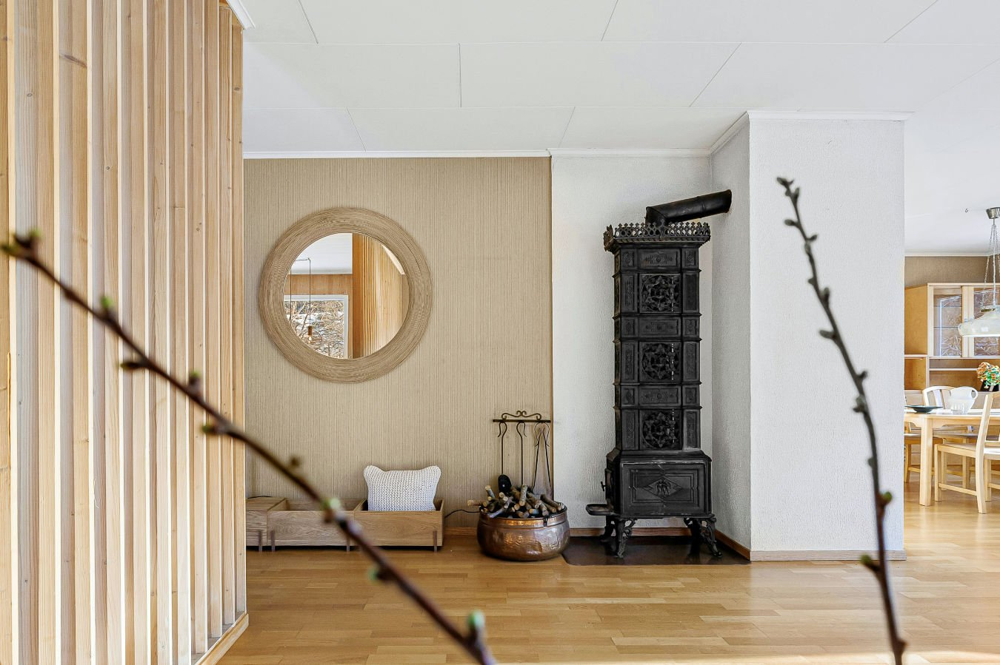
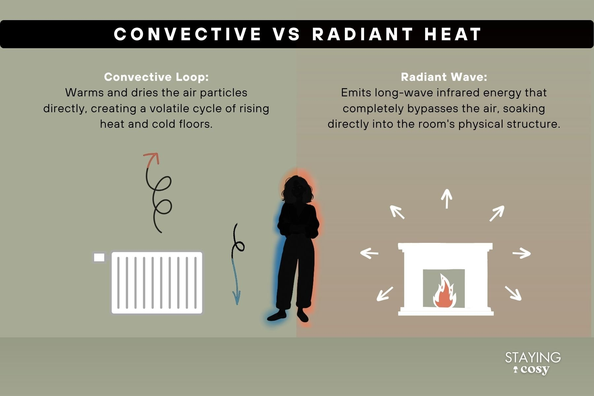
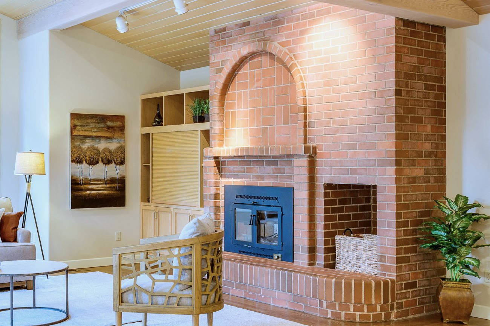
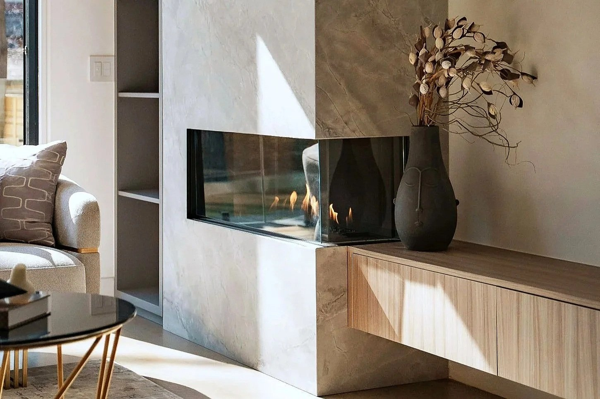
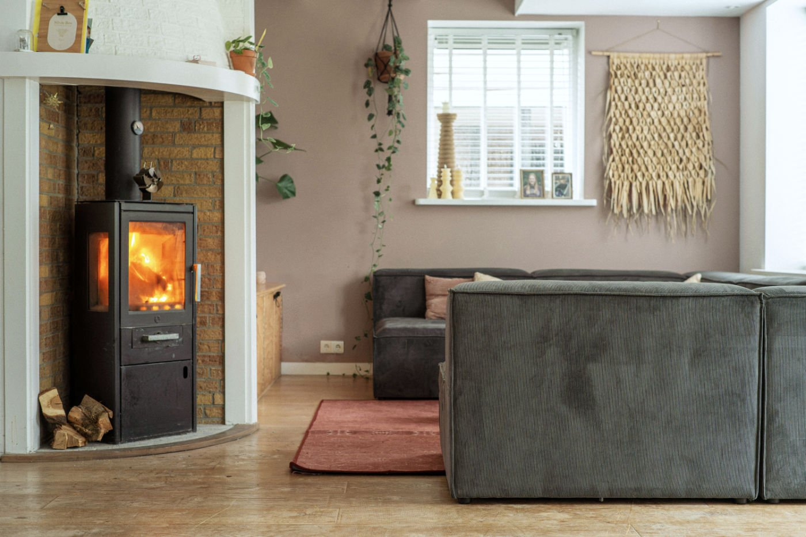
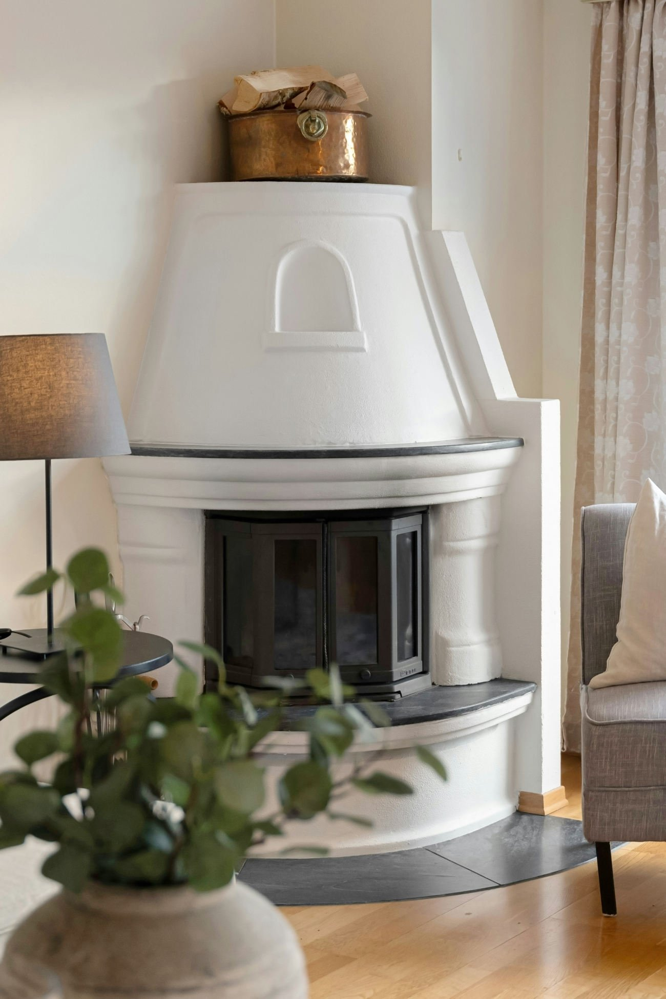

*My fascination with fire places started on a faded rug in my great-grandmother’s bedroom. Smack in the middle of the large, draughty room sat the tiniest black iron stove I’ve ever seen. It didn’t work. The pipe was disconnected, the grate was rusted completely shut, and as a heating source, it was entirely useless. But boy, I loved it.*

<Caption>
Image credit: [Lisa Anna](https://unsplash.com/@lisaanna195?utm_source=unsplash&utm_medium=referral&utm_content=creditCopyText) on [Unsplash](https://unsplash.com/photos/a-living-room-filled-with-furniture-and-a-fire-place-uTOwsVzFDyY?utm_source=unsplash&utm_medium=referral&utm_content=creditCopyText)
</Caption>

I used to sit next to it, completely mesmerised by its silent presence. It felt like the room’s anchor. Decades later, I realised my childhood obsession wasn’t just a weird quirk. It was an instinctive appreciation for an ancient architectural truth; a home is meant to be built around a hearth.

Today, the sustainability machine tells us that the future of home heating is completely invisible, driven by a quiet, monotonous hum. We are urged to dismantle our brick chimneys, pitch our matches into the bin, and hand over our thermal comfort to an automated air-source heat pumps sitting outside in the rain. And yes, they are incredibly convenient. They keep a clean climate baseline steady in a sealed house.

Yet, our collective obsession with the traditional oven stove refuses to die. It isn't just my own fixation either; a few of my friends have them sitting proudly in their kitchens right now, even alongside modern appliances. We just can’t seem to let go of the idea.

## Where Did Oven Stoves Come From?

The truth is, we are hardwired to want them. If you look back at traditional homes across Europe, the heavy masonry oven stove sat dead in the centre of domestic life. It wasn't a decorative feature or a design statement. It was the literal engine of the household. It cooked the stews, baked the weekly sourdough, dried the damp woollen socks, and kept the family warm. I still remember childhood fairy tales where characters would climb up and sleep right on top of the massive clay stove body to escape the winter frost.

Our stubborn refusal to give this up isn’t just soft, nostalgic sentimentality. It is a biological revolt. That engineered mechanical breeze will simply never replicate the bone-deep comfort of an oven stove.

Here is why the modern electrical grid keeps failing to replace a giant pile of heavy brick.

## Why Blown Air Feels Flawed — Radiant vs Convective Heat

To understand why we still cling to the classic wood stove, we need to look at how hot air moves around us. Most modern setups, especially radiators, rely on pushing warm air around. In the tech world, they call it convective heat. But let’s just call it something more pleasant for now, like a mechanical breeze. The system heats the air, that hot air shoots straight up to the ceiling because it’s light, cools down against the plaster, and drops back to the floor.

It’s a non-stop, rolling loop. And to be honest, it feels somewhat — wrong. It dries out your eyes, stirs up every bit of hidden dog hair, cooks your forehead, but still leaves your toes completely freezing. It feels a bit like sitting under a giant hair dryer. Clinical.

A traditional masonry oven operates on a completely different wavelength. Literally. It’s all about radiant heat.

<Caption>
Graphic: Staying Cosy — made in Canva
</Caption>

Instead of aggressively cooking the air, a massive stone or clay body slowly releases long-wave infrared energy. It’s the exact same type of warmth you feel on your skin when you step into the sunshine. It omits the air entirely. The energy travels straight through the room until it bumps into something solid, like your oak table, a lime-plastered wall, or your own chilly shoulders. It ignores the air entirely and just warms you. From the inside out.

When you compare radiant heat with forced air, the real wizardry hides inside your walls. A proper masonry heater ignores the flighty, fast-moving air and focuses on warming the heavy bones of the house. That means the warmth stays put. You can open a window, let in a blast of crisp winter air, shut it, and the room feels instantly cosy again. No waiting around.

Why? Because the room itself is holding onto that energy like a giant thermal battery. It’s exactly why people hunting for sustainable home heating options or the best eco friendly heating for old houses always end up looking at traditional brick or solid wood; you just can’t replicate that deep, structural soak.

## Three Heavyweight Alternatives to the Standard Fireplace

When I say *oven stove*, I am not talking about a cheap, sheet-metal log burner you buy at a local DIY store. Those boxes blast intense, aggressive heat for an hour. They roast everyone out of the room, and then go freezing cold the second the wood turns to ash.

True thermal safety requires serious structural mass. Historically, this wasn't a luxury. It was basic survival. Walk through old European castles or centuries-old country homesteads. They didn’t have tiny metal heaters tucked into a dark corner. They built massive, beautiful masonry stoves right into the structural walls to heat vast, cold stone spaces that a convective vent could never touch.

If you are looking to bring this kind of permanence into a modern home, you are generally looking at three very different paths.

**1. The Traditional Masonry Oven Stove (*Kachelofen*)**

<Caption>
Image credit: [Francesca Tosolini](https://unsplash.com/@fromitaly?utm_source=unsplash&utm_medium=referral&utm_content=creditCopyText) on [Unsplash](https://unsplash.com/photos/brown-and-grey-room-interior-LL9V0iMpStM?utm_source=unsplash&utm_medium=referral&utm_content=creditCopyText)
</Caption>

The absolute peak of European craftsmanship. These are massive, bespoke structures featuring an internal labyrinth of winding brick smoke channels wrapped in thick ceramic tile or heavy plaster. You light one incredibly hot fire for two hours. Then you shut the flue dampener, and walk away. The internal brick network absorbs the intense energy and slowly feeds it back to the house for the next twenty-four hours. Finding an experienced craftsman to build one today is like hunting for a unicorn, but it is a lifetime investment.

**2. The Soapstone Stove**

<Caption>
Image credit: [Thom Bradley](https://unsplash.com/@thombradley?utm_source=unsplash&utm_medium=referral&utm_content=creditCopyText) on [Unsplash](https://unsplash.com/photos/a-room-with-a-fireplace-and-a-shelf-with-a-plant-in-it-0N5YRJgb0js?utm_source=unsplash&utm_medium=referral&utm_content=creditCopyText)
</Caption>

Nature’s perfect thermal battery. Soapstone has a unique volcanic density that conducts and retains heat far better than standard firebrick. It acts like a massive thermal sponge, smoothing out temperature peaks and providing incredibly clean, allergen-free air. The most popular ones you can encounter in Europe are the Finish [Tulikivi](https://www.tulikivishop.com/en_GB).

**3. The Heat Accumulation Fireplace**

<Caption>
Image credit: [Sven Brandsma](https://unsplash.com/@seffen99?utm_source=unsplash&utm_medium=referral&utm_content=creditCopyText) on [Unsplash](https://unsplash.com/photos/cozy-living-room-with-wood-stove-fRx9CBTvL-E?utm_source=unsplash&utm_medium=referral&utm_content=creditCopyText)
</Caption>

This is the modern, pragmatic hybrid setup. It uses a heavy fireplace insert, but instead of letting the heat escape, it’s fitted with heavy cast-iron or ceramic accumulation rings stacked on top of the firebox. The rings absorb the raw energy and radiate it outward. Some people attach hidden pipe networks to these setups to siphon warm convective air to other rooms.

It works well, but truth be told, the moment you add those blowers and air ducts, you lose some of that pure, silent radiant magic and trade it back for moving air. Still, if you want a clean aesthetic, it's one of the best accumulation fireplaces around. It balances old-school heat with modern drywall lines.

## The South African Lesson — How to Burn a Forest and Stay Freezing

We don’t usually appreciate our own homegrown habits until we travel to the other side of the world. My husband is originally from South Africa. It’s a country famous for its magnificent sunshine, but its winter interiors can absolutely break your spirit.

Because the climate is mostly glorious, traditional South African houses are basically built like giant summer pavilions. We are talking soaring ceilings, massive tiled floors, zero insulation, and window frames that treat draughts like welcome guests. When we visited his family at the beginning of winter, I watched piles of logs arrive at the doorstep. All of it was destined for a simple iron fireplace. That was the main heat source for the entire house. Really.

Needless to say, after a brief chat with my sister-in-law, I confirmed what I already suspected. It was wildly uneconomical. Beautiful, yes, but incredibly inefficient. Every single bit of that precious heat rushed straight up the chimney, while icy air kept seeping under the doors just to feed the flames.

I tried my best to explain the basic principles of wood accumulation stove efficiency to her. I sketched out how a heavy stone mass would work magic in an open-plan space like theirs. But I felt like I was failing miserably. It’s hard to sell the concept of a giant brick box when you're both shivering. I promised myself that day, I would write a blog post about it. Something clear and comprehensive, explaining this beautiful form of heat with all its perks.

So, this is it.

## The Eco Angle — The Truth About the Clean Burn & Grid Resilience

Can we genuinely talk about wood stoves as a sustainable choice anymore? Or are we just committing a carbon-heavy crime every time we strike a match?

<Caption>
Image credit: [Alex Tyson](https://unsplash.com/@alextyson195?utm_source=unsplash&utm_medium=referral&utm_content=creditCopyText) on [Unsplash](https://unsplash.com/photos/a-living-room-filled-with-furniture-and-a-fire-place-8_nnMW5jQG8?utm_source=unsplash&utm_medium=referral&utm_content=creditCopyText)
</Caption>

Let’s see. If you are throwing damp, unseasoned logs into an old, leaky iron stove, it is an absolute environmental disaster. Black smoke, choked flues, the lot. But a modern, high-tech masonry heater is a completely different beast. Because the internal firebox gets incredibly hot, we are talking over 800°C (or nearly 1,500°F) within minutes, the wood burns completely clean. All that smoke that usually pollutes the air gets trapped and burned off inside the stone chambers before it ever has a chance to reach your chimney pot.

Wood is just stored solar energy. When harvested properly, it's a brilliant, renewable way to handle carbon neutral home heating.

But here is the real kicker that the heat pump crowd likes to gloss over — grid resilience. A heat pump is a fantastic tool, but it is utterly helpless without a constant stream of electricity. If a winter storm rolls in, takes out the power lines, and drops the grid, those sleek outdoor units turn into very expensive garden ornaments.

A masonry stove doesn't care about power cuts. It offers absolute, off-grid safety. While the neighbourhood goes dark and the modern systems shut down, a home with a heavy, heat-retaining stove stays completely warm, secure, and self-sufficient. No plugs required. It’s exactly why eco friendly wood burning stoves are making a massive comeback for people who want a backup plan that actually works.

## The Plot Twist — Why We Kicked Out Our Own Chimney

So, if I am this hopelessly in love with masonry stone stoves, why on earth did my husband and I choose to leave the chimney out of our own home build?

Ironically, when we first mapped out our sustainable home architectural blueprint, we planned the entire open-plan ground floor around a massive, custom-built stove. It was going to be the absolute heart of our space.

But as our technical calculations evolved, we hit a hard reality check. We were building an ultra-insulated, completely airtight eco-home with a high-efficiency [MVHR ventilation system](/blog/clean-air-home-ventilation-mvhr-guide).

In a modern, highly sealed envelope, even the smallest masonry oven stove can easily cause thermal overshoot. It would dump so much heavy energy into the space that it would turn our living room into a literal sauna within an hour. We would have been forced to open the windows just to survive the heat, completely destroying our eco-credentials.

Ultimately, we settled on a simple hydronic underfloor heating system. And for atmosphere we added an ethanol fireplace. I’m not sorry. Our underfloor pipes distribute heat using the exact same low-temperature radiant principles as an old stone stove. It keeps our feet warm, our air still, and our dust down.

Keep that in mind if you're browsing passive house heating options or [planning your own project](/blog/eco-friendly-building-guide-materials-principles).

## The Best Accumulation Stove for Your Architecture

You don’t need to reject modern progress to love the ancient ritual of fire. If you are taking on sustainable home refurbishments for an older, moderately insulated home or a countryside cottage, a heavy masonry or soapstone stove remains one of the single best investments you can make.

It grounds a room. It slows down your tempo, forcing you to gather wood, tend a flame, and respect the slow release of natural energy.

Modern electrical heating boxes can keep you comfortable. But if your architecture allows for it, there is nothing quite like a radiant hearth to make a room feel complete.

---

**☘︎ Find out more ideas about sustainable living:**

*•* [*The Best Type of Fireplace for Winter Sofa Snuggling Through an Eco-Lens*](/blog/the-best-type-of-fireplace-for-your-needs)

*•* [*Why Mould Keeps Returning and How To Prevent It*](/blog/mould-keeps-coming-back-how-to-stop-it)

*•* [*The Seamless Bathroom Dream: Is Micro-Cement the Tile Killer?*](/blog/micro-cement-in-bathroom)

SEARCH THE BLOG

