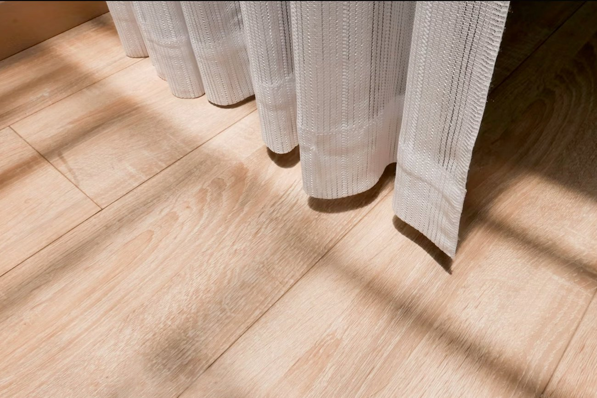
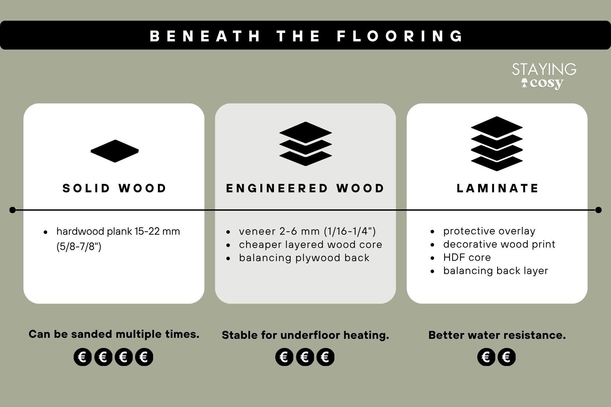
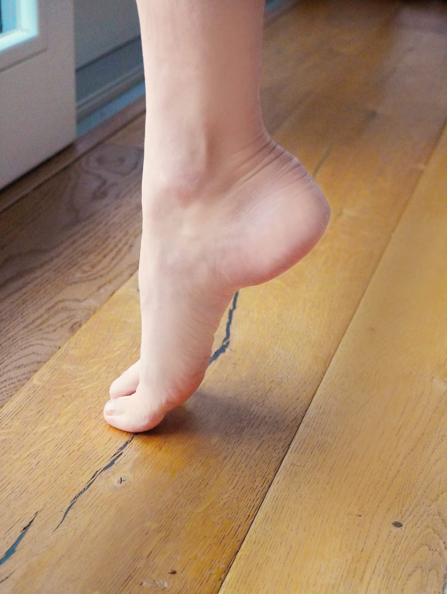
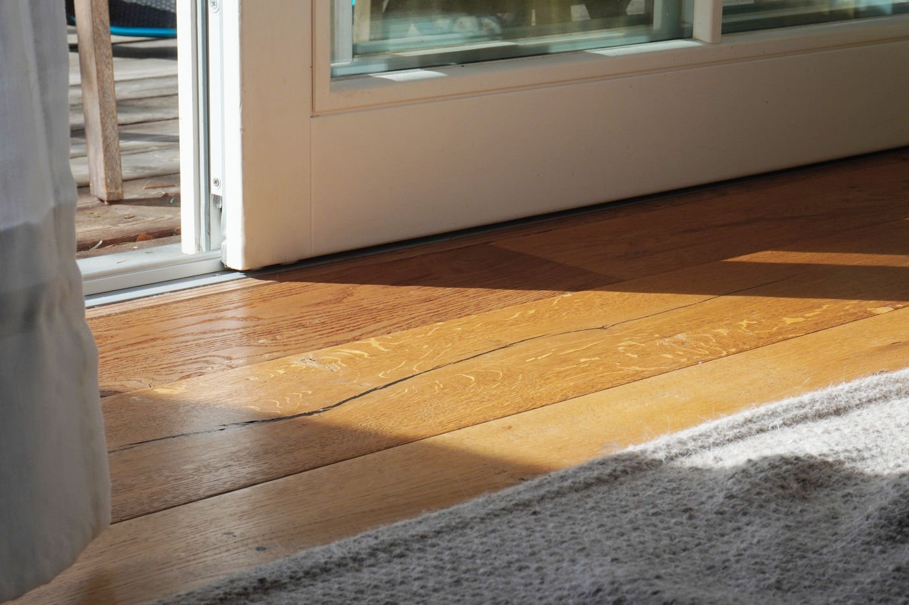

*I’ve seen my fair share of floors over a lifetime of moving. I've learned that a floor isn't just a surface, but the stage where our lives happen. Decades ago, a wooden floor was an honest material. It was solid timber, protected by beeswax or oil, and what you saw was exactly what you got. Not anymore.*

<Caption>
Image credit: [A65 Design](https://unsplash.com/photos/white-window-curtain-on-brown-wooden-floor-IpVDFPg5_lU) on [Unsplash](https://unsplash.com/@huutin23)
</Caption>

Today, that authenticity is harder to find. We’ve become masters of the ‘look’. What appears to be oak under your kitchen table might be a clever photograph printed on plastic, or a composite of wood dust and resin.

In our own home, wood was non-negotiable. I wanted the soul of it. But as I dove into the research, I found myself pausing. With the leap in modern woodworking, I kept asking myself: *Is the traditional choice always the most mindful one for a busy family life?*

I am not crowning a winner here. This is an honest look at whether a high-tech alternative can truly earn its place in a [slow-living home](/blog/holistic-interior-design-guide-101), or if real wood still holds something irreplaceable beneath our feet.

And just so we’re on the same page: when I talk about real wood, I’m referring to solid timber and its layered cousin, engineered wood. Everything else, the wood-look laminates and composites, we’ll call laminate.

## The Look, the Feel, and the Patina

Whether it’s classic oak, deep walnut, or a weathered aged finish, today you really can have it all. But there is still a deeper question to consider. **Does this floor become more beautiful with time, or does it ask us to tiptoe around it?**

While real wood is limited to what nature provides, modern stains and oils can coax a hundred different shades out of a single oak plank. Laminate, on the other hand, offers endless options, as the surface is essentially a high-resolution photograph.

But my senses aren't so easily tricked. For me, it’s about the feeling — the natural warmth and slight *give* that only real wood offers. Laminate often feels cold and clinical, a look-alike that mimics the grain but misses the soul.

Then there is the matter of aging. Real wood is a living material. Its beauty, surprisingly, often comes from wear.

> “A scratch in the wood isn’t a flaw; it’s a record of life — of children learning to bake, of furniture being moved, and of a house becoming a home.”

Those little indents act as **imprinted memories**. When the surface gets tired, it can be sanded and healed. Laminate, however, is a perfect image that can only decline. Once it chips or wears through, it cannot be repaired; it must be replaced. It doesn't age, it simply expires.

## The Soul of the Material — Sustainability and Health

Appearance can be deceiving. In a holistic home, health is paramount, and knowing what lurks beneath an innocent-looking surface is vital when making a decision you’ll live with for decades.

So, how does the composition of different floors look like?

<Caption>
Graphic: Staying Cosy - made in Canva
</Caption>

### Longevity as Sustainability

Which floor is really more eco-friendly? One with lesser glued layers? One that looks impeccable for the first five years but only acceptable for the next ten? Perhaps it’s a floor that can last a century.

While careful maintenance prolongs the life of any surface, wood’s endurance is incomparable. Its sustainability starts with its natural origin and finishes with its end-of-life story. When wood eventually completes its journey, it returns to the earth or can be recycled. Laminate, however, has a general lifespan of only about 15 years. Once it fails, it heads straight to a landfill, a plastic-heavy cycle that repeats every decade or two.

### Breathability and Indoor Air

When we speak of real wood, we must also mention its natural sibling — cork. Both are raw, organic products that offer natural moisture regulation. More importantly, they are traditionally low in Volatile Organic Compounds (VOCs).

In contrast, laminates and vinyls are petroleum-based. Because laminate manufacturing relies heavily on synthetic glues and resins, they are often prone to *off-gassing.* We essentially want a home that breathes with us, not one that emits chemical vapours. As the [American Lung Association](https://www.lung.org/clean-air/indoor-air) points out, choosing low-emission materials is a critical step in maintaining healthy indoor air. You can read my deeper dive into the VOCs [here](/blog/chemicals-that-pollute-our-living-rooms).

#### 💡 **What is Formaldehyde?**

It is a common VOC found in cheap laminate resins. Look for [**GREENGUARD Gold**](https://www.ul.com/resources/ul-greenguard-certification-program) certification or [**Floor Score**](https://www.scsglobalservices.com/services/floorscore-certification) label when shopping for your planks to ensure these levels are near zero.

## Sensory Comfort and the Barefoot Test

I have both [wood and cork floors](/blog/natural-materials-around-my-home) in my home, and what I love most about them is the warmth they provide. To understand why, we have to look briefly at the physics of touch.

### Warmth and Thermal Touch

<Caption>
Image Credit: Staying Cosy
</Caption>

Our bodies are constantly trying to balance their temperature with the environment. When your bare feet, usually around 30°C (86°F), touch a surface, that surface either steals your heat or helps you retain it.

Because wood is a natural insulator, it has a low thermal conductivity. It doesn’t pull heat away from your skin, so it feels warm and inviting. Laminate, however, is a dense, high-pressure composite. It often feels cold and clinical to the touch, especially on a winter morning. While underfloor heating can offset this, there is a natural, *sun-warmed* quality to real wood that synthetic surfaces simply can’t replicate.

If you want to see this physics in action, try this simple experiment at home. It’s the ultimate proof that our floors are not just static surfaces, but active participants in our comfort.

#### ☘︎\*\* **The** \*\*Barefoot Experiment

*Find a spot where two different surfaces meet — perhaps a wooden hallway and a tiled bathroom. Stand with one bare foot on each for 60 seconds.*

*Notice which foot feels "drained" and which remains content. It is the simplest proof that our floors are active participants in our comfort, not just static surfaces.*

### Softness and ‘The Give’

Beyond simple comfort, the natural elasticity of real wood mirrors a slower pace of life. This gentle resilience makes it possible to stand by the stove for hours, stirring a slow-simmering meal, while keeping our joints rested and at ease.

There is a reason professional dance floors were traditionally made of solid wood with a flexible underlay. It protects the body. While a soft area rug can help cushion a harder laminate floor, it can’t replace the structural give of a natural material beneath your feet.

### The Sound of Home

Have you ever had a neighbour who walked in high heels across a laminate floor? I have. The sharp *click-clack* hollow sound adds an unnecessary layer of background noise to a home that should be a sanctuary. Natural wood, on the other hand, enhances the quiet of a slow-living space. Instead of a sharp, echoing click, it provides a dull, solid *thud* that absorbs sound rather than reflecting it. It is a sound that feels as grounded as the trees it came from.

## Practical Reality — Living with Your Choice

Choosing a floor for a slow-living home means accepting that life is rarely a curated photo. Spills happen, furniture is dragged across the room, and muddy paws are a daily reality. To make a mindful choice, we have to look past the showroom glow and ask one more question.

> “How does this material handle the mess of real life?”

### The Best of Both Worlds — Engineered Wood

Before I dive into the demands, I’d like to point out the difference between solid and engineered wood. While solid timber is a single slice of tree, engineered wood is a clever hybrid. It features a top layer of genuine hardwood, thick enough to be sanded and refinished, bonded over stable, layered plywood.

It’s the version of *real wood* that allows us to enjoy the luxury of underfloor heating without the fear of the floor warping. It sits perfectly in that sweet spot between tradition and modern comfort, offering the soul of timber with a structure built for today’s homes.

### Resilience vs Repairability

As a living material, real wood is sensitive to its environment. Its greatest enemy is **standing water**; a major leak or a forgotten spill can cause timber to warp or cup. It requires a level of care — a quick wipe after a splash — that synthetic floors simply don't demand. However, there is a certain ‘wabi-sabi’ beauty here. A scratch on a wooden floor isn't a ruined product. It is a mark of a life well-lived which, even in a worst-case scenario, can be repaired or sanded away.

This is where laminate and vinyl take the lead. If you are designing a mudroom or a laundry space where puddles are a daily occurrence, these materials offer a stress-free resilience that wood cannot match. But there is a trade-off. While they are harder to damage, they are impossible to fix locally. Once the protective top layer of a laminate plank is breached or the core swells from a leak, the damage is permanent. You cannot sand away a mistake on plastic.

To help you weigh these trade-offs, I’ve put together a quick comparison of how these materials stand up to the *real world*.

<Caption>
Brief overview of wood & laminate performance, value and sustainability.
</Caption>

## The Investment — Cost vs Value

In the slow-living world, we look at the cost per year rather than the price at the checkout. Budgets are finite, and if a property is intended as a short-term investment or a quick rental rather than a ‘forever home’, the urge to save on materials is strong. Regardless, there is a hidden price to the affordable choice that only reveals itself over time.

### Initial Price and Long-term Benefits

Laminate absolutely wins on the initial receipt. It is affordable, accessible, and quick to install, making it the hero of the weekend DIY project. But when we zoom out, the math changes.

Once you factor in that real wood can last 50-100 years, the annual cost of wood is actually much lower. You are virtually buying the next century of your home’s history. Real wood doesn't just hold its value; it appreciates, often becoming the most sought-after feature for future owners who value authenticity.

### The Replacement Trap

Going for laminate often means committing to a cycle of ‘planned obsolescence’. Every 15 years, as the edges fray or the image fades, you are faced with the upheaval of ripping out the old and buying the new. This cycle is the antithesis of slow living.

Real wood is an investment in the future value of your home and the planet. It becomes a responsible long-term decision. Instead of a landfill-bound product, you are choosing a surface that can be healed, sanded, and refreshed. A floor that grows more soulful with every passing decade.

## The Verdict — Which Floor Fits Your Life?

<Caption>
Image Credit: Staying Cosy
</Caption>

In case you are standing at the threshold of a major renovation or buying a house in which to raise a family, the pressure to decide *correctly* can be overwhelming. If you haven't yet found your flooring champion, here is a final breakdown to help you decide:

- **Choose real wood if:** You prioritise the sensory *barefoot* connection, value superior indoor air quality, and want a floor that will age alongside your family, telling your story through a beautiful, lived-in patina.
- **Choose laminate if:** You are in a season of life where high-moisture resilience or immediate, budget-friendly durability is your priority. It is a practical floor for a specific time and place.

There is no perfect choice. Only the choice that works for you. While I lean heavily toward natural materials, this is a blog about slow living, after all — there is no judgment here. The goal isn't to achieve a flawless interior, but to create a comfortable home that is aligned with your expectations.

Take your time, trust your feet, and choose the foundation that makes you feel most at peace.

---

**☘︎ You may enjoy reading further:**

[*Experience Sensory Cleaning Reset*](/blog/eco-friendly-spring-cleaning-rituals) *|* [*Pick the Best Performing Fireplace for Your Home*](/blog/the-best-type-of-fireplace-for-your-needs)

SEARCH THE BLOG

