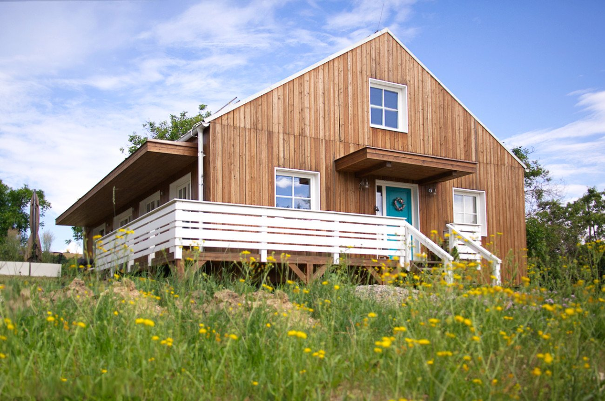
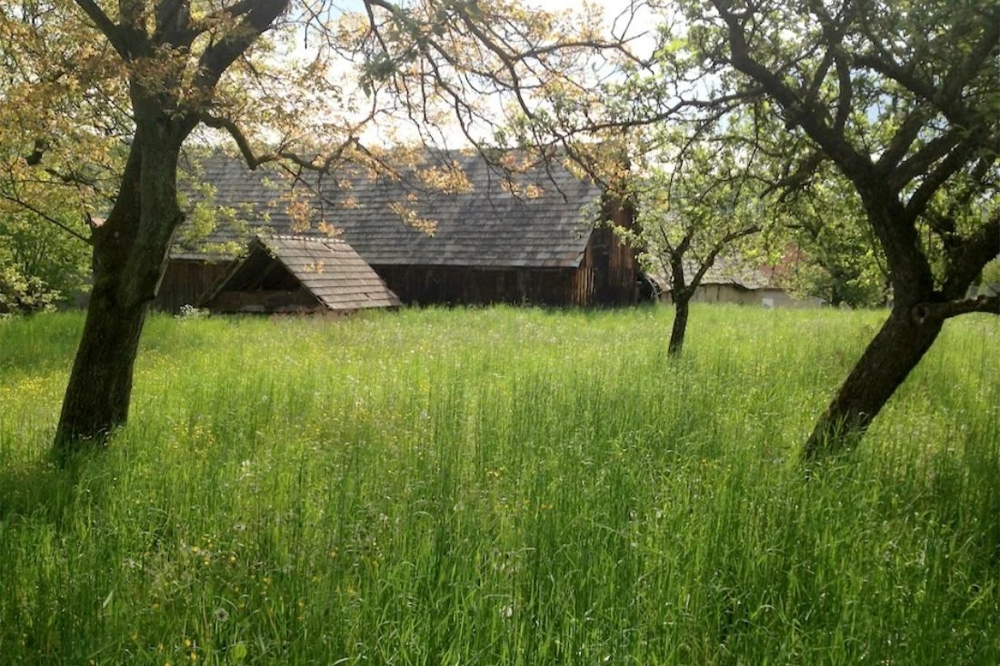
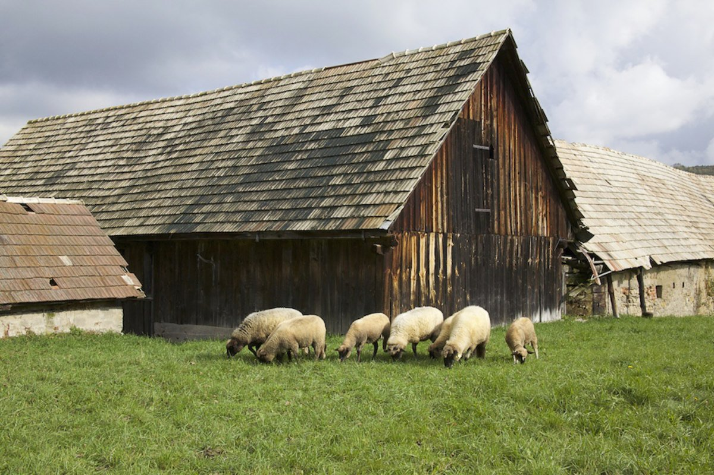
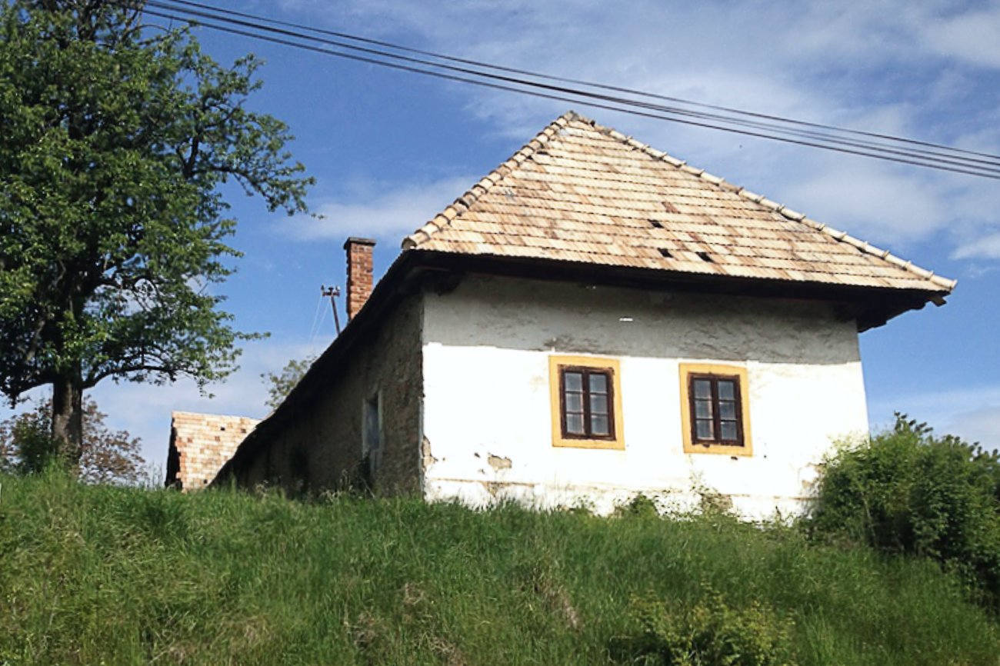
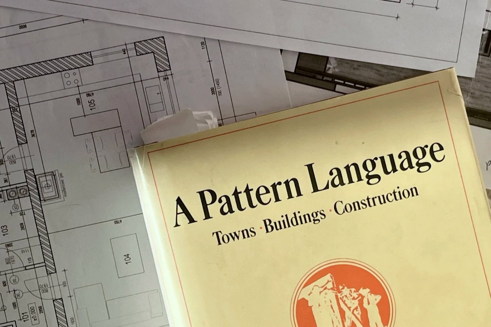
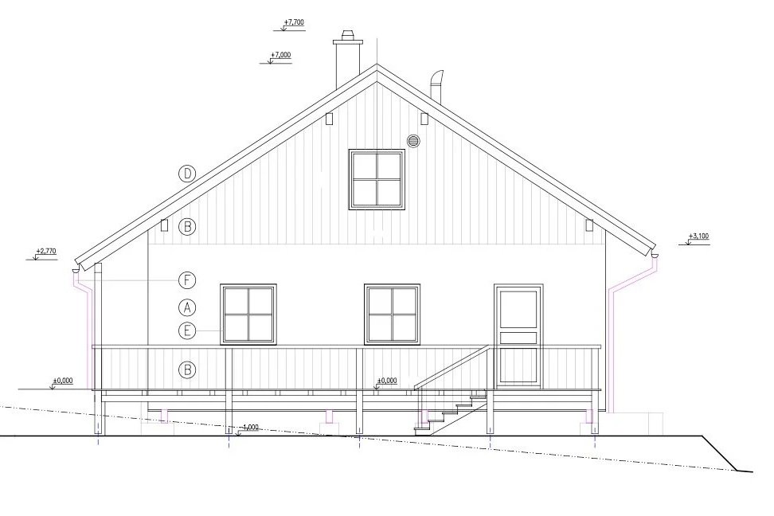
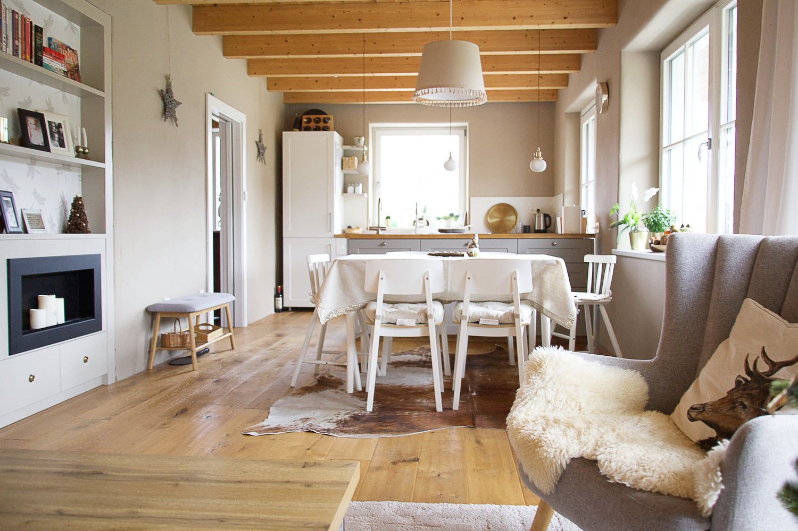
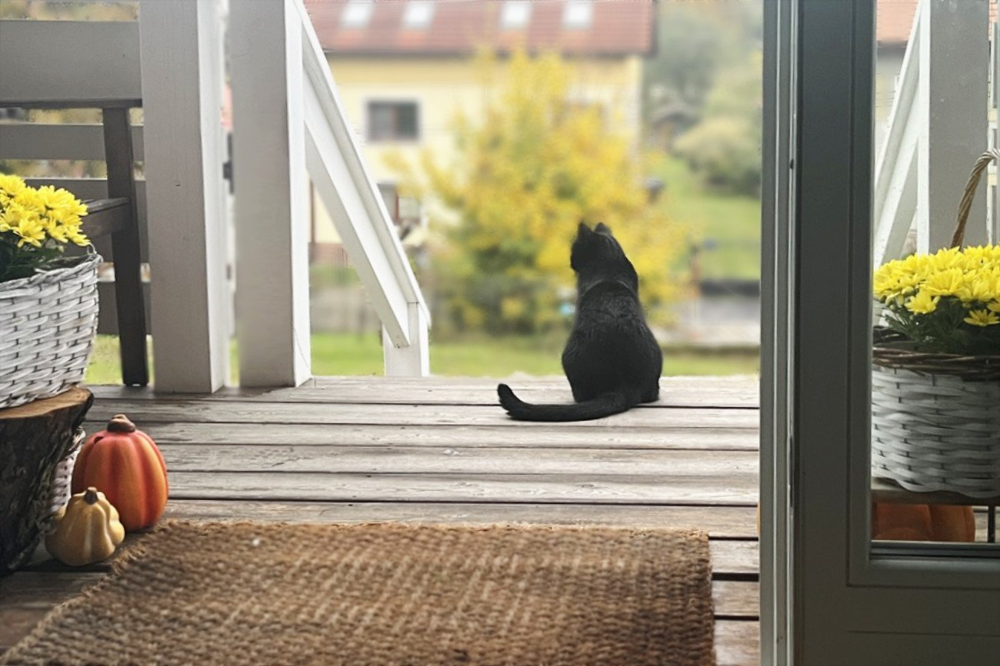

*Once upon a time, there was a house. It was old and tired, carrying the weight of many years. In time, it made space for a new one. A home built with care, guided by nature, and echoing timeless architecture. This is the story of our house, and of how it came to be.*

<Caption>
Our new-built house | Image credit — Staying Cosy
</Caption>

I still remember how, as newlyweds, my husband and I would sit and watch [*Grand Designs*](https://www.channel4.com/programmes/grand-designs) TV show, hosted by Kevin McCloud. We were dreamers back then, quietly dreaming of building a house of our own in the future. Episode after episode, we watched in awe, wondering what *our home* might look like one day. Without realising it, we were already collecting ideas, storing impressions, while drifting through life with that soft mix of youth, optimism, and naivety.

Would we ever be ready? Is there even such a thing as the right time to build a home? Not knowing the answers can feel unsettling, or strangely liberating. Often, it’s simply a matter of perspective.

> “Starting a family became our turning point. ”

Since our older daughter was born the decision came quickly: buy a larger flat, or look for a plot of land and build from scratch. If you’ve ever searched for the *perfect property*, you know exactly what that process involves. And yet, believe it or not — we found it.

## The Perfect Land

<Caption>
Our land the first time we saw it | Image credit — Staying Cosy
</Caption>

Some things are simply meant to be. I took my very first steps as a baby in my great-grandmother’s yard, beside a tiny old house built from clay, resting peacefully within a slope. Perhaps that’s where it all began. A slightly uneven, organically shaped hillside plot became my secret heart’s desire. We weren’t actively searching for it, but once we found it, we knew — that was it.

<Caption>
The sheep on our land | Image credit — Staying Cosy
</Caption>

Now, picture this. A spring day, a warm breeze brushing against our faces. A 150-year-old house standing on a small rise above the road. Beyond it, a garden framed by majestic walnut trees, sheep grazing nearby, and open farmland stretching into the distance. Yet only six minutes from a small city, located just a hill away. It couldn’t have been better.

The south-facing orientation and neighbouring houses already in place were a welcome bonus. But it was the feeling, the one I had while walking through the tall grass, that sealed it. A quiet, unmistakable confirmation. Certain places align with everything you believe in, but they can’t really be described. They have to be experienced.

So, how did it all go?

My husband said: *No, I don’t want the hassle of demolishing an old house.*

I said: *Yes, this land is perfect.*

Guess who won.

## Listening While Honouring the Past

With a background interest in 3D design, I began sketching our new house ideas early on. Pulling virtual walls into place, testing proportions, imagining how light and space might move through the house. At first, we considered partially preserving the old building. But after consulting with our architect, it became clear that its lack of structural stability, poor orientation, and permanently cold stone walls would work against everything we hoped to create.

<Caption>
The old house | Image credit: Staying Cosy
</Caption>

So we made the decision to let it go. Not without respect. We kept the original stones for future garden landscaping and preserved one of the old wooden beams, etched with a simple inscription:

*This house was built by Johannes Martines in the year of the Lord 1885.*

It felt really important to honour what had stood there before us.

The original house was built from stone, wood, and clay. Materials that were entirely natural and surprisingly easy to take apart. That, in itself, was deeply inspiring. It led us to a guiding principle for our new home: to build in a way that respects the full life cycle of a house. One day, when its own journey reaches an end, it should be possible to dismantle it without harming anyone’s health or the land it stands upon.

Somewhere during this period, I was gifted a book written by Christopher Alexander, an architect considered controversial in the 1970s. Over the course of his career, he gathered an extraordinary amount of data from around the world, observing homes, buildings, streets, and living environments. He then identified architectural patterns that support how people live, both from practical and psychological perspective. The result was a publication of — [*A Pattern Language*](https://www.amazon.com/Pattern-Language-Buildings-Construction-Environmental/dp/0195019199).

<Caption>
[Pattern Language](https://www.amazon.com/Pattern-Language-Buildings-Construction-Environmental/dp/0195019199) by Ch. Alexander | Image credit: Staying Cosy
</Caption>

This book marked the beginning of my lifelong fascination. It became my architectural and design bible, a powerful influence that eventually moved from theory into physical reality, gradually narrating the way we built our home.

## When Dreams Meet Reality

With the land secured, its unique proportions and orientation toward the world set the framework for everything that followed. Some aspects flowed easily; others required careful problem-solving. We spent nearly a year and a half working closely with our architect, refining the layout again and again, searching for a design that wouldn’t announce itself as a *new house* among a row of old ones. We wanted it to sit seamlessly within the landscape, as though it had always been there.

At the same time, we embraced modern building technologies and materials, carefully balanced with natural elements like wood and cellulose insulation. The house was designed to stand on concrete pillars, allowing the ecosystem beneath it to remain undisturbed while also improving thermal efficiency.

Thickly insulated walls preserve heat, help soften the acoustics, and the clay plaster regulates the indoor climate. The result is a home that feels [comfortable and steady](/blog/holistic-interior-design-guide-101), modern in function yet warm in character.

<Caption>
One of our older project drawings | Image credit: Staying Cosy
</Caption>

Not everything unfolded smoothly. With the support of our building supervisor, we eventually reached a difficult point where we had to let our contractor go and take on the final finishing stages ourselves. With a small child and a baby on the way, that period was difficult. Had I known then everything we would face, I might have chosen the easier path and settled for a flat instead.

But how do we carry the weight of a dream never pursued? Inherent curiosity pulls us forward. Time and again, we discover that we are far more resilient than we think.

## Moving In

Life is full of ups and downs, but despite all the hurdles, we finally moved in at the end of 2016. The house wasn’t finished, but it was finished *enough*. Our rented flat contract was expiring, and we knew that renewing it would only delay the move further. So we decided it was time. The right moment to start our new chapter.

> “I will always remember that very first morning in our new home.”

We moved in on New Year’s Eve and woke up not just in a new house, but in a new year and a new era of our lives — already a family of four. That morning was nothing short of beautiful. The low winter sun streamed through our east-facing kitchen window, hitting the clay wall across the room. Its warmth was tangible as it began to slowly wake up the house, heating every surface it touched.

What better way to start the year than with sunlight that invigorates and heals?

<Caption>
Open plan living in our home | Image credit: Staying Cosy
</Caption>

Even now, I still love those sunny winter days when the early morning light floods the house, illuminating deep corners that only see the sun’s warmth once a year. And it’s no accident. We designed it this way. Intentionally letting the sunlight enrich our lives.

## Back to Now

Is our house finished? I don’t think so. Will it ever be? Who knows. But do we live comfortably here? Absolutely.

Life has slowed down in recent years, and we’ve made peace with the fact that not everything will be perfect or finished. We value the moments we spend together, our privacy, our energy we bring to each day.

The last decade has been challenging on many levels, but we’ve pushed through. We’re still missing one bathroom, something that would certainly come in handy as our older daughter reached her teens. For many people, a second bathroom is a luxury. That realisation makes us appreciate what we already have even more.

Our family grew unexpectedly last year when a stray cat found her way to us.  And, believe me, I’m someone who never imagined having an indoor pet, let alone a cat. Yet she chose us. Her calm presence settled into our home as if she had always been there. Such moments remind me that when we let life unfold organically, when we receive with gratitude what we’ve been offered — new doors open, and our lives become richer and more meaningful.

<Caption>
Our lucky cat | Image credit: Staying Cosy
</Caption>

Over time, our house has grown into a *home*. It is holistically imperfect, missing bits here and there, but already filled with unforgettable memories and a handful of very happy, thriving souls.

---

**☘︎ Are you up for more musings on slow living and interior? Check out:**

[*Mindful Eco Living*](/blog/shaping-a-green-home-with-purpose) *|* [*Natural Materials Around my Home*](/blog/natural-materials-around-my-home) *|* [*Air Purifying Plants*](/blog/air-purifying-plants)

SEARCH THE BLOG

