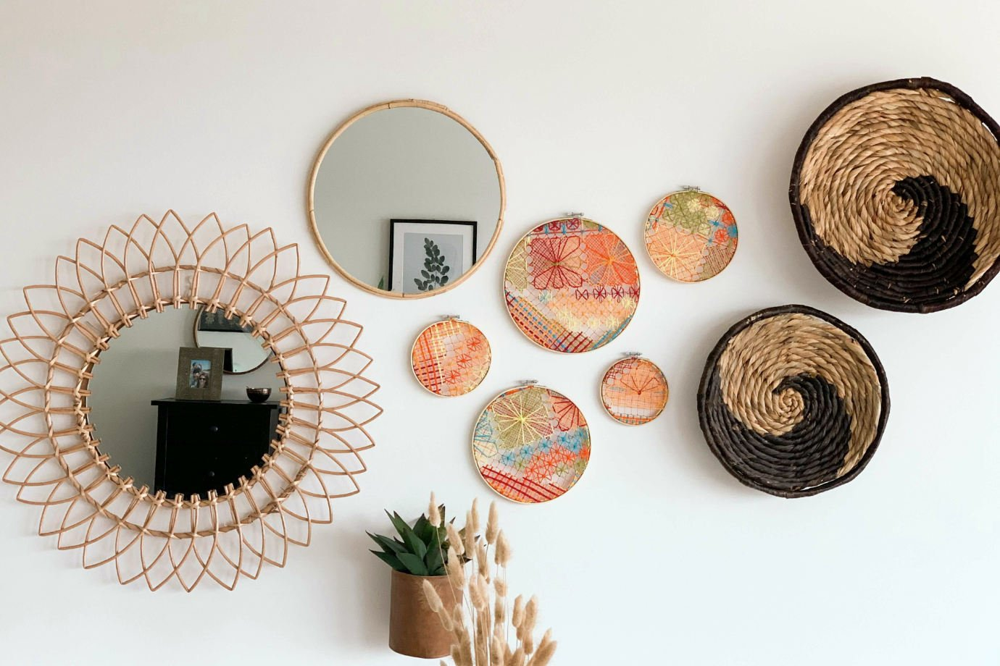
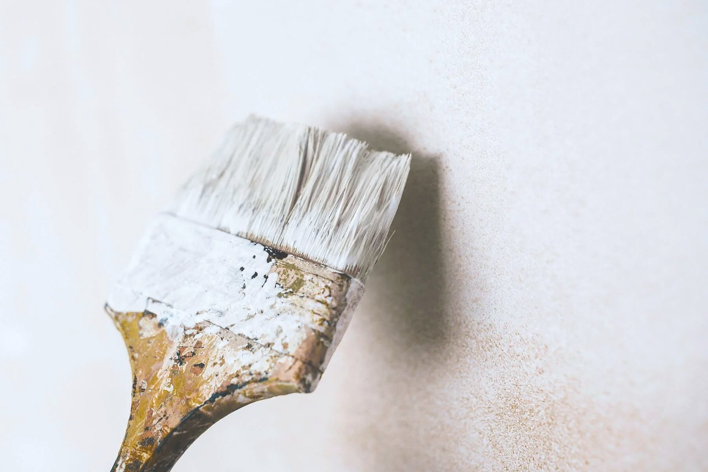
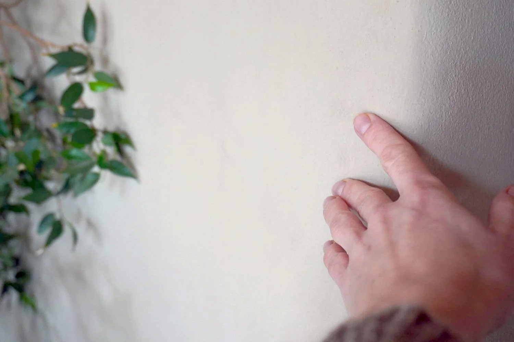
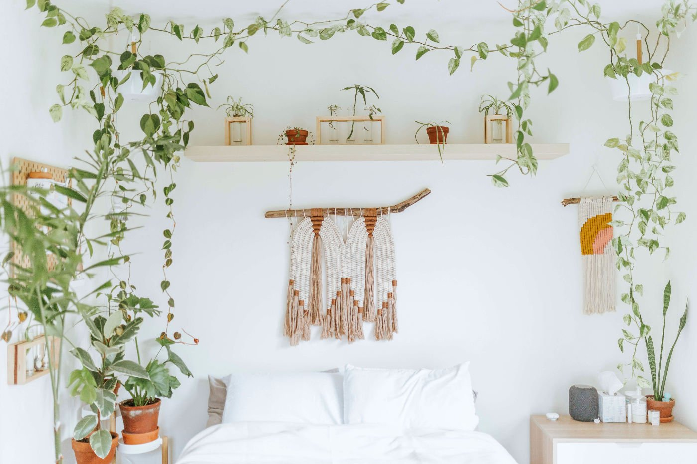
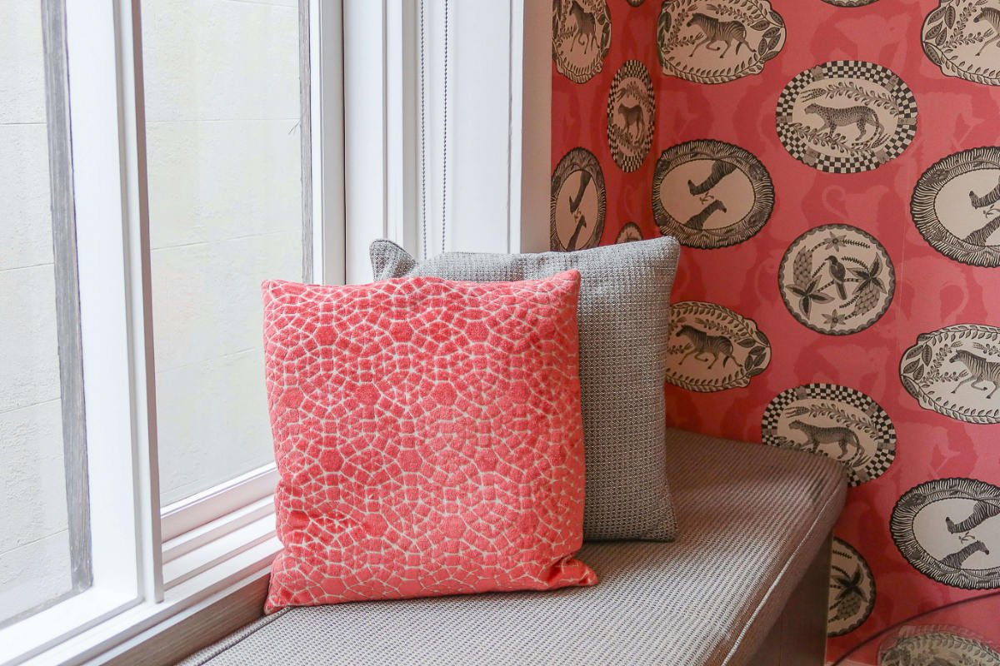
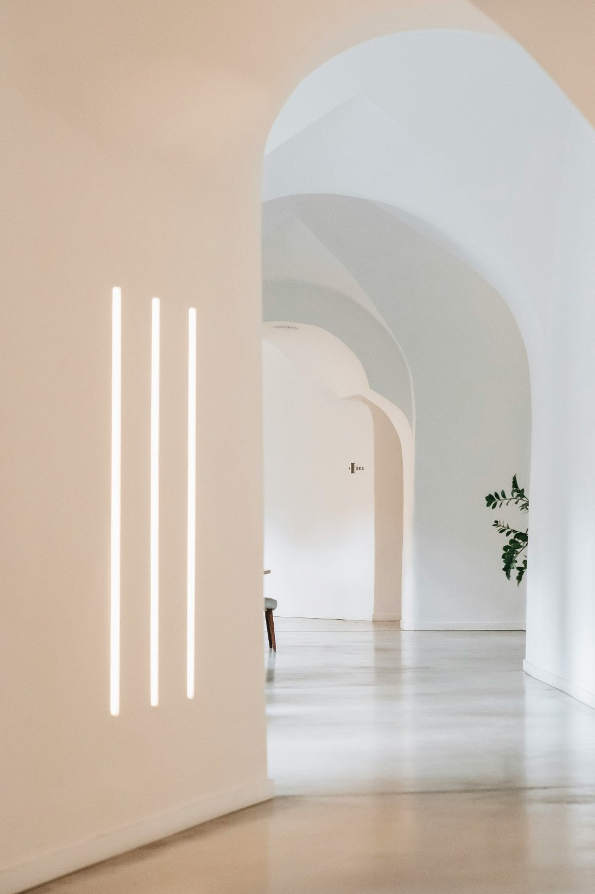
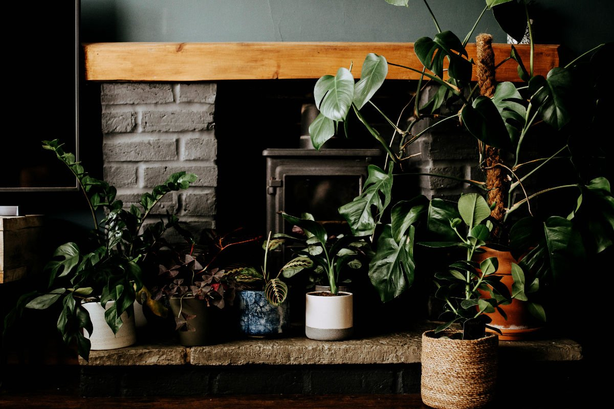

*At some point, most of us have stood in front of a wall, paint samples in hand, convinced that a fresh coat is exactly what the room needs. White if we’re playing it safe, grey or beige if we’ve been browsing interiors online for a little too long. But in a world of fast décor and fleeting trends, perhaps we’ve forgotten to consider a sustainable alternative: leaving the wall exactly as it is.*

<Caption>
Image credit: [Rosana Cunha](https://unsplash.com/@rosanabatista?utm_source=unsplash&utm_medium=referral&utm_content=creditCopyText) on [Unsplash](https://unsplash.com/photos/black-iphone-4-on-white-table-VzSo3NaG1sU?utm_source=unsplash&utm_medium=referral&utm_content=creditCopyText)‍ ‍
</Caption>

Choosing not to repaint might start with the understandable inconvenience of moving furniture or the smell of fumes. But it is more than that. It has become a deliberate design choice — a nod to slow living and a commitment to the breathable home. At times, the most soulful thing you can do for a room is to simply leave it alone.

## Why Fresh Isn't Always Healthy

We often equate the smell of fresh paint with cleanliness, but in reality, that *new room smell* is usually a cocktail of [Volatile Organic Compounds](/blog/chemicals-that-pollute-our-living-rooms) (VOCs). When we coat our walls in standard acrylic or latex paints, we are essentially shrink-wrapping our living spaces in a thin layer of plastic.

By choosing *not* to repaint, you are making three deliberate health choices:

- Eliminating off-gassing
- Reducing microplastics
- Preventing chemical waste

Standard paints are effectively liquid plastic. Avoiding them is an act of environmental rebellion. You are saving a tin of paint; but also skipping the masking tape, the single-use plastic sheets, and the chemical rinse-water that inevitably ends up in our water systems. If your walls are in visibly good condition, leaving them as they are allows your home to breathe alongside you, rather than trapping you in a synthetic bubble once again.

<Caption>
Image credit: Canva — edited
</Caption>

### Remediation Before Renovation

Often, what we perceive as *tired walls* is simply stagnant energy and settled dust. Before you reach for the roller to freshen up a stale room, consider a thorough airing.

#### Follow Deep Ventilation Protocol

Open every window for a full cross-breeze to purge the indoor air. Use a high-quality diffuser with disinfecting essential oils — like lemon, eucalyptus, or tea tree to naturally cleanse the air and surfaces. You might find that once the air is cleared, the walls regain their clarity, saving you from a month-long project and a perceived refresh you never really needed.

Of course, there are rare moments when a fresh start is non-negotiable. If you have moved into a home where walls are saturated with decades of cigarette smoke or deep-seated water damage, the structural and sensory health of the space may require a total reset.

☘︎ ***A Note on Atmospheric Cleansing***

To clear stagnant air of pathogens, consider the ancient practice of burning white sage. Far from being mere folklore, research published in the [Journal of Ethnopharmacology](https://www.sciencedirect.com/science/article/abs/pii/S0378874107004357) found that medicinal smoke used for 60 minutes can eliminate up to **94% of airborne bacteria**.

While it doesn't clean the walls physically, it deeply disinfects the air, creating a sterile, fresh slate for your home.

*Always ensure a window is cracked for ventilation and never leave burning sage unattended.*

## Art of the Living Surface — Embracing Patina and Wabi-sabi

Are we fearing imperfections? We’ve fallen for the idea that sanding down every bump and covering every swirl with a heavy coat of flat, uniform paint somehow brings a sense of order, and control. But in a genuinely holistic home, we are beginning to see these textures for what they really are: the history and the original soul of the house.

<Caption>
Clay wall detail | Image credit: Staying Cosy
</Caption>

Around my own home, we have hand-finished clay plaster with beautifully rounded reveals around the windows. It is our unique take on natural finishes — a surface that carries a human touch and a character that a pristine wall can only dream of. While I sometimes take it for granted, it is these very imperfections that catch the light and provide the room with its grounded, Wabi-Sabi essence.

**The Architectural Narrative**

If your existing walls have an intentional texture, a hand-finished edge or a classic relief, painting over them often distorts the room’s distinct feel. These layers are architectural footprints that provide depth. Before you refresh your space into a characterless box, consider that your current walls might already be providing the very personality you are searching for.

## Atmospheric Layers — Redecorating Without the Roller

If you crave change but want to skip a month-long project, there are plenty of effective and far more flexible options. Slow living focuses on adding elements that evolve with your lifestyle while omitting the chemical waste of a total repaint job.

### Textile Architecture & Spatial Depth

<Caption>
Image credit: [Cole Keister](https://unsplash.com/@coleito?utm_source=unsplash&utm_medium=referral&utm_content=creditCopyText) on [Unsplash](https://unsplash.com/photos/white-and-brown-floral-textile-on-white-bed-ZN9LhLYCVko?utm_source=unsplash&utm_medium=referral&utm_content=creditCopyText)‍ ‍
</Caption>

Wall textiles are not a forgotten art belonging in a museum. To this day, I remember my great-grandmother’s hand-woven tapestry depicting a late summer harvest. Hanging above her bed, it captured my curious child’s eyes every time I visited. What was the wall colour behind it? I don’t remember — but the art imprinted on it is forever etched in my mind.

Hanging a large-scale linen tapestry or a hand-woven macramé piece covers a tired wall; and introduces a new acoustic and tactile softness. By pushing the wall into the background, you create a focal point through material and composition.

Alternatively, use oversized leaning mirrors or floor-to-ceiling bookshelves. These non-permanent structures act as new walls themselves, shielding the original paint while adding a sense of high-end spatial depth.

And if non of these fits your vibe, a traditional gallery wall will successfully take the centre stage.

### Selective Pattern & Removable Accents

<Caption>
Image credit: [Linh Pham](https://unsplash.com/@linlin411?utm_source=unsplash&utm_medium=referral&utm_content=creditCopyText) on [Unsplash](https://unsplash.com/photos/a-window-sill-with-two-pillows-on-top-of-it-Fr9IC5Svy6s?utm_source=unsplash&utm_medium=referral&utm_content=creditCopyText)
</Caption>

You don't need to commit to four walls of wallpaper. Use removable, non-woven textile wall-coverings to define a specific zone. They are affordable, ecological and very easy to install. Think of a cosy reading nook, or even the ceiling. This creates a sculptural interest that breaks up a monochrome wall without overwhelming the entire architectural envelope. And most importantly — without using a drop of paint.

### Lighting as a Sculptural Tool

<Caption>
Image credit: [Mateusz Zatorski](https://unsplash.com/@knowbody?utm_source=unsplash&utm_medium=referral&utm_content=creditCopyText) on [Unsplash](https://unsplash.com/photos/a-white-room-with-a-plant-in-the-corner-_EHLHOry38A?utm_source=unsplash&utm_medium=referral&utm_content=creditCopyText)
</Caption>

Lighting is your most powerful hidden design asset. If you feel bored with your wall colour, don't change the paint; change the colour temperature of your bulbs. They can dramatically shift the hue of a room the moment they are switched on.

**The Shadow-Theatre Effect**

Combining different lighting strategies can turn your walls into a unique, multi-dimensional shadow-theatre. Use directional floor lamps or uplighting to create highlights and deep shadows. This adds a sculpted quality to a flat wall, making it feel alive and textured after sunset.

**How to shift the mood**

Equip your lights with correct light bulbs to suit the mood you want to create. For more detailed info on lighting, read my [comprehensive guide](/blog/interior-lighting-guide), for now here is a quick break-down:

- Warmth (2700K): Turns a sterile white or a tired grey into a golden, gallery-like glow.
- The Smart Spectrum: Using [smart bulbs](https://www.amazon.com/Govee-Changing-Dynamic-Bluetooth-Assistant/dp/B09B6XV6VB/ref=sr_1_18?crid=1TU6HQEBJ5CJ9&dib=eyJ2IjoiMSJ9.n5iDQtLF2u2R18BsRg2VC7R-EPypqyzBPS0YYEJdGwMrdAXHTabIhl0MEMvpLfGW_McOv35BFbJffP2vBEtRMVpYG_-hLe73_gB-aiaKaAiWMU2odrqSfUBd3-1580A_FiiEC681uIyRtFihwnBLLW8mYd6VUQ9VIbP_OyeS_Sb_Y2deGMVE8wYqggdThjpxmkP1uhBtI2y9HIXfW7ysFzAH-86S47_J5oO5zFrYao18XaO-YuchBDP5ThrLJogh7H66pzfLM3QOG6rloNWYlZbJpcRVjbiKESqB6gBRmaA.Vdo1WTMck7A1Gd_dBoZSUqY0mvFChI2HzPdzA_IHsoY&dib_tag=se&keywords=smart%2Blight%2Bbulb&qid=1777485763&sbo=RZvfv%2F%2FHxDF%2BO5021pAnSA%3D%3D&sprefix=smart%2Blight%2Bbul%2Caps%2C219&sr=8-18&th=1) with a full spectrum of colour allows you to achieve more dramatic effects, shifting the wall’s hue instantly to match your evening mood.

### Natural Screening of Greenery

In a holistic biophilic interior, plants are your living wallpaper. Large-leafed varieties like a *Ficus Lyrata* or a climbing *Pothos* create organic silhouettes against your walls. This natural screening softens the corners of the room and distracts the eye from any perceived imperfections in the existing paint, bringing a fresh, oxygenated energy to the space. You can explore [air-purifying plants](/blog/air-purifying-plants) to learn how to harness their full air-cleansing potential.

<Caption>
Image credit: [Annie Spratt](https://unsplash.com/@anniespratt?utm_source=unsplash&utm_medium=referral&utm_content=creditCopyText) on [Unsplash](https://unsplash.com/photos/green-plants-on-brown-clay-pot-ZLlLfPgP-W0?utm_source=unsplash&utm_medium=referral&utm_content=creditCopyText)‍ ‍
</Caption>

## Pick Healthier Wall Colour if Really Necessary

If a total reset is the only way, look beyond the world of standard acrylics. To align with *living finishes*, the only sustainable refresh is one that allows your walls to breathe.

Instead of synthetic options, look for **natural mineral paints** or **plant-based emulsions**. These eco-friendly, water-based alternatives are 100% plastic-free and non-toxic, offering a rich, matte depth that improves with age rather than off-gassing into your sanctuary. Whether you choose a soft lime-wash-like one with zero-VOC offered by [JH Wall Paints](https://www.jhwallpaints.com/products/lime-wall-paint) or a high-performance clay paint from [Earthborn](https://earthbornpaints.co.uk/paint/claypaint/), you are choosing a finish that respects both your health and the environment.

By embracing the walls you already have, with all their textures, history, and *Millennial Grey* nuances, you are prioritising wellness over short-lived trends. It turns out that the most transformative design tool isn't a roller or a tin of acrylic, but the perspective to see the beauty in what is already there.

---

**☘︎ Want more healthy ideas for your home? Get Inspired:**

*•* [*Holistic Home 101*](/blog/holistic-interior-design-guide-101)

*•* [*Decluttering Matters More Than You Think*](/blog/stuff-taking-over-why-decluttering-matters)

*•* [*Sculptural Lamps*](/blog/sculptural-lamps-light-personality)

SEARCH THE BLOG

