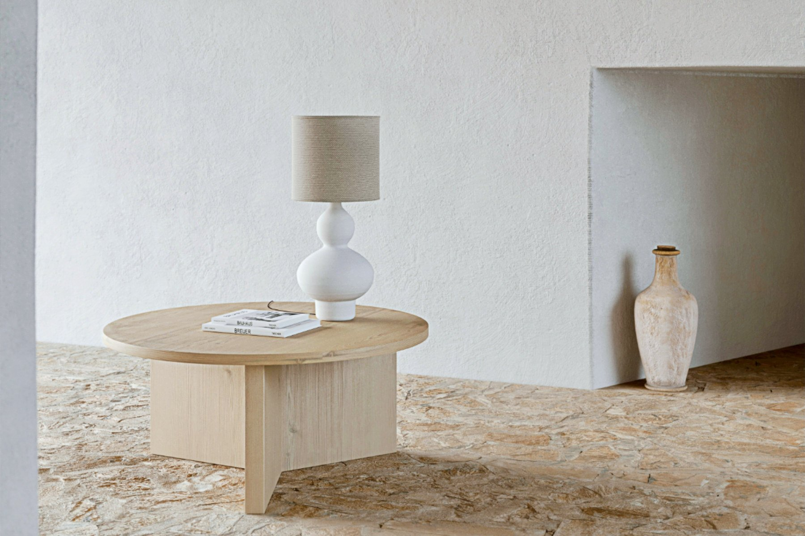
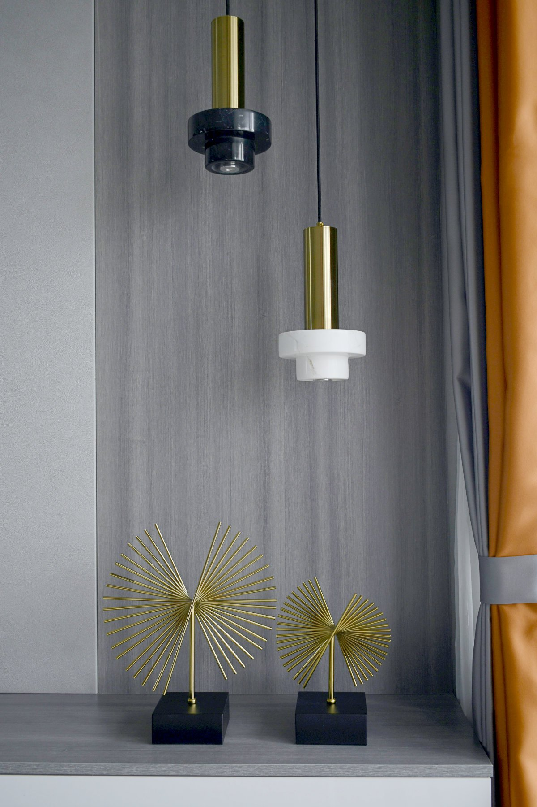
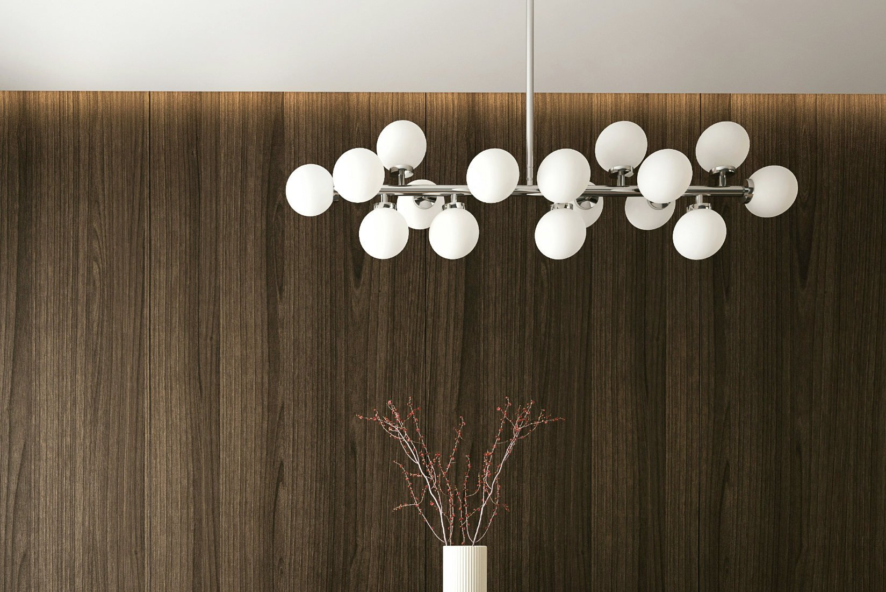
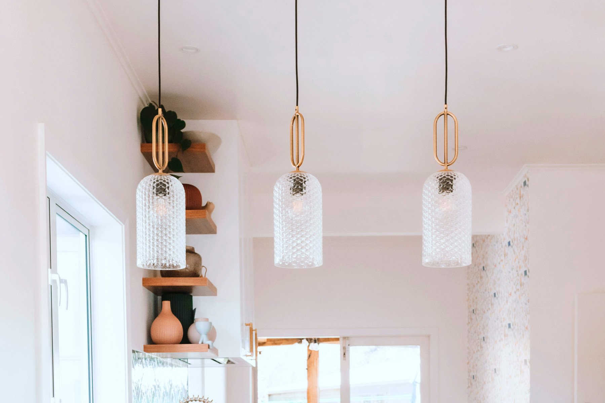
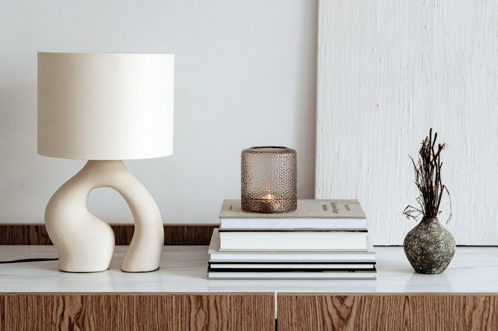
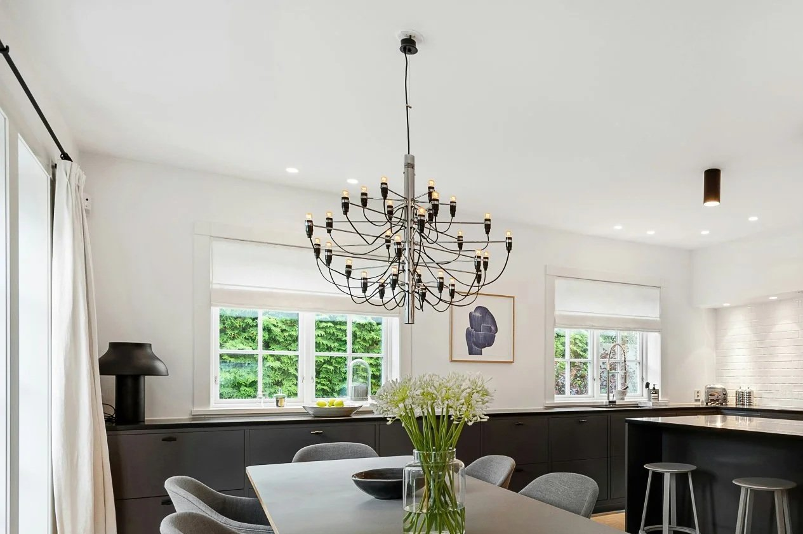
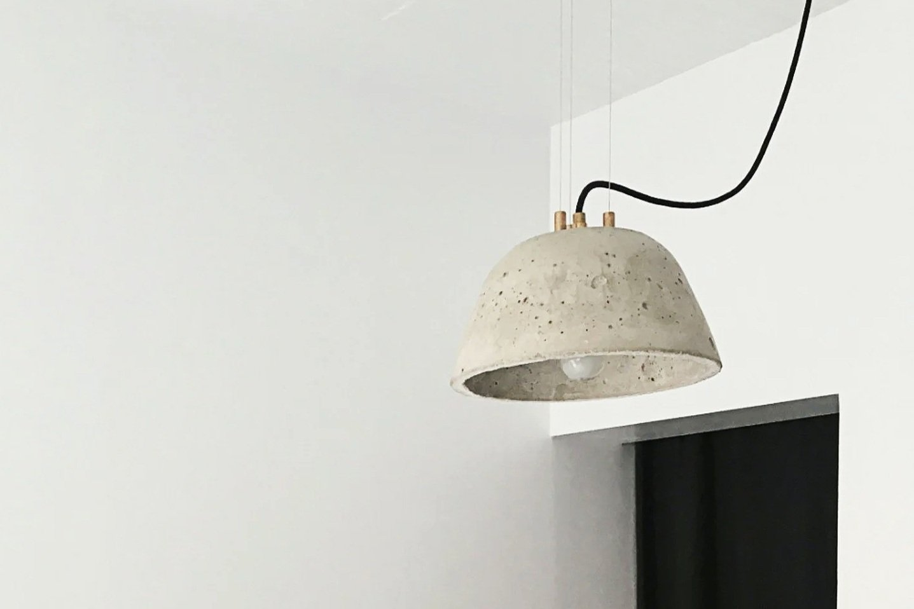
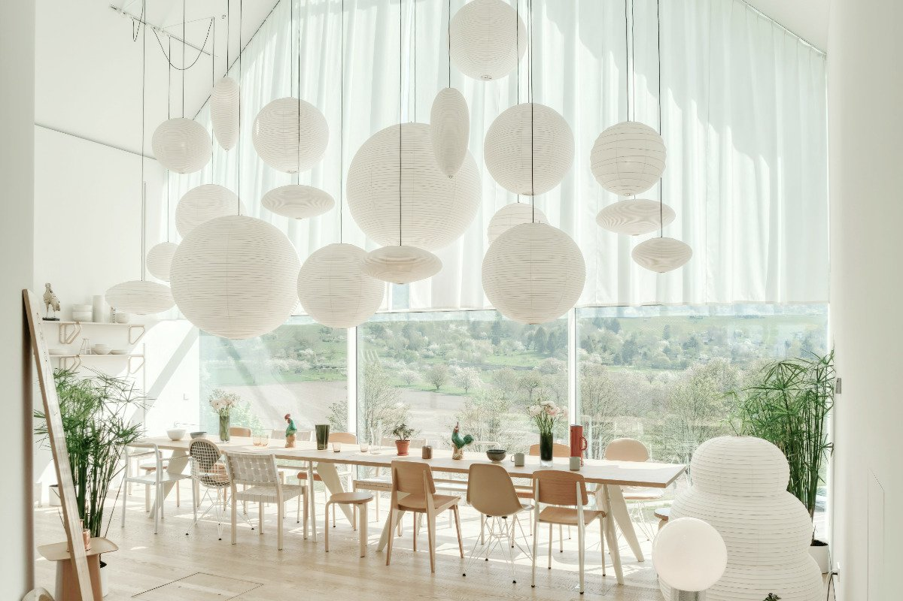
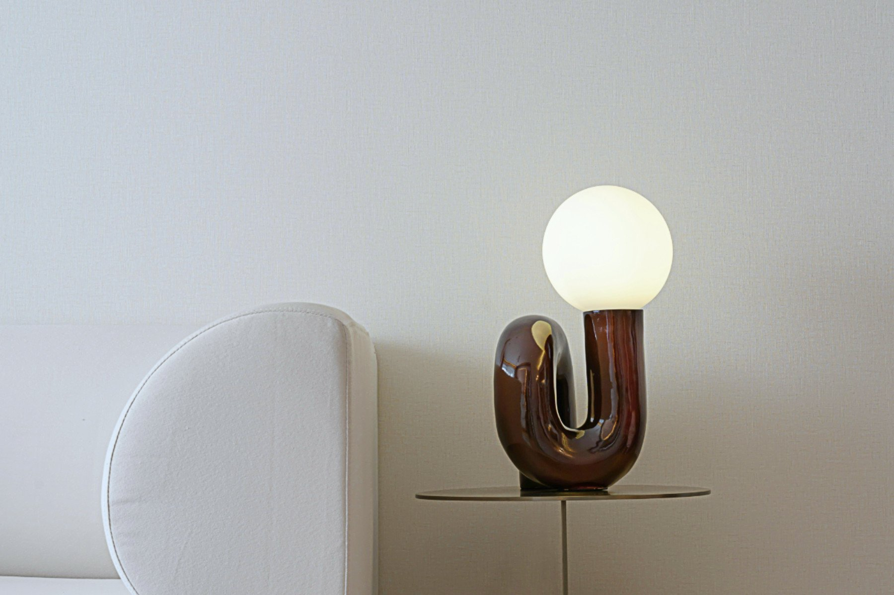

*I find myself captivated by sculptural lighting that refuses to just sit there and be — useful. These are the overachievers of the design world, possessing a secret, shimmering magic that transforms a basic living room into a curated gallery the second you flick the switch. It’s a mood, an atmosphere, and a total pinch-me moment all at once.*

<Caption>
Image credit: [Lasse Jensen](https://unsplash.com/@maybejensen?utm_source=unsplash&utm_medium=referral&utm_content=creditCopyText) on [Unsplash](https://unsplash.com/photos/brown-wooden-table-with-white-ceramic-vase-on-top-7rvkxLAraU8?utm_source=unsplash&utm_medium=referral&utm_content=creditCopyText)
</Caption>

Yet, where does such a sculptural soul originate? To my eye, the most breathtaking pieces are love letters to the world around us. Designers are looking at the cosmic curves of a distant planet, defiant twist of a tree root, or even the humble perfection of an egg sitting on your breakfast plate. Inspiration is hiding in plain sight, just waiting to be cast in bronze or glass.

Ready to see how the everyday becomes extraordinary? Let’s shed some light on the curvaceous silhouettes currently redefining our homes.

## Artful Light for a Grounded Home

<Caption>
Image credit: [wang xiaoji](https://unsplash.com/@wangyingjie987?utm_source=unsplash&utm_medium=referral&utm_content=creditCopyText) on [Unsplash](https://unsplash.com/photos/white-and-black-pendant-lamp-8pF89UIHrro?utm_source=unsplash&utm_medium=referral&utm_content=creditCopyText)
</Caption>

For spaces that crave a *back-to-nature* soul, architectural pieces with soft, sweeping lines feel less like a purchase and more like a living part of the room’s ecosystem. That grounded power of stone and marble reflects a sense of class while honouring the raw earth they came from. These organic silhouettes and tactile materials have a rare quality to anchor corners, or even entire rooms.

Paired with refined metal fittings that often become part of the sculpture itself, these lamps balance artistry with function. Whether they blend into the shadows or stand out as a focal point, they provide just enough weight and presence to harmonise a space.

## The Sculptural Heavy-hitters

Here are the heavy-hitters currently redefining the art of the glow.

### Cosmic Clusters — Glass Ball Chandeliers

<Caption>
Find your perfect ball cluster: [Sputnik Opal Globes Linear Chandelier](https://yiilighting.com/en-eu/products/8-light-glam-modern-sputnik-frosted-opal-globes-bubble-chandelier-for-living-room-dining-room-kitchen-island?variant=41175689396302) (EU) | Image credit: [Kam Idris](https://unsplash.com/@ka_idris?utm_source=unsplash&utm_medium=referral&utm_content=creditCopyText) on [Unsplash](https://unsplash.com/photos/a-room-with-a-table-chairs-and-a-plant-with-lights-wMzpa3WsDkI?utm_source=unsplash&utm_medium=referral&utm_content=creditCopyText)
</Caption>

Unlike single-bulb pendants, these branch out like cosmic clusters or frozen bubbles. They fill the air with multiple points of light, creating a sense of volume without feeling heavy. They are the perfect centrepiece for a dining room where you want the conversation to feel as elevated as the art above the table.

---

### The Prismatic Focus — Light-Refracting Glass Pendants

<Caption>
Find your prismatic pendant: [EBB & FLOW Rowan Crystal Pendant Lamp](https://lamptwist.com/products/ebb-flow-rowan-crystal-pendant-lamp?variant=44324402495734&_gl=1*9kj4bk*_up*MQ..*_gs*MQ..&gclid=EAIaIQobChMI_pmWo-ehkgMVNDQIBR2lziikEAQYFiABEgLMKvD_BwE&gbraid=0AAAAADlAjH6RSh-axgkoBy72AMGkOHcx_) (EU) | Image credit: [Callum Hill](https://unsplash.com/@inkyhills?utm_source=unsplash&utm_medium=referral&utm_content=creditCopyText) on [Unsplash](https://unsplash.com/photos/a-kitchen-with-a-white-counter-top-and-wooden-floors-k6GS-c6zB7I?utm_source=unsplash&utm_medium=referral&utm_content=creditCopyText)
</Caption>

Minimalist and often classic in spirit, these pendants focus on the magic of a single bulb. Hand-blown glass acts as a shimmering prism, bending light at a million different angles to create a cinematic atmosphere. They are the jewellery of the kitchen or hallway — subtle until you flick the switch.

---

### Earthy Soul — Intricate Ceramic Bases

<Caption>
Find your ceramic lamp: [Westwing Collection Gisella Table Lamp](https://www.westwing.de/grosse-keramik-tischlampe-gisella-137075.html) (EU) | Image credit: [Karolina Grabowska](https://unsplash.com/@kaboompics?utm_source=unsplash&utm_medium=referral&utm_content=creditCopyText) on [Unsplash](https://unsplash.com/photos/a-lamp-and-books-on-a-table-ulh3-dLSXjI?utm_source=unsplash&utm_medium=referral&utm_content=creditCopyText)
</Caption>

Having spent some time in a ceramic studio myself, I’ve seen the soul that goes into every hand-thrown curve. These bases carry a grounded, *hand-touched* energy that honors the artisan. They are perfect for those who want their home to feel lived-in and human, offering a tactile contrast to modern, flat surfaces.

---

### Architectural Drama — Wrought Iron & Metal

<Caption>
Check out this metal chandelier: [Herstal Manola 12 Chandelier](https://www.nordicnest.com/brands/herstal/manola-12-chandelier/?variantId=34655-04) (EU) | Image credit: [Alex Tyson](https://unsplash.com/@alextyson195?utm_source=unsplash&utm_medium=referral&utm_content=creditCopyText) on [Unsplash](https://unsplash.com/photos/a-dining-room-table-with-chairs-and-a-chandelier-4vRQHAi7DJs?utm_source=unsplash&utm_medium=referral&utm_content=creditCopyText)
</Caption>

For those who love a bit of moody drama, wrought iron chandeliers and sculptural sconces are the way to go. These pieces act as wall art even when they are off. When switched on, they cast bold, architectural shadows that play with the texture of your walls, turning a simple corridor into a gallery walk.

---

### The Gentle Anchor — Heavy Stone & Concrete

<Caption>
Find your concrete lamp: [Westwing Seline Pendant](https://www.westwing.de/pendelleuchte-selin-aus-beton-159014.html) (EU) | Image credit: [Kirill](https://unsplash.com/@kirillz) on [Unsplash](https://unsplash.com/photos/white-and-brown-wooden-counter-near-white-wall-x_VOtnVJeGE)
</Caption>

Stone and concrete lamps feel permanent, raw, and wonderfully brutalist. Yet, there’s a beautiful irony here: these cold, heavy materials soften instantly when hit by a warm glow, proving that strength and comfort can exist in the same silhouette. And if you’re not keen on a heavy overhead lamp, you can choose a floor version, or shades that mimic a concrete finish while being made from ecological papier-mâché.

---

### Cloud-Like Impact — Oversized Fabric & Paper

<Caption>
Check this paper pendant: [Watt & Veke Pumpkin Pendant Lamp](https://www.nordicnest.com/brands/watt--veke/pumpkin-pendant-lamp/?variantId=580587-01) (EU) | Image credit: [Ricardo Gomez Angel](https://unsplash.com/@rgaleriacom?utm_source=unsplash&utm_medium=referral&utm_content=creditCopyText) on [Unsplash](https://unsplash.com/photos/a-room-filled-with-lots-of-furniture-and-a-large-window-Zcyc2sO9Zgo?utm_source=unsplash&utm_medium=referral&utm_content=creditCopyText)
</Caption>

Think of these as clouds floating in your living room. Artsy paper shades, often inspired by Japandi beehives or delicate pleats, offer a soft, diffused glow that feels like a warm hug. They provide massive visual impact without the physical weight, making them ideal for centering large, open spaces.

---

### Twisted Shape — Your Room’s Subtle Star

<Caption>
Find the same lamp here: [Petite Friture Neotenic Table Lamp](https://lamptwist.com/products/petite-friture-neotenic-table-lamp?variant=46469505909079&_gl=1*bm23s8*_up*MQ..*_gs*MQ..&gclid=EAIaIQobChMI_pmWo-ehkgMVNDQIBR2lziikEAQYFiABEgLMKvD_BwE&gbraid=0AAAAADlAjH6RSh-axgkoBy72AMGkOHcx_) (EU) | Image credit: [Xie Yujie Nick](https://unsplash.com/@xieyujie?utm_source=unsplash&utm_medium=referral&utm_content=creditCopyText) on [Unsplash](https://unsplash.com/photos/white-and-brown-lamp-on-brown-wooden-table-xe_f__fOBNs?utm_source=unsplash&utm_medium=referral&utm_content=creditCopyText)
</Caption>

Forget boring, flat lighting — twisted bases are lamp jewellery in their purest form. Their sculptural curves bring movement and texture, letting light glide softly across the surface rather than bounce or glare. Even when turned off, their spiralled silhouettes serve as high-end art, where form does the talking and craftsmanship shines.

## Let Your Home Glow

A truly great sculptural piece is a long-term love affair. Do they belong in a natural interior? Absolutely. Since these designs are rooted in art rather than fleeting trends, they possess a rare staying power. A decade from now, your lamp will look just as intentional and striking as it does today, effortlessly adapting to every furniture swap or paint colour change your home undergoes.

Be adventurous. I often see clients playing it too safe with their lighting. Take the leap and choose the piece that grabs your eye and makes your heart jump. I promise, you won’t regret it.

To unlock that magic, pair your piece with a warm-toned bulb. Warmer light softens the mood and illuminates a room in the most flattering way. It practically begs you to slow down — allowing the lamp to tell its story.

---

---

---
