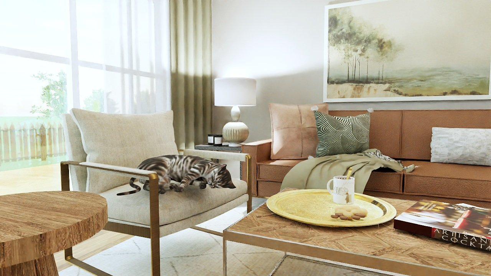
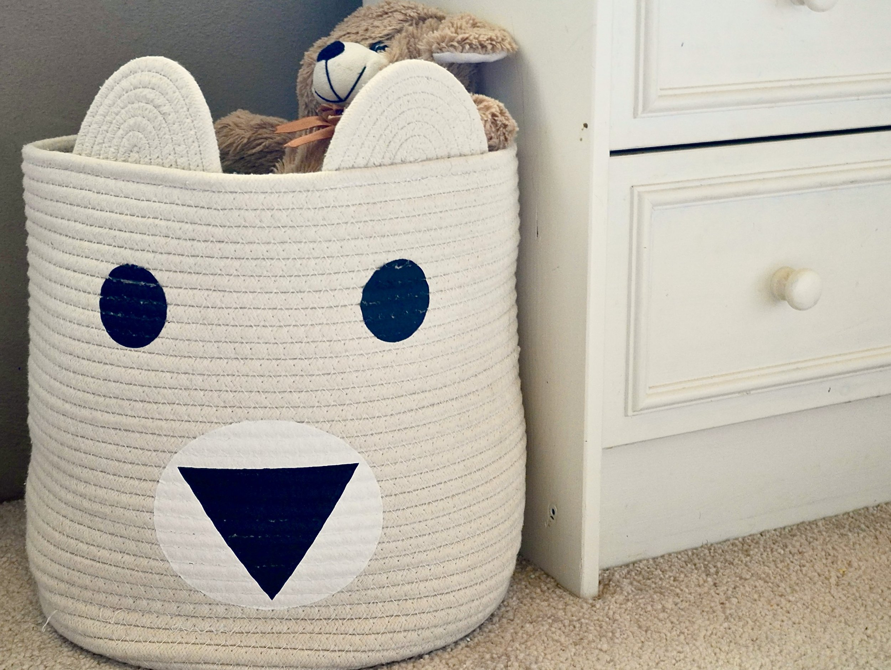
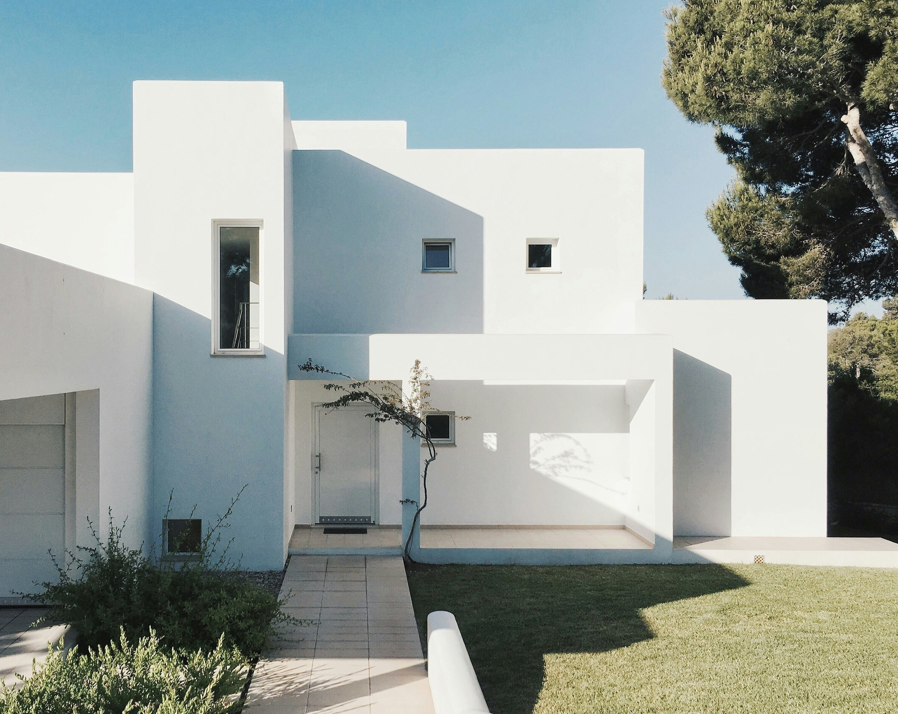
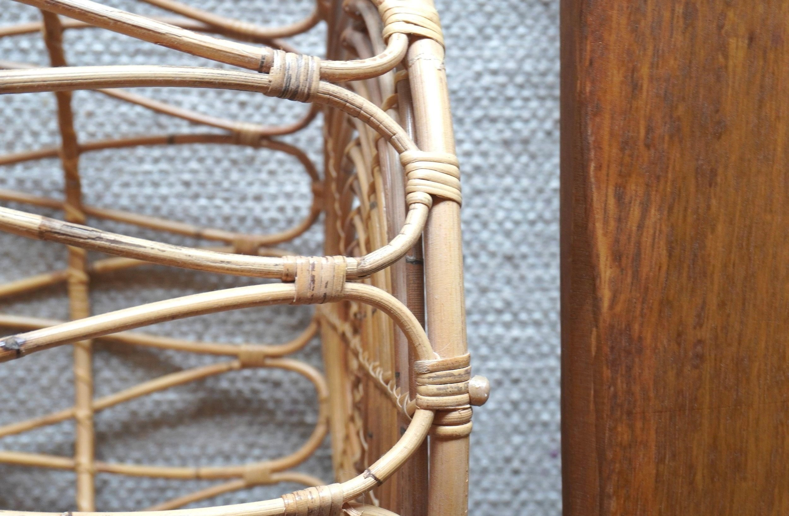
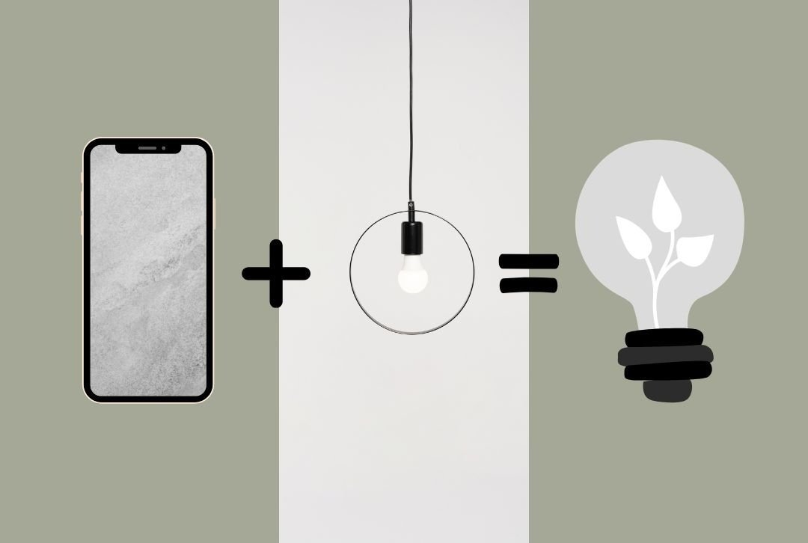
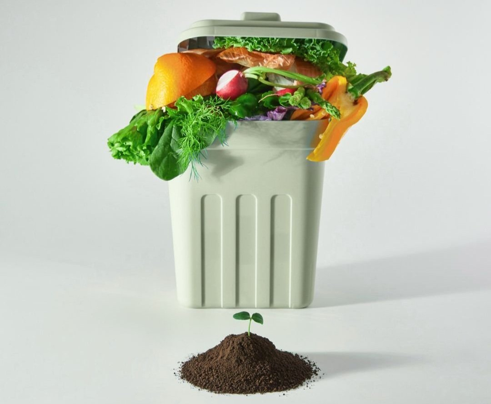
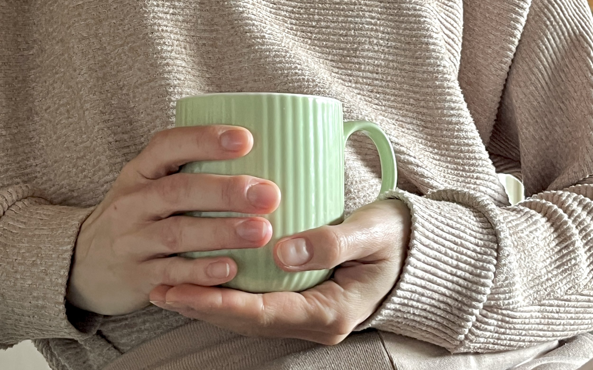
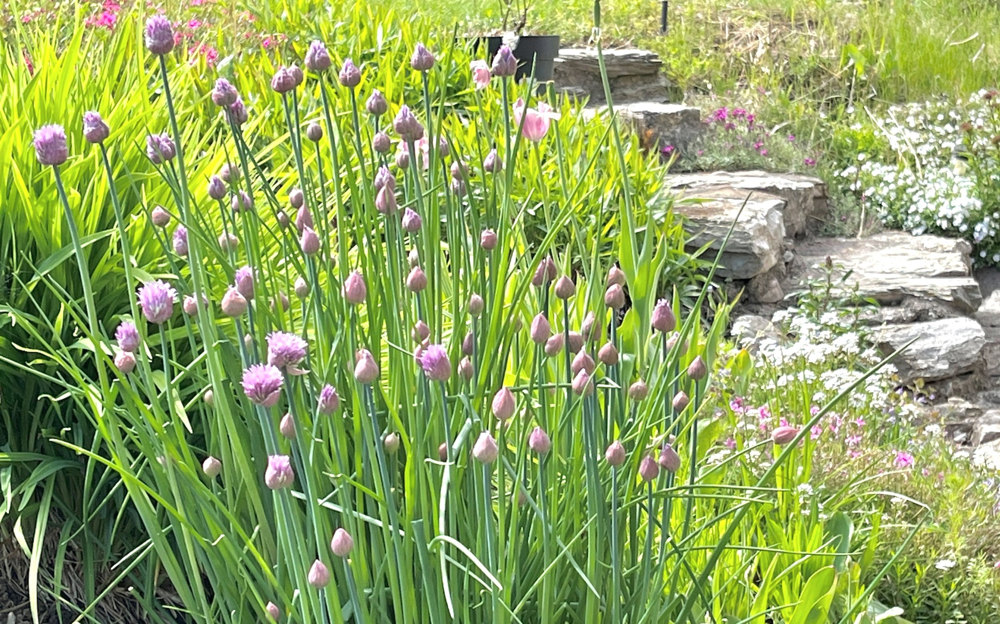
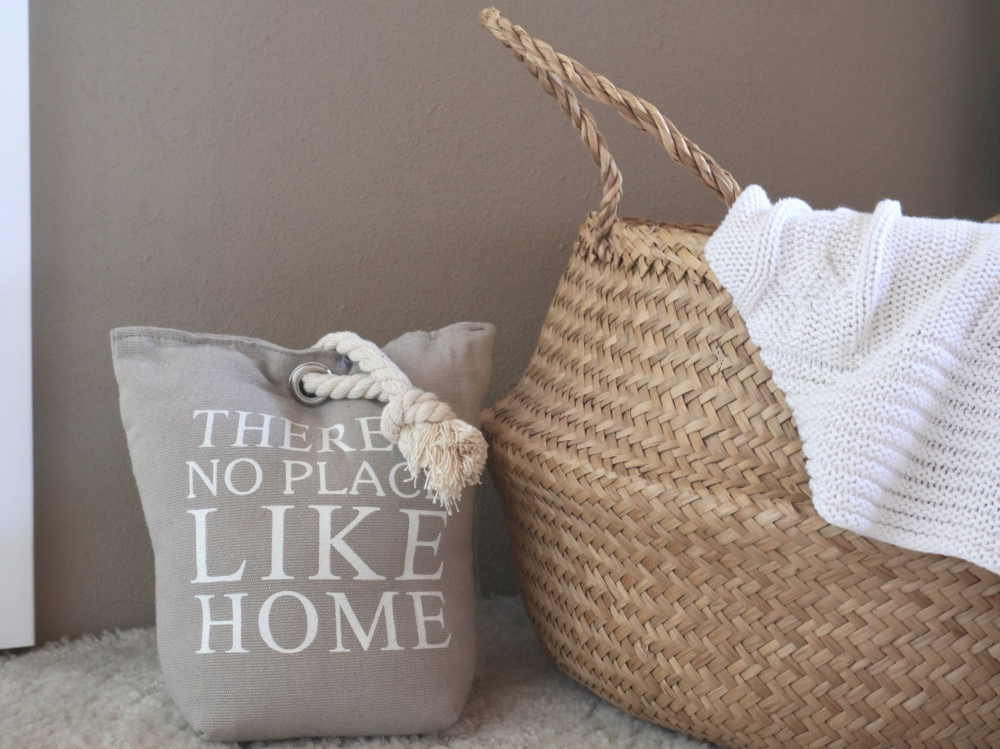

*Building your own home can be a life-changing experience. It certainly was for me. There’s something deeply primal about owning a piece of land—somewhere you can shape, nurture, and grow with. A place to plant vegetables, tend flowers, or simply watch your children play and thrive as the sun dips behind the horizon.*

<Caption>
Image credit: Staying Cosy
</Caption>

We often forget that we, too, are part of our incredible living ecosystem, where everything is connected—each part enhancing the other. We live in a quiet, lifelong symbiosis with our environment. As much as we are part of nature, nature is part of us—inseparable and essential.

## Make a House Feel Like Home

Imagine going camping.

#### *What are the few essential things you manage to stuff into your backpack?*

It’s always surprising how little we actually need: a warm place to sleep—maybe just a carry mat and sleeping bag—and a basic shelter to keep the weather out. If you're lucky, you’ve brought along a few friends and matches for a cosy fire. Unless, of course, you're a dedicated solo camper seeking quiet solitude in the wilderness.

At its core, a home offers the same essential things:

- Shelter from the elements
- Safety
- Comfort
- Connection and social life

### Modern Home Comforts

All of home’s primary functions can have a significant impact on our health. They’re closely tied to modern technologies, which give us easy access to the basics—like water, electricity, and heating—alongside the convenience of furniture and well-designed living spaces.

When we take into account both our evolution and the expectations of today’s Western society, we begin to uncover a few more layers of what *“comfort”* really means.

Especially after the pandemic and the rise of working from home, many of us began to notice how much our surroundings affect our sense of wellbeing—and even our productivity.

<Caption>
Image credit: Staying Cosy
</Caption>

### Creating a Calming and Healthy Environment

*The peak of our home-design efforts should be meeting our needs on both practical and emotional level.*

Whether you prefer a fresh splash of colour over calming neutrals, the presence, or absence, of a fireplace, or the addition of water or air purification systems — these details all shape how we feel in our space.

## What Is an Eco-House?

After spending a couple of years planning, building, and finally living in our home, I’ve come to realise just how much time and care go into what looks from the outside *just like a house.*

<Caption>
Image credit: [Pixasquare](https://unsplash.com/@pixasquare?utm_content=creditCopyText&utm_medium=referral&utm_source=unsplash) on [Unsplash](https://unsplash.com/photos/white-concrete-house-near-green-tree-during-daytime-4ojhpgKpS68?utm_content=creditCopyText&utm_medium=referral&utm_source=unsplash)
</Caption>

> “Eco-home is a blend of sustainability, comfort, and a deep connection with the world around us. It’s in the air we breathe, the textures under our feet & the views outside the window.”

All of it working together like a quiet orchestra.

Behind the walls, every detail carries meaning. From the low CO₂ footprint materials to the design features that support our wellbeing.

### What Can We Do Now?

The best place to start is right where you are—your home, your garden, your balcony, or that one sunny corner by the window. Our choices matter most when we’re creating or renovating our space. That’s where our real power lies.

### Energy Efficiency Comes From the Whole Picture

Efficiency is not just about one magic solution—it’s a combination of smart design, sustainable materials, and thoughtful tech. And no, you don’t need to build a brand-new house from scratch. These principles can be applied to *anywhere, anytime.*

*All you need is intention, a bit of budget (let’s be honest), and reliable info* — and you're already in the right place for that. :-)

### Design Which Does the Work

A well-designed home uses the sun’s warmth in winter and keeps cool in summer, thanks to smart positioning and clever shading. Taking the surrounding landscape and sun orientation into account from the start can seriously cut down your heating bills—and make your home flooded with sunlight just when you need it.

Some planning regulations might limit the design a bit (like fewer windows on the north side and large glass areas to the south), but a good architect who understands eco design can work wonders within those boundaries.

### Insulation—The House’s Favourite Jacket

And not just a thermal one!

#### *Good insulation also muffles noise.*

Most materials used for thermal insulation also do a great job acoustically, which is always a bonus.

The most common and budget-friendly options include plastic-based materials like polystyrene and spray foam. Then you have the middle range—rock wool and fibreglass. And finally, there’s the greener side of the spectrum, like wood fibre, cellulose, hemp, wool, straw, or even recycled textiles.

We insulated our home with wood fibre and blown-in cellulose, and we even tried a hemp wall just for fun. I worked with wood fibre rolls myself—dust mask and goggles on!—and they were totally manageable. Plus, the soundproofing is honestly amazing.

### Solar Power & Beyond

Renewable energy sources like solar, wind, or water are becoming common place, though most homes stick with solar panels, either photovoltaic or solar tubes. Wind and water turbines are usually for bigger setups, but who knows what the future holds?

If you're building new, plan space for solar panels early on, even if the budget won’t stretch just yet. It’ll save you time and money down the line. Renovating? *Go for it!* Solar works for older homes too, and every little step makes a difference.

## Natural & Sustainable Materials

Wether you are doing just tiny little changes to your interior, going for bigger redecoration, or sizing up all the way to renovation or new build, healthy materials are there to help you put good strong bones and provide necessary grounding to a truly wholesome home.

### Back to Earth—Healthy Construction

Thinking first of construction materials, what better way to utilise our Earth’s offerings than using whatever is the most local to us.

In countries with plentiful of woodlands, it’d be wood, in the southern regions full of fields, you probably have plentiful of sticky soil to form clay bricks, or straw bales as a leftover product from agriculture and in dry places were rock are abundant stone structures can be erected - just as it was done in the old days centuries ago.

<Caption>
Image credit: Staying Cosy
</Caption>

### Natural Furniture Ages Beautifully

It is wise to further experiment with raw and unique properties of natural materials once getting into furnishing and decorating. Wood floors, beam ceiling or wall cladding are the largest areas where you can utilise wood.

#### *Keep it raw, treated only with oils to prevent it from loosing its natural air purifying and moisture regulating properties.*

Consider your home’s style and introduce soft cork flooring, bamboo blinds, jute or sisal rugs, rich hemp, linen, or cotton textiles. Don’t hesitate to opt for wool wall-to-wall carpeting, leather armchairs or stone counter tops.

*It is good to mix different textures and colours to create variety and keep your interior look balanced.*

While it’s true that natural materials may need a bit more care than their cheaper alternatives, they will last much longer—often well beyond a lifetime. And those little dents, scratches, and signs of wear? They become a living record of time well spent, quietly inscribing memories into the surfaces of our everyday lives.

### The Garden is Already a Gift

As you expand outdoors and start working on landscaping, try to avoid the use of concrete, rather choose natural stone paths and walls. They look way more attractive, too.

Brick is another good option and in its raw natural colour looks best in country gardens, while painting them white, grey or black colour works great for modern outdoor spaces.

### Materials with Low CO2 Emissions

#### *On average, natural materials tend to have lower carbon emissions compared to synthetic ones.*

It depends on the type of material, transportation distance as well as the manufacturing processes, which can significantly raise this value. Therefore, it is important to consider the entire lifecycle of a product, from raw material extraction to disposal, when assessing its carbon footprint.

## Smart Homes

### ‘A’ Graded Energy-Efficient Appliances Help you Save Money

Say yes to that new A++ no-frost fridge! I sometimes wonder how many pluses they’ll keep adding to the energy ratings. From water-saving taps, shower heads, and toilet flushing systems to energy-smart white goods like fridges and washing machines — and even tiny LED bulbs — our choices impact not only the environment but also our wallets.

Energy-efficient appliances are usually built to higher standards with better-quality components, which means they last longer and break down less often. That means fewer repairs, less waste, and more savings in the long run.

*If you focus on one thing, make it your fridge/freezer — they run all year round and can use up to four times more energy than newer models.*

<Caption>
Graphic: Staying Cosy - made in Canva
</Caption>

### Heat Pumps Are the Latest Hype

Heat pumps have been gaining popularity recently, especially in Europe, as a cutting-edge way to heat and cool homes — and even heat water. Sure, the initial cost can be on the higher side, but depending on the type, their benefits usually pay off after a few years.

### Forced Ventilation Keeps the Air Clean

Ventilation systems have moved from large buildings and shopping malls into our homes, and they’re becoming essential. Tight, well-insulated houses trap heat — which is great — but without proper ventilation, stale air builds up. These systems save energy by preventing the heat from escaping when you ventilate during winter.

> “I was skeptical at first, preferring to open windows, but after trying it myself, I wouldn’t go back. The difference is especially noticeable in the bedrooms — waking up to fresh air is my personal game changer.”

### Embracing Technology for a Smarter Lifestyle

I know for some of you, this might be a stretch—after all, we certainly don’t need to over-control our lives. Back to basics means different things to different people.

#### *For me, staying on top of the game includes welcoming computer technologies in our everyday life.*

Smart home tech lets us automate, control, and monitor everything from lighting and heating to security and kitchen appliances. For example, your dishwasher can ping you on your phone when the cycle’s done — maybe not life-changing, but definitely helpful when it comes to avoiding those forgotten, stinky clothes waiting to be reworn.

Voice assistants like Apple’s Siri, Amazon Echo, or Google Home can control many smart devices with simple voice commands.

I love it when I’m cooking or doing dishes and need more light, I just ask Alexa to turn it on. Want music? I say the genre or song, and it plays. Volume up or down? No problem. I’m so used to it now, the only time I realize it’s not common everywhere is when guests come over!

## Low-Waste Living

<Caption>
Graphic: Staying Cosy - made in Canva
</Caption>

### Recycling

In most homes, recycling has become second nature. I still remember the first time I encountered it—visiting a friend who rinsed cans before recycling them. It stuck with me!

Nowadays, we try to reduce even the amount of recyclable waste we produce. It’s honestly surprising to see someone not recycling, but of course, you can’t force it—only inspire.

### Composting

*One huge perk of having a garden is how much easier composting becomes.*

Compost is a natural fertiliser that boosts soil health by enriching nutrients, improving water retention, and increasing airflow. This helps plants thrive and reduces the need for chemical fertilisers—which we definitely want to avoid. There’s nothing better than fresh compost ready for your spring garden.

We recently replaced our old compost bin—yes, it was originally a nappy bucket from ages ago! Now we’ve got a shiny new kitchen compost [container.](https://www.amazon.com/dp/B0D2DJKRZT/ref=twister_B09Z64YGNS?_encoding=UTF8&th=1)

### Going Zero

Recycling and composting are rock solid in our household, and we’re working on going zero waste with little things like home-sewn fruit and veggie bags and refilling our washing liquid containers. Unfortunately, the food packaging still stays the main source of our home-waste.

I wish I could call myself: *“a zero waste hero”* (rhyming is my second nature, sorry!) and I wish I was *way* better at it, but the truth is I’m definitely trying. If you’re like me, please join the team, and get your [reusable bags](https://www.amazon.com/Reusable-Double-stitched-Drawstring-vegetables-Lightweight/dp/B08128T11K/ref=sr_1_5?crid=2GUYJFMII52FJ&dib=eyJ2IjoiMSJ9.JGvnzo7IHH89qQfft0JpCdE9QxShLZ2F638NHftWIUWuQ1k44EzRZ7H5ilIp2CX0yQ3rDrkqkdFU9WnJT8ihdeosrLX2AkruRNQxGkvRuZ5w6B1wb6Ryu7Flsw4ZlL80BDYapqiajp2mJgO8h3FpAnohnTzGFgLIoH5TlW2fhS0I8lF8ssuvVp7WtgecH1Dcz3Y2ewaiQ96co0z3vL4UQPH5fIF0D1z1HBMVfY2QMnIESTtRL7yj6vjSvAtU5wLcouMjLm1tfa9OIaaSYHnQDzAO6qYIqw61Fw7rfRpkDrI.xqFBZRNgqs6H0daN8Ez0fCe1B7H3sig68sGWFJukF_8&dib_tag=se&keywords=reusable%2Bcanva%2Bveggiebags&qid=1747731092&sprefix=reusable%2Bcanva%2Bveggibags%2Caps%2C184&sr=8-5&th=1) ready to pop those veggies right in!

## The Holistic Principles

Holistic home principles are a thoughtful mix of common sense, design, Feng Shui, and psychology. They’re often obvious, yet frequently go unnoticed—*like that uplifting feeling you get in a space, without knowing exactly why.* The reason? It is a sense of balance, wellbeing, and purpose.

So, how do we create that? Below are just a few essentials to get you started.

<Caption>
Image credit: Staying Cosy
</Caption>

### Fresh, Clean Air

This is the number one necessity for any healthy home. Whether through manual ventilation—good old-fashioned window-opening, or a modern system like the one we use, fresh air is essential for a healthy indoor climate.

#### *Oxygen-rich air supports good blood flow, keeps our brains alert, and our hearts happy.*

I recommend airing out your home at least four times a day. Poor air quality can affect energy, disrupt sleep, and lead to coughing, snoring, and general fatigue.

### Plants Are Not Just for Decoration

Plants work hand in hand with clean air. They create a mini interior ecosystem by removing common pollutants—like formaldehyde from paints, furniture, and cleaning products—and releasing oxygen during photosynthesis.

Before you run to the nearest garden centre, take a moment to research what works best for your space and lifestyle. *The direction your windows face matters*—North-facing rooms won't do well with sun-loving plants, and nobody likes disappointed greenery, right?

### Only a Decluttered Home Can Breathe

Once your home is filled with natural materials, clean air, and happy plants, make sure that air can *move* freely through the space. I know—decluttering can be emotional and time-consuming. But think of it as the next layer of ventilation. Letting go of unused items clears the way for fresh energy and more purposeful living.

### Feng Shui and Everyday Layout Logic

I spend a lot of time shaping spaces to feel just right. And, truth be told, wherever I go—on holiday or visiting a friend—I catch myself mentally rearranging furniture, tweaking colours, imagining ways to let the energy flow better. Some call it Feng Shui, *I call it an instinct for comfort and ease.*

> “Beautiful design isn’t about trends, designer labels, or Pinterest-worthy kitchens. It’s about everyday life. It’s about those little scratches on the countertop made by your child rolling out cookie dough.”

It’s the hand-me-down table from Grandma that only gets better with age. It’s that odd, too-small window you almost bricked up—until you noticed how it perfectly frames the fields beyond and bathes your breakfast in morning light.

I believe this kind of “common sense” lives in all of us. Sometimes, you just need a little silence to hear what it’s saying. Often, less really *is* more.

<Caption>
Image credit: Staying Cosy
</Caption>

### Green Landscaping

If your home comes with a garden, lucky you!

#### *You’ve got a whole new world to explore!*

A truly sustainable home wouldn’t be complete without a thriving, organic outdoor space.

Permaculture and green landscaping aim to create not just beautiful, but *balanced* gardens—ones that work *with* nature, not against it. These spaces support your wellbeing, and that of the animals, insects and all the living creatures that call your yard home.

Think native plants that thrive with less water and fuss, natural fertilisers, and gentle pest solutions. Water conservation is key, with smart irrigation, rainwater harvesting, and landscape designs that help reduce runoff and filter rain naturally—think rain gardens, green roofs, and bioswales. Water *really is* life, in every sense of the word.

## Love is the True Foundation of a Healthy Home

As much as I’d love to stick to all of these principles perfectly, life doesn’t usually work that way—and that’s okay. What’s more realistic is embracing a combination that suits our circumstances.

In our efforts to live better and more consciously, it’s important to stay grounded and focus on what truly matters most to us as human beings: our relationships and the time we spend together.

So here’s a little reminder—for all of us:

> “No matter your budget, your country, or the size of your house. What truly makes a house ‘home’ is YOU. You—and the people you share it with. Your family, your friends, even your pets.”

<Caption>
Image credit: Staying Cosy
</Caption>

#### *A home filled with love is the one that truly nourishes the body and soul.*

If you’ve made it this far—thank you! I hope this post has given you a fresh perspective, a spark of inspiration, or maybe even a little encouragement.

Yes, creating a more ecological home may take some thought and time. But the long-term benefits—for your wellbeing *and* for the planet—are so worth it.

By making more conscious choices and taking even small steps toward sustainable living, we’re all helping to shape a better world for future generations.

---

---

---
