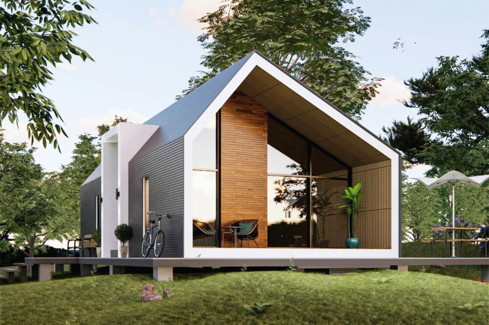
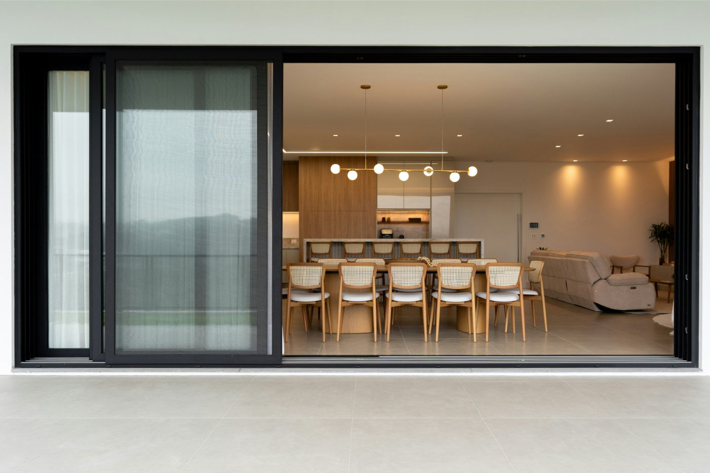
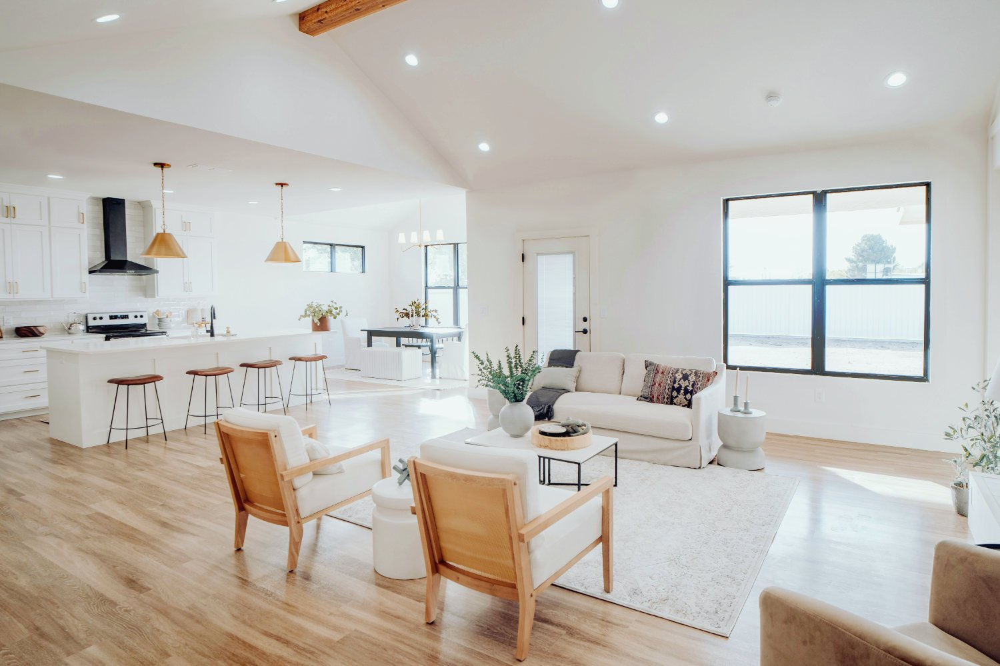

*While standard floor plans show you how to navigate from the front door inward, what happens when you treat them as holistic manuals with powerful, eco-efficient features? A plot's access road can often feel like a massive constraint, but a driveway arriving from the "wrong" direction shouldn't compromise your entire design. Here is how to map out your home using north, south, east, and west orientations as your ultimate starting points.*

<Caption>
Image credit: [Mayoposi Fasola](https://unsplash.com/@theposi?utm_source=unsplash&utm_medium=referral&utm_content=creditCopyText) on [Unsplash](https://unsplash.com/photos/a-house-with-a-glass-front-e9M0FTE75ys?utm_source=unsplash&utm_medium=referral&utm_content=creditCopyText)
</Caption>

By their very nature, pre-made catalogue plans cannot account for the unique characteristics of your specific land. They are designed for a blank canvas, which can be a massive missed opportunity. If you are investing your hard-earned money into building a home, you deserve a layout that actively takes advantage of your garden, your views, and the natural elements.

True eco-architecture is about macro-flow and how the entire house handles the sun’s journey to keep you warm in winter and cool in summer. If you’ve read my recent posts on [the sunny kitchen](/blog/sunny-kitchen-design-best-friend), you already know how much light matters to our daily well-being.

Today, we are zooming out to the whole house. Using a practical rectangular canvas tailored for a three-to-four-person family, let’s look at how a **single-storey, bungalow-style layout** can be perfectly zoned for all four compass directions.

This footprint is a universal sweet spot. It’s mall enough to be highly eco-efficient, yet large enough to give everyone plenty of breathing room. Think of these configurations not as rigid templates, but as mindful starting points for your own home.

After all, the logic of the sun doesn't change with square footage.

## Let’s Clear a Few Things up First

Before we pull out the compass, there are a few foundational design shifts we need to establish. Think of these three recommendations not as restrictions, but as the secret keys to unlocking your plot’s true potential.

### The Universal Scale — Europe vs the US & Australia

For those building in North America or Australia, a 150 m² (1,615 sq ft) footprint serves as a cosy, highly intentional starting size. In Europe, where standalone bungalows rarely cross the 120 m² (1,300 sq ft) mark, you can easily compress these exact same layouts without losing a single bit of the room flow. If you are still wrestling with your own footprint requirements, read my guide on [how much space we really need](/blog/how-big-should-your-home-be) to understand the philosophy of sizing a functional family home.

If you happen to be building in the Southern Hemisphere, simply flip the orientations by 180 degrees. North becomes south, while east and west remain exactly the same.

<Caption>
Image credit: [Caroline Badran](https://unsplash.com/@___atmos?utm_source=unsplash&utm_medium=referral&utm_content=creditCopyText) on [Unsplash](https://unsplash.com/photos/modern-dining-room-with-chairs-around-a-table-LCzQE5dOGrk?utm_source=unsplash&utm_medium=referral&utm_content=creditCopyText)
</Caption>

### How About a Side Entry?

We need to address the single biggest design bottleneck future homeowners face on day one: assuming the front door must face the street. Many successful eco-houses use side entries instead. Tucking the entrance around the corner from the driveway completely frees up your prime exterior walls. Instead of losing your best views and natural light to a public entryway and a coat closet, you can save those walls for large windows and private living zones. Your driveway might arrive from the north, but your front door should live wherever it makes the most holistic sense.

### Compass Axis and the Real Plot

Of course, real-world land rarely aligns perfectly with a crisp compass axis. Your plot might sit slightly off-centre, facing south-east, north-west, or anywhere in between. Don't worry if your orientation isn't mathematically perfect. The foundational rules of light and flow still apply beautifully, even with a slight directional tilt.

To make things completely clear, each of the four layouts below follows five foundational principles to maximise its eco potential and daily comfort:

☘︎ **The 5 Core Principles of Eco-Efficient Layouts**

1. **The 1:2 golden ratio**: A rectangular footprint with its longest axis facing the sun acts as a natural solar sponge, maximising passive heat.
2. **Thermal zoning**: Living zones sit on the sun-facing side, while utilities, bathrooms, and closets act as a cold-buffer zone on the opposite side.
3. **The 45-degree overhang**: Smart roof overhangs let the low winter sun slide deep inside to warm your floors, but completely block the high, scorching summer sun.
4. **Cross ventilation paths**: Placing windows directly opposite or diagonally from each other creates clear paths for summer breezes to flush out trapped heat.
5. **Corridor-free circulation**: Hallways are wasted space. Eliminating them saves square footage, cuts material costs, and prevents stagnant cold air pockets.

## North Entry Layout — The Sun Greeter

***Best suited for:*** *Plots where your driveway or access road arrives from the north, leaving your private garden space completely open to the south.*

<Caption>
Graphic: Staying Cosy — made in Canva
</Caption>

**Zoning for Light & Flow**\
Because you enter from the colder north side, we push all the utility spaces, bathrooms, and the entryway here to act as a natural insulation blanket. This leaves the entire south side of your rectangular footprint completely open for large, expansive sliding doors. The low winter sun floods straight into your living areas and bedrooms, heating the floors naturally all day long.

To pull this warmth even deeper, high-level transom windows marked with white dashed lines on the internal walls steal bouncing southern sunlight from the living zone and throw it deep into the darker entry foyer. The same way east-facing bedroom brings more light into the whole living area.

**Structural Shading & Connections**\
To keep things beautifully cool in July, deep south roof overhangs (1–1.2 m / 3.3–4 ft) step in to block the high midday sun entirely. On the flip side, keeping the north glazing to a minimum prevents harsh winter winds from pulling heat out of the house.

I also added a set of glass double doors between the entry and the kitchen, which acts as a secondary thermal air-lock to stop winter drafts the moment someone enters the house.

**Holistic View**\
This layout creates a lovely, clear psychological boundary. The public street-facing side, though a never sun-kissed north entry, feels closed, safe, and protective. But the moment you cross the threshold, the house completely opens up, instantly connecting you to nature, the backyard, and the changing light. Even the northern utility room plays a role, acting as a practical mudroom shortcut where you can bring in wet pets or muddy boots without ever disrupting the clean areas of the main house.

## South Entry Layout — The Private Sanctuary

***Best suited for:*** *Plots where your main road access is on the sunny south side, requiring smart zoning to protect your family privacy without losing your light.*

<Caption>
Graphic: Staying Cosy — made in Canva
</Caption>

**Zoning for Light & Flow**\
Entering from the sun-facing side can be tricky. I used an entry vestibule to block street views, then pushed the bedrooms to the east and west corners. This clears out the centre of the footprint so your main living room can still drink in all that beautiful, direct southern light. Because this vestibule handles the heavy lifting of visual privacy, there is no need to split the foyer and living room with a solid internal buffer — leaving the entryway beautifully open and direct.

To keep the mechanical systems cost-effective and highly efficient, all your main water connections and utilities are grouped together in the northeast corner of the house, allowing for a tight, easy plumbing stack.

If you are in the very early stages of your project, you might also want to catch up on [what I wish I'd known about planning an eco-friendly house build](/blog/eco-friendly-building-guide-materials-principles) to avoid the most common day-one mistakes.

**Structural Shading & Connections**\
The entire entry facade features a deep overhang to prevent the scorching summer sun from overheating the core, which can be easily transformed into a welcoming front porch with direct living room access. Off the main kitchen zone, you can step straight out through sliding doors onto a protected western patio, perfect for shaded afternoon dining.

Tucked right next to the kitchen is an extra pantry featuring a small ventilation window, marked by a crisp dashed line on the plan, which flows directly into the utility and laundry room. This utility hub repeats our global rule, keeping a dedicated outside access door for seamless indoor-outdoor utility flow.

**The Holistic View**\
It proves you can have a south-facing entry and still feel completely tucked away. By recessing the entryway or creating a small front courtyard, the house acts as a private retreat that guards you from the street while embracing the sun. It balances the public requirement of a front door with the private necessity of an eco-home, ensuring your daily life feels secure and seemingly disconnected from the passing traffic outside.

## East Entry Layout — The Morning Ritual

***Best suited for:*** *Side-access plots where your driveway arrives from the side, allowing the long face of the home to look toward the south and west.*

<Caption>
Graphic: Staying Cosy — made in Canva
</Caption>

**Zoning for Light & Flow**\
This configuration is built for morning lovers. The sun greets you right at the front door and warms up the kitchen and a cosy east-facing breakfast nook while you make your coffee. The foyer is fully separated to handle cold drafts, but it doesn't need to be completely closed off. A clean architectural opening guides you straight into the central kitchen and living hub. Turn the other way, and you find a highly intriguing layout secret: direct guest access to a bathroom styled in a Jack-and-Jill design, which connects seamlessly to one of the smaller bedrooms through a walk-through closet.

To keep your plumbing build costs down and highly efficient, the main utility hubs share the northeast side of the house, keeping the central living zones completely open and spacious.

**Structural Shading & Connections**\
Right outside, a massive south-facing covered patio connects both the breakfast nook and the main living room via large sliding glass doors. As the day goes on, the sunlight moves beautifully through the house, landing in the central living room just in time for your afternoon unwind.

However, late afternoon western sun can easily overheat a home because it sits so low in the sky. Standard roof overhangs can't block these horizontal rays, so on the west side all layouts are recommended to use vertical exterior slats or strategic trees to keep things cool. It works perfectly here since the master bedroom gets its own private, shaded western patio access.

On the colder northern side, windows are strictly limited to just two small, high-performance openings for eco-efficiency, including the northern utility and laundry hub with its signature direct outdoor access door.

**The Holistic View**\
This home flows seamlessly with human circadian rhythms. It wakes you up naturally with bright, energetic light in your morning active zones and transitions to softer, ambient evening light right where you gather to rest. It feels incredibly pleasing because your daily movement perfectly mirrors the natural journey of the sun, grounding your routine in the quiet, predictable cycles of the surrounding environment.

## West Entry Layout — The Evening Sunset

***Best suited for:*** *Plots that face harsh prevailing weather, strong winds, or intense afternoon heatwaves directly from the west.*

<Caption>
Graphic: Staying Cosy — made in Canva
</Caption>

**Zoning for Light & Flow**\
We treat the west side of this house like a protective shield. Because western entries are highly prone to overheating in the summer and shoulder seasons, we fully closed off the entrance using a long, narrow, corridor-like foyer to trap the heat before it reaches the main house. The smaller bedrooms have direct access right toward the end of this foyer. From there, a beautiful set of double doors swings open into a sweeping, central kitchen and living room area. Symmetrically across the room, an identical set of double doors leads you straight into the master suite.

Unlike our other layouts, the kitchen utilities sit along the southern wall here, completely separated from the compact northern utility hub to keep your core living zones wide open. One of these smaller bedrooms also features a clever Jack-and-Jill style bathroom, this time sharing its entrance directly with the main living area.

**Structural Shading & Connections**\
By keeping that west wall mostly solid and heavily insulated, the house stays beautifully cool during blistering summer heatwaves. For cross-ventilation, open windows on the east and south easily draw cooler, shaded air through the home. To see how frame selections affect the overall building profile, check out my breakdown of [architectural window design](/blog/architectural-window-design-trends).

Your dining room sits toward the back of the footprint in an enchanting, east-facing nook that welcomes soft morning light. Both this dining space and the main living room share direct access to a shielded, south-facing patio through large sliding glass doors. The master bedroom claims the quiet back-end of the house, where you can step straight out onto your own private, east-facing patio for an uninterrupted morning coffee.

**The Holistic View**\
This layout feels open, generous, and relaxed. By intentionally turning its back on the harshest weather elements, the house creates a protected micro-climate inside, focusing your family life toward a private, sun-drenched courtyard. It changes the narrative of a difficult plot from an exposure problem into a deep, inward-facing haven, all while ensuring the master bedroom wins the absolute perfect sunrise positioning.

## Your Land Is the Blueprint

In my mind, a floor plan shouldn't feel like a rigid puzzle you are forced to solve. The magic happens when you stop fighting the constraints of your plot and start cooperating with them. A custom home deserves a custom relationship with its environment.

Treat these four configurations as your personal design playground, but keep two foundational rules in mind as you sketch:

### The Mirroring Trap

If you choose to flip or mirror these layouts to fit your specific road access, you must adjust your windows and shading accordingly. Never let a mirrored plan accidentally place a massive wall of glass on the blistering west facade. Keep your western openings modest to prevent summer overheating, maximise your gentle morning light on the east, and ensure your main glazing stays on the deeply protected south wall.

<Caption>
Image credit: [Bailey Alexander](https://unsplash.com/@baileyal3xander?utm_source=unsplash&utm_medium=referral&utm_content=creditCopyText) on [Unsplash](https://unsplash.com/photos/a-living-room-filled-with-furniture-and-a-kitchen-PE4pFgcYzoQ?utm_source=unsplash&utm_medium=referral&utm_content=creditCopyText)‍ ‍
</Caption>

### The Sacred Centre

You might have noticed that in every single one of these configurations, the exact middle of the house remains completely open and easy to walk through. Holistically, this is the invisible, energetic heart of the home. Leaving this central axis clear creates a peaceful path for cross-ventilation, keeps family life flowing smoothly, and prevents the layout from feeling cramped.

Take these walls, stretch them, flip them for your hemisphere, and use them as a mindful starting point for your own sketches. When you step away from uniform catalogue blueprints and design for macro-flow, the entire layout opens up and greets you. And believe me, you will know when it’s just right.

---

**☘︎ Explore more from the blog:**

*•* [*18 Places One Home - What Frequent Moving Taught Me About Living Well*](/blog/18-places-one-home-lessons)

*•* [*Why Fresh Air is The Most Underrated Element of a Healthy Home*](/blog/fresh-air-in-home)

*•* [*Choose The Best Type of Fireplace to Suit Your House*](/blog/the-best-type-of-fireplace-for-your-needs)

SEARCH THE BLOG

